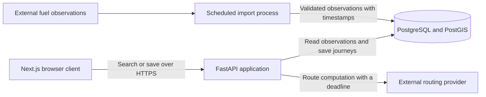
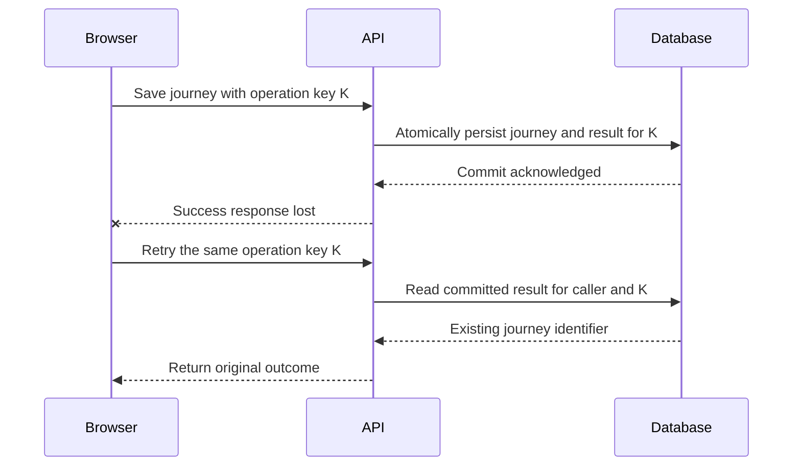

# Senior Full-Stack System Design Masterclass

Working edition · 2 written lesson(s) · Target: 98 lessons

This partial edition contains the complete currently written lesson content and worked exercise solutions. The original 98-lesson curriculum has been verified against both supplied sources. It is not the completed 98-lesson textbook.

See the [full syllabus](COURSE_TOC.md) for all 98 lessons and their writing status.

## Written lessons

- [Foundations & delivery framework](#module-0)
  - [Introduction](#lesson-0-01)
  - [How to prepare](#lesson-0-02)

<a id="module-0"></a>

## Foundations & delivery framework

<a id="lesson-0-01"></a>

### Introduction

Lesson 0.01 · Foundations & delivery framework

<a id="lesson-0-01--a-learning-objectives-and-prerequisites"></a>

#### A. Learning objectives and prerequisites

After this lesson, you should be able to turn a feature description into a system boundary, distinguish user-visible guarantees from implementation choices, estimate workload with explicit units, and explain why retries and concurrent requests complicate correctness. You should also be able to name the evidence needed to investigate a slow request instead of immediately adding infrastructure.

Prerequisites: experience delivering a web application, calling HTTP APIs, and interpreting basic application logs. No prior distributed-systems knowledge is assumed. Your existing frontend skills transfer: tracing state, defining component contracts, and measuring rendering performance all become useful across process boundaries.

This lesson introduces concepts that later lessons examine in detail: networking, API contracts, transactions, concurrency, capacity planning, and observability. The [full course syllabus](COURSE_TOC.md) preserves all 98 lessons from the verified original curriculum. Continue with [0.02 — How to prepare](#lesson-0-02), and see the [exercise solution](#lesson-0-01--exercise-solution) after attempting the work.

<a id="lesson-0-01--b-mental-model-and-intuition"></a>

#### B. Mental model and intuition

A frontend feature is often described by what appears on screen: enter a route, choose a fuel type, and see recommended stops. A production system must explain how that answer becomes trustworthy. Where do prices originate? How old can they be? What happens when the routing provider is unavailable? Can another user read a saved journey? What remains true if two requests arrive together?

System design connects a product promise to the mechanisms that uphold it. A diagram names components; a design explains their responsibilities, the facts they own, the messages between them, and their behavior under failure. The useful unit of reasoning is an operation with an outcome, such as “save this journey for this user,” rather than a list of products such as PostgreSQL, Redis, and Kafka.

In a browser, you can often inspect the state relevant to one interaction. Across a browser, API process, database, and external provider, there is no single observer with perfect information. A timeout may mean that a request never arrived, that execution is still running, or that execution finished but its response was lost. These possibilities require different recovery behavior.

Senior engineering begins by making such uncertainty explicit. You do not need an elaborate architecture for every feature. You need a small architecture whose assumptions, limits, and recovery behavior you can explain and test.

<a id="lesson-0-01--c-deep-technical-explanation"></a>

#### C. Deep technical explanation

<a id="lesson-0-01--translate-requirements-into-observable-contracts"></a>

##### Translate requirements into observable contracts

A functional requirement describes behavior: “return fuel stations within a configurable detour of the selected route.” A quality requirement constrains that behavior: “for eligible searches, return a valid response within 1.5 seconds for at least 95% of requests over a rolling seven-day window.” Both statements still need definitions. Is time measured in the browser or at the API boundary? Does a routing-provider timeout count as failure? Is an empty result valid?

Define an **eligible request** as one that meets a documented contract, including authorized access where required and supported input bounds. Exclude genuine caller validation mistakes from a service-availability denominator only through a stable rule; never relabel overload errors as invalid input. An empty search can be successful if the search completed correctly. A provider failure should not masquerade as “no stations found.”

A service level indicator measures behavior; a service level objective sets its target. For example, count valid API responses delivered before a deadline and divide by eligible requests. This combined measure makes slow failures visible. Browser timing and API timing answer different questions and should have separate definitions. These terms follow [Google's SRE treatment of service level objectives](https://sre.google/sre-book/service-level-objectives/).

Requirements should also identify **invariants**: properties that must remain true across all allowed executions. Examples include “a saved journey has exactly one owner,” “a response never labels an unknown price as current,” and “retrying one save operation does not create two journeys.” An invariant guides schema constraints, authorization, and transaction boundaries. “Use a relational database” is an implementation choice, not an invariant.

<a id="lesson-0-01--identify-ownership-and-boundaries"></a>

##### Identify ownership and boundaries

A process boundary separates address spaces and failure domains. If an API process restarts, its in-memory variables disappear; committed data in a separate database can remain. A trust boundary separates actors whose input or authority must be checked. A browser-to-API request crosses both boundaries. A function call between modules inside one API process crosses neither by itself.

Choose a source of truth for each important fact. A database can own saved journeys and their ownership. A fuel-data provider can own observations of prices, while your database owns the observations you imported and their timestamps. A browser cache owns a local representation, not authority to modify another user's journey.

An operation should have a clear authoritative outcome. For a save, that usually means a committed database change. The browser displaying a success toast is an observation of that outcome. Losing the response after the commit does not undo the save. This distinction is the foundation of reliable retries.

<a id="lesson-0-01--understand-concurrency-before-adding-machines"></a>

##### Understand concurrency before adding machines

Concurrency means multiple operations can be in progress with overlapping lifetimes. Parallelism means computation occurs simultaneously. Even one API process can interleave requests while waiting for database or network I/O. A single deployment does not make read-then-write code safe.

Suppose two requests read a journey's version as 7, independently edit it, and both overwrite its contents. The second write can erase the first. A database transaction groups work, but its isolation level and statements determine which interference is prevented. PostgreSQL's default Read Committed isolation gives a statement its own committed-data snapshot; successive statements in one transaction can see different committed changes. See the [PostgreSQL transaction-isolation documentation](https://www.postgresql.org/docs/18/transaction-iso.html).

One possible solution is a conditional update with an expected version: update only when the stored version is still 7, increment it, and return a conflict when no row matches. Another is to lock the row before a coordinated update. The former detects stale edits; the latter makes competing writers wait. Neither substitutes for authorization or input validation. PostgreSQL documents row-lock behavior and the cost of long transactions in its [explicit-locking reference](https://www.postgresql.org/docs/18/explicit-locking.html).

Do not hold a database transaction open while asking a slow external provider to compute a route unless there is a compelling consistency requirement. That extends connection occupancy and may extend lock duration without making the remote operation part of the database transaction.

<a id="lesson-0-01--separate-rate-latency-and-concurrency"></a>

##### Separate rate, latency, and concurrency

Consider this illustrative workload, not measured StopAround traffic:

- 100,000 daily active users.
- 4 recommendation searches per active user per day.
- A peak rate 8 times the daily average.
- Mean API residence time of 300 milliseconds during a stable peak interval.

The daily volume is `100,000 users/day × 4 searches/user = 400,000 searches/day`. There are `24 × 60 × 60 = 86,400 seconds/day`, so the average rate is `400,000 / 86,400 = 4.63 searches/second`. The illustrative peak rate is `4.63 × 8 = 37.04 searches/second`.

Little's law relates average occupancy, throughput, and average residence time: `L = λ × W`. For a stable system with matched measurement boundaries, `37.04 requests/second × 0.300 seconds/request = 11.11 requests` in flight on average. This use of averages and a stationary regime is discussed in [MIT's queueing-model lectures](https://web.mit.edu/1.041/www/lectures/L8-queuing-models-2024sp.pdf).

If mean residence time becomes 3 seconds at the same achieved throughput, average occupancy becomes 111.11 requests. Latency can therefore create a resource problem even when request rate is unchanged. If arrivals exceed service capacity and backlog grows without bound, this stable-regime estimate cannot describe the incident as if it had settled.

These numbers do not tell you how many CPU cores or database connections to purchase. Requests can wait without consuming a core, and they may hold a database connection for only part of their lifetime. To estimate occupied database connections, use database operations per second and the time a connection is actually checked out. Retries add attempts; multiple queries add database operations. Measure each boundary separately.

You also cannot substitute p95 latency for mean residence time in Little's law. A percentile describes a point in a distribution; an average supports this occupancy relationship. Keep both: averages help resource reasoning, while tail percentiles expose slow user experiences.

<a id="lesson-0-01--treat-failure-as-a-set-of-states"></a>

##### Treat failure as a set of states

For a network operation, distinguish success, definite rejection, and unknown outcome. A schema validation error is a definite rejection before mutation. A lost connection after a database commit creates an unknown outcome for the caller. Retrying must be based on operation semantics, not merely on an exception class.

An idempotent operation has the same intended effect when repeated as when performed once. HTTP method semantics provide guidance, but an arbitrary creation endpoint is not automatically safe to replay. [RFC 9110's idempotency section](https://www.rfc-editor.org/rfc/rfc9110.html#section-9.2.2) explains this distinction and cautions about automatic retries of non-idempotent requests.

An application can make creation retryable by binding a client-generated operation key to an authenticated caller, request fingerprint, and durable result. Reserving the key and performing the mutation must be coordinated so two simultaneous attempts cannot both create resources. Later lessons will implement that protocol. Here, the essential insight is that retry policy and data design must agree.

<a id="lesson-0-01--d-architecture-and-data-flow"></a>

#### D. Architecture and data flow

This illustrative boundary map is a starting point for reasoning, not a complete StopAround design or a description of its current implementation.



The database owns saved journeys. Imported prices retain observation timestamps. Route computation is a dependency with its own failure behavior. The importer can initially be a scheduled command from the same codebase; this box does not imply a separate microservice or a message broker.

The next diagram isolates a write whose response is lost:



Read the sequence as a protocol requirement. It assumes the durable operation record is committed with the mutation and the retry is authenticated and fingerprint-checked. A cache entry written after the commit would leave a failure window.

<a id="lesson-0-01--e-real-world-examples"></a>

#### E. Real-world examples

For StopAround, freshness is part of answer quality. A quick response based on an old fuel observation may be less useful than a slightly slower one with a clear observation time. A reasonable product contract could display age and warn when observations exceed a threshold. The threshold is a product assumption to validate, not a universal database setting.

The route-aware search also needs the driver's remaining range and fuel preference. A station near the route can still be unsuitable if it is beyond that range or does not supply the requested fuel. Those are business constraints to validate and test, independently of how quickly a spatial query returns rows. Keep the browser's presentation of reachability consistent with the backend's authoritative calculation.

For an independent example, consider a workshop with ten remaining seats. A browser disabling its submit button reduces accidental repeated clicks, but two users and two tabs can still submit together. The authoritative capacity check belongs where concurrent reservations become durable. A safe mechanism must prevent accepted reservations from exceeding capacity; UI state alone cannot uphold that invariant.

These are teaching examples. No internal architectures or performance metrics of named commercial applications are assumed. The lesson's documented operational framework is narrower: Google describes latency, traffic, errors, and saturation as useful monitoring signals in [Monitoring Distributed Systems](https://sre.google/sre-book/monitoring-distributed-systems/).

<a id="lesson-0-01--f-executable-example"></a>

#### F. Executable example

The following complete Python model checks arithmetic and invalid assumptions. It is a local estimation tool, not a benchmark or an API implementation. Its inputs are daily volume, an illustrative peak multiplier, and mean latency at that peak workload.

The executable source is [load_model.py](exercises/module-00/01-system-boundaries/load_model.py):

```python
import json
from math import isfinite


def estimate_load(
    *, daily_requests: float, peak_factor: float, mean_latency_ms: float
) -> dict[str, float]:
    for name, value in (
        ("daily_requests", daily_requests),
        ("peak_factor", peak_factor),
        ("mean_latency_ms", mean_latency_ms),
    ):
        if not isfinite(value):
            raise ValueError(f"{name} must be finite")
    if daily_requests < 0 or peak_factor < 1 or mean_latency_ms <= 0:
        raise ValueError("volume >= 0, peak factor >= 1, latency > 0 required")

    average_rps = daily_requests / 86_400
    peak_rps = average_rps * peak_factor
    mean_in_flight = peak_rps * (mean_latency_ms / 1_000)
    if not all(isfinite(value) for value in (peak_rps, mean_in_flight)):
        raise ValueError("estimate exceeds finite numeric range")
    return {
        "average_rps": average_rps,
        "peak_rps": peak_rps,
        "mean_in_flight": mean_in_flight,
    }


if __name__ == "__main__":
    print(json.dumps(estimate_load(
        daily_requests=400_000, peak_factor=8, mean_latency_ms=300
    ), indent=2))
```

Run from the repository root:

```sh
python3 exercises/module-00/01-system-boundaries/load_model.py
python3 -m unittest discover -s exercises/module-00/01-system-boundaries -v
```

Expect approximately `4.6296` average requests/second, `37.0370` peak requests/second, and `11.1111` mean in-flight requests. The tests check the reference calculation, tenfold latency growth, zero volume, invalid inputs, and numeric overflow. They do not establish production capacity. To do that, run representative load against a realistic environment and observe saturation and the latency distribution.

The function rejects NaN, infinity, negative volume, invalid peak factors, and nonpositive latency. That matters because a model that silently accepts meaningless assumptions can produce a confident but unusable recommendation. The type annotations describe a numeric Python interface; this function is not an untrusted JSON request parser.

<a id="lesson-0-01--g-architectural-decisions-and-trade-offs"></a>

#### G. Architectural decisions and trade-offs

Start with a modular application and a relational database when they satisfy the workload and ownership model. One deployable API keeps local changes and transactions straightforward. It can still have separate modules for routing, journeys, and data import. Separate processes become useful when isolation, resource profiles, or independent operational ownership justify their cost.

| Decision | Useful starting point | Evidence that could change it |
|---|---|---|
| Compute recommendations synchronously | Return a result within a bounded request | Work routinely exceeds the response deadline; expose a durable job and status |
| Read observations from PostgreSQL | Keep query logic and authority together | Measured repeated reads dominate cost and bounded staleness is acceptable; consider caching |
| Keep business modules in one API | Preserve simple deployment and local coordination | A workload needs independently controlled resources or a team needs a separate ownership boundary |
| Run imports on a schedule | Match a known data-refresh cadence | Bursts, resumability, or backlog management require a durable job mechanism |
| Choose a deployment size | Use a representative load test and recovery target | Measurements show CPU, memory, database, or dependency saturation |

Every additional component introduces configuration, credentials, monitoring, deployment work, and a new failure surface. A cache may reduce read latency but adds invalidation and freshness decisions. A queue moves work out of the response path but requires retry, duplicate handling, and backlog visibility. Costs include operator attention as well as the hosting bill.

Preserve migration options through clear ownership and contracts. Do not create an abstraction for every possible future database. Document why today's choice meets today's requirements and specify a measurable condition for revisiting it.

<a id="lesson-0-01--h-common-failures-and-debugging"></a>

#### H. Common failures and debugging

Consider an illustrative incident: recommendation p95 latency rises from 700 milliseconds to 6 seconds, while HTTP traffic remains roughly flat. Begin with impact and scope. Identify the affected endpoint, time window, region, response codes, and deployment changes. Avoid concluding that “the database is slow” from one aggregate graph.

| Observation | Hypothesis | Evidence to collect | Targeted response |
|---|---|---|---|
| Provider spans grow; CPU stays low | Remote dependency slows down | Dependency latency, timeouts, attempts per search | Bound deadlines and concurrency; provide an explicitly limited fallback when valid |
| Connection acquisition dominates | Pool exhausted or connections held too long | Checkout time, active transactions, pool waiters | Shorten connection lifetime; fix leaks; bound admission |
| One query duration grows | Changed plan, missing useful index, or more data | Query plan, row estimates, buffers, data distribution | Test the query or index change on representative data |
| Saved journeys appear twice | Retry after an unknown outcome | Operation keys, request attempts, committed rows | Add durable deduplication tied to the mutation |
| API looks healthy but users wait | Measurement boundary misses client delay | Browser timings and correlated request traces | Investigate network, rendering, or gateway delay |

If requests hold database connections during remote calls, more API replicas may create even more waiting connections. Compare the total configured pools across all processes with database capacity. Scaling one tier can worsen another tier's saturation.

Mitigate before completing a perfect explanation: roll back a recent harmful change, cap expensive work, or disable an optional enrichment. Preserve correctness when degrading. Returning timestamped observations with a clear limitation may be acceptable; silently presenting stale data as fresh is a different product behavior.

After recovery, test the causal hypothesis and write a prevention action. “Increase the pool” is incomplete without knowing whether demand, hold time, or a leak caused exhaustion. Observability should let you distinguish those causes; otherwise the next incident repeats the same guesswork.

<a id="lesson-0-01--i-practical-exercise"></a>

#### I. Practical exercise

Write a one-page engineering brief for a StopAround recommendation request and saved-journey operation. Spend approximately 60–90 minutes, then compare your reasoning with the [worked solution](#lesson-0-01--exercise-solution).

Use the illustrative workload from section C. Add these constraints: imported observations may be at most 30 minutes old before a warning is required; route computation can fail; saved journeys are private; the client can retry after a timeout. The 30-minute threshold is an exercise assumption.

Your brief must include:

1. Two functional requirements, a precisely bounded latency indicator, an availability indicator, and three invariants.
2. A responsibility map for browser, API, database, and providers, including authoritative ownership.
3. Average and peak request rates, mean occupancy at 300 milliseconds and 3 seconds, and one reason those figures cannot size a database pool directly.
4. A timeline in which a save commits and its response disappears. State the retry protocol and the consistency boundary it requires.
5. A decision to include or omit a cache and a queue, justified by present requirements.
6. A debugging plan for rising latency with stable traffic and a safe degraded response for provider failure.

For an additional challenge, repeat the invariant analysis for the workshop's last seat. Identify where a read-then-write sequence can violate the capacity rule. You need not implement the transaction in this introductory exercise.

Successful work makes assumptions explicit, shows units, distinguishes failed search from an empty result, and explains the durable outcome of a retried write. A list of infrastructure names does not satisfy the exercise.

<a id="lesson-0-01--j-interview-and-senior-engineering-assessment"></a>

#### J. Interview and senior-engineering assessment

Attempt these before reading the solutions.

1. A product manager asks for a “fast, reliable recommendation API.” Which questions turn that statement into an implementable contract?
2. Does deploying a single API process eliminate concurrent-update bugs? Explain with an interleaving.
3. A save request times out after the database commits. What does the browser know, and how should it recover?
4. At 37.04 requests/second and 300 milliseconds mean residence time, how many requests are in flight on average? Why is that not a database connection count?
5. API p95 is low, but users report slow searches. How would you investigate the discrepancy?
6. Would a cache, a queue, or additional API replicas fix a slow external routing provider? Explain the conditions and risks.
7. What evidence would justify splitting an importer out of the API deployment? What would remain shared or coordinated afterward?

<a id="lesson-0-01--assessment-solutions"></a>

#### Assessment solutions

<a id="lesson-0-01--1-define-the-boundary-and-denominator"></a>

##### 1. Define the boundary and denominator

Ask which operation and user journey matter, where elapsed time is measured, which requests are eligible, what a valid result means, which failures count, and over what window the target is evaluated. Set an explicit latency target and success proportion. Clarify freshness and privacy separately: a fast response can still be wrong or unauthorized. An implementable contract describes observable behavior and can be turned into an automated measurement.

<a id="lesson-0-01--2-one-process-still-interleaves-work"></a>

##### 2. One process still interleaves work

Request A reads version 7 and waits. Request B reads version 7. A writes its edit; B writes an edit based on the old value. Without a condition or appropriate locking, B can erase A's change. Waiting on I/O allows overlap even without parallel CPU execution. Choose conflict detection or serialization according to the product behavior required; a process-local mutex would not protect a second process or another database writer.

<a id="lesson-0-01--3-the-outcome-is-unknown-to-the-caller"></a>

##### 3. The outcome is unknown to the caller

The browser knows that it did not receive a usable response, not that the save failed. Reuse the same operation key with the same payload and authenticated owner. The API should return the durable original outcome when that operation has committed. A new key represents a new operation and could create a duplicate. Deduplication must survive API restarts and concurrent requests, and payload mismatches must be rejected rather than silently treated as the same save.

<a id="lesson-0-01--4-match-units-and-resource-boundaries"></a>

##### 4. Match units and resource boundaries

`37.04 requests/second × 0.300 seconds/request = 11.112 requests`, approximately 11.11 in flight on average. This includes all time inside the API measurement boundary. Database connections are occupied only during checkout intervals, and there may be several database operations per request. Pool sizing also needs burst behavior, query latency, database capacity, and limits across replicas. Replacing the mean with p95 would not compute mean occupancy.

<a id="lesson-0-01--5-follow-the-user-visible-path"></a>

##### 5. Follow the user-visible path

Compare browser measurements with gateway and API spans for the same searches. Check DNS/connect/TLS time where available, request queueing before the API, provider duration, response transfer, and client rendering. Confirm that successful-only API metrics are not hiding timed-out requests and that sampling is not excluding slow users. Determine whether the complaint concerns a particular device or network rather than trusting a global percentile to describe every user.

<a id="lesson-0-01--6-change-the-dependency-pressure-deliberately"></a>

##### 6. Change the dependency pressure deliberately

A cache helps only when repeated computations can be reused under an acceptable freshness and privacy policy. A durable job helps only if the product accepts deferred completion and has a status contract; it does not make computation faster. More replicas may increase calls to an already constrained provider. First measure attempts, deadlines, latency, and rate limits. Bound work and retries, then choose reuse, deferred work, or a documented degraded mode when its semantics fit.

<a id="lesson-0-01--7-separate-a-measured-operational-need"></a>

##### 7. Separate a measured operational need

Useful evidence includes imports consuming enough CPU or memory to harm interactive requests, a need to restart imports independently, or a distinct scheduling and recovery model. A scheduled process from the same repository may already provide sufficient separation. Splitting does not eliminate schema coordination, database budgets, credentials, or observability. Define checkpointing and idempotent import behavior so a process crash does not require guessing which observations were committed.

<a id="lesson-0-01--k-key-takeaways-and-navigation"></a>

#### K. Key takeaways and navigation

Design begins with an operation, measurable promises, and invariants. Assign authority for each fact, make process and trust boundaries explicit, and account for unknown outcomes. Concurrency exists before horizontal scaling. Capacity estimates connect rates to time within a precise boundary; they guide measurement rather than replace load testing.

Choose additional infrastructure when its benefits address an observed or required constraint. For production ownership, you must be able to implement the contract, test competing operations, deploy a change, detect a failure, and recover safely. Recognizing component names is only the beginning.

Continue with [0.02 — How to prepare](#lesson-0-02), attempt the [exercise](#lesson-0-01--i-practical-exercise), or review the [solutions](#lesson-0-01--assessment-solutions). The [course syllabus](COURSE_TOC.md) links the full learning path, and the [checkpoint](CHECKPOINT.md) records the current batch.

<a id="lesson-0-01--exercise-solution"></a>

#### Worked solution: system boundaries and workload

Attempt [the exercise](#lesson-0-01--i-practical-exercise) first. This is one defensible solution to the stated hypothetical workload, not a description of the current StopAround application.

<a id="lesson-0-01--exercise-solution--requirements-and-invariants"></a>

##### Requirements and invariants

The search accepts a supported route and fuel preference, then returns matching station observations and observation times. The save operation creates a private journey owned by the authenticated caller and returns a stable identifier.

For the exercise, define the latency indicator as the fraction of eligible searches receiving a valid response within 1.5 seconds, measured from API ingress to completion of response transmission at that boundary. Target at least 95% over seven days. This is a combined timeliness-and-success target; count timeouts as failures. It excludes the browser's network and rendering time, which need a separate user-experience measurement.

Define availability as valid search responses divided by eligible searches over 30 days, with an illustrative 99.5% target. Count dependency timeouts and overload rejections as failed eligible searches. A 4xx response is not automatically a caller mistake: classification follows the request contract and failure cause. Missing final responses must remain visible through ingress accounting and deadlines rather than disappearing from success-only instrumentation.

Three invariants are: only the owner can read or mutate a private journey; each successful retry of one save operation identifies the same journey; and an observation older than 30 minutes is accompanied by a freshness warning. Distinguish observation time from import time. Reimporting an old observation does not make it fresh. Compare timestamps at a defined response-evaluation time with monitored clock synchronization.

<a id="lesson-0-01--exercise-solution--responsibilities"></a>

##### Responsibilities

The browser collects input, renders warnings, and retains a save operation key across retries. The API validates input, authenticates the caller, enforces resource ownership, bounds provider work, and coordinates durable writes. PostgreSQL owns saved journeys and committed operation outcomes. The import process validates external observations and preserves their source timestamps. The routing provider owns the computation it performs; its failure is not evidence that no station exists.

<a id="lesson-0-01--exercise-solution--capacity-calculation"></a>

##### Capacity calculation

`100,000 users/day × 4 searches/user = 400,000 searches/day`.

`400,000 searches/day ÷ 86,400 seconds/day = 4.6296 searches/second` average.

`4.6296 × 8 = 37.0370 searches/second` illustrative peak.

At a stable peak interval, `37.0370 requests/second × 0.300 seconds/request = 11.1111 requests` in flight on average. At a 3-second mean residence time, `37.0370 × 3 = 111.1111 requests`.

If each search performs one database operation holding a connection for 20 milliseconds, a separate illustrative estimate is `37.0370 operations/second × 0.020 seconds/operation = 0.7407 occupied connections` on average. This is not a recommended pool size: it excludes bursts, long transactions, imports, other endpoints, and capacity limits. It demonstrates why request lifetime and connection lifetime are different quantities.

<a id="lesson-0-01--exercise-solution--lost-response-and-retry"></a>

##### Lost response and retry

The browser sends operation K with payload P as user U. The API validates the request. Within a database transaction, it coordinates the unique operation identity `(U, K)`, stores a fingerprint of P, creates the journey, and records its result. It commits; the response is lost. The browser retries with U, K, and P. The API finds the committed operation, checks the fingerprint, and returns the same journey identifier.

Concurrent attempts must coordinate on the durable unique identity. A conflicting in-progress attempt may wait for the transaction or receive a documented retryable response. A changed payload under the same key is a conflict. A rollback leaves no successful operation outcome. Define key retention before promising an unlimited deduplication window. This is a protocol design exercise; a later idempotency lesson must implement and test these cases.

<a id="lesson-0-01--exercise-solution--infrastructure-decisions"></a>

##### Infrastructure decisions

Begin without a separate search cache: the exercise provides no measured read bottleneck and freshness rules already require care. Revisit caching if repeated equivalent searches consume a measured resource and acceptable reuse rules are defined.

Begin without a broker for interactive searches. A bounded request matches the product contract. Run imports as a scheduled process. Consider durable jobs when work needs resumability, deferred completion, or explicit backlog handling. Neither a cache nor a broker replaces ownership checks or a transaction protocol.

<a id="lesson-0-01--exercise-solution--failure-investigation-and-degradation"></a>

##### Failure investigation and degradation

Correlate API residence time with provider duration, attempt rate, database query duration, and pool checkout waits. Compare mean and tail latency. Check whether recent deployments extended transaction lifetimes or changed queries. Stable ingress with rising occupancy points to longer work or waiting, not necessarily more users.

If a route cannot be computed and no permitted route-specific fallback exists, return a clear temporary failure within the deadline. If the product explicitly permits an approximate result using a previously computed compatible route, label its age and limitations. An HTTP 200 containing an empty list would conceal a failed computation.

For the workshop extension, two callers can both read one remaining seat and both create reservations. Move the capacity decision and accepted reservation into one coordinated database operation or transaction. Conditional updates, row locks, or serializable transactions with retries are candidate mechanisms; each must also address cancellation and replayed requests.

<a id="lesson-0-02"></a>

### How to prepare

Lesson 0.02 · Foundations & delivery framework

<a id="lesson-0-02--a-learning-objectives-and-prerequisites"></a>

#### A. Learning objectives and prerequisites

By the end of this lesson, you should be able to build a learning session around a specific engineering question, make a prediction before running an experiment, choose evidence that can disprove a design claim, and decide whether you are ready to move on. You should also distinguish an interview explanation from an implementation check and an operational check.

Read [0.01 — Introduction](#lesson-0-01) first. It establishes system boundaries, invariants, unknown outcomes, and the difference between rate and concurrency. You need enough Python familiarity to run a short script; understanding every asyncio detail is not a prerequisite. Async Python receives its own treatment during backend foundations.

This lesson prepares you to use [0.03 — Delivery framework](COURSE_TOC.md#lesson-0-03), then work through [Module 1](COURSE_TOC.md#module-1). The [worked exercise solution](#lesson-0-02--exercise-solution) is separate so you can make your own predictions first.

<a id="lesson-0-02--b-mental-model-and-intuition"></a>

#### B. Mental model and intuition

Prepare to make a decision, not to recognize a diagram. Reading about a queue can help you explain its vocabulary, but production work asks different questions: what survives a crash, who retries, how duplicates are handled, and which observation would reveal a growing backlog?

A useful learning session leaves behind a small claim and evidence about that claim. For example: “Limiting concurrent calls to two will keep active calls at or below two, while eventually completing all ten submitted operations.” That claim has a boundary, an expected result, and a way to fail. “I understand concurrency” has none of those properties.

Your frontend experience already provides a good starting point. You distinguish a component's inputs from its internal state, inspect a waterfall when an interaction is slow, and test the behavior that a user observes. Apply the same habits to services and data. Draw the boundary, identify the state, inspect the events, and check the promised outcome.

The course will repeatedly use a loop: explain a mechanism, predict its behavior, exercise it, inspect evidence, and revise the explanation. The purpose is not to collect passing experiments. A surprising result is valuable when you can locate the assumption it contradicts. Confidence should become more specific as you learn, rather than simply becoming stronger.

<a id="lesson-0-02--c-deep-technical-explanation"></a>

#### C. Deep technical explanation

<a id="lesson-0-02--turn-a-topic-into-a-question-you-can-answer"></a>

##### Turn a topic into a question you can answer

A topic names a large area: transactions, caching, replication, or authentication. A question identifies a decision inside that area. “Can two requests reserve the last seat?” is a better starting question than “How does PostgreSQL work?” The smaller question gives you a workload, a required property, and a concrete failure to investigate.

Write three things before using a tool. First, state the property you want to preserve. Second, state what you believe the mechanism will do. Third, identify an observation that would show the belief is wrong. For the concurrency example, the property is bounded active work. The mechanism is a shared gate. A maximum-active counter greater than the limit would refute the claim.

Be careful about the scope of a successful observation. A local gate may coordinate operations inside one process; it does not demonstrate coordination across three API processes. A fake provider can reveal scheduling behavior; it does not establish a real provider's rate limit. Every conclusion needs a boundary as explicit as the experiment's inputs.

<a id="lesson-0-02--separate-three-kinds-of-competence"></a>

##### Separate three kinds of competence

**Explanation competence** means you can describe the mechanism and its trade-offs. For example, you can distinguish waiting for an available resource from performing useful work. Explain the state transitions with a small request timeline, without relying on a product name as the explanation.

**Implementation competence** means code enforces the property under relevant conditions. A concurrency limiter must release its permit when work fails. A write must preserve ownership checks on every path. A test should observe the promised outcome, not merely assert that a helper was called.

**Operational competence** means you can detect and recover when assumptions fail. If a dependency becomes slow, which metric distinguishes too much incoming work from longer residence time? What can you disable safely? What state remains after a process restarts? These questions require evidence from the running boundary, not just a unit test.

You do not need all three at maximum depth before proceeding with every introductory lesson. You do need to record which one you have exercised. An articulate explanation plus one happy-path test is useful progress, but it is not proof that the service is ready for production.

<a id="lesson-0-02--choose-evidence-that-distinguishes-competing-explanations"></a>

##### Choose evidence that distinguishes competing explanations

Suppose an API becomes slow while traffic stays flat. One hypothesis is that the external route provider is slower. Another is that database connections are held while the API waits for that provider. These hypotheses can both be true, but they predict different resource behavior. Measure provider duration and connection checkout duration separately; a total request timer alone cannot distinguish them.

An experiment becomes more useful when alternative explanations predict different observations. If you are testing a concurrency limit, compare one permit, two permits, and a limit large enough for all submitted work. If the measured maximum is identical in every case, investigate whether the workload actually overlaps or whether the metric measures the wrong interval.

Controlled experiments change a relevant input while holding other assumptions steady. They are especially useful in an isolated development environment. In production, prefer existing observations and low-risk mitigations before deliberately disturbing a service. Google's [Effective Troubleshooting](https://sre.google/sre-book/effective-troubleshooting/) describes diagnosis as forming hypotheses and looking for confirming or disconfirming evidence.

<a id="lesson-0-02--design-a-test-around-an-observable-contract"></a>

##### Design a test around an observable contract

A good test needs a contract, an input, and an observation. “All ten requests finish, with no more than two active operations at once” yields two independent assertions. Testing only the limit might miss dropped requests. Testing only the completion count might miss an ineffective limit.

Make the observation at the point where the property matters. Increment an active-operation counter after acquiring the gate, not before it. Counting before acquisition would measure active plus waiting operations. Both quantities can be useful, but they answer different questions. This is the same boundary discipline used in latency and database-pool measurements.

Prefer a deterministic way to expose the condition you care about. A scheduling yield lets several tasks become runnable without claiming a real network delay. For an eventual database race test, coordinate the competing operations deliberately instead of hoping a sufficiently large number of random requests happens to reveal the bug.

Passing tests reduce uncertainty within their scope. They do not prove that every failure has been considered. Google's [Testing for Reliability](https://sre.google/sre-book/testing-reliability/) distinguishes different testing boundaries and explains why passing tests alone do not establish reliability. Use that limitation to choose your next check, rather than abandoning useful automated tests.

<a id="lesson-0-02--keep-an-evidence-log-that-another-engineer-could-use"></a>

##### Keep an evidence log that another engineer could use

For each substantial exercise, save a compact record:

- Question and invariant.
- Assumptions, including process count and workload.
- Prediction made before execution.
- Exact command and relevant input values.
- Observed result and what it rules out.
- What remains untested and the next decision.

This is not a diary of every keystroke. It is a reproducible argument. Someone else should be able to rerun the experiment and understand why it supports a particular conclusion. Include versions when behavior depends on a database, library, or deployment configuration.

Use measured and illustrative values differently. A value printed by a toy model is evidence about that model's behavior. It is not a measured capacity of your FastAPI application, even if the model uses the same number of requests. A performance report needs the environment, representative data, workload shape, and measurement method.

<a id="lesson-0-02--build-a-sustainable-sequence-of-sessions"></a>

##### Build a sustainable sequence of sessions

After a workday, use a bounded question rather than an open-ended objective such as “learn distributed systems tonight.” An illustrative 30-minute session might use five minutes to reconstruct the mechanism, ten minutes for one experiment, ten minutes to explain the result and try a counterexample, and five minutes to record the remaining uncertainty.

The time allocation is a planning example, not a scientific prescription. A transaction lab may need several sessions; a prerequisite explanation may need one. End at a clear checkpoint rather than declaring a lesson complete because the allotted time expired.

At the next session, try to reconstruct the decision before rereading your notes. If you cannot explain which observation supported it, you have identified a precise gap. Revisit that gap instead of restarting an entire module. Readiness comes from the ability to apply and challenge an explanation, not the number of pages you have scrolled past.

<a id="lesson-0-02--d-architecture-and-data-flow"></a>

#### D. Architecture and data flow

The experiment has two paths: submitted work and evidence about that work. Keeping them distinct prevents a test from measuring a quantity that merely looks like the desired result.

```text
10 submitted operations
        |
        v
Shared gate: at most 2 permits
        |
        v
Active work interval ---------> active / maximum-active counters
        |
        v
Completion ------------------> completed-operation counter

Prediction: maximum_active <= 2 AND completed == 10
Observation: compare both counters, then revise or retain the claim
```

Waiting operations remain outside the active-work counter. The experiment uses one process and one event loop. That boundary is part of its design, and changing to several processes requires a new coordination question. The diagram does not imply a distributed queue, worker fleet, or production telemetry pipeline.

<a id="lesson-0-02--e-real-world-examples"></a>

#### E. Real-world examples

For StopAround, prepare for a slow-search investigation by writing down the request stages: validation, route computation, database access, ranking, and serialization. Then name one observation for each stage. If all you collect is total endpoint duration, several plausible causes remain indistinguishable.

Practice with a hypothetical incident: traffic is steady, provider duration grows, and connection wait time also grows. Your first question should be whether the API checks out a connection before waiting for the provider. Inspect the relevant code path and timing boundaries before proposing a larger database pool. An observed overlap can support that hypothesis; a graph alone cannot establish which request paths hold the connections.

For an independent example, consider a workshop reservation endpoint. A test that receives two successful HTTP responses does not prove the last seat was reserved correctly. Inspect accepted reservations and remaining capacity after the competing operations. You may need an assertion that exactly one request succeeds, one receives a conflict, and the stored capacity stays nonnegative.

These are illustrative exercises, not reports of production measurements. The transferable preparation habit is to choose evidence that reflects the business invariant rather than a convenient proxy such as a response code, helper invocation, or dashboard color.

<a id="lesson-0-02--f-executable-example"></a>

#### F. Executable example

This scheduling probe gives you a small mechanism to predict and test. It runs entirely locally with Python 3.10 or later. Ten operations compete for a shared semaphore, which is a counter of available permits. An operation acquires a permit before entering the interval counted as active and releases it on exit.

The executable source is [concurrency_probe.py](exercises/module-00/02-how-to-prepare/concurrency_probe.py):

```python
"""A local scheduling experiment, not a network or throughput benchmark."""

import asyncio
import json


async def probe(requests: int, limit: int) -> dict[str, int]:
    if type(requests) is not int or type(limit) is not int:
        raise ValueError("requests and limit must be integers")
    if not 0 <= requests <= 10_000 or not 1 <= limit <= 10_000:
        raise ValueError("requests must be 0..10000 and limit must be 1..10000")
    gate = asyncio.Semaphore(limit)
    active = maximum = completed = 0

    async def operation():
        nonlocal active, maximum, completed
        async with gate:
            active += 1
            maximum = max(maximum, active)
            try:
                await asyncio.sleep(0)
                completed += 1
            finally:
                active -= 1

    await asyncio.gather(*(operation() for _ in range(requests)))
    return {"completed": completed, "maximum_active": maximum}


async def main():
    for limit in (1, 2, 10):
        result = await probe(requests=10, limit=limit)
        print(json.dumps({"limit": limit, **result}))


if __name__ == "__main__":
    asyncio.run(main())
```

Before running it, predict the maximum active operations for limits 1, 2, and 10. Then run:

```sh
python3 exercises/module-00/02-how-to-prepare/concurrency_probe.py
python3 -m unittest discover -s exercises/module-00/02-how-to-prepare -v
```

For this workload and explicit scheduling yield, the three runs complete ten operations and reach maximum-active values of 1, 2, and 10 respectively. The tests also check an empty workload and reject invalid inputs before scheduling. The 10,000-operation bound is an explicit local-lab resource limit, not an estimate of a production service's capacity.

`asyncio.sleep(0)` yields control; it does not model a particular number of network milliseconds. The output contains counts, not latency or throughput measurements. `finally` restores the active counter if the operation exits exceptionally, while the context manager releases its permit. These behaviors are described in the Python documentation for [sleep](https://docs.python.org/3.10/library/asyncio-task.html#asyncio.sleep) and [semaphores](https://docs.python.org/3.10/library/asyncio-sync.html#asyncio.Semaphore). This example does not implement provider timeouts, durable jobs, or distributed coordination.

For a useful mutation experiment in a temporary copy, replace the shared gate with a separate semaphore inside each operation. Predict why the two-permit test should fail, then confirm the failure. Do not preserve that mutation as the solution. The failing test establishes that the gate must be shared across the operations it coordinates.

<a id="lesson-0-02--g-architectural-decisions-and-trade-offs"></a>

#### G. Architectural decisions and trade-offs

Choose the learning method according to the uncertainty you need to reduce. More infrastructure does not automatically produce stronger evidence.

| Method | What it can establish | What still needs a different check |
|---|---|---|
| Explain a request timeline | You can identify boundaries and state transitions | The code actually follows that timeline |
| Small deterministic model | A mechanism behaves under explicit assumptions | A real dependency has the same behavior |
| Integration test | Components preserve a contract together | The production workload and failure distribution |
| Representative load test | Resource and latency behavior in the tested environment | Recovery from failures not included in the workload |
| Failure drill | Detection and recovery for a defined incident | Every other failure path |

Use the smallest experiment that distinguishes the current hypotheses. A model is appropriate for learning a scheduling boundary. Use PostgreSQL for a claim about PostgreSQL transaction behavior; a Python dictionary cannot establish that claim. Use a real HTTP boundary when client cancellation, response loss, or authentication behavior is the subject.

Keep interview practice and implementation practice connected but separate. An interview answer must communicate a defensible design under time constraints. An implementation exercise must demonstrate the contract. Operational practice adds telemetry, recovery, and the cost of change. Each produces evidence that the others cannot replace.

<a id="lesson-0-02--h-common-failures-and-debugging"></a>

#### H. Common failures and debugging

**Mistaking familiarity for readiness.** You recognize the diagram but cannot explain which state survives a restart. Close the reference and draw the failure timeline. If you cannot do it, record that exact gap and revisit the mechanism.

**Using a test that cannot fail for the claimed bug.** A test checks only that ten operations finish, so removing the concurrency limit leaves it green. Add the maximum-active assertion. A targeted mutation is a useful check that the assertion observes the property you intend.

**Measuring at the wrong boundary.** You count waiting requests as active provider calls. Inspect where counters are incremented and decremented. Give active work and queued work different names; a single ambiguous “in flight” metric can conceal the distinction.

**Changing too many inputs.** You change concurrency, request volume, data size, and retry policy, then attribute the result to one of them. Restore a baseline and vary one relevant factor. If factors must change together, state why and narrow the conclusion accordingly.

**Turning toy output into a production recommendation.** A local counter test passes with ten operations, so you choose ten database connections. Identify the missing evidence: real hold times, other workloads, bursts, process count, and database limits. The model did not answer the sizing question.

**Collecting tools instead of decisions.** You set up a broker before identifying a durability requirement. Return to the invariant and failure timeline. If a scheduled command meets the current contract, learning its recovery behavior is more valuable than configuring infrastructure without a reason.

<a id="lesson-0-02--i-practical-exercise"></a>

#### I. Practical exercise

Create a short evidence log for the scheduling probe, then prepare the next real-system experiment. Work through this before opening the [solution](#lesson-0-02--exercise-solution).

1. State the bounded-work invariant and predict all three probe outputs before execution.
2. Run the script and tests. Record the command, Python version, result, and the boundary the counters measure.
3. In a temporary copy, move the semaphore inside each operation. Explain why a limit of two no longer constrains the group, then verify that the targeted test detects it.
4. Write two claims the successful original probe does not establish. One must involve several processes and one must involve a real external provider.
5. Design a StopAround investigation that distinguishes slow route computation from long database connection occupancy. Name the two measurements and identify an unsafe conclusion to avoid.
6. Write a checkpoint for a later session: the precise unresolved question, the next experiment, and what outcome would change your design.

The deliverable is the reasoning and a reproducible evidence log, not a screenshot of green tests. A strong answer explains both the supported claim and its limits. For additional practice, propose the database-state assertions needed to test the workshop's last-seat invariant.

<a id="lesson-0-02--j-interview-and-senior-engineering-assessment"></a>

#### J. Interview and senior-engineering assessment

1. What makes “I understand queues” a weaker readiness claim than a specific delivery and recovery contract?
2. Why does testing both completion count and maximum active work matter in the probe?
3. A test passes with a local semaphore. Can you conclude that three API processes share its limit?
4. Why does a deliberately coordinated interleaving often teach more than a large random request burst?
5. Your model predicts a correct result, but an integration test fails. Which source should you trust, and how do you investigate?
6. What information belongs in a useful continuation checkpoint after a short evening session?
7. When should you move on from a lesson even though you have not implemented every production detail?

<a id="lesson-0-02--assessment-solutions"></a>

#### Assessment solutions

<a id="lesson-0-02--1-a-readiness-claim-needs-an-observable-boundary"></a>

##### 1. A readiness claim needs an observable boundary

Queue vocabulary does not specify whether acknowledged work survives a restart, whether processing may repeat, or how a stuck item becomes visible. A useful claim identifies the operation, its guarantees, and the evidence that checks those guarantees. You can then test a defined failure instead of treating the presence of a queue product as proof of reliability.

<a id="lesson-0-02--2-the-properties-fail-independently"></a>

##### 2. The properties fail independently

A broken implementation can keep active work below two by silently dropping eight operations. Another can complete everything while allowing all ten to overlap. The completion assertion detects the first defect; the maximum-active assertion detects the second. Together they describe the intended local contract more accurately, while still leaving timeout and cancellation behavior to separate checks.

<a id="lesson-0-02--3-process-scope-is-part-of-the-assumption"></a>

##### 3. Process scope is part of the assumption

The semaphore belongs to one Python process and coordinates the operations that share that object. Three independently created gates do not form one global limit. A multi-process design needs an explicit shared coordination mechanism or a deliberately divided budget. The experiment supports a local scheduling claim, not a distributed one.

<a id="lesson-0-02--4-a-controlled-schedule-makes-the-mechanism-visible"></a>

##### 4. A controlled schedule makes the mechanism visible

A random burst might never create the problematic overlap, or might fail in ways you cannot reproduce. Deliberately arranging the relevant ordering makes the assumption testable. Randomized stress can supplement that test, but it should not be the only evidence for a race condition whose critical sequence you already understand.

<a id="lesson-0-02--5-treat-the-disagreement-as-evidence"></a>

##### 5. Treat the disagreement as evidence

Do not dismiss the failing integration test merely because the model is simpler. Check the test's setup and observation boundary, reproduce the failure, and compare the real component's behavior with the model's assumptions. The model may omit transaction isolation, serialization, network outcomes, or process scope. Fix the explanation or implementation according to the actual contract, then retain a regression test for the discovered gap.

<a id="lesson-0-02--6-record-the-decision-still-in-front-of-you"></a>

##### 6. Record the decision still in front of you

Write the current claim, the assumptions, the exact result already observed, and the next question. Include a command or file location needed to resume. “Continue studying caching” is too vague; “test whether two simultaneous misses cause duplicate provider calls under this cache policy” identifies an executable next step and the result that could change the design.

<a id="lesson-0-02--7-move-on-with-an-accurate-account-of-the-remaining-gap"></a>

##### 7. Move on with an accurate account of the remaining gap

Proceed when you can explain the mechanism, predict an important failure, complete the required exercise, and distinguish tested behavior from assumptions. An introductory lesson need not solve all later production topics. Record a specific dependency to revisit, such as cancellation cleanup or cross-process coordination, and return to it in the relevant lesson. Do not count an unknown requirement as solved.

<a id="lesson-0-02--k-key-takeaways-and-navigation"></a>

#### K. Key takeaways and navigation

Prepare by turning topics into falsifiable engineering questions. Keep explanation, implementation, and operation distinct. Predict before executing, measure at the contract boundary, and test outcomes that can fail independently. A small experiment is strong evidence for a small claim; increasing the claim requires additional evidence.

Use a bounded session and leave a precise checkpoint. Your existing frontend debugging skills transfer when you follow ownership and state across the API and data layers. The goal is to make justified decisions and recover from failed assumptions, rather than recognize a standard architecture.

Review [0.01 — Introduction](#lesson-0-01), attempt the [exercise](#lesson-0-02--i-practical-exercise), or compare the [worked solution](#lesson-0-02--exercise-solution). Next is [0.03 — Delivery framework](COURSE_TOC.md#lesson-0-03), currently listed in the verified syllabus and scheduled for the next writing batch.

<a id="lesson-0-02--exercise-solution"></a>

#### Worked solution: prepare with an evidence log

Attempt [lesson 0.02's exercise](#lesson-0-02--i-practical-exercise) before reading this example. This is a local learning experiment; none of its counts is a production throughput measurement.

<a id="lesson-0-02--exercise-solution--question-invariant-and-prediction"></a>

##### Question, invariant, and prediction

Question: does one shared gate bound active work without dropping submitted operations?

Invariant: the number of operations in the counted work interval never exceeds the shared permit limit. Completion requirement: all ten submitted operations eventually finish in this successful, uncancelled workload.

Before execution, predict maximum-active counts of 1, 2, and 10 for the three limits, with a completed count of 10 in each run. A zero-request workload should report zero for both counters.

<a id="lesson-0-02--exercise-solution--evidence-to-record"></a>

##### Evidence to record

Run the script and test commands given in the lesson, and record the actual Python version from your environment. The probe prints one JSON object per configuration. Compare the values to your predictions rather than recording only that the program exited successfully.

The active interval begins after permit acquisition and ends in `finally`. Waiting for a permit is outside that count. All tasks share one event loop and one semaphore object during each probe invocation. `asyncio.sleep(0)` exposes overlap by yielding; it does not represent 300 milliseconds of provider work.

<a id="lesson-0-02--exercise-solution--mutation-and-its-interpretation"></a>

##### Mutation and its interpretation

In a disposable copy, create a separate semaphore inside each `operation` and use that local gate. Every operation can acquire its own permit, so the group is no longer limited to two. The maximum-active assertion should fail for ten submitted operations, even though all ten still complete.

This mutation checks whether the test can detect loss of shared coordination. It does not prove the test detects every possible concurrency defect. Restore the original code after the experiment.

<a id="lesson-0-02--exercise-solution--limits-of-the-conclusion"></a>

##### Limits of the conclusion

The local probe does not establish that several API processes obey one global limit. Each process could have its own gate and permit budget.

It also does not establish the allowed call rate, latency, cancellation behavior, or availability of a real routing provider. A concurrency budget and a requests-per-second budget are different constraints. Integration tests and representative measurements are needed for those boundaries.

<a id="lesson-0-02--exercise-solution--stoparound-investigation"></a>

##### StopAround investigation

Hypothesis A: the provider takes longer, but the API checks out database connections only during short database operations. Hypothesis B: requests hold checked-out connections while awaiting the provider, so the slowdown also consumes pool capacity.

Measure provider-call duration and database connection checkout-to-return duration for correlated requests. Also separate time waiting to acquire a connection from time holding one. Inspect the code path that determines when a connection is acquired and released.

An unsafe conclusion is “increase the pool because the API is slow.” A larger pool may only let more work accumulate against a constrained database. First identify which boundary is responsible for longer occupancy.

<a id="lesson-0-02--exercise-solution--a-useful-continuation-checkpoint"></a>

##### A useful continuation checkpoint

“The single-process probe completed ten operations and bounded active work to two. The deliberately unshared-gate mutation failed the maximum-active assertion. Next, inspect the StopAround search path to find whether provider calls occur inside a database connection's lifetime. Correlate the two timing intervals before changing a pool budget.”

For the workshop extension, check accepted reservation count, final capacity, and the outcomes returned to both callers. With one remaining seat and two competing new reservations, the intended contract might allow exactly one accepted reservation and one conflict. A test that inspects HTTP status alone could miss an incorrect stored count or a response sent before commit.
