# Senior Full-Stack System Design Masterclass

Working edition · 11 written lesson(s) · Target: 98 lessons

This partial edition contains the complete currently written lesson content and worked exercise solutions. The original 98-lesson curriculum has been verified against both supplied sources. It is not the completed 98-lesson textbook.

See the [full syllabus](COURSE_TOC.md) for all 98 lessons and their writing status.

## Written lessons

- [Foundations & delivery framework](#module-0)
  - [Introduction](#lesson-0-01)
  - [How to prepare](#lesson-0-02)

- [Core concepts](#module-1)
  - [Networking essentials](#lesson-1-01)
  - [API design](#lesson-1-02)
  - [Data modeling](#lesson-1-03)
  - [Caching](#lesson-1-04)
  - [Sharding](#lesson-1-05)
  - [Consistent hashing](#lesson-1-06)
  - [CAP theorem](#lesson-1-07)
  - [Database indexing](#lesson-1-08)
  - [Numbers to know](#lesson-1-09)

<a id="module-0"></a>

## Foundations & delivery framework

<a id="lesson-0-01"></a>

### Introduction

Lesson 0.01 · Foundations & delivery framework

<a id="lesson-0-01--a-learning-objectives-and-prerequisites"></a>

#### A. Learning objectives and prerequisites

After this lesson, you should be able to turn a feature description into a system boundary, distinguish user-visible guarantees from implementation choices, estimate workload with explicit units, and explain why retries and concurrent requests complicate correctness. You should also be able to name the evidence needed to investigate a slow request instead of immediately adding infrastructure.

Prerequisites: experience delivering a web application, calling HTTP APIs, and interpreting basic application logs. No prior distributed-systems knowledge is assumed. Your existing frontend skills transfer: tracing state, defining component contracts, and measuring rendering performance all become useful across process boundaries.

This lesson introduces concepts that later lessons examine in detail: networking, API contracts, transactions, concurrency, capacity planning, and observability. The [full course syllabus](COURSE_TOC.md) preserves all 98 lessons from the verified original curriculum. Continue with [0.02 — How to prepare](#lesson-0-02), and see the [exercise solution](#lesson-0-01--exercise-solution) after attempting the work.

<a id="lesson-0-01--b-mental-model-and-intuition"></a>

#### B. Mental model and intuition

A frontend feature is often described by what appears on screen: enter a route, choose a fuel type, and see recommended stops. A production system must explain how that answer becomes trustworthy. Where do prices originate? How old can they be? What happens when the routing provider is unavailable? Can another user read a saved journey? What remains true if two requests arrive together?

System design connects a product promise to the mechanisms that uphold it. A diagram names components; a design explains their responsibilities, the facts they own, the messages between them, and their behavior under failure. The useful unit of reasoning is an operation with an outcome, such as “save this journey for this user,” rather than a list of products such as PostgreSQL, Redis, and Kafka.

In a browser, you can often inspect the state relevant to one interaction. Across a browser, API process, database, and external provider, there is no single observer with perfect information. A timeout may mean that a request never arrived, that execution is still running, or that execution finished but its response was lost. These possibilities require different recovery behavior.

Senior engineering begins by making such uncertainty explicit. You do not need an elaborate architecture for every feature. You need a small architecture whose assumptions, limits, and recovery behavior you can explain and test.

<a id="lesson-0-01--c-deep-technical-explanation"></a>

#### C. Deep technical explanation

<a id="lesson-0-01--translate-requirements-into-observable-contracts"></a>

##### Translate requirements into observable contracts

A functional requirement describes behavior: “return fuel stations within a configurable detour of the selected route.” A quality requirement constrains that behavior: “for eligible searches, return a valid response within 1.5 seconds for at least 95% of requests over a rolling seven-day window.” Both statements still need definitions. Is time measured in the browser or at the API boundary? Does a routing-provider timeout count as failure? Is an empty result valid?

Define an **eligible request** as one that meets a documented contract, including authorized access where required and supported input bounds. Exclude genuine caller validation mistakes from a service-availability denominator only through a stable rule; never relabel overload errors as invalid input. An empty search can be successful if the search completed correctly. A provider failure should not masquerade as “no stations found.”

A service level indicator measures behavior; a service level objective sets its target. For example, count valid API responses delivered before a deadline and divide by eligible requests. This combined measure makes slow failures visible. Browser timing and API timing answer different questions and should have separate definitions. These terms follow [Google's SRE treatment of service level objectives](https://sre.google/sre-book/service-level-objectives/).

Requirements should also identify **invariants**: properties that must remain true across all allowed executions. Examples include “a saved journey has exactly one owner,” “a response never labels an unknown price as current,” and “retrying one save operation does not create two journeys.” An invariant guides schema constraints, authorization, and transaction boundaries. “Use a relational database” is an implementation choice, not an invariant.

<a id="lesson-0-01--identify-ownership-and-boundaries"></a>

##### Identify ownership and boundaries

A process boundary separates address spaces and failure domains. If an API process restarts, its in-memory variables disappear; committed data in a separate database can remain. A trust boundary separates actors whose input or authority must be checked. A browser-to-API request crosses both boundaries. A function call between modules inside one API process crosses neither by itself.

Choose a source of truth for each important fact. A database can own saved journeys and their ownership. A fuel-data provider can own observations of prices, while your database owns the observations you imported and their timestamps. A browser cache owns a local representation, not authority to modify another user's journey.

An operation should have a clear authoritative outcome. For a save, that usually means a committed database change. The browser displaying a success toast is an observation of that outcome. Losing the response after the commit does not undo the save. This distinction is the foundation of reliable retries.

<a id="lesson-0-01--understand-concurrency-before-adding-machines"></a>

##### Understand concurrency before adding machines

Concurrency means multiple operations can be in progress with overlapping lifetimes. Parallelism means computation occurs simultaneously. Even one API process can interleave requests while waiting for database or network I/O. A single deployment does not make read-then-write code safe.

Suppose two requests read a journey's version as 7, independently edit it, and both overwrite its contents. The second write can erase the first. A database transaction groups work, but its isolation level and statements determine which interference is prevented. PostgreSQL's default Read Committed isolation gives a statement its own committed-data snapshot; successive statements in one transaction can see different committed changes. See the [PostgreSQL transaction-isolation documentation](https://www.postgresql.org/docs/18/transaction-iso.html).

One possible solution is a conditional update with an expected version: update only when the stored version is still 7, increment it, and return a conflict when no row matches. Another is to lock the row before a coordinated update. The former detects stale edits; the latter makes competing writers wait. Neither substitutes for authorization or input validation. PostgreSQL documents row-lock behavior and the cost of long transactions in its [explicit-locking reference](https://www.postgresql.org/docs/18/explicit-locking.html).

Do not hold a database transaction open while asking a slow external provider to compute a route unless there is a compelling consistency requirement. That extends connection occupancy and may extend lock duration without making the remote operation part of the database transaction.

<a id="lesson-0-01--separate-rate-latency-and-concurrency"></a>

##### Separate rate, latency, and concurrency

Consider this illustrative workload, not measured StopAround traffic:

- 100,000 daily active users.
- 4 recommendation searches per active user per day.
- A peak rate 8 times the daily average.
- Mean API residence time of 300 milliseconds during a stable peak interval.

The daily volume is `100,000 users/day × 4 searches/user = 400,000 searches/day`. There are `24 × 60 × 60 = 86,400 seconds/day`, so the average rate is `400,000 / 86,400 = 4.63 searches/second`. The illustrative peak rate is `4.63 × 8 = 37.04 searches/second`.

Little's law relates average occupancy, throughput, and average residence time: `L = λ × W`. For a stable system with matched measurement boundaries, `37.04 requests/second × 0.300 seconds/request = 11.11 requests` in flight on average. This use of averages and a stationary regime is discussed in [MIT's queueing-model lectures](https://web.mit.edu/1.041/www/lectures/L8-queuing-models-2024sp.pdf).

If mean residence time becomes 3 seconds at the same achieved throughput, average occupancy becomes 111.11 requests. Latency can therefore create a resource problem even when request rate is unchanged. If arrivals exceed service capacity and backlog grows without bound, this stable-regime estimate cannot describe the incident as if it had settled.

These numbers do not tell you how many CPU cores or database connections to purchase. Requests can wait without consuming a core, and they may hold a database connection for only part of their lifetime. To estimate occupied database connections, use database operations per second and the time a connection is actually checked out. Retries add attempts; multiple queries add database operations. Measure each boundary separately.

You also cannot substitute p95 latency for mean residence time in Little's law. A percentile describes a point in a distribution; an average supports this occupancy relationship. Keep both: averages help resource reasoning, while tail percentiles expose slow user experiences.

<a id="lesson-0-01--treat-failure-as-a-set-of-states"></a>

##### Treat failure as a set of states

For a network operation, distinguish success, definite rejection, and unknown outcome. A schema validation error is a definite rejection before mutation. A lost connection after a database commit creates an unknown outcome for the caller. Retrying must be based on operation semantics, not merely on an exception class.

An idempotent operation has the same intended effect when repeated as when performed once. HTTP method semantics provide guidance, but an arbitrary creation endpoint is not automatically safe to replay. [RFC 9110's idempotency section](https://www.rfc-editor.org/rfc/rfc9110.html#section-9.2.2) explains this distinction and cautions about automatic retries of non-idempotent requests.

An application can make creation retryable by binding a client-generated operation key to an authenticated caller, request fingerprint, and durable result. Reserving the key and performing the mutation must be coordinated so two simultaneous attempts cannot both create resources. Later lessons will implement that protocol. Here, the essential insight is that retry policy and data design must agree.

<a id="lesson-0-01--d-architecture-and-data-flow"></a>

#### D. Architecture and data flow

This illustrative boundary map is a starting point for reasoning, not a complete StopAround design or a description of its current implementation.

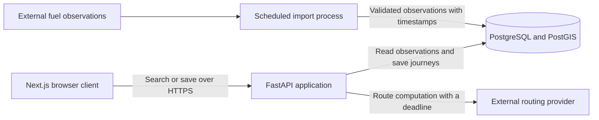

The database owns saved journeys. Imported prices retain observation timestamps. Route computation is a dependency with its own failure behavior. The importer can initially be a scheduled command from the same codebase; this box does not imply a separate microservice or a message broker.

The next diagram isolates a write whose response is lost:

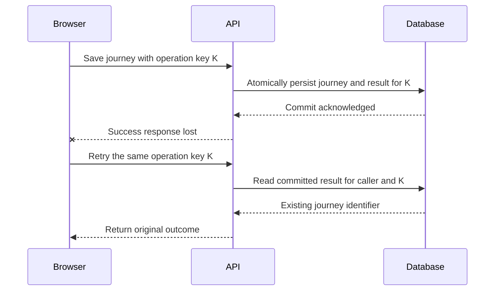

Read the sequence as a protocol requirement. It assumes the durable operation record is committed with the mutation and the retry is authenticated and fingerprint-checked. A cache entry written after the commit would leave a failure window.

<a id="lesson-0-01--e-real-world-examples"></a>

#### E. Real-world examples

For StopAround, freshness is part of answer quality. A quick response based on an old fuel observation may be less useful than a slightly slower one with a clear observation time. A reasonable product contract could display age and warn when observations exceed a threshold. The threshold is a product assumption to validate, not a universal database setting.

The route-aware search also needs the driver's remaining range and fuel preference. A station near the route can still be unsuitable if it is beyond that range or does not supply the requested fuel. Those are business constraints to validate and test, independently of how quickly a spatial query returns rows. Keep the browser's presentation of reachability consistent with the backend's authoritative calculation.

For an independent example, consider a workshop with ten remaining seats. A browser disabling its submit button reduces accidental repeated clicks, but two users and two tabs can still submit together. The authoritative capacity check belongs where concurrent reservations become durable. A safe mechanism must prevent accepted reservations from exceeding capacity; UI state alone cannot uphold that invariant.

These are teaching examples. No internal architectures or performance metrics of named commercial applications are assumed. The lesson's documented operational framework is narrower: Google describes latency, traffic, errors, and saturation as useful monitoring signals in [Monitoring Distributed Systems](https://sre.google/sre-book/monitoring-distributed-systems/).

<a id="lesson-0-01--f-executable-example"></a>

#### F. Executable example

The following complete Python model checks arithmetic and invalid assumptions. It is a local estimation tool, not a benchmark or an API implementation. Its inputs are daily volume, an illustrative peak multiplier, and mean latency at that peak workload.

The executable source is [load_model.py](exercises/module-00/01-system-boundaries/load_model.py):

```python
import json
from math import isfinite


def estimate_load(
    *, daily_requests: float, peak_factor: float, mean_latency_ms: float
) -> dict[str, float]:
    for name, value in (
        ("daily_requests", daily_requests),
        ("peak_factor", peak_factor),
        ("mean_latency_ms", mean_latency_ms),
    ):
        if not isfinite(value):
            raise ValueError(f"{name} must be finite")
    if daily_requests < 0 or peak_factor < 1 or mean_latency_ms <= 0:
        raise ValueError("volume >= 0, peak factor >= 1, latency > 0 required")

    average_rps = daily_requests / 86_400
    peak_rps = average_rps * peak_factor
    mean_in_flight = peak_rps * (mean_latency_ms / 1_000)
    if not all(isfinite(value) for value in (peak_rps, mean_in_flight)):
        raise ValueError("estimate exceeds finite numeric range")
    return {
        "average_rps": average_rps,
        "peak_rps": peak_rps,
        "mean_in_flight": mean_in_flight,
    }


if __name__ == "__main__":
    print(json.dumps(estimate_load(
        daily_requests=400_000, peak_factor=8, mean_latency_ms=300
    ), indent=2))
```

Run from the repository root:

```sh
python3 exercises/module-00/01-system-boundaries/load_model.py
python3 -m unittest discover -s exercises/module-00/01-system-boundaries -v
```

Expect approximately `4.6296` average requests/second, `37.0370` peak requests/second, and `11.1111` mean in-flight requests. The tests check the reference calculation, tenfold latency growth, zero volume, invalid inputs, and numeric overflow. They do not establish production capacity. To do that, run representative load against a realistic environment and observe saturation and the latency distribution.

The function rejects NaN, infinity, negative volume, invalid peak factors, and nonpositive latency. That matters because a model that silently accepts meaningless assumptions can produce a confident but unusable recommendation. The type annotations describe a numeric Python interface; this function is not an untrusted JSON request parser.

<a id="lesson-0-01--g-architectural-decisions-and-trade-offs"></a>

#### G. Architectural decisions and trade-offs

Start with a modular application and a relational database when they satisfy the workload and ownership model. One deployable API keeps local changes and transactions straightforward. It can still have separate modules for routing, journeys, and data import. Separate processes become useful when isolation, resource profiles, or independent operational ownership justify their cost.

| Decision | Useful starting point | Evidence that could change it |
|---|---|---|
| Compute recommendations synchronously | Return a result within a bounded request | Work routinely exceeds the response deadline; expose a durable job and status |
| Read observations from PostgreSQL | Keep query logic and authority together | Measured repeated reads dominate cost and bounded staleness is acceptable; consider caching |
| Keep business modules in one API | Preserve simple deployment and local coordination | A workload needs independently controlled resources or a team needs a separate ownership boundary |
| Run imports on a schedule | Match a known data-refresh cadence | Bursts, resumability, or backlog management require a durable job mechanism |
| Choose a deployment size | Use a representative load test and recovery target | Measurements show CPU, memory, database, or dependency saturation |

Every additional component introduces configuration, credentials, monitoring, deployment work, and a new failure surface. A cache may reduce read latency but adds invalidation and freshness decisions. A queue moves work out of the response path but requires retry, duplicate handling, and backlog visibility. Costs include operator attention as well as the hosting bill.

Preserve migration options through clear ownership and contracts. Do not create an abstraction for every possible future database. Document why today's choice meets today's requirements and specify a measurable condition for revisiting it.

<a id="lesson-0-01--h-common-failures-and-debugging"></a>

#### H. Common failures and debugging

Consider an illustrative incident: recommendation p95 latency rises from 700 milliseconds to 6 seconds, while HTTP traffic remains roughly flat. Begin with impact and scope. Identify the affected endpoint, time window, region, response codes, and deployment changes. Avoid concluding that “the database is slow” from one aggregate graph.

| Observation | Hypothesis | Evidence to collect | Targeted response |
|---|---|---|---|
| Provider spans grow; CPU stays low | Remote dependency slows down | Dependency latency, timeouts, attempts per search | Bound deadlines and concurrency; provide an explicitly limited fallback when valid |
| Connection acquisition dominates | Pool exhausted or connections held too long | Checkout time, active transactions, pool waiters | Shorten connection lifetime; fix leaks; bound admission |
| One query duration grows | Changed plan, missing useful index, or more data | Query plan, row estimates, buffers, data distribution | Test the query or index change on representative data |
| Saved journeys appear twice | Retry after an unknown outcome | Operation keys, request attempts, committed rows | Add durable deduplication tied to the mutation |
| API looks healthy but users wait | Measurement boundary misses client delay | Browser timings and correlated request traces | Investigate network, rendering, or gateway delay |

If requests hold database connections during remote calls, more API replicas may create even more waiting connections. Compare the total configured pools across all processes with database capacity. Scaling one tier can worsen another tier's saturation.

Mitigate before completing a perfect explanation: roll back a recent harmful change, cap expensive work, or disable an optional enrichment. Preserve correctness when degrading. Returning timestamped observations with a clear limitation may be acceptable; silently presenting stale data as fresh is a different product behavior.

After recovery, test the causal hypothesis and write a prevention action. “Increase the pool” is incomplete without knowing whether demand, hold time, or a leak caused exhaustion. Observability should let you distinguish those causes; otherwise the next incident repeats the same guesswork.

<a id="lesson-0-01--i-practical-exercise"></a>

#### I. Practical exercise

Write a one-page engineering brief for a StopAround recommendation request and saved-journey operation. Spend approximately 60–90 minutes, then compare your reasoning with the [worked solution](#lesson-0-01--exercise-solution).

Use the illustrative workload from section C. Add these constraints: imported observations may be at most 30 minutes old before a warning is required; route computation can fail; saved journeys are private; the client can retry after a timeout. The 30-minute threshold is an exercise assumption.

Your brief must include:

1. Two functional requirements, a precisely bounded latency indicator, an availability indicator, and three invariants.
2. A responsibility map for browser, API, database, and providers, including authoritative ownership.
3. Average and peak request rates, mean occupancy at 300 milliseconds and 3 seconds, and one reason those figures cannot size a database pool directly.
4. A timeline in which a save commits and its response disappears. State the retry protocol and the consistency boundary it requires.
5. A decision to include or omit a cache and a queue, justified by present requirements.
6. A debugging plan for rising latency with stable traffic and a safe degraded response for provider failure.

For an additional challenge, repeat the invariant analysis for the workshop's last seat. Identify where a read-then-write sequence can violate the capacity rule. You need not implement the transaction in this introductory exercise.

Successful work makes assumptions explicit, shows units, distinguishes failed search from an empty result, and explains the durable outcome of a retried write. A list of infrastructure names does not satisfy the exercise.

<a id="lesson-0-01--j-interview-and-senior-engineering-assessment"></a>

#### J. Interview and senior-engineering assessment

Attempt these before reading the solutions.

1. A product manager asks for a “fast, reliable recommendation API.” Which questions turn that statement into an implementable contract?
2. Does deploying a single API process eliminate concurrent-update bugs? Explain with an interleaving.
3. A save request times out after the database commits. What does the browser know, and how should it recover?
4. At 37.04 requests/second and 300 milliseconds mean residence time, how many requests are in flight on average? Why is that not a database connection count?
5. API p95 is low, but users report slow searches. How would you investigate the discrepancy?
6. Would a cache, a queue, or additional API replicas fix a slow external routing provider? Explain the conditions and risks.
7. What evidence would justify splitting an importer out of the API deployment? What would remain shared or coordinated afterward?

<a id="lesson-0-01--assessment-solutions"></a>

#### Assessment solutions

<a id="lesson-0-01--1-define-the-boundary-and-denominator"></a>

##### 1. Define the boundary and denominator

Ask which operation and user journey matter, where elapsed time is measured, which requests are eligible, what a valid result means, which failures count, and over what window the target is evaluated. Set an explicit latency target and success proportion. Clarify freshness and privacy separately: a fast response can still be wrong or unauthorized. An implementable contract describes observable behavior and can be turned into an automated measurement.

<a id="lesson-0-01--2-one-process-still-interleaves-work"></a>

##### 2. One process still interleaves work

Request A reads version 7 and waits. Request B reads version 7. A writes its edit; B writes an edit based on the old value. Without a condition or appropriate locking, B can erase A's change. Waiting on I/O allows overlap even without parallel CPU execution. Choose conflict detection or serialization according to the product behavior required; a process-local mutex would not protect a second process or another database writer.

<a id="lesson-0-01--3-the-outcome-is-unknown-to-the-caller"></a>

##### 3. The outcome is unknown to the caller

The browser knows that it did not receive a usable response, not that the save failed. Reuse the same operation key with the same payload and authenticated owner. The API should return the durable original outcome when that operation has committed. A new key represents a new operation and could create a duplicate. Deduplication must survive API restarts and concurrent requests, and payload mismatches must be rejected rather than silently treated as the same save.

<a id="lesson-0-01--4-match-units-and-resource-boundaries"></a>

##### 4. Match units and resource boundaries

`37.04 requests/second × 0.300 seconds/request = 11.112 requests`, approximately 11.11 in flight on average. This includes all time inside the API measurement boundary. Database connections are occupied only during checkout intervals, and there may be several database operations per request. Pool sizing also needs burst behavior, query latency, database capacity, and limits across replicas. Replacing the mean with p95 would not compute mean occupancy.

<a id="lesson-0-01--5-follow-the-user-visible-path"></a>

##### 5. Follow the user-visible path

Compare browser measurements with gateway and API spans for the same searches. Check DNS/connect/TLS time where available, request queueing before the API, provider duration, response transfer, and client rendering. Confirm that successful-only API metrics are not hiding timed-out requests and that sampling is not excluding slow users. Determine whether the complaint concerns a particular device or network rather than trusting a global percentile to describe every user.

<a id="lesson-0-01--6-change-the-dependency-pressure-deliberately"></a>

##### 6. Change the dependency pressure deliberately

A cache helps only when repeated computations can be reused under an acceptable freshness and privacy policy. A durable job helps only if the product accepts deferred completion and has a status contract; it does not make computation faster. More replicas may increase calls to an already constrained provider. First measure attempts, deadlines, latency, and rate limits. Bound work and retries, then choose reuse, deferred work, or a documented degraded mode when its semantics fit.

<a id="lesson-0-01--7-separate-a-measured-operational-need"></a>

##### 7. Separate a measured operational need

Useful evidence includes imports consuming enough CPU or memory to harm interactive requests, a need to restart imports independently, or a distinct scheduling and recovery model. A scheduled process from the same repository may already provide sufficient separation. Splitting does not eliminate schema coordination, database budgets, credentials, or observability. Define checkpointing and idempotent import behavior so a process crash does not require guessing which observations were committed.

<a id="lesson-0-01--k-key-takeaways-and-navigation"></a>

#### K. Key takeaways and navigation

Design begins with an operation, measurable promises, and invariants. Assign authority for each fact, make process and trust boundaries explicit, and account for unknown outcomes. Concurrency exists before horizontal scaling. Capacity estimates connect rates to time within a precise boundary; they guide measurement rather than replace load testing.

Choose additional infrastructure when its benefits address an observed or required constraint. For production ownership, you must be able to implement the contract, test competing operations, deploy a change, detect a failure, and recover safely. Recognizing component names is only the beginning.

Continue with [0.02 — How to prepare](#lesson-0-02), attempt the [exercise](#lesson-0-01--i-practical-exercise), or review the [solutions](#lesson-0-01--assessment-solutions). The [course syllabus](COURSE_TOC.md) links the full learning path, and the [checkpoint](CHECKPOINT.md) records the current batch.

<a id="lesson-0-01--exercise-solution"></a>

#### Worked solution: system boundaries and workload

Attempt [the exercise](#lesson-0-01--i-practical-exercise) first. This is one defensible solution to the stated hypothetical workload, not a description of the current StopAround application.

<a id="lesson-0-01--exercise-solution--requirements-and-invariants"></a>

##### Requirements and invariants

The search accepts a supported route and fuel preference, then returns matching station observations and observation times. The save operation creates a private journey owned by the authenticated caller and returns a stable identifier.

For the exercise, define the latency indicator as the fraction of eligible searches receiving a valid response within 1.5 seconds, measured from API ingress to completion of response transmission at that boundary. Target at least 95% over seven days. This is a combined timeliness-and-success target; count timeouts as failures. It excludes the browser's network and rendering time, which need a separate user-experience measurement.

Define availability as valid search responses divided by eligible searches over 30 days, with an illustrative 99.5% target. Count dependency timeouts and overload rejections as failed eligible searches. A 4xx response is not automatically a caller mistake: classification follows the request contract and failure cause. Missing final responses must remain visible through ingress accounting and deadlines rather than disappearing from success-only instrumentation.

Three invariants are: only the owner can read or mutate a private journey; each successful retry of one save operation identifies the same journey; and an observation older than 30 minutes is accompanied by a freshness warning. Distinguish observation time from import time. Reimporting an old observation does not make it fresh. Compare timestamps at a defined response-evaluation time with monitored clock synchronization.

<a id="lesson-0-01--exercise-solution--responsibilities"></a>

##### Responsibilities

The browser collects input, renders warnings, and retains a save operation key across retries. The API validates input, authenticates the caller, enforces resource ownership, bounds provider work, and coordinates durable writes. PostgreSQL owns saved journeys and committed operation outcomes. The import process validates external observations and preserves their source timestamps. The routing provider owns the computation it performs; its failure is not evidence that no station exists.

<a id="lesson-0-01--exercise-solution--capacity-calculation"></a>

##### Capacity calculation

`100,000 users/day × 4 searches/user = 400,000 searches/day`.

`400,000 searches/day ÷ 86,400 seconds/day = 4.6296 searches/second` average.

`4.6296 × 8 = 37.0370 searches/second` illustrative peak.

At a stable peak interval, `37.0370 requests/second × 0.300 seconds/request = 11.1111 requests` in flight on average. At a 3-second mean residence time, `37.0370 × 3 = 111.1111 requests`.

If each search performs one database operation holding a connection for 20 milliseconds, a separate illustrative estimate is `37.0370 operations/second × 0.020 seconds/operation = 0.7407 occupied connections` on average. This is not a recommended pool size: it excludes bursts, long transactions, imports, other endpoints, and capacity limits. It demonstrates why request lifetime and connection lifetime are different quantities.

<a id="lesson-0-01--exercise-solution--lost-response-and-retry"></a>

##### Lost response and retry

The browser sends operation K with payload P as user U. The API validates the request. Within a database transaction, it coordinates the unique operation identity `(U, K)`, stores a fingerprint of P, creates the journey, and records its result. It commits; the response is lost. The browser retries with U, K, and P. The API finds the committed operation, checks the fingerprint, and returns the same journey identifier.

Concurrent attempts must coordinate on the durable unique identity. A conflicting in-progress attempt may wait for the transaction or receive a documented retryable response. A changed payload under the same key is a conflict. A rollback leaves no successful operation outcome. Define key retention before promising an unlimited deduplication window. This is a protocol design exercise; a later idempotency lesson must implement and test these cases.

<a id="lesson-0-01--exercise-solution--infrastructure-decisions"></a>

##### Infrastructure decisions

Begin without a separate search cache: the exercise provides no measured read bottleneck and freshness rules already require care. Revisit caching if repeated equivalent searches consume a measured resource and acceptable reuse rules are defined.

Begin without a broker for interactive searches. A bounded request matches the product contract. Run imports as a scheduled process. Consider durable jobs when work needs resumability, deferred completion, or explicit backlog handling. Neither a cache nor a broker replaces ownership checks or a transaction protocol.

<a id="lesson-0-01--exercise-solution--failure-investigation-and-degradation"></a>

##### Failure investigation and degradation

Correlate API residence time with provider duration, attempt rate, database query duration, and pool checkout waits. Compare mean and tail latency. Check whether recent deployments extended transaction lifetimes or changed queries. Stable ingress with rising occupancy points to longer work or waiting, not necessarily more users.

If a route cannot be computed and no permitted route-specific fallback exists, return a clear temporary failure within the deadline. If the product explicitly permits an approximate result using a previously computed compatible route, label its age and limitations. An HTTP 200 containing an empty list would conceal a failed computation.

For the workshop extension, two callers can both read one remaining seat and both create reservations. Move the capacity decision and accepted reservation into one coordinated database operation or transaction. Conditional updates, row locks, or serializable transactions with retries are candidate mechanisms; each must also address cancellation and replayed requests.

<a id="lesson-0-02"></a>

### How to prepare

Lesson 0.02 · Foundations & delivery framework

<a id="lesson-0-02--a-learning-objectives-and-prerequisites"></a>

#### A. Learning objectives and prerequisites

By the end of this lesson, you should be able to build a learning session around a specific engineering question, make a prediction before running an experiment, choose evidence that can disprove a design claim, and decide whether you are ready to move on. You should also distinguish an interview explanation from an implementation check and an operational check.

Read [0.01 — Introduction](#lesson-0-01) first. It establishes system boundaries, invariants, unknown outcomes, and the difference between rate and concurrency. You need enough Python familiarity to run a short script; understanding every asyncio detail is not a prerequisite. Async Python receives its own treatment during backend foundations.

This lesson prepares you to use [0.03 — Delivery framework](COURSE_TOC.md#lesson-0-03), then work through [Module 1](COURSE_TOC.md#module-1). The [worked exercise solution](#lesson-0-02--exercise-solution) is separate so you can make your own predictions first.

<a id="lesson-0-02--b-mental-model-and-intuition"></a>

#### B. Mental model and intuition

Prepare to make a decision, not to recognize a diagram. Reading about a queue can help you explain its vocabulary, but production work asks different questions: what survives a crash, who retries, how duplicates are handled, and which observation would reveal a growing backlog?

A useful learning session leaves behind a small claim and evidence about that claim. For example: “Limiting concurrent calls to two will keep active calls at or below two, while eventually completing all ten submitted operations.” That claim has a boundary, an expected result, and a way to fail. “I understand concurrency” has none of those properties.

Your frontend experience already provides a good starting point. You distinguish a component's inputs from its internal state, inspect a waterfall when an interaction is slow, and test the behavior that a user observes. Apply the same habits to services and data. Draw the boundary, identify the state, inspect the events, and check the promised outcome.

The course will repeatedly use a loop: explain a mechanism, predict its behavior, exercise it, inspect evidence, and revise the explanation. The purpose is not to collect passing experiments. A surprising result is valuable when you can locate the assumption it contradicts. Confidence should become more specific as you learn, rather than simply becoming stronger.

<a id="lesson-0-02--c-deep-technical-explanation"></a>

#### C. Deep technical explanation

<a id="lesson-0-02--turn-a-topic-into-a-question-you-can-answer"></a>

##### Turn a topic into a question you can answer

A topic names a large area: transactions, caching, replication, or authentication. A question identifies a decision inside that area. “Can two requests reserve the last seat?” is a better starting question than “How does PostgreSQL work?” The smaller question gives you a workload, a required property, and a concrete failure to investigate.

Write three things before using a tool. First, state the property you want to preserve. Second, state what you believe the mechanism will do. Third, identify an observation that would show the belief is wrong. For the concurrency example, the property is bounded active work. The mechanism is a shared gate. A maximum-active counter greater than the limit would refute the claim.

Be careful about the scope of a successful observation. A local gate may coordinate operations inside one process; it does not demonstrate coordination across three API processes. A fake provider can reveal scheduling behavior; it does not establish a real provider's rate limit. Every conclusion needs a boundary as explicit as the experiment's inputs.

<a id="lesson-0-02--separate-three-kinds-of-competence"></a>

##### Separate three kinds of competence

**Explanation competence** means you can describe the mechanism and its trade-offs. For example, you can distinguish waiting for an available resource from performing useful work. Explain the state transitions with a small request timeline, without relying on a product name as the explanation.

**Implementation competence** means code enforces the property under relevant conditions. A concurrency limiter must release its permit when work fails. A write must preserve ownership checks on every path. A test should observe the promised outcome, not merely assert that a helper was called.

**Operational competence** means you can detect and recover when assumptions fail. If a dependency becomes slow, which metric distinguishes too much incoming work from longer residence time? What can you disable safely? What state remains after a process restarts? These questions require evidence from the running boundary, not just a unit test.

You do not need all three at maximum depth before proceeding with every introductory lesson. You do need to record which one you have exercised. An articulate explanation plus one happy-path test is useful progress, but it is not proof that the service is ready for production.

<a id="lesson-0-02--choose-evidence-that-distinguishes-competing-explanations"></a>

##### Choose evidence that distinguishes competing explanations

Suppose an API becomes slow while traffic stays flat. One hypothesis is that the external route provider is slower. Another is that database connections are held while the API waits for that provider. These hypotheses can both be true, but they predict different resource behavior. Measure provider duration and connection checkout duration separately; a total request timer alone cannot distinguish them.

An experiment becomes more useful when alternative explanations predict different observations. If you are testing a concurrency limit, compare one permit, two permits, and a limit large enough for all submitted work. If the measured maximum is identical in every case, investigate whether the workload actually overlaps or whether the metric measures the wrong interval.

Controlled experiments change a relevant input while holding other assumptions steady. They are especially useful in an isolated development environment. In production, prefer existing observations and low-risk mitigations before deliberately disturbing a service. Google's [Effective Troubleshooting](https://sre.google/sre-book/effective-troubleshooting/) describes diagnosis as forming hypotheses and looking for confirming or disconfirming evidence.

<a id="lesson-0-02--design-a-test-around-an-observable-contract"></a>

##### Design a test around an observable contract

A good test needs a contract, an input, and an observation. “All ten requests finish, with no more than two active operations at once” yields two independent assertions. Testing only the limit might miss dropped requests. Testing only the completion count might miss an ineffective limit.

Make the observation at the point where the property matters. Increment an active-operation counter after acquiring the gate, not before it. Counting before acquisition would measure active plus waiting operations. Both quantities can be useful, but they answer different questions. This is the same boundary discipline used in latency and database-pool measurements.

Prefer a deterministic way to expose the condition you care about. A scheduling yield lets several tasks become runnable without claiming a real network delay. For an eventual database race test, coordinate the competing operations deliberately instead of hoping a sufficiently large number of random requests happens to reveal the bug.

Passing tests reduce uncertainty within their scope. They do not prove that every failure has been considered. Google's [Testing for Reliability](https://sre.google/sre-book/testing-reliability/) distinguishes different testing boundaries and explains why passing tests alone do not establish reliability. Use that limitation to choose your next check, rather than abandoning useful automated tests.

<a id="lesson-0-02--keep-an-evidence-log-that-another-engineer-could-use"></a>

##### Keep an evidence log that another engineer could use

For each substantial exercise, save a compact record:

- Question and invariant.
- Assumptions, including process count and workload.
- Prediction made before execution.
- Exact command and relevant input values.
- Observed result and what it rules out.
- What remains untested and the next decision.

This is not a diary of every keystroke. It is a reproducible argument. Someone else should be able to rerun the experiment and understand why it supports a particular conclusion. Include versions when behavior depends on a database, library, or deployment configuration.

Use measured and illustrative values differently. A value printed by a toy model is evidence about that model's behavior. It is not a measured capacity of your FastAPI application, even if the model uses the same number of requests. A performance report needs the environment, representative data, workload shape, and measurement method.

<a id="lesson-0-02--build-a-sustainable-sequence-of-sessions"></a>

##### Build a sustainable sequence of sessions

After a workday, use a bounded question rather than an open-ended objective such as “learn distributed systems tonight.” An illustrative 30-minute session might use five minutes to reconstruct the mechanism, ten minutes for one experiment, ten minutes to explain the result and try a counterexample, and five minutes to record the remaining uncertainty.

The time allocation is a planning example, not a scientific prescription. A transaction lab may need several sessions; a prerequisite explanation may need one. End at a clear checkpoint rather than declaring a lesson complete because the allotted time expired.

At the next session, try to reconstruct the decision before rereading your notes. If you cannot explain which observation supported it, you have identified a precise gap. Revisit that gap instead of restarting an entire module. Readiness comes from the ability to apply and challenge an explanation, not the number of pages you have scrolled past.

<a id="lesson-0-02--d-architecture-and-data-flow"></a>

#### D. Architecture and data flow

The experiment has two paths: submitted work and evidence about that work. Keeping them distinct prevents a test from measuring a quantity that merely looks like the desired result.

```text
10 submitted operations
        |
        v
Shared gate: at most 2 permits
        |
        v
Active work interval ---------> active / maximum-active counters
        |
        v
Completion ------------------> completed-operation counter

Prediction: maximum_active <= 2 AND completed == 10
Observation: compare both counters, then revise or retain the claim
```

Waiting operations remain outside the active-work counter. The experiment uses one process and one event loop. That boundary is part of its design, and changing to several processes requires a new coordination question. The diagram does not imply a distributed queue, worker fleet, or production telemetry pipeline.

<a id="lesson-0-02--e-real-world-examples"></a>

#### E. Real-world examples

For StopAround, prepare for a slow-search investigation by writing down the request stages: validation, route computation, database access, ranking, and serialization. Then name one observation for each stage. If all you collect is total endpoint duration, several plausible causes remain indistinguishable.

Practice with a hypothetical incident: traffic is steady, provider duration grows, and connection wait time also grows. Your first question should be whether the API checks out a connection before waiting for the provider. Inspect the relevant code path and timing boundaries before proposing a larger database pool. An observed overlap can support that hypothesis; a graph alone cannot establish which request paths hold the connections.

For an independent example, consider a workshop reservation endpoint. A test that receives two successful HTTP responses does not prove the last seat was reserved correctly. Inspect accepted reservations and remaining capacity after the competing operations. You may need an assertion that exactly one request succeeds, one receives a conflict, and the stored capacity stays nonnegative.

These are illustrative exercises, not reports of production measurements. The transferable preparation habit is to choose evidence that reflects the business invariant rather than a convenient proxy such as a response code, helper invocation, or dashboard color.

<a id="lesson-0-02--f-executable-example"></a>

#### F. Executable example

This scheduling probe gives you a small mechanism to predict and test. It runs entirely locally with Python 3.10 or later. Ten operations compete for a shared semaphore, which is a counter of available permits. An operation acquires a permit before entering the interval counted as active and releases it on exit.

The executable source is [concurrency_probe.py](exercises/module-00/02-how-to-prepare/concurrency_probe.py):

```python
"""A local scheduling experiment, not a network or throughput benchmark."""

import asyncio
import json


async def probe(requests: int, limit: int) -> dict[str, int]:
    if type(requests) is not int or type(limit) is not int:
        raise ValueError("requests and limit must be integers")
    if not 0 <= requests <= 10_000 or not 1 <= limit <= 10_000:
        raise ValueError("requests must be 0..10000 and limit must be 1..10000")
    gate = asyncio.Semaphore(limit)
    active = maximum = completed = 0

    async def operation():
        nonlocal active, maximum, completed
        async with gate:
            active += 1
            maximum = max(maximum, active)
            try:
                await asyncio.sleep(0)
                completed += 1
            finally:
                active -= 1

    await asyncio.gather(*(operation() for _ in range(requests)))
    return {"completed": completed, "maximum_active": maximum}


async def main():
    for limit in (1, 2, 10):
        result = await probe(requests=10, limit=limit)
        print(json.dumps({"limit": limit, **result}))


if __name__ == "__main__":
    asyncio.run(main())
```

Before running it, predict the maximum active operations for limits 1, 2, and 10. Then run:

```sh
python3 exercises/module-00/02-how-to-prepare/concurrency_probe.py
python3 -m unittest discover -s exercises/module-00/02-how-to-prepare -v
```

For this workload and explicit scheduling yield, the three runs complete ten operations and reach maximum-active values of 1, 2, and 10 respectively. The tests also check an empty workload and reject invalid inputs before scheduling. The 10,000-operation bound is an explicit local-lab resource limit, not an estimate of a production service's capacity.

`asyncio.sleep(0)` yields control; it does not model a particular number of network milliseconds. The output contains counts, not latency or throughput measurements. `finally` restores the active counter if the operation exits exceptionally, while the context manager releases its permit. These behaviors are described in the Python documentation for [sleep](https://docs.python.org/3.10/library/asyncio-task.html#asyncio.sleep) and [semaphores](https://docs.python.org/3.10/library/asyncio-sync.html#asyncio.Semaphore). This example does not implement provider timeouts, durable jobs, or distributed coordination.

For a useful mutation experiment in a temporary copy, replace the shared gate with a separate semaphore inside each operation. Predict why the two-permit test should fail, then confirm the failure. Do not preserve that mutation as the solution. The failing test establishes that the gate must be shared across the operations it coordinates.

<a id="lesson-0-02--g-architectural-decisions-and-trade-offs"></a>

#### G. Architectural decisions and trade-offs

Choose the learning method according to the uncertainty you need to reduce. More infrastructure does not automatically produce stronger evidence.

| Method | What it can establish | What still needs a different check |
|---|---|---|
| Explain a request timeline | You can identify boundaries and state transitions | The code actually follows that timeline |
| Small deterministic model | A mechanism behaves under explicit assumptions | A real dependency has the same behavior |
| Integration test | Components preserve a contract together | The production workload and failure distribution |
| Representative load test | Resource and latency behavior in the tested environment | Recovery from failures not included in the workload |
| Failure drill | Detection and recovery for a defined incident | Every other failure path |

Use the smallest experiment that distinguishes the current hypotheses. A model is appropriate for learning a scheduling boundary. Use PostgreSQL for a claim about PostgreSQL transaction behavior; a Python dictionary cannot establish that claim. Use a real HTTP boundary when client cancellation, response loss, or authentication behavior is the subject.

Keep interview practice and implementation practice connected but separate. An interview answer must communicate a defensible design under time constraints. An implementation exercise must demonstrate the contract. Operational practice adds telemetry, recovery, and the cost of change. Each produces evidence that the others cannot replace.

<a id="lesson-0-02--h-common-failures-and-debugging"></a>

#### H. Common failures and debugging

**Mistaking familiarity for readiness.** You recognize the diagram but cannot explain which state survives a restart. Close the reference and draw the failure timeline. If you cannot do it, record that exact gap and revisit the mechanism.

**Using a test that cannot fail for the claimed bug.** A test checks only that ten operations finish, so removing the concurrency limit leaves it green. Add the maximum-active assertion. A targeted mutation is a useful check that the assertion observes the property you intend.

**Measuring at the wrong boundary.** You count waiting requests as active provider calls. Inspect where counters are incremented and decremented. Give active work and queued work different names; a single ambiguous “in flight” metric can conceal the distinction.

**Changing too many inputs.** You change concurrency, request volume, data size, and retry policy, then attribute the result to one of them. Restore a baseline and vary one relevant factor. If factors must change together, state why and narrow the conclusion accordingly.

**Turning toy output into a production recommendation.** A local counter test passes with ten operations, so you choose ten database connections. Identify the missing evidence: real hold times, other workloads, bursts, process count, and database limits. The model did not answer the sizing question.

**Collecting tools instead of decisions.** You set up a broker before identifying a durability requirement. Return to the invariant and failure timeline. If a scheduled command meets the current contract, learning its recovery behavior is more valuable than configuring infrastructure without a reason.

<a id="lesson-0-02--i-practical-exercise"></a>

#### I. Practical exercise

Create a short evidence log for the scheduling probe, then prepare the next real-system experiment. Work through this before opening the [solution](#lesson-0-02--exercise-solution).

1. State the bounded-work invariant and predict all three probe outputs before execution.
2. Run the script and tests. Record the command, Python version, result, and the boundary the counters measure.
3. In a temporary copy, move the semaphore inside each operation. Explain why a limit of two no longer constrains the group, then verify that the targeted test detects it.
4. Write two claims the successful original probe does not establish. One must involve several processes and one must involve a real external provider.
5. Design a StopAround investigation that distinguishes slow route computation from long database connection occupancy. Name the two measurements and identify an unsafe conclusion to avoid.
6. Write a checkpoint for a later session: the precise unresolved question, the next experiment, and what outcome would change your design.

The deliverable is the reasoning and a reproducible evidence log, not a screenshot of green tests. A strong answer explains both the supported claim and its limits. For additional practice, propose the database-state assertions needed to test the workshop's last-seat invariant.

<a id="lesson-0-02--j-interview-and-senior-engineering-assessment"></a>

#### J. Interview and senior-engineering assessment

1. What makes “I understand queues” a weaker readiness claim than a specific delivery and recovery contract?
2. Why does testing both completion count and maximum active work matter in the probe?
3. A test passes with a local semaphore. Can you conclude that three API processes share its limit?
4. Why does a deliberately coordinated interleaving often teach more than a large random request burst?
5. Your model predicts a correct result, but an integration test fails. Which source should you trust, and how do you investigate?
6. What information belongs in a useful continuation checkpoint after a short evening session?
7. When should you move on from a lesson even though you have not implemented every production detail?

<a id="lesson-0-02--assessment-solutions"></a>

#### Assessment solutions

<a id="lesson-0-02--1-a-readiness-claim-needs-an-observable-boundary"></a>

##### 1. A readiness claim needs an observable boundary

Queue vocabulary does not specify whether acknowledged work survives a restart, whether processing may repeat, or how a stuck item becomes visible. A useful claim identifies the operation, its guarantees, and the evidence that checks those guarantees. You can then test a defined failure instead of treating the presence of a queue product as proof of reliability.

<a id="lesson-0-02--2-the-properties-fail-independently"></a>

##### 2. The properties fail independently

A broken implementation can keep active work below two by silently dropping eight operations. Another can complete everything while allowing all ten to overlap. The completion assertion detects the first defect; the maximum-active assertion detects the second. Together they describe the intended local contract more accurately, while still leaving timeout and cancellation behavior to separate checks.

<a id="lesson-0-02--3-process-scope-is-part-of-the-assumption"></a>

##### 3. Process scope is part of the assumption

The semaphore belongs to one Python process and coordinates the operations that share that object. Three independently created gates do not form one global limit. A multi-process design needs an explicit shared coordination mechanism or a deliberately divided budget. The experiment supports a local scheduling claim, not a distributed one.

<a id="lesson-0-02--4-a-controlled-schedule-makes-the-mechanism-visible"></a>

##### 4. A controlled schedule makes the mechanism visible

A random burst might never create the problematic overlap, or might fail in ways you cannot reproduce. Deliberately arranging the relevant ordering makes the assumption testable. Randomized stress can supplement that test, but it should not be the only evidence for a race condition whose critical sequence you already understand.

<a id="lesson-0-02--5-treat-the-disagreement-as-evidence"></a>

##### 5. Treat the disagreement as evidence

Do not dismiss the failing integration test merely because the model is simpler. Check the test's setup and observation boundary, reproduce the failure, and compare the real component's behavior with the model's assumptions. The model may omit transaction isolation, serialization, network outcomes, or process scope. Fix the explanation or implementation according to the actual contract, then retain a regression test for the discovered gap.

<a id="lesson-0-02--6-record-the-decision-still-in-front-of-you"></a>

##### 6. Record the decision still in front of you

Write the current claim, the assumptions, the exact result already observed, and the next question. Include a command or file location needed to resume. “Continue studying caching” is too vague; “test whether two simultaneous misses cause duplicate provider calls under this cache policy” identifies an executable next step and the result that could change the design.

<a id="lesson-0-02--7-move-on-with-an-accurate-account-of-the-remaining-gap"></a>

##### 7. Move on with an accurate account of the remaining gap

Proceed when you can explain the mechanism, predict an important failure, complete the required exercise, and distinguish tested behavior from assumptions. An introductory lesson need not solve all later production topics. Record a specific dependency to revisit, such as cancellation cleanup or cross-process coordination, and return to it in the relevant lesson. Do not count an unknown requirement as solved.

<a id="lesson-0-02--k-key-takeaways-and-navigation"></a>

#### K. Key takeaways and navigation

Prepare by turning topics into falsifiable engineering questions. Keep explanation, implementation, and operation distinct. Predict before executing, measure at the contract boundary, and test outcomes that can fail independently. A small experiment is strong evidence for a small claim; increasing the claim requires additional evidence.

Use a bounded session and leave a precise checkpoint. Your existing frontend debugging skills transfer when you follow ownership and state across the API and data layers. The goal is to make justified decisions and recover from failed assumptions, rather than recognize a standard architecture.

Review [0.01 — Introduction](#lesson-0-01), attempt the [exercise](#lesson-0-02--i-practical-exercise), or compare the [worked solution](#lesson-0-02--exercise-solution). Next is [0.03 — Delivery framework](COURSE_TOC.md#lesson-0-03), currently listed in the verified syllabus and scheduled for the next writing batch.

<a id="lesson-0-02--exercise-solution"></a>

#### Worked solution: prepare with an evidence log

Attempt [lesson 0.02's exercise](#lesson-0-02--i-practical-exercise) before reading this example. This is a local learning experiment; none of its counts is a production throughput measurement.

<a id="lesson-0-02--exercise-solution--question-invariant-and-prediction"></a>

##### Question, invariant, and prediction

Question: does one shared gate bound active work without dropping submitted operations?

Invariant: the number of operations in the counted work interval never exceeds the shared permit limit. Completion requirement: all ten submitted operations eventually finish in this successful, uncancelled workload.

Before execution, predict maximum-active counts of 1, 2, and 10 for the three limits, with a completed count of 10 in each run. A zero-request workload should report zero for both counters.

<a id="lesson-0-02--exercise-solution--evidence-to-record"></a>

##### Evidence to record

Run the script and test commands given in the lesson, and record the actual Python version from your environment. The probe prints one JSON object per configuration. Compare the values to your predictions rather than recording only that the program exited successfully.

The active interval begins after permit acquisition and ends in `finally`. Waiting for a permit is outside that count. All tasks share one event loop and one semaphore object during each probe invocation. `asyncio.sleep(0)` exposes overlap by yielding; it does not represent 300 milliseconds of provider work.

<a id="lesson-0-02--exercise-solution--mutation-and-its-interpretation"></a>

##### Mutation and its interpretation

In a disposable copy, create a separate semaphore inside each `operation` and use that local gate. Every operation can acquire its own permit, so the group is no longer limited to two. The maximum-active assertion should fail for ten submitted operations, even though all ten still complete.

This mutation checks whether the test can detect loss of shared coordination. It does not prove the test detects every possible concurrency defect. Restore the original code after the experiment.

<a id="lesson-0-02--exercise-solution--limits-of-the-conclusion"></a>

##### Limits of the conclusion

The local probe does not establish that several API processes obey one global limit. Each process could have its own gate and permit budget.

It also does not establish the allowed call rate, latency, cancellation behavior, or availability of a real routing provider. A concurrency budget and a requests-per-second budget are different constraints. Integration tests and representative measurements are needed for those boundaries.

<a id="lesson-0-02--exercise-solution--stoparound-investigation"></a>

##### StopAround investigation

Hypothesis A: the provider takes longer, but the API checks out database connections only during short database operations. Hypothesis B: requests hold checked-out connections while awaiting the provider, so the slowdown also consumes pool capacity.

Measure provider-call duration and database connection checkout-to-return duration for correlated requests. Also separate time waiting to acquire a connection from time holding one. Inspect the code path that determines when a connection is acquired and released.

An unsafe conclusion is “increase the pool because the API is slow.” A larger pool may only let more work accumulate against a constrained database. First identify which boundary is responsible for longer occupancy.

<a id="lesson-0-02--exercise-solution--a-useful-continuation-checkpoint"></a>

##### A useful continuation checkpoint

“The single-process probe completed ten operations and bounded active work to two. The deliberately unshared-gate mutation failed the maximum-active assertion. Next, inspect the StopAround search path to find whether provider calls occur inside a database connection's lifetime. Correlate the two timing intervals before changing a pool budget.”

For the workshop extension, check accepted reservation count, final capacity, and the outcomes returned to both callers. With one remaining seat and two competing new reservations, the intended contract might allow exactly one accepted reservation and one conflict. A test that inspects HTTP status alone could miss an incorrect stored count or a response sent before commit.

<a id="module-1"></a>

## Core concepts

<a id="lesson-1-01"></a>

### Networking essentials

Lesson 1.01 · Core concepts

<a id="lesson-1-01--a-learning-objectives-and-prerequisites"></a>

#### A. Learning objectives and prerequisites

By the end, you should be able to explain the path from a browser interaction to an API response, distinguish connection setup from application work, assign a useful timeout to each boundary, and investigate a slow request without immediately adding servers. You should also explain why canceling a browser request cannot establish whether a database mutation committed.

Start with [0.01 — Introduction](#lesson-0-01) and [0.02 — How to prepare](#lesson-0-02). Familiarity with browser developer tools is sufficient; you do not need to implement a transport protocol. The [Module 1 lab guide](exercises/module-01/README.md) supplies the Python environment and commands. All workloads and incident numbers below are illustrative.

<a id="lesson-1-01--b-mental-model-and-intuition"></a>

#### B. Mental model and intuition

A request is a sequence of dependent work across separately operated systems. Your React component sees one promise, but that promise can include waiting for a connection, resolving a name, establishing transport security, reaching a reverse proxy, entering an application queue, querying a database, and transferring a response. A single duration cannot tell you which resource was scarce.

Think in boundaries and clocks. A browser measures an interaction; a proxy measures its upstream exchange; FastAPI measures handler work; PostgreSQL measures a statement. Those intervals overlap. Adding all of them double-counts time, while looking only at handler time misses everything before the handler starts. A trace connects related spans; it does not make their durations interchangeable.

For StopAround, separate the page shell, the route computation, the station list, and the saved journey. A cached JavaScript bundle can arrive quickly while an uncached route request crosses a continent. Improving the bundle does not reduce the routing provider's response time. Making requests parallel reduces some waiting, but increases simultaneous load and makes the slowest required dependency determine completion.

<a id="lesson-1-01--c-deep-technical-explanation"></a>

#### C. Deep technical explanation

<a id="lesson-1-01--names-addresses-and-connection-reuse"></a>

##### Names, addresses, and connection reuse

DNS translates names into records, including IPv4 A records and IPv6 AAAA records. Your browser, operating system, recursive resolver, and authoritative service may participate, with caches at multiple points. A DNS TTL expresses a caching lifetime for a record; it does not force every established connection to close when that lifetime ends. A hostname can resolve successfully while its returned destination remains unreachable. These are separate failure domains. [DNS concepts, RFC 1034](https://www.rfc-editor.org/rfc/rfc1034.html).

Changing a DNS record therefore creates a transition period. Existing clients may retain an address or an open connection. During a planned cutover, keep the previous destination safe long enough for the actual clients and caches involved. A shorter TTL can help future lookups converge, but cannot recall a response already cached under an older TTL. Measure traffic at both destinations instead of declaring a migration complete after one successful lookup.

TCP supplies an ordered byte stream with retransmission, flow control, and congestion control. It does not preserve your JSON message boundaries or tell you whether a SQL transaction committed. A TCP acknowledgement concerns received transport data, not completed application work. Packet loss can delay later bytes even when the application server is healthy. [TCP specification, RFC 9293](https://www.rfc-editor.org/rfc/rfc9293.html).

Connection reuse avoids repeated setup, but introduces another resource: a bounded pool. Suppose a backend permits twenty provider connections. If all twenty are occupied, request twenty-one may wait locally before sending any bytes. The provider's dashboard can show normal response times while your application is slow. Observe pool acquisition time, active connections, and rejected or queued work separately from upstream service time.

<a id="lesson-1-01--security-and-protocol-versions"></a>

##### Security and protocol versions

TLS authenticates the peer under a certificate-validation policy and protects the connection's contents against observation and alteration. Keep hostname verification enabled. A valid certificate for the API hostname does not authorize Alice to read Bob's journey; application authorization is a later decision. A CDN may terminate one TLS connection and establish another to the origin, producing two separate trust and timing boundaries. [TLS 1.3, RFC 8446](https://www.rfc-editor.org/rfc/rfc8446.html).

The conventional HTTPS-over-TCP path is not universal. HTTP/2 multiplexes streams on one TCP connection, so separate HTTP exchanges can share transport-level delays. HTTP/3 uses QUIC over UDP and has different transport behavior. The probe in this lesson intentionally measures Python's HTTPS-over-TCP path; it does not characterize every browser protocol. Your browser's network panel should identify the negotiated protocol before you reason about connection sharing.

HTTP supplies the request method, target, headers, status, and representation. A proxy's 504 means it timed out waiting for an upstream response according to its policy. It does not prove the upstream operation was canceled. Similarly, a 200 says the server reports success under the endpoint's contract; only that contract tells you what was committed or merely accepted. [HTTP semantics, RFC 9110](https://www.rfc-editor.org/rfc/rfc9110.html).

<a id="lesson-1-01--latency-has-a-shape"></a>

##### Latency has a shape

An illustrative cold request might spend 15 ms in name resolution, 40 ms establishing TCP, 40 ms negotiating TLS, 25 ms waiting for an application worker, 80 ms in useful handler work, and 20 ms transferring and consuming the response. That particular serial path totals 220 ms. A warm request can reuse the name and connection, but still queue for a worker. Do not quote 220 ms as a universal internet latency or assume every handshake always costs exactly one round trip.

Bandwidth measures a rate of transferred data; latency measures elapsed time. Compressing a large payload can reduce transfer time, but cannot remove a slow database lock. Moving the API nearer its database can reduce repeated database round trips, even if the browser remains distant. The best placement depends on how many sequential exchanges occur on each link, not simply on where the frontend is hosted.

Percentiles describe a distribution. A p99 endpoint duration is a threshold covering 99% of the measured requests in that population and window. It is not a guarantee for a particular user. For parallel calls, the maximum of their durations matters when every result is required. For serial calls, the durations add per request, but adding separately reported p99 values does not generally produce the p99 of the sum. Retain traces or joint measurements when a budget depends on correlations.

<a id="lesson-1-01--deadlines-timeouts-and-retries"></a>

##### Deadlines, timeouts, and retries

A timeout bounds one wait according to a library's definition. A deadline bounds the remaining useful lifetime of the overall operation. Distinguish pool acquisition, connection establishment, reading response data, database execution, and the user interaction. Some read timeouts reset after progress; a peer sending occasional bytes may keep such a request alive much longer than expected.

For an illustrative one-second interaction budget, reserve time for browser-to-API transit and response handling before allocating the remainder to dependencies. Propagate the remaining budget. If a dependency receives only 120 ms of useful budget, starting a second 500 ms attempt cannot rescue the interaction. Set limits on both attempt count and total time, apply backoff with jitter where appropriate, and stop admitting work once it cannot finish usefully.

Retries add traffic precisely when something may already be overloaded. If four layers each allow three attempts, one logical operation can create as many as 81 leaf attempts. Choose a retry owner and a total budget. A successful retry of a read is different from safely retrying a write whose acknowledgement disappeared. The latter requires a durable operation identity, taught in the next lesson. [Google SRE: handling overload](https://sre.google/sre-book/handling-overload/).

<a id="lesson-1-01--d-architecture-and-data-flow"></a>

#### D. Architecture and data flow

This is an illustrative logical path. The CDN and API can terminate separate connections; the resolver is a naming dependency rather than a service through which every HTTP request passes.

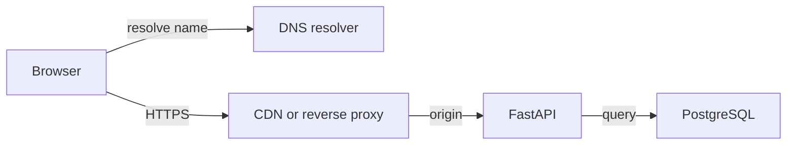

On a warm connection, the browser may skip name resolution and handshake work for this exchange. At the edge, a valid public cache hit can avoid the origin. A personalized journey request follows the configured private-data policy instead. The API should attach a request identifier and trace context, enforce admission limits, and observe provider and database waits. A database acknowledgement precedes a successful synchronous-save response, but the response can still be lost after that acknowledgement.

<a id="lesson-1-01--e-real-world-examples"></a>

#### E. Real-world examples

In an illustrative StopAround incident, users report that the station list appears after several seconds. Handler logs show 90 ms, while browser traces show two seconds before the response starts. Inspect the proxy's upstream timing and the API's connection-pool wait. If the queue is outside the handler timer, adding database indexes may leave the delay unchanged. Reproduce from the same region and connection state before comparing measurements.

For a separate example, an internal document service uploads large attachments. Small requests are fast, while large uploads fail through a proxy. Investigate body-size limits, upload timeouts, buffering, and application streaming before increasing application CPU. An application cannot fix a request body that the proxy rejected before forwarding it. A precise boundary diagram saves time because it identifies which component could have observed the failure.

At a CDN, treat a cached public station-directory response differently from a user's saved routes. The cache key and authorization policy must prevent one user's response from being served to another. Geographic proximity is useful only after the content is eligible to be shared. Lesson 1.04 develops the consistency and privacy implications.

<a id="lesson-1-01--f-executable-example"></a>

#### F. Executable example

The full [network probe](exercises/module-01/01-networking-essentials/network_probe.py) resolves a hostname, creates a verified HTTPS connection, requests a response, and reads at most 4,096 body bytes. Run it against a public HTTPS endpoint you are authorized to query:

```bash
python3 exercises/module-01/01-networking-essentials/network_probe.py https://www.python.org/
```

The labels are deliberately narrow: `connect_including_tls_ms` also includes the connection library's own address lookup, and `request_to_headers_ms` ends after response headers arrive, not at full-body completion. The preliminary DNS lookup can warm a resolver cache. This is a diagnostic experiment, not a browser benchmark or a clean separation of TCP and TLS timings.

<!-- Listing: exercises/module-01/01-networking-essentials/network_probe.py -->

```python
"""Bounded HTTPS timing probe. Resolves DNS separately; connect includes a second lookup."""
import http.client
import socket
import ssl
import time
from urllib.parse import urlsplit


def probe(url: str, timeout: float = 2.0) -> dict:
    target = urlsplit(url)
    if target.scheme != 'https' or not target.hostname or target.username or target.password or target.fragment:
        raise ValueError('Use an HTTPS URL without credentials or a fragment')
    if not 0 < timeout <= 30:
        raise ValueError('timeout must be greater than zero and at most 30 seconds')
    port = target.port or 443
    start = time.monotonic()
    addresses = socket.getaddrinfo(target.hostname, port, type=socket.SOCK_STREAM)
    resolved = time.monotonic()
    connection = http.client.HTTPSConnection(target.hostname, port, timeout=timeout, context=ssl.create_default_context())
    try:
        connection.connect()
        connected = time.monotonic()
        connection.request('GET', (target.path or '/') + ('?' + target.query if target.query else ''))
        response = connection.getresponse()
        headers = time.monotonic()
        sample = response.read(4096)
        return {'addresses': len({item[4][0] for item in addresses}), 'status': response.status,
                'dns_ms': round((resolved-start)*1000, 2),
                'connect_including_tls_ms': round((connected-resolved)*1000, 2),
                'request_to_headers_ms': round((headers-connected)*1000, 2), 'sample_bytes': len(sample)}
    finally:
        connection.close()


if __name__ == '__main__':
    import json
    import sys
    print(json.dumps(probe(sys.argv[1]), indent=2))
```

Socket timeouts do not establish a total operation deadline, and the system resolver may have its own timeout policy. The probe does not follow redirects, pool connections, implement retries, or make its results comparable across unrelated hosts. The deterministic tests verify bounded reads, resource cleanup, and input rejection; a live request is a separate environment-dependent check. The module's [pinned dependencies](exercises/module-01/requirements.txt) and [check runner](exercises/module-01/run_checks.py) accompany the lab guide.

<a id="lesson-1-01--g-architectural-decisions-and-trade-offs"></a>

#### G. Architectural decisions and trade-offs

Prefer one well-instrumented API near its primary database until a measured requirement justifies more regions. Cross-region replicas and active writers introduce failure and consistency questions that a CDN for public assets does not. First reduce unnecessary sequential network exchanges, reuse bounded connections, and remove oversized payloads.

For a provider dependency, choose between waiting, returning a partial result, or using an explicitly stale fallback. A stale station price may be acceptable with its observation time displayed; a save confirmation cannot be invented from a cached response. Write down the user-visible behavior for each dependency failure before choosing a timeout.

Retries need a cost limit and a semantic rule. Retry a transient failure only when the remaining budget allows it and the endpoint's contract makes repetition safe. A timeout during a mutation should become an unknown outcome associated with an operation key, rather than a prompt to create a new operation. Backpressure should bound work before downstream queues grow beyond useful deadlines.

<a id="lesson-1-01--h-common-failures-and-debugging"></a>

#### H. Common failures and debugging

If DNS resolution fails, compare the failing client's resolver and record type with a known-good client. Check record changes and expiry rather than restarting the API. If resolution succeeds but connection establishment fails, investigate routing, destination readiness, firewall policy, and address-family behavior. A healthy IPv4 route does not prove IPv6 connectivity.

If certificate validation fails, inspect hostname, expiry, certificate chain, and trust configuration. Disabling verification hides the fault and removes the security property you were trying to establish. If only established connections fail after deployment, inspect connection draining and idle-timeout alignment across clients and proxies.

If latency rises with concurrency, inspect queue age, active requests, pool occupancy, and database waits. Record the time before a handler starts. When a browser aborts a save, correlate the operation key with the database result; do not infer rollback from an aborted promise. Keep credentials, sensitive query parameters, and full route coordinates out of routine logs.

<a id="lesson-1-01--i-practical-exercise"></a>

#### I. Practical exercise

Investigate this illustrative report: “The API is 80 ms, but saving a journey takes 700 ms.” The browser records 20 ms DNS, 90 ms connection and security setup, 300 ms waiting before upstream processing, 80 ms handler work, and 30 ms response handling. The remaining 180 ms is not instrumented. The first save committed, but its response was lost; the user clicked again.

Produce a boundary diagram, account for the measured 520 ms without inventing an explanation for the remaining 180 ms, identify the next two measurements, and propose a one-second end-to-end budget with explicit retry ownership. State how the UI should recover the ambiguous save. Run the probe twice, record its protocol and limitations, and explain why those results cannot establish the browser's missing interval. Compare with the [worked solution](#lesson-1-01--exercise-solution).

<a id="lesson-1-01--j-interview-and-senior-engineering-assessment"></a>

#### J. Interview and senior-engineering assessment

1. Why can an API handler report low latency while the user experiences a slow request?
2. Does a DNS TTL expiring force an existing HTTPS connection to move to a new server?
3. What does a TCP acknowledgement establish about a journey save?
4. How should a browser timeout affect the interpretation of a write's outcome?
5. Why can connection reuse improve latency and still create a bottleneck?
6. Is the sum of three dependency p99 values the p99 of the user interaction?
7. When is a CDN useful for StopAround, and what must remain protected?

<a id="lesson-1-01--assessment-solutions"></a>

#### Assessment solutions

<a id="lesson-1-01--1-different-timing-boundaries"></a>

##### 1. Different timing boundaries

The handler timer can exclude browser queuing, DNS, connection setup, proxy buffering, worker admission, and response transfer. Correlate the same request across browser, proxy, application, and database. Compare nested intervals rather than adding overlapping span durations. A new measurement should target an unexplained boundary.

<a id="lesson-1-01--2-dns-and-established-transport-are-separate"></a>

##### 2. DNS and established transport are separate

TTL affects caching of a DNS record. An open connection already has a destination and may continue until it closes or fails. A safe migration accounts for both cached answers and connection lifetimes, with evidence that traffic has drained from the old destination.

<a id="lesson-1-01--3-transport-receipt-is-not-transaction-commit"></a>

##### 3. Transport receipt is not transaction commit

TCP acknowledges transport data, without understanding a business operation. The API can receive bytes and crash before commit, or commit and lose the response. Only a durable application record and a defined response contract resolve that distinction.

<a id="lesson-1-01--4-timeout-means-the-caller-stopped-waiting"></a>

##### 4. Timeout means the caller stopped waiting

A write can be committed, rejected, or still executing. Preserve the original operation identity and reconcile or retry under the endpoint's idempotency contract. Canceling UI work can prevent stale rendering, but cannot retroactively roll back a remote transaction.

<a id="lesson-1-01--5-pools-trade-setup-cost-for-bounded-shared-capacity"></a>

##### 5. Pools trade setup cost for bounded shared capacity

Reuse avoids repeated connection work. However, a fixed pool can fill with slow operations and make new requests wait before sending. Observe acquisition latency and bound the waiting population. Increasing the pool without checking downstream capacity can move the bottleneck into the provider or database.

<a id="lesson-1-01--6-percentiles-cannot-generally-be-added"></a>

##### 6. Percentiles cannot generally be added

The slowest one percent of each dependency need not occur on the same requests. Correlation, serial versus parallel structure, and request populations matter. Measure the end-to-end distribution and inspect representative traces; use component budgets as design constraints rather than a percentile identity.

<a id="lesson-1-01--7-cache-eligible-public-representations"></a>

##### 7. Cache eligible public representations

A CDN can serve public assets and appropriately keyed public station data closer to readers. Private journeys need a policy that prevents cross-user reuse. Authentication, cache eligibility, key design, and origin protection come before assuming an edge hit is safe.

<a id="lesson-1-01--k-key-takeaways-and-navigation"></a>

#### K. Key takeaways and navigation

Follow the request across boundaries, distinguish waiting from useful work, and define timeout semantics before adding retries. A lost response is an application protocol problem as well as a network symptom.

Next: [1.02 — API design](#lesson-1-02). Revisit [the learning loop](#lesson-0-02) when an experiment produces a number without resolving a question.

<a id="lesson-1-01--exercise-solution"></a>

#### Networking essentials — worked solution

The supplied intervals total 520 ms: 20 + 90 + 300 + 80 + 30. Label the other 180 ms **unexplained**. The initial hypothesis is queuing or an omitted boundary; the numbers do not prove it. Verify that the supplied intervals are disjoint for the same request before adding them.

```text
Browser -> resolver
Browser -> edge/proxy -> worker admission -> handler -> database
Browser <- edge/proxy <- handler after commit
            response can disappear on this return path
```

First add correlated proxy timestamps for receiving the request, beginning the upstream exchange, and receiving upstream headers. Then measure application arrival to handler admission and connection-pool acquisition. These distinguish transit/proxy waiting, worker waiting, and downstream waiting. If all are accounted for, inspect browser scheduling and body consumption with the same request identifier. Do not log bearer tokens or raw private route data.

An illustrative one-second budget can reserve 200 ms for frontend/edge transport and response handling, 100 ms for admission, and 700 ms for application work. Within that last interval, reserve 100 ms for validation, commit, and serialization, leaving at most 600 ms for dependencies. These are proposed limits, not measurements or a universal good configuration. A dependency retry consumes what remains of the same 600 ms; it does not receive a new budget.

Give the API ownership of transient provider retries. The UI should reuse the same operation key for a repeated save and reconcile the persisted outcome. It should not generate a new key merely because the first response timed out. The API's durable operation record must commit with the journey; an in-memory remembered key cannot survive a restart.

The probe's first DNS lookup changes the environment for the subsequent connect lookup, and its connection interval includes TLS and library lookup work. Each execution opens a fresh connection. A second execution can benefit from resolver or network caches, but does not demonstrate persistent-connection reuse. Record the destination, timestamp, client location, status, and measured labels. An unreachable public endpoint is an environmental result, not evidence that the deterministic unit tests failed.

Check your answer: does each hypothesis predict a different measurement, is the missing interval still marked unknown, and can a lost response be retried without creating another journey? Run the Module 1 checks described in [the lab guide](exercises/module-01/README.md).

<a id="lesson-1-02"></a>

### API design

Lesson 1.02 · Core concepts

<a id="lesson-1-02--a-learning-objectives-and-prerequisites"></a>

#### A. Learning objectives and prerequisites

You should finish this lesson able to turn a user operation into a resource contract, distinguish authentication from resource authorization, make retries safe across API replicas, paginate a changing collection, and evolve a contract without silently changing its meaning. The goal is a reliable boundary between your TypeScript client and Python service.

Read [networking essentials](#lesson-1-01) first. The example uses the PostgreSQL schema explained fully in the next lesson; the [lab guide](exercises/module-01/README.md) initializes it for you. All endpoint designs and incidents here are teaching examples, not descriptions of a deployed StopAround system.

<a id="lesson-1-02--b-mental-model-and-intuition"></a>

#### B. Mental model and intuition

An API is a set of promises about observations and state changes. A route name and a JSON shape are only the visible surface. The contract also includes who may call it, what identifies the operation, when success becomes durable, what a repeated request means, and how the caller should recover from uncertainty.

Start with the user action. “Save this journey for me” implies a principal, an owned journey, a durable write, and a recoverable outcome. “Find stations near this route” implies bounded query input, a freshness policy, pagination or truncation rules, and a potentially partial response when a provider is unavailable. Giving both endpoints a convenient POST body does not make their operational semantics equivalent.

For a frontend engineer, treat the API as a state machine you cannot inspect directly. Your client must distinguish loading, confirmed success, a known rejection, and an unknown outcome. A generic error toast collapses those states and often encourages unsafe repetition. Design the recovery path alongside the happy path.

<a id="lesson-1-02--c-deep-technical-explanation"></a>

#### C. Deep technical explanation

<a id="lesson-1-02--resources-and-method-semantics"></a>

##### Resources and method semantics

Use nouns for durable resources and a consistent representation. The lab exposes `POST /v1/journeys`, `GET /v1/journeys/{id}`, and `GET /v1/journeys`. Creation returns 201 and a Location header; replay of an already completed creation returns 200 with the stored representation. This replay status is an explicit lab convention, not a universal requirement for idempotency.

HTTP defines safe methods and idempotent method semantics. Safe means the client does not request a state change; idempotent means repeating the same intended request has the same intended effect. Incidental logging can still occur. POST is not inherently idempotent, so this endpoint adds a durable operation-key contract. A DELETE can remain idempotent even when a second response reports that the resource is already absent. [HTTP semantics, RFC 9110](https://www.rfc-editor.org/rfc/rfc9110.html).

Separate acceptance from completion. Returning 202 for a background route calculation should include a way to observe the operation and its terminal result. Returning 201 for a synchronous save should occur after the transaction commits. The lab does the latter; there is no queue or hidden worker. Choose asynchronous processing when its lifecycle and recovery costs are justified, not to make a slow mutation appear successful sooner.

<a id="lesson-1-02--validate-a-bounded-contract"></a>

##### Validate a bounded contract

Validate types, lengths, ranges, allowed fields, and semantic relationships at the boundary. The lab rejects blank or excessively long names, extra request fields, malformed identifiers, oversized page limits, and operation keys outside a small allowed alphabet. Server-owned fields such as owner, creation time, and version are absent from the input model. That prevents a client from assigning them through mass updates.

Validation is not authorization. A syntactically valid journey identifier can identify another person's data. Authentication establishes a principal from verified credentials. Authorization checks whether that principal may perform this operation on this resource, including collection queries, export routes, background jobs, and nested resources. Filtering the detail endpoint while leaving the list endpoint unscoped is a data leak.

The executable lab uses a server-configured map of demonstration bearer tokens to user identifiers, binds to loopback, and stores only synthetic data. It demonstrates ownership enforcement, not an identity provider. A deployed service needs verified issuer/audience/expiry policy, credential handling and rotation, HTTPS, abuse controls, and an appropriate browser session design. Do not move the demonstration token map into a public application.

<a id="lesson-1-02--durable-idempotency-across-replicas"></a>

##### Durable idempotency across replicas

The client creates one unpredictable operation key for one intended creation and preserves it through transport retries. The server scopes the key by authenticated owner, canonicalizes the accepted payload, and stores its hash with the completed response. Reusing a key with a different payload returns a conflict, rather than silently creating a different resource or replaying an unrelated result.

The lab serializes contenders for an owner/key pair with a PostgreSQL transaction-scoped advisory lock. Every API replica using this write path consults the same database. After acquiring the lock, the transaction checks the durable operation record. A completed matching request returns its stored response snapshot. Otherwise, it inserts the journey and its operation record in one transaction. Commit happens before the response is returned.

This lock is not a substitute for database constraints. The primary key on owner and operation key prevents duplicate records even if another writer violates the application protocol. The lock prevents a race in the normal check-then-create path. A rare hash collision between different lock identities only serializes unrelated operations; it cannot merge their separately checked records. A timeout acquiring the lock returns a retryable failure under the same operation key.

Storing a response snapshot matters. If the user later renames the journey, replaying its original creation should not accidentally return a newly assembled response with different data. The lab retains keys indefinitely and has no delete endpoint. A real retention policy must specify the replay window, resource deletion behavior, privacy obligations, and what happens after a key expires. Deleting a key can allow the same old request to create another resource.

The guarantee is limited to effects in this transaction and to cooperating writers. A provider charge, email, or queue publication outside it needs its own delivery and deduplication design, often an outbox. The phrase “exactly once” cannot erase the boundary between two independent systems.

<a id="lesson-1-02--pagination-and-concurrent-changes"></a>

##### Pagination and concurrent changes

Offset pagination is understandable, but inserts and deletes before an offset can cause skips or repeats between requests. Keyset pagination asks for rows after a stable ordering tuple. For a chronological feed, `(created_at, id)` supplies a tie-breaker; using a timestamp alone loses rows when timestamps are equal.

The lab intentionally uses the simpler total order `id ASC` and a UUID `after` cursor. This order is deterministic but not chronological. Each query filters by owner, asks for `limit + 1` rows, returns at most `limit`, and supplies a next cursor only if another row exists. A cursor does not grant access: authorization is re-evaluated on every page. It also does not create a snapshot. Concurrent inserts with identifiers behind the cursor may not appear in this traversal.

For an export requiring a complete stable set, define snapshot semantics or materialize an export job. For an ordinary live list, document how concurrent changes appear. Opaque or signed cursors can bind ordering and filter parameters, but signing alone does not establish ownership or point-in-time consistency.

<a id="lesson-1-02--errors-and-evolution"></a>

##### Errors and evolution

Use machine-readable error categories and stable meanings. Distinguish missing credentials, forbidden operations, absent resources, validation failures, conflicting operation keys, rate limits, and temporary dependency failure. A 404 can deliberately conceal an inaccessible resource, as in this lab. Keep SQL text, credentials, and stack traces out of client errors. A request identifier belongs in diagnostics without becoming an authorization credential.

The lab uses FastAPI's small `detail` errors. A larger API can adopt the standardized problem-details representation with a stable problem type and structured extensions. Do not claim the lab already implements that representation. [Problem details, RFC 9457](https://www.rfc-editor.org/rfc/rfc9457.html).

Evolve contracts by considering existing consumers. Adding an optional response field is often easier than changing a field's type, ordering, unit, or nullability. Strict enum decoders can break when a new value appears. A `/v1` path is a namespace, not a migration plan: document deprecation, observe old-client traffic, test compatibility, and define when old behavior ends.

<a id="lesson-1-02--d-architecture-and-data-flow"></a>

#### D. Architecture and data flow

The operation record and business mutation share the same commit boundary. The browser remains outside it.

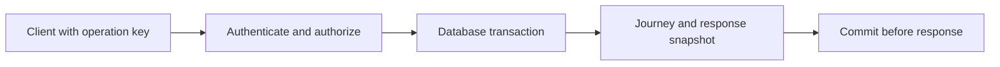

Inside the transaction, acquire the owner/key lock, inspect an existing record, and either replay it or insert both rows. If the process fails before commit, the transaction rolls back. If it fails after commit but before the client receives the response, another attempt with the same key observes the stored result. A database connection failure around commit still leaves the immediate outcome unknown to the caller; idempotency gives the caller a safe recovery operation.

<a id="lesson-1-02--e-real-world-examples"></a>

#### E. Real-world examples

For StopAround, imagine a mobile user crossing between networks while saving a planned fuel stop. The client retains the same operation key while retrying the save. The UI can say that confirmation is pending and avoid creating a fresh operation. Once the response is recovered, it uses the server's journey identifier. The server never trusts a supplied owner identifier simply because the client also sent a valid bearer token.

For an independent example, an appointment service accepts “reserve this slot.” A resource identifier and an idempotency key solve different problems. The key prevents one user's repeated intent from creating duplicate reservations; a unique constraint or conditional capacity update prevents two different users from both reserving the final slot. You need both when both invariants matter. Idempotency cannot compensate for an incorrect capacity transaction.

In either service, a list endpoint should publish its order and filtering semantics. A pleasant frontend cannot repair an API that sometimes orders by modification time and sometimes by creation time while treating the same cursor as valid. Contract tests should inspect observable behavior, including authorization and repeated operations.

<a id="lesson-1-02--f-executable-example"></a>

#### F. Executable example

The full [FastAPI application](exercises/module-01/02-api-design/api.py) is shown below. Follow [the lab guide](exercises/module-01/README.md) to initialize PostgreSQL, start it on port 8001, and call it with synthetic credentials. The integration checks exercise real PostgreSQL commits and concurrent duplicate requests; they do not mock the database.

<!-- Listing: exercises/module-01/02-api-design/api.py -->

```python
"""Local teaching API. Demo bearer tokens are supplied by the caller, not an identity provider."""
import hashlib
import hmac
import json
import re
from typing import Annotated
from uuid import UUID, uuid4

import psycopg
from psycopg.rows import dict_row
from psycopg.types.json import Jsonb
from fastapi import Depends, FastAPI, Header, HTTPException, Query
from fastapi.encoders import jsonable_encoder
from fastapi.responses import JSONResponse
from fastapi.security import HTTPAuthorizationCredentials, HTTPBearer
from pydantic import BaseModel, ConfigDict, Field, field_validator


class JourneyInput(BaseModel):
    model_config = ConfigDict(extra='forbid')
    name: str = Field(min_length=1, max_length=120)

    @field_validator('name')
    @classmethod
    def clean_name(cls, value):
        value = value.strip()
        if not value: raise ValueError('name cannot be blank')
        return value


def create_app(database_url: str, principals: dict[str, UUID], schema: str = 'public') -> FastAPI:
    if not re.fullmatch(r'[a-z][a-z0-9_]{0,62}', schema): raise ValueError('invalid schema')
    if not principals: raise ValueError('at least one demo principal is required')
    app = FastAPI(title='Module 1 journey lab')
    bearer = HTTPBearer(auto_error=False)

    def owner(credentials: Annotated[HTTPAuthorizationCredentials | None, Depends(bearer)]):
        if credentials:
            for token, user_id in principals.items():
                if hmac.compare_digest(credentials.credentials.encode(), token.encode()): return user_id
        raise HTTPException(401, 'Valid bearer credentials required', headers={'WWW-Authenticate': 'Bearer'})

    def connect():
        return psycopg.connect(database_url, row_factory=dict_row,
                               options=f'-csearch_path={schema} -cstatement_timeout=3000 -clock_timeout=1000')

    @app.exception_handler(psycopg.OperationalError)
    @app.exception_handler(psycopg.errors.QueryCanceled)
    def temporary_failure(request, error):
        return JSONResponse(status_code=503, content={'detail': 'Database temporarily unavailable; retry creation with the same operation key'}, headers={'Retry-After': '1'})

    @app.post('/v1/journeys')
    def create_journey(body: JourneyInput, user_id: Annotated[UUID, Depends(owner)],
                       operation_key: Annotated[str, Header(alias='Idempotency-Key', min_length=1, max_length=80)]):
        if not re.fullmatch(r'[A-Za-z0-9._:-]+', operation_key): raise HTTPException(422, 'Invalid operation key')
        digest = hashlib.sha256(json.dumps(body.model_dump(), sort_keys=True, separators=(',', ':')).encode()).digest()
        lock = int.from_bytes(hashlib.blake2b(f'{user_id}:create:{operation_key}'.encode(), digest_size=8).digest(), 'big', signed=True)
        with connect() as connection:
            connection.execute('SELECT pg_advisory_xact_lock(%s)', (lock,))
            previous = connection.execute('SELECT payload_hash,response_snapshot FROM create_requests WHERE owner_id=%s AND operation_key=%s', (user_id, operation_key)).fetchone()
            if previous:
                if bytes(previous['payload_hash']) != digest: raise HTTPException(409, 'Operation key was used with another payload')
                journey = previous['response_snapshot']
                status = 200
            else:
                journey_id = uuid4()
                journey = connection.execute('INSERT INTO journeys(id,owner_id,name) VALUES (%s,%s,%s) RETURNING id,name,created_at,version', (journey_id, user_id, body.name)).fetchone()
                connection.execute('INSERT INTO create_requests(owner_id,operation_key,payload_hash,journey_id,response_snapshot) VALUES (%s,%s,%s,%s,%s)', (user_id, operation_key, digest, journey_id, Jsonb(jsonable_encoder(journey))))
                status = 201
        return JSONResponse(status_code=status, content=jsonable_encoder(journey), headers={'Location': f'/v1/journeys/{journey["id"]}', 'Cache-Control': 'private, no-store'})

    @app.get('/v1/journeys/{journey_id}')
    def get_journey(journey_id: UUID, user_id: Annotated[UUID, Depends(owner)]):
        with connect() as connection:
            row = connection.execute('SELECT id,name,created_at,version FROM journeys WHERE owner_id=%s AND id=%s', (user_id, journey_id)).fetchone()
        if not row: raise HTTPException(404, 'Journey not found')
        return JSONResponse(content=jsonable_encoder(row), headers={'Cache-Control': 'private, no-store'})

    @app.get('/v1/journeys')
    def list_journeys(user_id: Annotated[UUID, Depends(owner)], after: UUID | None = None,
                      limit: Annotated[int, Query(ge=1, le=50)] = 20):
        with connect() as connection:
            rows = connection.execute('SELECT id,name,created_at,version FROM journeys WHERE owner_id=%s AND (%s::uuid IS NULL OR id>%s) ORDER BY id LIMIT %s', (user_id, after, after, limit+1)).fetchall()
        page = rows[:limit]
        return JSONResponse(content=jsonable_encoder({'items': page, 'next_after': page[-1]['id'] if len(rows)>limit else None}), headers={'Cache-Control': 'private, no-store'})

    return app


if __name__ == '__main__':
    import os
    import uvicorn
    app = create_app(os.environ['MODULE1_DATABASE_URL'], {'alice-lab-token': UUID('00000000-0000-0000-0000-000000000001'), 'bob-lab-token': UUID('00000000-0000-0000-0000-000000000002')})
    uvicorn.run(app, host='127.0.0.1', port=8001)
```

The synchronous handlers run through FastAPI's synchronous endpoint execution path, so they do not place synchronous psycopg calls inside an `async def` handler. Each request uses a short-lived connection in this small lab. A deployed high-throughput service should use a bounded connection pool with acquisition limits and measure that extra waiting boundary. Framework execution details and test patterns should be checked against the installed version. [FastAPI asynchronous tests](https://fastapi.tiangolo.com/advanced/async-tests/).

<a id="lesson-1-02--g-architectural-decisions-and-trade-offs"></a>

#### G. Architectural decisions and trade-offs

A small REST-style JSON API is enough here. GraphQL can help clients request varied graph-shaped data, while RPC can make command-oriented operations explicit; neither choice supplies transaction semantics or ownership checks automatically. Select an interface based on consumer needs and operational cost.

Durable response snapshots consume storage and create a retention responsibility. Recomputing a response is cheaper only when its contract permits changing representations. Advisory locking serializes repeated requests without a separate coordination service, but contended keys can wait and a database outage affects both the operation and its deduplication. The lab uses bounded database statement and lock waits, returning 503 for transient database failures.

UUID keyset pagination keeps the lab small. A product requiring “newest journey first” should change the public contract, query, cursor, and supporting index together. Do not silently reinterpret the UUID cursor as chronological after a deployment.

<a id="lesson-1-02--h-common-failures-and-debugging"></a>

#### H. Common failures and debugging

For duplicate creations, trace owner, operation key, canonical payload hash, and stored result identifier. A new key on every UI retry defeats deduplication. An in-memory dictionary works only within one process lifetime and cannot coordinate replicas. A record written after the transaction leaves a crash window between mutation and deduplication.

For a cross-user leak, inspect the actual SQL filter on every path, including pagination and joins. Client-side filtering is not access control. For unexplained conflicts, compare canonical accepted payloads: whitespace normalization or a newly added default can change the hash policy across versions. Plan compatibility before changing canonicalization.

For slow requests, separate lock wait, connection acquisition, execution, and response transfer. Do not retry a database integrity error as though it were a transient network failure. Preserve the operation key when a temporary failure leaves commit status uncertain.

<a id="lesson-1-02--i-practical-exercise"></a>

#### I. Practical exercise

Run the API and create a journey as Alice. Repeat the request with the same key and payload, then with the same key and a different name. Try reading Alice's journey as Bob. Create several journeys and traverse two pages with a page size of two. Record the statuses, identifiers, and cursor behavior.

Next, design a chronological version of the list contract without implementing a second pagination mode. Specify the ordering tuple, cursor fields, SQL predicate, ownership filter, and what happens when a concurrent insert lands before the current cursor. Finally, explain which additional mechanism would be required if creating a journey also published an event to a separate message broker. Compare with the [worked solution](#lesson-1-02--exercise-solution).

<a id="lesson-1-02--j-interview-and-senior-engineering-assessment"></a>

#### J. Interview and senior-engineering assessment

1. What must an API contract specify beyond the request and response types?
2. Why must an idempotency record commit with the mutation?
3. Why are an operation key and a unique reservation constraint both useful?
4. Is a valid bearer token sufficient to read an arbitrary journey identifier?
5. What guarantees does the lab's cursor provide, and what does it omit?
6. Why store a response snapshot instead of querying the journey on every replay?
7. How would you evolve a name field into structured destination data safely?

<a id="lesson-1-02--assessment-solutions"></a>

#### Assessment solutions

<a id="lesson-1-02--1-semantics-and-recovery"></a>

##### 1. Semantics and recovery

Specify principal and resource authorization, validation limits, success durability, retry behavior, error categories, ordering, freshness, and evolution rules. Those promises determine how a client handles uncertainty and how operators identify a broken invariant.

<a id="lesson-1-02--2-remove-the-crash-window"></a>

##### 2. Remove the crash window

Separate commits allow the business effect to survive without its deduplication record, or a record to survive without its effect. One transaction makes both durable together. After an acknowledgement is lost, the same key can resolve the existing result rather than repeat the mutation.

<a id="lesson-1-02--3-they-enforce-different-invariants"></a>

##### 3. They enforce different invariants

An operation key identifies repeated attempts at one intent. A uniqueness or capacity rule coordinates different legitimate intents competing for the same resource. Two users normally have different keys; deduplication alone cannot prevent both from claiming the final slot.

<a id="lesson-1-02--4-identity-does-not-imply-ownership"></a>

##### 4. Identity does not imply ownership

Verify credentials, derive the principal server-side, and include the authorization condition in the database query. The lab returns 404 for a journey not visible to that principal. Apply the same rule to list and nested-resource paths.

<a id="lesson-1-02--5-stable-order-without-snapshot-isolation-across-requests"></a>

##### 5. Stable order without snapshot isolation across requests

The UUID cursor defines a strict continuation boundary and avoids offset shifts for existing rows. It does not sort chronologically or freeze the collection. New rows behind the cursor can be absent from a traversal, so stable exports need an additional snapshot or materialization design.

<a id="lesson-1-02--6-replay-the-original-completed-result"></a>

##### 6. Replay the original completed result

Querying a mutable resource can change the apparent result of the original operation after later edits. A stored snapshot preserves the agreed replay representation. It adds retention and privacy costs and must be included in the same transaction.

<a id="lesson-1-02--7-expand-migrate-observe-then-contract"></a>

##### 7. Expand, migrate, observe, then contract

Add a compatible optional structure, preserve the original field while clients migrate, and define authoritative meanings during coexistence. Measure old-client use, test readers that handle absent or new fields, and remove the old shape only under an explicit compatibility policy. A new path version alone does not migrate anyone.

<a id="lesson-1-02--k-key-takeaways-and-navigation"></a>

#### K. Key takeaways and navigation

Design APIs around owned resources, durable outcomes, bounded inputs, and explicit recovery. Pagination and idempotency are contracts with limits, not magic flags.

Next: [1.03 — Data modeling](#lesson-1-03). Previous: [1.01 — Networking essentials](#lesson-1-01).

<a id="lesson-1-02--exercise-solution"></a>

#### API design — worked solution

Use the [lab guide](exercises/module-01/README.md) to run the server. Send `Authorization: Bearer alice-lab-token`, `Idempotency-Key: trip-001`, and `{"name":"Weekend route"}` to `POST /v1/journeys`. A first creation returns 201, a Location header, and a journey identifier. Repeating that key with the same accepted payload returns 200 and the original response snapshot. Changing the name under that key returns 409. Generate a fresh key for a genuinely different intended creation.

Bob's detail request returns 404, and his list excludes Alice's journey. The authorization condition belongs in SQL, not in a frontend array filter. Missing credentials return 401. The synthetic token map is a local teaching substitute for an identity provider and must not be deployed as real authentication.

For pagination, record each page's IDs and next cursor. A page of exactly two items can be the final page; requesting a third row internally determines whether another cursor is necessary. The actual lab sorts UUIDs in ascending order, so its list is not a newest-first feed.

A chronological contract can order `created_at DESC, id DESC` and carry both values in an opaque cursor. The next-page query retains the owner filter and uses:

```sql
SELECT id, name, created_at
FROM journeys
WHERE owner_id = $1
  AND (created_at, id) < ($2::timestamptz, $3::uuid)
ORDER BY created_at DESC, id DESC
LIMIT $4;
```

These are PostgreSQL positional parameters, not a complete psycopg invocation. Bind parameters using the driver's syntax in application code. A supporting index begins with owner and then the ordering tuple. Validate and bind the cursor to its filter/order contract; never accept a cursor as evidence of authorization.

A concurrent new journey ahead of the cursor belongs on an earlier page and can be absent from the current traversal. This is an explicitly live list. For a consistent export, use a server-managed snapshot or materialized export with a defined expiry and access policy.

Publishing directly to a broker after commit leaves a crash window. Publishing before commit can announce a journey that later rolls back. An outbox records an event beside the journey in the same database transaction; a worker publishes it with retries, and consumers deduplicate by stable event identity. Delivery and downstream side effects still need their own contracts. The API lab deliberately contains no broker or outbox implementation.

<a id="lesson-1-03"></a>

### Data modeling

Lesson 1.03 · Core concepts

<a id="lesson-1-03--a-learning-objectives-and-prerequisites"></a>

#### A. Learning objectives and prerequisites

After this lesson, you should be able to derive entities from user operations, choose keys and relationship cardinalities, place invariants in PostgreSQL constraints, and select a transaction strategy for concurrent changes. You should recognize when normalization protects correctness and when a deliberately maintained projection can improve a measured read path.

Read [API design](#lesson-1-02) first. You need basic SQL vocabulary, but not previous database administration experience. The [lab guide](exercises/module-01/README.md) runs the schema and integration checks on PostgreSQL 18. StopAround schemas and workloads below are illustrative teaching designs. They are not a claim that every production database should share this schema.

<a id="lesson-1-03--b-mental-model-and-intuition"></a>

#### B. Mental model and intuition

A data model records facts and protects relationships between them. Start with what must remain true after every accepted operation. “A stop belongs to an existing journey owned by the same person” is more useful than “we need a stops table.” It identifies two entities, an ownership boundary, and a relationship that can be checked independently of the current API implementation.

Your frontend state already has identities and relationships. A selected journey identifier refers to one saved journey; an ordered list of stops refers to positions within it. The backend adds persistence, competing writers, partial failures, and callers that do not follow your UI's conventions. A disabled button cannot protect an invariant when another client or a background job writes directly.

Separate authoritative facts from convenient views. A station's current display card can be assembled from station identity, recent observations, and a user's preferences. Those facts do not necessarily share an owner, update rate, or retention rule. Copying the assembled card into every saved journey can accidentally turn a mutable display into historical truth.

<a id="lesson-1-03--c-deep-technical-explanation"></a>

#### C. Deep technical explanation

<a id="lesson-1-03--entities-keys-and-cardinality"></a>

##### Entities, keys, and cardinality

The lab has users, journeys, ordered journey stops, and completed creation requests. A user owns many journeys. A journey has zero or more stops. One completed creation request identifies one journey, while different operation keys could legitimately create different journeys with the same display name. A name is therefore not the journey's identity.

Use a stable primary key for identity and additional unique constraints for independent business rules. UUIDs make it convenient to assign identifiers without a global sequence call, but random UUID values are not a chronology. A database sequence is also a valid choice; predictability of an identifier is not an authorization mechanism. Choose based on access patterns, storage, generation, and exposure requirements rather than treating one type as universally senior.

The stop key `(journey_id, position)` represents an ordered slot within a journey. It permits a station to appear twice at different positions, which can be reasonable for a round trip. The nonnegative position check does not require a contiguous sequence beginning at zero. If the product needs contiguity or atomic reordering, that is an additional operation-level invariant, not something the existing key quietly guarantees.

The schema stores a synthetic station UUID without a station table. This keeps the local lab focused on ownership and transactions; it does not prove that a real station exists. A complete station catalog would need its own identity and lifecycle policy. Explicitly naming the boundary is better than implying an unenforced foreign relationship.

<a id="lesson-1-03--constraints-are-executable-rules"></a>

##### Constraints are executable rules

NOT NULL, CHECK, UNIQUE, primary keys, and foreign keys express different promises. NOT NULL prevents absent required values. CHECK constrains an individual row's accepted values. UNIQUE coordinates competing inserts of the same key. A foreign key requires a referenced identity to exist. A nullable column can interact surprisingly with uniqueness; PostgreSQL normally treats nulls as distinct for a unique constraint, with an explicit alternative available. [PostgreSQL 18 constraints](https://www.postgresql.org/docs/18/ddl-constraints.html).

The journey has a global `id` primary key and a unique `(owner_id, id)` pair. The apparently redundant second key gives a composite foreign key a target. A stop carries both owner and journey identifiers and references that pair. This prevents a syntactically valid Bob-owned stop from pointing at Alice's journey, even if application code supplies the wrong pair. It also supports owner-scoped access paths, at the cost of another maintained index.

Constraints complement authorization rather than replacing it. This schema does not enable row-level security, and a database client with broad privileges can still select another user's rows. The API must derive the principal and filter operations. Database roles and optional row-level policies can provide additional protection when designed and tested explicitly.

<a id="lesson-1-03--normalization-and-controlled-duplication"></a>

##### Normalization and controlled duplication

Normalization reduces contradictory copies of the same fact. If station name and address appear in every price observation, correcting an address requires changing many rows. If only some updates succeed, the database offers multiple answers to the same question. A station table for stable identity and separate observations for changing prices avoids that update anomaly.

A useful practical test is to ask what determines each attribute. A journey's owner and display name depend on the journey identifier. A stop's position belongs to its journey relationship. A station's address depends on station identity rather than stop position. Putting facts at the wrong grain creates deletion, insertion, and update anomalies even when the JSON shape looks convenient.

Denormalization can be deliberate. A route-search projection might store a latest-price summary beside indexed station geography, refreshed from authoritative observations. Specify which source wins, how updates propagate, how readers detect age, and how the projection is rebuilt. A projection that cannot be rebuilt or reconciled has quietly become another authority.

Historical snapshots have a different purpose. A saved quote or original API response may need to preserve what the user observed at a particular moment. The lab's response snapshot is intentional duplication with operation-history semantics. It should not be used as the current journey record after later edits.

<a id="lesson-1-03--transactions-and-concurrency"></a>

##### Transactions and concurrency

A transaction groups changes into one commit or rollback boundary. In the schema check, inserting a journey followed by an invalid stop rolls back both. Outside observers should not see a successful partial result from that transaction. This does not make an email or external provider call part of the database transaction; those systems remain outside it.

Isolation describes which concurrent observations are permitted. Under PostgreSQL's default Read Committed isolation, each statement sees a snapshot appropriate to that statement; two SELECTs in one transaction can observe different committed data. A transaction alone does not turn check-then-act code into a race-free reservation. [PostgreSQL transaction isolation](https://www.postgresql.org/docs/18/transaction-iso.html).

Suppose two requests both read `remaining = 1`, then independently decide to reserve. An application-level check can approve both. Prefer an atomic conditional update such as “decrement where remaining is greater than zero,” inspect whether a row changed, and create the reservation in the same transaction. Alternatively, lock the relevant row before checking, or use serializable transactions with whole-transaction retries. The appropriate choice depends on the invariant and contention, not on a blanket rule that higher isolation is always free.

For edits, the lab demonstrates optimistic concurrency. The caller reads version 1; an update changes the name and increments the version only where the current version is still 1. One writer succeeds; a stale writer changes zero rows. The application can then present a conflict instead of silently overwriting someone else's change. Retrying the exact stale update without reconciliation defeats the point.

Locks have cost. Keep transactions short, acquire shared resources in a consistent order, and avoid waiting on a network provider while holding a row lock. Deadlocks are possible even with individually correct statements. An aborted transaction must be rolled back; retry the complete logical transaction with a bounded policy when the failure is transient and repetition is safe.

<a id="lesson-1-03--time-measurements-and-deletion"></a>

##### Time, measurements, and deletion

Store event time and ingestion time separately when delayed provider data matters. An observation received today might describe a price seen yesterday. Use timezone-aware timestamps for instants, preserve the relevant local timezone when scheduling is a domain requirement, and do not infer ordering from client clocks alone. The lab's `created_at` uses transaction time; long transactions can assign the same time to several inserted rows, which is another reason a pagination tuple needs a unique tie-breaker.

Choose units and precision explicitly. A distance can be stored as integer meters, and a displayed fuel price can use a decimal type with a declared currency and volume unit. A float does not communicate whether a value means meters, kilometers, liters, or gallons. Geographic proximity later needs appropriate spatial types, coordinate reference systems, and indexes; this lab does not install PostGIS or validate a spatial query.

Deletion is a relationship policy. Stops cascade when their parent journey is deleted, while retained creation-request records currently prevent deleting the referenced journey. That deliberate lab restriction preserves replay identity. A product supporting erasure must coordinate operation-record retention, response snapshots, child rows, analytics, and backups. Adding CASCADE everywhere can remove audit or replay state that another operation still depends on.

<a id="lesson-1-03--d-architecture-and-data-flow"></a>

#### D. Architecture and data flow

Read the arrows as references to authoritative identities, not as a network call graph.

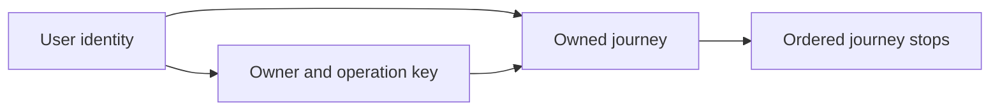

The stop and request references include owner and journey together. On creation, the API inserts the journey and completed request within one database transaction. On a stop update, it must verify the authenticated owner and maintain the ordered-set invariant. Database constraints reject structurally invalid relationships even when a writer bypasses the normal API path.

<a id="lesson-1-03--e-real-world-examples"></a>

#### E. Real-world examples

For StopAround, keep station identity distinct from a price observation. A station can change its display name, while old observations remain associated with the same identity. A latest-price projection can accelerate route search, but a user should still see the observation time and any freshness limitation. A saved journey can reference the station without claiming that its current price will remain valid when the driver arrives.

For an independent example, a team task tracker has projects, members, and tasks. Copying a member's current display name into every task is convenient for reads but creates a consistency obligation when the member changes their name. A historical “name shown when this approval happened” is a different fact with different retention semantics. The table design should reflect which meaning the product needs.

In both examples, test a concurrent invariant directly. “Two requests attempted the last slot and only one committed” is stronger evidence than two unit tests that individually validate positive input. Similarly, a database foreign-key rejection demonstrates protection against a writer that does not use the frontend.

<a id="lesson-1-03--f-executable-example"></a>

#### F. Executable example

The [schema](exercises/module-01/03-data-modeling/schema.sql) is the same one used by the API lab. Bootstrap only adds missing lab tables and synthetic users; it does not constitute a migration framework for changing existing production tables. Use a fresh local lab database and the pinned environment in [the guide](exercises/module-01/README.md).

<!-- Listing: exercises/module-01/03-data-modeling/schema.sql -->

```sql
CREATE TABLE IF NOT EXISTS users (
    id uuid PRIMARY KEY,
    email text NOT NULL UNIQUE CHECK (length(email) BETWEEN 3 AND 254)
);
CREATE TABLE IF NOT EXISTS journeys (
    id uuid PRIMARY KEY,
    owner_id uuid NOT NULL REFERENCES users(id),
    name text NOT NULL CHECK (length(btrim(name)) BETWEEN 1 AND 120),
    created_at timestamptz NOT NULL DEFAULT now(),
    version integer NOT NULL DEFAULT 1 CHECK (version > 0),
    UNIQUE (owner_id, id)
);
CREATE TABLE IF NOT EXISTS journey_stops (
    owner_id uuid NOT NULL,
    journey_id uuid NOT NULL,
    position integer NOT NULL CHECK (position >= 0),
    station_id uuid NOT NULL,
    PRIMARY KEY (journey_id, position),
    FOREIGN KEY (owner_id, journey_id) REFERENCES journeys(owner_id, id) ON DELETE CASCADE
);
CREATE TABLE IF NOT EXISTS create_requests (
    owner_id uuid NOT NULL,
    operation_key varchar(80) NOT NULL,
    payload_hash bytea NOT NULL,
    journey_id uuid NOT NULL,
    response_snapshot jsonb NOT NULL,
    PRIMARY KEY (owner_id, operation_key),
    FOREIGN KEY (owner_id, journey_id) REFERENCES journeys(owner_id, id)
);
```

The [bootstrap script](exercises/module-01/03-data-modeling/bootstrap.py) adds the synthetic lab users. The PostgreSQL tests attempt a cross-owner stop insert, force a failure after inserting a parent, and issue two updates against the same expected version. They verify actual constraint enforcement, rollback, and stale-write rejection. Each test class owns a newly generated schema and drops only that schema afterward. No production or existing user table is truncated.

<a id="lesson-1-03--g-architectural-decisions-and-trade-offs"></a>

#### G. Architectural decisions and trade-offs

Start with a normalized relational authority when joins and transactions match the invariant. JSONB can hold flexible supplementary data, but moving every relationship into a JSON document makes constraints, joins, and independent updates harder. A document model can be appropriate when the aggregate is naturally read and written together and its limits are understood.

Optimistic concurrency is attractive when edits rarely conflict and users can reconcile them. Pessimistic locking helps serialize a short, contended decision but adds waiting and deadlock risk. Serializable isolation can protect broader invariants, with a requirement to handle retryable aborts. Choose and test the particular race you need to prevent.

Denormalize after identifying an expensive read path and a maintainable update policy. An extra maintained index or projection increases write work and recovery responsibility. Record the authoritative source and rebuild procedure before accepting the optimization.

<a id="lesson-1-03--h-common-failures-and-debugging"></a>

#### H. Common failures and debugging

For contradictory data, inspect the keys that identify facts and every writer that maintains duplicate fields. A repair script that changes only one copy can make the contradiction harder to detect. For foreign-key errors, inspect the exact referenced tuple, including owner, and confirm that the parent insert committed in the same intended schema.

For lost edits, reproduce two writers using the same starting version. Inspect row counts from conditional updates instead of assuming that a syntactically successful UPDATE changed a row. For unexpected waits, inspect long-running transactions, lock holders, and transaction boundaries; do not immediately raise every timeout.

For an aborted transaction, ensure the connection is rolled back before reuse. For a deletion failure, read the referencing constraint and decide which retained fact depends on the row. Removing the constraint merely to make the delete succeed can destroy the invariant that the schema was protecting.

<a id="lesson-1-03--i-practical-exercise"></a>

#### I. Practical exercise

Draw the four lab entities with keys and cardinalities. Explain why the composite owner/journey reference exists despite the journey's global primary key. Predict the outcome of inserting a Bob-owned stop for Alice's journey, inserting a negative stop position, and reusing an occupied position.

Then design a station/price-observation extension on paper. Specify identity, event and ingestion time, currency and volume unit, uniqueness for provider observations, and a latest-price projection with a rebuild policy. Finally, describe how to reorder three stops atomically without allowing concurrent edits to overwrite each other. Run the real PostgreSQL checks and compare with the [worked solution](#lesson-1-03--exercise-solution).

<a id="lesson-1-03--j-interview-and-senior-engineering-assessment"></a>

#### J. Interview and senior-engineering assessment

1. What question should you ask before creating a table?
2. Why is a client-side ownership check insufficient?
3. What does normalization prevent, and when is duplication intentional?
4. Does wrapping check-then-act in a default transaction prevent every race?
5. How does an expected-version update prevent a lost edit?
6. What does the stop-position constraint fail to guarantee?
7. Why can a journey deletion fail even though stops use cascading deletion?

<a id="lesson-1-03--assessment-solutions"></a>

#### Assessment solutions

<a id="lesson-1-03--1-identify-the-fact-and-invariant"></a>

##### 1. Identify the fact and invariant

Ask what one row represents, what identifies it, which attributes depend on that identity, and what must remain true across accepted operations. Those answers determine keys, cardinality, constraints, and transaction scope more reliably than copying a current screen's JSON shape.

<a id="lesson-1-03--2-writers-and-clients-are-independent"></a>

##### 2. Writers and clients are independent

An attacker or another legitimate client can bypass UI checks, while background jobs may have separate code paths. Derive identity server-side and enforce ownership in every operation. The composite foreign key additionally rejects a structurally cross-owner relationship at the database boundary.

<a id="lesson-1-03--3-avoid-conflicting-copies-of-a-fact"></a>

##### 3. Avoid conflicting copies of a fact

Normalization reduces update, insertion, and deletion anomalies. A maintained read projection or a historical snapshot can deliberately duplicate values, but must have explicit authority, update or immutability rules, retention, and recovery semantics. Convenience alone does not define those rules.

<a id="lesson-1-03--4-isolation-and-statement-structure-matter"></a>

##### 4. Isolation and statement structure matter

At Read Committed, separate reads can both observe the same available capacity before either update. Use a conditional update, suitable row lock, uniqueness rule, or stronger isolation with retry handling. The transaction groups effects but does not automatically express the business invariant.

<a id="lesson-1-03--5-make-the-precondition-part-of-the-write"></a>

##### 5. Make the precondition part of the write

The update predicate includes the previously observed version, and success increments it. A competing earlier update changes the version, causing the stale write to affect zero rows. The caller must treat that result as a conflict and reconcile rather than ignoring it.

<a id="lesson-1-03--6-it-protects-slots-not-an-entire-ordered-list-policy"></a>

##### 6. It protects slots, not an entire ordered-list policy

The primary key prevents two stops from occupying one journey position, and CHECK rejects negative positions. Gaps, a nonzero first position, repeated stations, and concurrent reorder intent require additional decisions. Do not claim those properties from constraints that do not encode them.

<a id="lesson-1-03--7-different-relationships-have-different-lifecycle-rules"></a>

##### 7. Different relationships have different lifecycle rules

Retained creation requests reference the journey without cascading deletion. Their replay contract currently depends on that identity. A deletion workflow must deliberately reconcile request retention and snapshots; cascading stops addresses only one relationship.

<a id="lesson-1-03--k-key-takeaways-and-navigation"></a>

#### K. Key takeaways and navigation

Model authoritative facts, encode structural invariants, and test the concurrent operation that could break them. Transactions are a boundary whose isolation and external effects still need reasoning.

Next: [1.04 — Caching](#lesson-1-04). Previous: [1.02 — API design](#lesson-1-02).

<a id="lesson-1-03--exercise-solution"></a>

#### Data modeling — worked solution

User to journey is one-to-many. Journey to stop is one-to-many. A completed create request has an owner/key primary key and references exactly one journey. Multiple different creation requests may create journeys with the same name. The composite foreign keys prevent owner and journey from disagreeing; they do not implement read authorization or database row-level security.

A Bob-owned stop for Alice's journey fails the composite foreign key. A negative position fails CHECK. A second stop at the same journey/position fails the primary key. Positions 0 and 2 without position 1 are permitted, as are repeated station identifiers at distinct positions. Station existence is not checked by this intentionally limited schema.

A station extension can use a stable station identifier with provider identities in a separate mapping table. Store price observations with station, provider, stable provider-observation identifier, decimal amount, currency, volume unit, observed-at, and ingested-at. A unique provider/observation pair deduplicates repeated deliveries. If the provider lacks stable identifiers, define a documented approximation and its collision and correction behavior rather than assuming timestamps are unique.

The latest-price projection chooses a deterministic winning observation for a station and fuel type under a freshness policy. It can retain observation ID and observed-at, allowing readers to expose age. Rebuild it from authoritative observations and periodically compare it with source history. Late arrival must not blindly replace a newer event just because it was ingested later.

For atomic reordering, lock the journey row, verify the expected journey version and authenticated owner, then replace its small stop set inside the same transaction and increment the journey version. Deleting and reinserting the set avoids transient primary-key collisions from swapping positions. Validate the full proposed set before changing it. Other stop writers must follow the same parent-lock/version protocol; the database does not infer that convention from the foreign key.

For a larger ordered set, alternative rank schemes or a deferrable uniqueness design can reduce rewrite work, but add their own ordering and concurrency rules. Begin with the short, bounded transaction when the product has a modest number of stops.

Run the checks from [the lab guide](exercises/module-01/README.md). They create unique temporary schemas, use real PostgreSQL transactions, and remove only the schemas they created. A passing schema test does not establish an unimplemented station catalog, migration strategy, or spatial index.

<a id="lesson-1-04"></a>

### Caching

Lesson 1.04 · Core concepts

<a id="lesson-1-04--a-learning-objectives-and-prerequisites"></a>

#### A. Learning objectives and prerequisites

You should be able to choose a cache location from an access pattern, define the key and freshness contract, analyze invalidation races, and protect the origin during a cache outage or synchronized expiry. You should also distinguish a cached representation from an authoritative record and a cache hit from an authorized response.

Read [networking](#lesson-1-01), [API design](#lesson-1-02), and [data modeling](#lesson-1-03). The executable example uses Python asyncio, with each concurrency mechanism explained here. It needs no Redis service. All cache sizes, TTLs, loads, and incidents below are illustrative unless identified as observed lab results.

<a id="lesson-1-04--b-mental-model-and-intuition"></a>

#### B. Mental model and intuition

A cache remembers a previously computed answer under assumptions about identity and time. Every lookup asks two questions: is this the same question, and is the remembered answer still acceptable? The key answers the first; the freshness and invalidation policy answer the second. Fast wrong answers are a correctness problem even when the hit-rate chart is excellent.

For StopAround, a station's public display name changes slowly, a provider price changes more often, and a user's saved journey is private. They should not automatically share one cache policy. A route search can combine public facts with private preferences, creating a representation whose key and sharing rules differ from either input alone.

Caching also changes failure behavior. A warm cache can protect a busy database. An empty or unreachable cache can suddenly send all traffic to that database. Design the origin admission limit and fallback behavior at the same time as the cache; otherwise, an optimization becomes a hidden capacity dependency.

<a id="lesson-1-04--c-deep-technical-explanation"></a>

#### C. Deep technical explanation

<a id="lesson-1-04--placement-follows-the-avoided-work"></a>

##### Placement follows the avoided work

A browser cache avoids some downloads for one user. A CDN can avoid long-distance origin requests for shareable content. An API-process cache avoids repeated local computation or provider calls within one process. A shared cache can coordinate reusable answers across API replicas but introduces network access and another operated service. A database buffer cache has different semantics again: it accelerates access to database pages without replacing SQL transaction rules.

Choose placement by asking which expensive work is repeated and who can safely share the result. A local cache may be sufficient for a small instance count and modest repeated lookups. Ten local caches can each perform the same miss, which matters when a provider quota is tight. A shared cache reduces duplicate storage and misses across processes, at the cost of another failure boundary.

Avoid treating every frontend framework cache as one mechanism. Browser HTTP caching, an application query cache, server rendering caches, and backend result caches can have different keys and invalidation triggers. Trace a stale value through the actual layers rather than repeatedly clearing whichever cache is easiest to reach.

<a id="lesson-1-04--keys-encode-the-question"></a>

##### Keys encode the question

A key might include a representation version, station identifier, fuel type, currency, locale, and relevant authorization scope. A route-search key also needs the routing assumptions that affect results, such as vehicle constraints and route geometry normalization. Omitting units or filters merges different questions. Including a random request identifier prevents reuse. Including an unbounded raw URL can create uncontrolled cardinality and expose sensitive data in diagnostics.

Do not use a bearer token itself as a cache key. Derive a stable permitted scope after authentication, and enforce current authorization before returning private data. An old cached ownership result can outlive a permission change. Whether that delay is acceptable is a security and product decision, not merely a performance setting.

Normalize inputs deliberately. Sorting unordered filter sets can improve reuse; sorting an ordered route's stops changes its meaning. Version the representation when interpretation changes, and retire old keys under a capacity policy. A version prefix prevents accidental mixing but does not automatically reclaim old entries.

<a id="lesson-1-04--freshness-expiry-and-eviction"></a>

##### Freshness, expiry, and eviction

TTL defines when an entry is considered expired under a policy. Eviction removes entries to satisfy capacity, often approximating least-recently-used or another workload-aware strategy. A key can be evicted before its TTL, and an expired key can remain physically allocated until accessed or reclaimed. Measure memory and useful hit rate rather than assuming expiry alone bounds storage.

A 30-second TTL does not universally mean data is at most 30 seconds behind the authority. A loader may read an already-lagging replica, wait before filling the cache, or accept stale provider data. Stale-while-revalidate can extend the serving window further. Track source observation or version time separately from cache insertion time and define which age the UI displays.

HTTP caching has its own vocabulary. `private` restricts shared-cache reuse, `no-store` asks caches not to store the response, and `no-cache` permits storage but requires validation before reuse. Validators such as ETags can avoid transferring an unchanged representation. `Vary` identifies request-header dimensions that affect selection; it is not a general authorization mechanism. The exact rules belong to the HTTP caching specification. [RFC 9111](https://www.rfc-editor.org/rfc/rfc9111.html).

<a id="lesson-1-04--cache-aside-and-invalidation-races"></a>

##### Cache-aside and invalidation races

In cache-aside, the application checks the cache, reads the authority on a miss, and fills the cache. Writes normally commit at the authority before invalidating or updating the cached representation. Writing the cache first can expose a value whose database transaction later rolls back.

Even commit-then-delete has a race. Reader R misses and reads version 1. Writer W commits version 2 and deletes the cache key. R then fills the key with version 1. The cache now contains stale data after the invalidation completed. A TTL limits that fill's residence under the assumed loader policy, but does not make the race disappear.

Possible responses include accepting a bounded stale window, using version-aware cache writes, writing a versioned immutable key and advancing an authoritative pointer, or coordinating the relevant read/write path. An invalidation event stream needs ordering, duplicate handling, and recovery after missed events. A delayed second deletion can reduce one race window but is not a proof of correctness under arbitrary delays.

Keep correctness-critical decisions at the authority. A cached “one appointment remains” can support a display, but the reservation must still atomically check availability. The cache should not become the final authority merely because it is faster.

<a id="lesson-1-04--stampedes-and-admission-control"></a>

##### Stampedes and admission control

A stampede occurs when many callers miss together and all load the same expensive value. Singleflight coalesces simultaneous loads for a key. TTL jitter spreads expiry across different keys. Proactive refresh can reduce cold misses for popular values. These solve related but different patterns: jitter does not prevent twenty simultaneous requests for one uncached key, and singleflight does not limit loads for twenty thousand distinct keys.

The lab bounds retained entries, value size, and the number of distinct active origin loads. A duplicate miss may join an existing load even when the distinct-load limit is full. A new key is rejected promptly rather than placed in an unbounded internal queue. Incoming request population and the number of waiters on one key still require admission limits outside this component.

The waiting caller and shared load have separate lifetimes. If one disconnected caller cancels the shared task, other callers can fail unnecessarily. The lab shields the shared task from individual waiter cancellation and places a timeout on the cooperative asynchronous loader. Shutdown explicitly cancels and joins outstanding loads. CPU-bound code that blocks the event loop cannot be preempted by an asyncio timeout.

<a id="lesson-1-04--failure-and-observability"></a>

##### Failure and observability

Decide whether cache errors fail open to a bounded origin path, serve an explicitly stale value, or fail closed. There is no universal safe fallback. A public station label can tolerate a different policy from revoked access or a capacity reservation. Negative caching of “not found” can reduce repeated expensive misses, but use short, scoped rules so a newly created resource or permission change is not hidden too long.

Measure hit/miss/error rates by useful low-cardinality categories, origin load, entry age, evictions, coalesced waiters, rejected loads, and memory. A high overall hit rate can conceal a small but expensive miss population. Avoid logging full private keys or labeling metrics with every user or route.

<a id="lesson-1-04--d-architecture-and-data-flow"></a>

#### D. Architecture and data flow

The cache is a reusable read path; database commits remain authoritative.

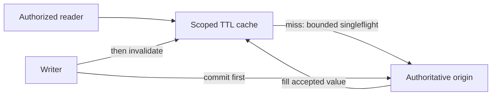

The writer arrows show a cache-aside design to reason about; the minimal executable cache implements TTL loading only and exposes no write-invalidation API. This distinction matters: its tests demonstrate coalescing, expiry, and resource limits, not a distributed invalidation protocol. A multi-process deployment needs a deliberate cross-process policy.

<a id="lesson-1-04--e-real-world-examples"></a>

#### E. Real-world examples

For an illustrative StopAround search, cache a public provider response by station, fuel type, and representation version. Retain the provider observation time and expose age. If the provider is unavailable, a bounded stale fallback can be useful if the user sees that limitation. Do not label a stale observation “live” merely because the cache was accessed recently.

For a private journey page, either avoid shared caching or scope the representation and recheck authorization under a documented permission-change policy. A shared cache key such as `journey:123` is unsafe if the lookup returns a private representation without checking who may see it. The API lab conservatively sends `private, no-store` rather than adding an unnecessary private-result cache.

For a separate example, a documentation service caches rendered public articles. An immutable key containing article revision makes historical rendering easy to reuse. The mutable “current revision” pointer has a smaller but still real freshness problem. This separation often makes invalidation reasoning clearer than overwriting one large mutable value.

<a id="lesson-1-04--f-executable-example"></a>

#### F. Executable example

The full [TTL cache](exercises/module-01/04-caching/ttl_cache.py) is a single-event-loop component for bounded UTF-8 strings. Run its tests through [the lab guide](exercises/module-01/README.md). Tests use controlled clocks and events for expiry and coalescing; the loader-timeout check uses a small real asynchronous timeout.

<!-- Listing: exercises/module-01/04-caching/ttl_cache.py -->

```python
"""Bounded, single-event-loop cache. It does not coordinate separate API processes."""
import asyncio
import math
import time
from collections import OrderedDict


class CacheBusy(Exception): pass


class TTLCache:
    def __init__(self, ttl=30.0, max_entries=128, max_inflight=8, max_value_bytes=4096, load_timeout=1.0, clock=time.monotonic):
        limits=(max_entries,max_inflight,max_value_bytes)
        if not math.isfinite(ttl) or ttl <= 0 or not math.isfinite(load_timeout) or load_timeout <= 0 or any(type(n) is not int or n < 1 for n in limits):
            raise ValueError('positive finite TTL and positive limits required')
        self.ttl, self.max_entries, self.max_inflight = ttl,max_entries,max_inflight
        self.max_value_bytes,self.clock=max_value_bytes,clock
        self.load_timeout=load_timeout
        self.entries=OrderedDict()
        self.pending={}
        self.closed=False

    async def get(self, key, loader):
        if self.closed: raise RuntimeError('cache is closed')
        if not isinstance(key,str) or not 0 < len(key) <= 256: raise ValueError('key must contain 1–256 characters')
        entry=self.entries.get(key)
        if entry and entry[0] > self.clock():
            self.entries.move_to_end(key)
            return entry[1]
        self.entries.pop(key,None)
        task=self.pending.get(key)
        if task is None:
            if len(self.pending) >= self.max_inflight: raise CacheBusy('too many distinct origin loads')
            async def fill():
                try:
                    value=await asyncio.wait_for(loader(),timeout=self.load_timeout)
                    if not isinstance(value,str) or len(value.encode()) > self.max_value_bytes:
                        raise ValueError('loader must return a bounded UTF-8 string')
                    self.entries[key]=(self.clock()+self.ttl,value)
                    self.entries.move_to_end(key)
                    while len(self.entries)>self.max_entries: self.entries.popitem(last=False)
                    return value
                finally:
                    self.pending.pop(key,None)
            task=asyncio.create_task(fill())
            # Retrieve errors even if every waiting caller has disconnected.
            task.add_done_callback(lambda done: done.exception() if not done.cancelled() else None)
            self.pending[key]=task
        return await asyncio.shield(task)

    async def close(self):
        self.closed=True
        tasks=list(self.pending.values())
        for task in tasks: task.cancel()
        await asyncio.gather(*tasks,return_exceptions=True)
        self.pending.clear()
        self.entries.clear()
```

Call `await cache.get(key, loader)` with an asynchronous, bounded origin loader and `await cache.close()` during shutdown. The default values are teaching configuration, not a sizing recommendation. Retained entries are bounded by count and accepted value bytes; upstream response streaming must impose its own body-size bound before a loader allocates a large value.

<a id="lesson-1-04--g-architectural-decisions-and-trade-offs"></a>

#### G. Architectural decisions and trade-offs

Choose TTL-only caching when a clearly stated stale window is acceptable and the simpler system meets the load target. Add invalidation or shared coordination when a measured requirement needs it. Every new consistency mechanism should have a missed-event or restart recovery story.

A cache cluster can improve reuse across API replicas but does not eliminate origin admission control. If it becomes unreachable, falling through all misses to the database can exceed database capacity. Test the cold-cache and cache-outage workloads, not just the warm steady state.

Coalescing makes one origin result serve several callers, so choose keys and failure propagation carefully. A failed shared load should not poison the cache indefinitely. Individual caller deadlines should not cancel work that other admitted callers still need, while the shared load itself still needs a finite useful lifetime.

<a id="lesson-1-04--h-common-failures-and-debugging"></a>

#### H. Common failures and debugging

For stale values, inspect source version/time, cache fill time, policy, and all cache layers. Reproduce the stale-fill race instead of assuming a successful delete proves freshness. For incorrect cross-user results, audit key dimensions and the authorization check before considering a TTL adjustment.

For a provider traffic spike at regular intervals, inspect synchronized expiry and whether singleflight is local or shared. For a memory increase despite a short TTL, inspect eviction behavior, value size, cardinality, and references held by pending tasks. Expiration is not necessarily immediate memory reclamation.

For cascading failure during an outage, measure distinct misses, fallback concurrency, and rejection behavior. Raising origin concurrency until errors disappear in a quiet test can make a real outage worse. Restore a bounded service path and choose an honest degraded response.

<a id="lesson-1-04--i-practical-exercise"></a>

#### I. Practical exercise

Predict and then test twenty concurrent requests for one missing key, one hundred different missing keys with an active-load limit of eight, and cancellation of one waiter while another still needs the shared value. Distinguish cached-entry capacity, distinct origin loads, and incoming waiter count.

Draw the version-1 reader/version-2 writer invalidation race. Choose a policy for public station prices and another for private journey permissions. For each, state the acceptable stale behavior, key scope, failure fallback, and one observation that would reveal a violated assumption. Compare with the [worked solution](#lesson-1-04--exercise-solution).

<a id="lesson-1-04--j-interview-and-senior-engineering-assessment"></a>

#### J. Interview and senior-engineering assessment

1. What two questions does a cache lookup need to answer?
2. Why does a 30-second TTL not prove a 30-second maximum source age?
3. How can stale data appear after a successful cache deletion?
4. What do singleflight and TTL jitter each solve?
5. Why shield a shared load from one caller's cancellation?
6. Is failing open to the database always safe?
7. What must a private cache key and lookup protect?

<a id="lesson-1-04--assessment-solutions"></a>

#### Assessment solutions

<a id="lesson-1-04--1-identity-and-acceptable-freshness"></a>

##### 1. Identity and acceptable freshness

The key must describe the same representation request, including relevant scope, filters, units, and version. The policy must say whether the stored answer is still acceptable. A fast lookup that merges different questions is wrong even with a high hit rate.

<a id="lesson-1-04--2-source-age-and-residence-time-differ"></a>

##### 2. Source age and residence time differ

The origin can already be stale, a delayed reader can fill an old value, and stale-serving extensions can exceed the nominal TTL. Record source observation/version separately from insertion and define freshness at the boundary the user actually cares about.

<a id="lesson-1-04--3-a-delayed-fill-can-follow-invalidation"></a>

##### 3. A delayed fill can follow invalidation

A reader fetches version 1, a writer commits version 2 and deletes the key, then the reader inserts version 1. Accept the bounded stale window explicitly or introduce a version-aware coordination design. A successful deletion alone does not order every concurrent reader.

<a id="lesson-1-04--4-same-key-concurrency-versus-many-key-expiry"></a>

##### 4. Same-key concurrency versus many-key expiry

Singleflight shares one active load for a key. Jitter spreads expiry across different keys. Neither replaces distinct-load admission, origin capacity limits, or cross-process coordination when local caches independently miss.

<a id="lesson-1-04--5-shared-work-has-several-beneficiaries"></a>

##### 5. Shared work has several beneficiaries

One caller disconnecting should not cancel the value another caller is awaiting. Shielding separates those lifetimes, while a shared timeout and explicit shutdown still bound the work. It does not remove the need to limit the number of admitted waiters.

<a id="lesson-1-04--6-fallback-can-overload-the-authority"></a>

##### 6. Fallback can overload the authority

An unavailable cache can turn nearly all requests into misses. The database may be sized for a much smaller miss population. Bound fallback load, choose a stale or partial response where valid, and reject work when there is no safe capacity.

<a id="lesson-1-04--7-representation-isolation-and-current-permissions"></a>

##### 7. Representation isolation and current permissions

Include the appropriate user or tenant scope and validate resource access. Do not use a bearer token as the key or assume a cached value authorizes itself. Permission changes need an explicit invalidation or allowed-staleness policy.

<a id="lesson-1-04--k-key-takeaways-and-navigation"></a>

#### K. Key takeaways and navigation

Cache a well-defined answer under a freshness contract, bound both storage and origin work, and keep correctness at the authority. Test the cold and failing paths as carefully as a warm hit.

Next: [1.05 — Sharding](#lesson-1-05). Previous: [1.03 — Data modeling](#lesson-1-03).

<a id="lesson-1-04--exercise-solution"></a>

#### Caching — worked solution

Twenty overlapping misses for one key should invoke one origin loader and share its result in this process. The tests hold that loader behind an event, admit callers, and then release it. Canceling one waiter should leave the shared load available to another; shutdown intentionally cancels shared work.

One hundred distinct keys are a different workload. With eight active distinct loads held open, new distinct misses receive CacheBusy. Existing-key waiters can join admitted work. This component does not cap the total number of incoming requests or waiters; the hosting API needs its own admission and deadline limits. Timeouts prevent a cooperative asynchronous loader from occupying a slot indefinitely.

The invalidation race is:

```text
R: miss -> read version 1 -----------------> fill version 1
W:               commit version 2 -> delete key
```

The final cache can contain version 1. Commit-then-delete is a sensible baseline, not a universal freshness proof. For a public price display, choose a bounded stale policy and show provider observation time. A 30-second cache residence limit alone does not bound provider source age. During provider failure, permit only a separately defined stale window and limit origin refresh work.

For permissions, a stale “allowed” decision can leak private data after revocation. Prefer a fresh authorization check or an explicitly designed revocation/invalidation mechanism. A user-scoped result key prevents accidental cross-user reuse but does not by itself revoke a previously valid user.

Monitor source age and representation version, useful hit rate, distinct active loads, rejected loads, pending waiters at the API, evictions, and memory. The tested cache holds UTF-8 strings with a configured byte limit and bounds entry count; its loader must still bound upstream bodies before allocation. It does not implement Redis locks or distributed invalidation.

<a id="lesson-1-05"></a>

### Sharding

Lesson 1.05 · Core concepts

<a id="lesson-1-05--a-learning-objectives-and-prerequisites"></a>

#### A. Learning objectives and prerequisites

You should be able to distinguish sharding from replication and local table partitioning, evaluate a partition key against reads and invariants, identify hot shards, and describe a migration that does not allow stale routers to keep writing to the old owner. You should also be able to explain when one PostgreSQL instance remains the better design.

Read [data modeling](#lesson-1-03) and [caching](#lesson-1-04). The exercise uses an in-memory sequential model, not a cluster or a live migration tool. All shard counts, tenant sizes, traffic rates, and migration scenarios are illustrative. The aim is to learn ownership and failure reasoning before operating a distributed database.

<a id="lesson-1-05--b-mental-model-and-intuition"></a>

#### B. Mental model and intuition

Sharding assigns different authoritative subsets of data to different storage owners. Replication stores additional copies of the same subset. A cache remembers a reusable answer; it does not become a shard merely because it contains only some keys. These mechanisms can coexist, but they solve different problems.

Imagine splitting a large shared filing room between several buildings. Every new document needs a stable rule for finding its authoritative building. A visitor carrying an old directory must not be allowed to keep changing the previous copy after a folder moves. The hard work is not drawing several database boxes; it is preserving ownership, routing, and invariants while data and traffic move.

For StopAround, private journeys naturally group by owner, while station search groups by geography and route corridor. One partition key is unlikely to optimize both. Separate the access patterns before deciding whether they belong in one sharded model, independent projections, or still one well-indexed database.

<a id="lesson-1-05--c-deep-technical-explanation"></a>

#### C. Deep technical explanation

<a id="lesson-1-05--start-with-evidence-for-the-split"></a>

##### Start with evidence for the split

A large table does not automatically require sharding. Measure query plans, working-set size, write throughput, lock contention, storage growth, maintenance windows, and failover requirements. Missing indexes, long transactions, oversized responses, and inefficient joins can create symptoms that more databases merely reproduce. Vertical capacity, better queries, local partitioning, and read replicas may satisfy the requirement at much lower operational cost.

Local PostgreSQL table partitioning divides a logical table into physical partitions managed by one database system, enabling pruning and lifecycle operations under its rules. It does not by itself distribute authoritative writes across independent PostgreSQL servers. Unique and primary-key constraints on a partitioned table also have partition-key requirements that affect schema design. [PostgreSQL 18 partitioning](https://www.postgresql.org/docs/18/ddl-partitioning.html).

Sharding becomes attractive when a measured resource or isolation boundary needs multiple authoritative owners and the application's access patterns can tolerate that split. Record the target bottleneck and an acceptance metric. “Support more users” is too vague to establish whether a migration paid for its new failure modes.

<a id="lesson-1-05--partition-key-choices"></a>

##### Partition-key choices

Hashing a tenant or user identifier spreads many independent owners across shards and preserves locality for their data. A tenant's journey list, stops, and idempotency records can share a transaction boundary if they live on one shard. A cross-tenant report now needs fan-out, a separate analytical store, or a maintained global projection.

Range partitioning supports ordered access and targeted movement, but growing keys can concentrate writes on the newest range. Geographic partitioning helps nearby searches, yet dense cities and cross-boundary routes can produce skew and fan-out. Time-based partitions simplify retention for observations, but the newest period can receive nearly all writes. The useful question is which workload becomes local and which becomes distributed.

Do not shard by a mutable display attribute unless its movement protocol is part of the design. A user's country or a station's provider mapping can change. Stable identity generally makes a better routing basis; separate mutable access projections when needed. A deterministic key should be available before a request performs a global lookup, or that lookup becomes another critical dependency.

<a id="lesson-1-05--skew-is-about-work-not-just-row-count"></a>

##### Skew is about work, not just row count

A shard with one unusually active tenant can be overloaded while peers are idle. Equal key counts do not imply equal bytes, write rates, CPU, or lock contention. A popular station identifier may be one hot key that no ownership hash can split by itself. Cache reads, isolate a large tenant, partition a suitable sub-aggregate, or redesign the operation according to the actual bottleneck.

Choose and observe per-shard metrics: request rate, service time, queue age, CPU, I/O, storage, replication lag, and tenant contribution under a privacy-aware diagnostics policy. A fleet-wide average can hide a failing shard. Capacity planning should account for the busiest surviving shard after failure or movement, not only the average before either event.

<a id="lesson-1-05--routing-and-virtual-buckets"></a>

##### Routing and virtual buckets

Directly computing `hash(key) modulo server_count` is simple, but changing server count remaps many keys. An indirection layer can map stable logical buckets to physical shard owners. The hash chooses a bucket; a versioned directory chooses its current owner. Moving one bucket changes the directory entry without changing the hash function for unrelated data.

The directory is part of correctness. Routers can cache it for speed, but storage must reject stale ownership epochs or the migration must safely drain and prevent old writers. Checking a route only in an application process is insufficient: a writer can pass that check, pause, and resume after cutover. The authority check and accepted write need an atomic or equivalently fenced boundary at the actual storage owner.

The lab models this boundary as one sequential `check` followed immediately by an in-memory assignment with no concurrent execution. Its directory is authoritative and all writes fail closed if that directory is unavailable. This is useful for histories, but is not a protocol for safely consulting a remote directory and then writing an independent database under arbitrary delays.

<a id="lesson-1-05--moving-a-bucket-safely"></a>

##### Moving a bucket safely

A simple migration can trade availability for an easier proof. Freeze writes for the bucket, drain accepted in-flight writes, copy a consistent source state, verify the copy, publish the new owner with a higher epoch, and reject writes under the old epoch. Reopen traffic only after the new ownership state is established. Reads need a policy too: pause them or serve an explicitly valid snapshot rather than accidentally mixing states.

The sequential lab freezes both reads and writes for that bucket, copies its current dictionary, advances ownership, and fences old routes. Other buckets remain unchanged. An abort before cutover reopens the source. The model retains old copies but does not route to them. Real implementation requires durable migration state, data verification, crash recovery, and enforcement across every writer.

For less downtime, systems can snapshot while copying, capture subsequent changes, reconcile them, and perform a shorter fenced cutover. Deletes, ordering, duplicate events, and writer progress all matter. Naive dual writing to two independent databases creates partial-success states: source-only, destination-only, or conflicting order. Calling it “dual write” does not specify which copy wins after a crash.

Migration throughput competes with application traffic. Rate-limit copy work, track remaining data and change backlog, reserve destination capacity, and establish abort criteria. If catch-up receives changes faster than it can apply them, a low-downtime migration may never reach cutover. A small freeze can be safer than an elaborate mechanism the team cannot verify.

<a id="lesson-1-05--cross-shard-invariants-and-operations"></a>

##### Cross-shard invariants and operations

A foreign key inside one PostgreSQL database cannot directly enforce a relationship in another independent database. Co-locate aggregates whose invariants require local transactions where possible. Global uniqueness may need a coordinator, a carefully scoped namespace, or a different product rule. Cross-shard transfers can require distributed transactions or an explicitly compensating workflow, with user-visible intermediate states.

Operational tasks also distribute. Backups must support an understandable restore point across related shards. Schema changes must coexist with mixed versions during rollout. Global queries require partial-failure and pagination policies. A router bug can send traffic to the wrong owner even when every database is healthy. Include these costs in the decision, not as a footnote after choosing the partition key.

<a id="lesson-1-05--d-architecture-and-data-flow"></a>

#### D. Architecture and data flow

The movement protocol below favors a short, explicit pause over concurrent writes during copying.

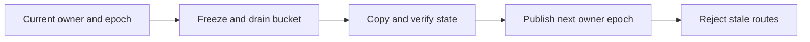

Each transition must be recoverable in a real implementation. The lab keeps these states only in memory; restarting the Python object loses them. Its tests establish the sequencing rule and stale-route rejection within one process. They do not establish online migration, crash durability, quorum membership, or a distributed fence implementation.

<a id="lesson-1-05--e-real-world-examples"></a>

#### E. Real-world examples

For an illustrative future StopAround scale, user-owned journeys might be assigned by owner identifier, keeping a user's stops and creation records together. Public station search could use a geographic read projection with a different partitioning policy. A route crossing two geographic cells would need a merged result and deduplication, even though saving the private journey remains one owner-local transaction.

For a separate example, a business-to-business task service shards by organization. Most reads and writes stay local, but one very large organization dominates a shard. Adding random organizations to new shards does not relieve that tenant's write contention. The service might isolate it, split an independent project aggregate, or change the contended operation. The solution follows the hotspot's unit of work.

These are proposed designs, not documented architectures of named companies. Before adopting either, compare the measured bottleneck with the simpler single-database alternatives and estimate the team's ability to operate migration, restore, and routing failures.

<a id="lesson-1-05--f-executable-example"></a>

#### F. Executable example

The full [shard model](exercises/module-01/05-sharding/shard_model.py) uses sixteen stable buckets and a versioned owner per bucket. Run its tests through [the lab guide](exercises/module-01/README.md). The code makes the freeze, copy, cutover, and abort steps explicit so you can inspect intermediate states.

<!-- Listing: exercises/module-01/05-sharding/shard_model.py -->

```python
"""Sequential freeze/copy/fence model, not a live database migration tool."""
import hashlib
from dataclasses import dataclass


class Unavailable(Exception): pass
class StaleRoute(Exception): pass


@dataclass(frozen=True)
class Route:
    bucket: int
    shard: str
    epoch: int


class ShardedStore:
    def __init__(self, buckets=16):
        if not isinstance(buckets,int) or buckets < 1: raise ValueError('positive bucket count required')
        self.buckets=buckets
        self.owners={i:Route(i,'A' if i%2==0 else 'B',1) for i in range(buckets)}
        self.data={'A':{},'B':{},'C':{}}
        self.frozen=set(); self.prepared={}; self.directory_available=True

    def bucket(self,key): return int.from_bytes(hashlib.sha256(key.encode()).digest()[:8],'big')%self.buckets

    def route(self,key):
        if not self.directory_available: raise Unavailable('authoritative directory unreachable')
        return self.owners[self.bucket(key)]

    def check(self,key,route):
        current=self.route(key)
        if route != current: raise StaleRoute('refresh ownership and retry safely')
        if current.bucket in self.frozen: raise Unavailable('bucket migration is frozen')

    def write(self,key,value,route):
        self.check(key,route); self.data[route.shard][key]=value

    def read(self,key,route):
        self.check(key,route); return self.data[route.shard].get(key)

    def freeze(self,bucket):
        if not self.directory_available: raise Unavailable('directory unreachable')
        if bucket not in self.owners or bucket in self.frozen: raise ValueError('invalid or already frozen bucket')
        self.frozen.add(bucket)

    def copy(self,bucket,target):
        if bucket not in self.frozen or target not in self.data or target==self.owners[bucket].shard:
            raise ValueError('freeze a bucket and choose another existing shard')
        source=self.owners[bucket].shard
        snapshot={k:v for k,v in self.data[source].items() if self.bucket(k)==bucket}
        for key in list(self.data[target]):
            if self.bucket(key)==bucket: del self.data[target][key]
        self.data[target].update(snapshot)
        self.prepared[bucket]=target

    def cutover(self,bucket):
        if not self.directory_available: raise Unavailable('directory unreachable')
        if bucket not in self.frozen or bucket not in self.prepared: raise ValueError('copy before cutover')
        old=self.owners[bucket]
        self.owners[bucket]=Route(bucket,self.prepared.pop(bucket),old.epoch+1)
        self.frozen.remove(bucket)

    def abort(self,bucket):
        if not self.directory_available: raise Unavailable('directory unreachable')
        self.prepared.pop(bucket,None); self.frozen.discard(bucket)
```

Every operation is sequential in this model. Do not wrap `check` and a remote SQL write around network awaits and claim the same guarantee. A real fence has to stop a writer whose route became stale after it began executing. Old physical copies are deliberately retained for inspection; cleanup is a separate operational action after ownership and recovery policy are settled.

<a id="lesson-1-05--g-architectural-decisions-and-trade-offs"></a>

#### G. Architectural decisions and trade-offs

Choose a partition key by transaction locality, query fan-out, skew, and movement cost. A perfectly even hash can be worse than a somewhat uneven tenant layout if every business operation becomes cross-shard. Conversely, one huge tenant can exceed a shard even when every other tenant is local.

Stable virtual buckets make incremental movement explicit, but add directory consistency and routing complexity. Consistent hashing, covered next, offers another placement mechanism; it still requires safe ownership transfer and routing agreement. Neither mapping strategy copies data or implements failure recovery by itself.

A freeze-and-copy migration sacrifices availability for a simpler correctness argument. Change capture and catch-up reduce pause time while adding ordering, durability, and reconciliation responsibilities. State the maximum acceptable pause and recovery behavior before selecting the more complex path.

<a id="lesson-1-05--h-common-failures-and-debugging"></a>

#### H. Common failures and debugging

For an overloaded shard, compare bytes and work rates by shard and by aggregate. Uniform row counts can conceal a hot tenant or large objects. For missing rows after movement, inspect routing epoch, copy completeness, deleted records, and whether reads accidentally reach an old owner.

For divergent copies, inspect every writer and migration transition. A stale router accepted by the old database is a fencing failure, not merely a cache-refresh delay. For an endless catch-up phase, compare change arrival with apply throughput and reserve capacity before trying another cutover.

For directory failure, observe whether the system fails closed or silently accepts ownership guesses. The correct degraded behavior depends on the protocol; the lab deliberately rejects operations. Exercise restore and rollback plans as well as the successful migration path.

<a id="lesson-1-05--i-practical-exercise"></a>

#### I. Practical exercise

Write values under several tenant keys, retain one old route, and migrate that route's bucket to shard C. Before copying, attempt a write while frozen. After cutover, attempt a write with the retained route, then refresh routing and verify the value. Confirm that unrelated buckets keep their owners.

Design the same migration for real PostgreSQL shards on paper. State where in-flight writers drain, where an epoch is enforced atomically with the write, what is durable before each transition, and how a crash after copy but before cutover is recovered. Explain why a router-only check is insufficient. Compare with the [worked solution](#lesson-1-05--exercise-solution).

<a id="lesson-1-05--j-interview-and-senior-engineering-assessment"></a>

#### J. Interview and senior-engineering assessment

1. How do sharding, replication, and local partitioning differ?
2. What makes an owner identifier a useful or problematic partition key?
3. Why can equal key counts still produce an overloaded shard?
4. What does a virtual-bucket directory add?
5. Why must old writers be fenced during cutover?
6. What failure states does naive dual writing create?
7. When would you postpone sharding?

<a id="lesson-1-05--assessment-solutions"></a>

#### Assessment solutions

<a id="lesson-1-05--1-ownership-copies-and-local-organization"></a>

##### 1. Ownership, copies, and local organization

Sharding assigns different authoritative subsets to different owners. Replication copies a subset for durability or reads. Local partitioning organizes one logical database table into partitions under that database's capabilities. None automatically supplies the others' guarantees.

<a id="lesson-1-05--2-local-invariants-versus-skew"></a>

##### 2. Local invariants versus skew

Owner-based placement keeps related data and transactions together, but cross-owner queries fan out and a very large owner can dominate one shard. Evaluate actual aggregate sizes and work rates, not only how uniformly identifiers hash.

<a id="lesson-1-05--3-work-is-uneven"></a>

##### 3. Work is uneven

Values differ in size, read popularity, write frequency, and contention. One hot key remains one owner even with an ideal hash. Measure the saturated resource and choose a remedy that splits or reduces that work.

<a id="lesson-1-05--4-stable-indirection"></a>

##### 4. Stable indirection

The hash selects a stable bucket and the directory selects its current physical owner. Moving a bucket avoids changing unrelated assignments. The directory becomes a versioned correctness dependency requiring agreement, cache policy, and failure handling.

<a id="lesson-1-05--5-a-stale-route-can-outlive-publication"></a>

##### 5. A stale route can outlive publication

A writer can hold an old route or pause after validating it. If the old owner still accepts its mutation, copies diverge. Drain accepted work and enforce ownership at the write boundary; publishing a new map alone cannot stop that writer.

<a id="lesson-1-05--6-partial-and-differently-ordered-success"></a>

##### 6. Partial and differently ordered success

One destination can accept while the other fails, and concurrent updates can arrive in different orders. Recovery needs authoritative ordering, deduplication, delete handling, and reconciliation. Two independent successful calls are not an atomic transaction.

<a id="lesson-1-05--7-when-simpler-capacity-meets-the-requirement"></a>

##### 7. When simpler capacity meets the requirement

Fix measured query, index, transaction, payload, and maintenance problems first. If one database with appropriate capacity and recovery meets the target, sharding's routing, movement, cross-shard invariants, and operational costs have no demonstrated benefit yet.

<a id="lesson-1-05--k-key-takeaways-and-navigation"></a>

#### K. Key takeaways and navigation

Sharding is a decision about authoritative ownership and local invariants. Placement, movement, fencing, and operations all belong in the design.

Next: [1.06 — Consistent hashing](#lesson-1-06). Previous: [1.04 — Caching](#lesson-1-04).

<a id="lesson-1-05--exercise-solution"></a>

#### Sharding — worked solution

Resolve and retain a route, write a value, then freeze its bucket. Writes and reads for that bucket raise Unavailable. Copy to C and publish cutover; the new route has the same bucket, owner C, and epoch incremented by one. The old route raises StaleRoute. Refreshing the route returns the copied value. The ownership map for every other bucket remains unchanged.

Aborting before cutover reopens the original owner. Copying alone does not change authority. Data left on a destination after an aborted copy is not authoritative, and the next copy clears stale destination keys in that bucket before installing the source snapshot. In a real system, cleanup and space limits still need explicit operation plans.

A real pause-based migration needs a durable migration identity and state machine. Fence new writes at the source, wait for previously accepted transactions to finish, copy a consistent state, verify counts and stronger content checks as appropriate, and establish destination readiness. Publish new ownership under a coordinated epoch, with the old owner unable to accept late writes. Reopen traffic under the new epoch.

The atomic enforcement location matters. A router can validate epoch 1, pause, and resume a write after epoch 2 is published. An independent remote database write will not know that the router's earlier check expired. Use a storage-enforced fence or a lock/drain protocol that prevents such a writer from committing. Merely refreshing the router map more often does not close the race.

Crash before cutover should leave a durable state that identifies the source as authority and permits a verified retry or abort. Crash after ownership publication should recover the new owner without reopening stale source writers. The in-memory model does not persist either state and is not evidence of crash-safe migration.

Directory unavailability deliberately fails closed in the model. A real design may maintain safely fenced local ownership, but that requires a specified agreement protocol. Consistent hashing changes the mapping mechanism; it does not remove these ownership transitions.

<a id="lesson-1-06"></a>

### Consistent hashing

Lesson 1.06 · Core concepts

<a id="lesson-1-06--a-learning-objectives-and-prerequisites"></a>

#### A. Learning objectives and prerequisites

You should be able to place keys on a hash ring, explain why adding a node moves only particular ranges, distinguish virtual nodes from physical replicas, and evaluate distribution using work as well as key count. You should also be able to list the coordination and migration mechanisms a hash ring does not provide.

Read [sharding](#lesson-1-05) first. Basic familiarity with a sorted list is sufficient for the implementation. The code uses a deterministic cryptographic digest for placement, not Python's process-dependent built-in string hash. All node names and workload measurements in the lab are synthetic.

<a id="lesson-1-06--b-mental-model-and-intuition"></a>

#### B. Mental model and intuition

A placement function answers “which owner should hold this key under this membership configuration?” A useful placement rule changes as little as practical when membership changes. If adding one cache node invalidates almost everyone's placement, the remaining nodes and the origin can receive a large avoidable burst of work.

Imagine numeric positions around a circular track. Each owner has markers, and each key has a position. Walk forward from the key to the first owner marker; that marker's physical node owns the key. When a new marker appears, it takes the interval immediately behind it. Other intervals keep their previous first marker.

That geometric explanation is the mechanism. It does not say that the new owner already has the data, that every router agrees about the markers, or that the old owner has stopped accepting writes. Those are the ownership and movement problems from the previous lesson. Keep placement separate from its operational use.

<a id="lesson-1-06--c-deep-technical-explanation"></a>

#### C. Deep technical explanation

<a id="lesson-1-06--why-modulo-placement-moves-broadly"></a>

##### Why modulo placement moves broadly

With a fixed membership size N, `hash(key) modulo N` maps keys to numbered owners. Changing N changes the arithmetic for many keys. Even keys assigned to surviving owners can now point to different surviving owners. That can create substantial movement when the intended change was just adding one machine.

Consistent hashing uses a stable hash space and owner positions instead. The original research developed this family of ideas for distributed caching under changing membership. Its central placement insight is limited remapping as the destination set changes. [Karger and colleagues, 1997](https://people.csail.mit.edu/karger/Papers/web.pdf).

For a small numeric illustration, place A at 20, B at 60, and C at 90 on a ring spanning 0 through 99. A key at 35 belongs to B; a key at 95 wraps around to A. Add D at 45. Keys after 20 through 45 now belong to D, while keys after 45 through 60 remain with B. At exactly an owner marker, this lesson chooses that marker as the owner, implemented with an inclusive successor lookup.

The numeric positions are illustrative, not the actual SHA-256 outputs in the code. The code uses a much larger hash space and several markers per physical node. The small example lets you verify the boundary rule without reading enormous integers.

<a id="lesson-1-06--virtual-nodes-improve-granularity"></a>

##### Virtual nodes improve granularity

One random point per physical node can produce uneven intervals. A node with a large preceding gap owns many uniformly distributed keys; another can own very few. Give each physical node multiple virtual-node tokens distributed through the ring. Each physical node then owns several smaller ranges, making movement and balance less dependent on one lucky position.

More virtual nodes improve granularity and often improve balance, but increase metadata, configuration, and lookup work. They cannot guarantee equal load for a particular finite workload. They also cannot split one hot key: every lookup for that key still chooses one owner unless an additional replication or request-distribution mechanism changes the read path.

Virtual nodes can express capacity weights by giving a larger physical node more tokens. Changing a node's token count is itself a placement change that needs a controlled rollout. If you regenerate every existing node's tokens during a membership change, you lose the limited-movement argument because old boundaries no longer remain fixed.

The lab uses a fixed number of tokens per node and deterministic token identities based on a length-prefixed UTF-8 node name plus token index. Sorting the input membership list makes configuration order irrelevant. The same names and virtual-node count reproduce the same positions across processes.

<a id="lesson-1-06--lookup-and-movement-properties"></a>

##### Lookup and movement properties

The ring stores sorted `(position, physical_node)` pairs. Hash a key, find the first position greater than or equal to its hash using binary search, and wrap to position zero if necessary. With N physical nodes and V virtual nodes each, the metadata has N times V entries and lookup is logarithmic in that entry count after computing the digest.

When a new physical node is added while old tokens remain fixed, every moved key moves to that new node. A surviving old node does not steal a range from another surviving old node during that addition. On removal, only keys previously owned by the removed node need a new primary owner. The tests check these structural properties rather than asserting one exact movement percentage.

Under symmetric, well-distributed assumptions, adding one equal-capacity node to N nodes moves an expected fraction near `1 / (N + 1)` of keys. That is an expectation under assumptions, not a per-run guarantee or a bound on bytes moved. A few large values can dominate transfer volume, and nonuniform demand can dominate request load even with a balanced key count.

The implementation rejects empty membership, duplicate physical names, invalid virtual-node counts, and token collisions. A cryptographic-space collision is very unlikely, but silently discarding a duplicate position would make ownership depend on an accidental ordering policy. Explicit rejection makes the configuration failure visible. Collision handling must be consistent across all routers.

<a id="lesson-1-06--replication-is-a-separate-rule"></a>

##### Replication is a separate rule

A primary owner alone does not provide durability or failover. To choose replicas, a ring-based design might continue clockwise and select distinct physical nodes, optionally respecting zone or rack boundaries. Choosing the next three tokens can accidentally select the same physical node three times. Distinct token identities do not establish independent failure domains.

Replica membership, acknowledged-write durability, repair, and leader or quorum rules require additional protocols. A timeout does not prove a node is permanently dead. Removing a temporarily unreachable owner immediately can produce churn, cold loads, and conflicting writes if the old owner is still reachable by another client.

For a disposable cache, losing a key may mean recomputing it from an authority. For an authoritative database, a missing key on the new owner cannot simply be treated as nonexistent. The data-transfer and stale-writer fencing protocol must establish where the latest accepted state lives.

<a id="lesson-1-06--membership-agreement-and-rollout"></a>

##### Membership agreement and rollout

Two routers with different membership views can assign the same key to different owners. A deterministic hash function only guarantees agreement when its inputs and membership agree. Version the configuration and observe which version each router uses. Decide whether old views are rejected, redirected, or temporarily supported under a specified migration policy.

Placement configuration includes encoding, hash algorithm, token identity format, token count, membership, weighting, and boundary convention. Changing any of those can move data. Persist or reproducibly derive the configuration, and plan a transition for schema or algorithm upgrades rather than assuming they are harmless code refactors.

For cached data, a rollout may permit fallback to the authority with bounded origin load. For durable data, use the ownership-transfer mechanisms from sharding: copy, reconcile where needed, publish ownership, and fence stale writers. A correct mathematical ring does not establish a correct distributed write history.

<a id="lesson-1-06--compare-simpler-alternatives"></a>

##### Compare simpler alternatives

A static map is sufficient for a small fixed fleet. Stable virtual buckets provide explicit directory-controlled movement. Rendezvous hashing assigns a score to each key/node pair and selects the highest-scoring node, avoiding a token ring at the cost of evaluating candidate owners under the chosen implementation. These approaches have different metadata, weighting, and lookup trade-offs; none automatically replicates data.

Choose based on actual membership churn, node count, workload skew, routing cost, and operational familiarity. For a small StopAround deployment using one PostgreSQL authority, a hash ring is a learning exercise, not an immediate application requirement. Additional infrastructure should solve an observed problem.

<a id="lesson-1-06--d-architecture-and-data-flow"></a>

#### D. Architecture and data flow

This diagram shows the placement calculation, followed by a separate movement responsibility.

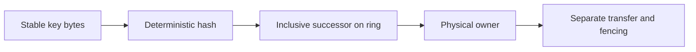

All routers must use the same versioned configuration to reproduce the owner. The executable ring stops at owner selection. Its demonstration compares old and expanded configurations without copying any values or changing a running service's routing. That keeps the evidence aligned with the mechanism being taught.

<a id="lesson-1-06--e-real-world-examples"></a>

#### E. Real-world examples

For an illustrative StopAround public-result cache, a ring could assign station lookup keys across cache nodes. Adding a node would transfer responsibility for selected ranges, causing bounded cold misses rather than a broad modulo remap. The origin still needs protection while those misses warm. Private-data authorization and key scoping remain requirements regardless of placement.

A documented engineering example is the 2007 Dynamo paper, which describes consistent hashing and virtual nodes as part of a larger key-value storage design. Its replication and recovery mechanisms are additional parts of that design, illustrating why placement alone is insufficient. Read its historical architecture in context rather than assuming a current managed product has the same implementation. [Dynamo paper](https://www.allthingsdistributed.com/files/amazon-dynamo-sosp2007.pdf).

For a separate workload, a thumbnail service may have evenly distributed image identifiers but a few extremely popular images. Adding more virtual nodes can balance many key ranges without relieving repeated reads of one image. Replicated hot results or a CDN address that demand pattern more directly than changing the primary hash rule.

<a id="lesson-1-06--f-executable-example"></a>

#### F. Executable example

Run the full [ring demonstration](exercises/module-01/06-consistent-hashing/hash_ring.py):

```bash
python3 exercises/module-01/06-consistent-hashing/hash_ring.py
```

It reports owner counts and moved keys for 10,000 deterministic synthetic identifiers when D joins A, B, and C. These observations describe that fixture and configuration. The tests verify membership-order independence, addition/removal movement, single-node operation, exact boundary selection, and wraparound.

<!-- Listing: exercises/module-01/06-consistent-hashing/hash_ring.py -->

```python
"""Deterministic placement only: no replication, failure detector, or data transfer."""
import bisect
import hashlib


def token(value): return int.from_bytes(hashlib.sha256(value.encode('utf-8')).digest(),'big')


class HashRing:
    def __init__(self,nodes,virtual_nodes=128):
        nodes=list(nodes)
        if not nodes or any(not isinstance(n,str) or not n for n in nodes) or len(set(nodes))!=len(nodes):
            raise ValueError('nonempty unique node names required')
        if not isinstance(virtual_nodes,int) or virtual_nodes < 1: raise ValueError('positive virtual-node count required')
        points=[]
        for node in sorted(nodes):
            for index in range(virtual_nodes):
                # Length prefix prevents ambiguities between node names and replica numbers.
                position=token(f'{len(node.encode())}:{node}:{index}')
                points.append((position,node))
        points.sort()
        if len({point[0] for point in points})!=len(points): raise ValueError('token collision: choose a new placement configuration')
        self.points=points
        self.positions=[point[0] for point in points]

    def owner(self,key):
        index=bisect.bisect_left(self.positions,token(key))%len(self.points)
        return self.points[index][1]


if __name__ == '__main__':
    from collections import Counter
    keys=[f'journey:{index}' for index in range(10000)]
    old=HashRing(['A','B','C']); new=HashRing(['A','B','C','D'])
    print('Owners after expansion:',dict(Counter(new.owner(key) for key in keys)))
    print('Moved keys:',sum(old.owner(key)!=new.owner(key) for key in keys),'of',len(keys))
```

The SHA-256 digest supplies stable placement bytes; this is not password hashing or credential verification. Python objects use substantially more memory than the digest bytes alone, so estimate actual router memory if scaling this implementation to many tokens. The demonstration remains a local algorithm model.

<a id="lesson-1-06--g-architectural-decisions-and-trade-offs"></a>

#### G. Architectural decisions and trade-offs

Use more virtual nodes when finer-grained balance and movement justify additional metadata. Measure key, byte, and request distributions independently. Treat a change in token count as a placement rollout, not a free tuning operation.

Separate temporary health observations from authoritative membership changes. Removing a node after one failed request can cause unnecessary movement and contradict another router's view. A production service needs a specified failure-detection and membership policy with observable configuration versions.

For a small fixed application, prefer the simplest ownership mechanism that meets the requirement. A ring is valuable when its limited-remapping property addresses meaningful churn; it is not a prerequisite for a scalable relational application.

<a id="lesson-1-06--h-common-failures-and-debugging"></a>

#### H. Common failures and debugging

If two processes disagree on an owner, compare configuration version, membership, token count, encoding, digest algorithm, token identity format, and boundary convention. Check for accidental use of Python's built-in hash. Do not begin by copying data until routing inputs agree.

If balance looks good by keys but poor by CPU, inspect popularity and value sizes. If an added node causes movement between surviving old nodes, verify that old tokens remained unchanged. If one physical server holds several nominal replicas, inspect whether replica selection skipped repeated physical owners and respected failure domains.

If expansion causes an origin spike, inspect cold misses and admission limits. An expected 25% key move in an equal four-node ring is not a guarantee that only 25% of traffic or bytes will move. Measure the workload's actual distribution and throttle warm-up accordingly.

<a id="lesson-1-06--i-practical-exercise"></a>

#### I. Practical exercise

Place A, B, and C at 20, 60, and 90 on a 0–99 ring. Assign keys 10, 20, 35, 60, 85, and 95 using the inclusive-successor convention. Add D at 45 and identify exactly which supplied keys move. Remove B and repeat the ownership reasoning.

Then run the real digest-based demonstration with one token and with 128 tokens per node. Record the key counts and movement without presenting either fixture as a universal balance guarantee. Describe the extra work required to use that ring for authoritative journey storage rather than a recomputable cache. Compare with the [worked solution](#lesson-1-06--exercise-solution).

<a id="lesson-1-06--j-interview-and-senior-engineering-assessment"></a>

#### J. Interview and senior-engineering assessment

1. What property does consistent hashing improve during membership changes?
2. Why do virtual nodes help, and what can they not fix?
3. Which keys can move when one node is added with old tokens unchanged?
4. Why must replica selection consider physical nodes?
5. What configuration differences can make routers disagree?
6. Is an expected moved-key fraction a bandwidth estimate?
7. What must accompany the ring for durable data?

<a id="lesson-1-06--assessment-solutions"></a>

#### Assessment solutions

<a id="lesson-1-06--1-limited-reassignment"></a>

##### 1. Limited reassignment

The rule preserves existing range boundaries when destinations change, so addition or removal need not remap unrelated keys broadly. It improves placement stability; it does not move data or establish agreement on membership.

<a id="lesson-1-06--2-smaller-distributed-ownership-ranges"></a>

##### 2. Smaller distributed ownership ranges

Several tokens reduce dependence on one random interval and offer finer movement granularity. They increase metadata and cannot divide one hot key or guarantee equal work for a skewed workload. Measure the resource you need to balance.

<a id="lesson-1-06--3-moved-keys-go-to-the-new-node"></a>

##### 3. Moved keys go to the new node

New tokens take predecessor intervals from existing owners. With all old tokens fixed, a moved key's new primary is the added node; it does not move between two surviving old nodes. Regenerating old tokens invalidates that property.

<a id="lesson-1-06--4-tokens-are-not-failure-domains"></a>

##### 4. Tokens are not failure domains

Adjacent tokens can belong to the same physical machine. Replica selection must skip duplicate physical owners and may need zone/rack constraints. Several copies on one machine do not protect against that machine's loss.

<a id="lesson-1-06--5-all-placement-inputs-matter"></a>

##### 5. All placement inputs matter

Compare membership and its version, encoding, hash algorithm, token identity format, virtual-node count, weights, and boundary convention. A deterministic function agrees only for equal inputs. Temporary health observations also need a coordinated membership policy.

<a id="lesson-1-06--6-keys-bytes-and-traffic-differ"></a>

##### 6. Keys, bytes, and traffic differ

An expected key fraction assumes a distribution and says nothing about value sizes or popularity. Transfer cost depends on bytes, indexes, replication, and catch-up traffic; user impact depends on which keys become cold or move.

<a id="lesson-1-06--7-ownership-and-recovery-protocols"></a>

##### 7. Ownership and recovery protocols

Add replicated durability where required, coordinated membership, safe transfer, stale-writer fencing, repair, and crash recovery. A new owner returning “missing” is not proof that a previously committed record never existed.

<a id="lesson-1-06--k-key-takeaways-and-navigation"></a>

#### K. Key takeaways and navigation

Understand the successor rule and its limited-movement assumptions. Keep distribution, replication, membership, and safe movement as distinct responsibilities.

Next: [1.07 — CAP theorem](#lesson-1-07). Previous: [1.05 — Sharding](#lesson-1-05).

<a id="lesson-1-06--exercise-solution"></a>

#### Consistent hashing — worked solution

With A at 20, B at 60, and C at 90, the supplied keys map as follows:

| Key position | Initial owner | After adding D at 45 | After then removing B |
|---|---|---|---|
| 10 | A | A | A |
| 20 | A | A | A |
| 35 | B | D | D |
| 60 | B | B | C |
| 85 | C | C | C |
| 95 | A | A | A |

This uses the inclusive-successor boundary: a key exactly at a token belongs to that token's owner. After D joins, only key 35 among this supplied set moves, and its destination is D. After B leaves the expanded ring, key 60 moves to C. Other keys in B's former interval would also move; the table is not the entire ring.

Run the digest-based example for observed distribution. To compare one and 128 virtual nodes, construct HashRing with the same physical names and different virtual_nodes values, then count owners for a fixed key set. Report the fixture and count; do not infer universal balance from one sample. Changing virtual-node count for existing nodes is itself a membership/configuration transition.

For a disposable cache, a new owner can miss and reload from an authority under bounded origin capacity. For durable journey storage, missing data on the new owner requires a transfer and recovery protocol. Copy the relevant state, reconcile concurrent changes if allowed, publish ownership under a coordinated epoch, and fence old writers. Also define replication and acknowledged-write durability separately.

The checks verify deterministic membership ordering, addition and removal properties, exact boundaries, and wraparound. They do not test a distributed membership service, node failure, data transfer, or recovery from an old owner that continues running.

<a id="lesson-1-07"></a>

### CAP theorem

Lesson 1.07 · Core concepts

<a id="lesson-1-07--a-learning-objectives-and-prerequisites"></a>

#### A. Learning objectives and prerequisites

You should be able to explain the impossibility result using an actual read/write history, distinguish linearizability from everyday uses of “consistent,” and state the failure behavior of one particular operation. You should also explain eventual convergence without implying a maximum stale interval or preservation of every concurrent intent.

Read [data modeling](#lesson-1-03), [sharding](#lesson-1-05), and [consistent hashing](#lesson-1-06). This lesson uses a two-node register model. It deliberately does not implement consensus, failover, durable replication, or arbitrary concurrent execution. All histories are teaching examples unless linked to a published source.

<a id="lesson-1-07--b-mental-model-and-intuition"></a>

#### B. Mental model and intuition

Imagine two service nodes that cannot exchange messages. Both remain reachable by some clients. A client completes a write through A, then another client asks B for the current value. B cannot know whether A accepted a new value. To preserve one globally current answer, B must obtain sufficient authority or stop successfully answering that operation. To keep answering locally, B may return an older value.

The important decision is the operation's behavior during this uncertainty. “We use a highly available database” does not tell your frontend whether a successful save will be visible on a different replica or whether a read might fail rather than return stale data. State the contract in terms a caller can observe.

For StopAround, displaying an older public station observation can be acceptable with an age label. Granting access to a private journey after permission was revoked can violate a different invariant. One application can make different decisions for different operations and representations. Do not force the whole product into one slogan.

<a id="lesson-1-07--c-deep-technical-explanation"></a>

#### C. Deep technical explanation

<a id="lesson-1-07--define-the-properties-precisely"></a>

##### Define the properties precisely

In the formal CAP setting, consistency is an atomic single-copy behavior commonly expressed as linearizability. Availability requires requests received by non-failing nodes to eventually complete with the operation's valid response. Partition tolerance considers executions where communication between nodes can fail. Gilbert and Lynch establish that these guarantees cannot all be maintained in their asynchronous partition model. An HTTP error is not a successful register read merely because a server responded. [Gilbert and Lynch](https://www.comp.nus.edu.sg/~gilbert/pubs/BrewersConjecture-SigAct.pdf).

Linearizability lets each completed operation appear to take effect at one instant between its invocation and response, while respecting real-time order between non-overlapping operations. Concurrent operations may have more than one legal ordering. If a write completes before a later read begins, that read cannot return the previous value unless an intervening legal write explains it. [Herlihy and Wing](https://cs.brown.edu/~mph/HerlihyW90/p463-herlihy.pdf).

This is different from a foreign-key constraint being internally consistent, from ACID's database-invariant usage of consistency, and from two replicas eventually containing equal bytes. Those are useful properties, but substituting one for another changes the question. Similarly, a 99.9% monthly success SLO is an operational metric, not the theorem's universal availability guarantee.

The result is about behavior under a partition, not a menu where an operator permanently removes networking failures from consideration. When all communication works, a service can provide both useful availability and strong reads. Under communication uncertainty, the specified operation must reveal which guarantee is relaxed or which subset of nodes stops successfully serving it.

<a id="lesson-1-07--walk-through-a-distinguishing-history"></a>

##### Walk through a distinguishing history

Start with value 0 at A and B. Prevent A and B from communicating. Write value 1 at A and observe a successful acknowledgement. Only after that response, ask B to read. B's local state is still 0. From its own messages, B cannot distinguish this execution from one where no write happened at A.

If B immediately returns 0, it continues serving but violates the required real-time ordering for this history. If B waits for authoritative information or returns an unavailable response, it avoids the stale successful read but gives up successful completion at that reachable non-failing node during the partition. A timeout can bound user waiting, but does not manufacture the missing information.

This simple register history is enough to expose the decision. Real databases have more complex protocols, but no amount of caching, a clever hash function, or an extra frontend retry makes the inaccessible state observable without additional assumptions. A client can request a minimum known version, yet B must still wait, route elsewhere, or reject when it cannot establish that version.

<a id="lesson-1-07--what-the-cp-model-actually-does"></a>

##### What the CP model actually does

The lab's `cp` mode has a permanently designated primary A. Connected requests through B forward logically to A. During a partition, B rejects reads and writes instead of serving its local copy. A remains the only writer and can continue serving under this deliberately restricted failure model.

There is no automatic promotion, primary crash, lease, or quorum in this code. Its linearizable histories rely on one fixed authority that is never replaced. Allowing B to promote itself independently would invalidate that argument. The model also does not promise that an A-only acknowledgement survives A's permanent loss. Durability and failover need additional protocols and evidence.

A real replicated service may use majority agreement to retain one authoritative history while a minority cannot proceed. The majority side can often continue; that does not satisfy the theorem's availability requirement for every non-failing node. Production availability depends on topology, client routing, failure domains, and which operations need coordination.

<a id="lesson-1-07--what-the-ap-model-actually-does"></a>

##### What the AP model actually does

In `ap` mode, each reachable replica accepts local reads and writes. During a partition, reading B after a completed A write can return the old value. On healing, the model selects one register state using a deterministic `(logical_counter, node_name)` ordering and installs it on both nodes. Under this model's finite history and successful healing, replicas converge.

The logical counter is not wall-clock time and cannot identify the globally most recent human action during disconnection. If A assigns 10 and B assigns 20 concurrently, one assignment wins under the rule and the other intent is not retained. Convergence establishes agreement under the merge rule, not that the merge satisfies every business requirement.

Eventual consistency needs assumptions: updates eventually stop or settle sufficiently, communication and repair eventually succeed, and replicas apply a compatible merge policy. It does not automatically bound staleness in seconds. A disconnected replica can remain old for the duration of disconnection. A UI claiming “always current within five seconds” needs additional operational assumptions and enforcement.

For sets, counters, or more complex objects, a merge can sometimes preserve more intent than a single winning register value. That requires a well-defined operation model and merge semantics. Replacing a last-winner register with a conflict-free structure is a domain decision, not an automatic upgrade that preserves arbitrary constraints such as “only one reservation remains.”

<a id="lesson-1-07--quorums-replication-and-misleading-shortcuts"></a>

##### Quorums, replication, and misleading shortcuts

For a fixed replica set of N distinct members, read and write sets with sizes R and W satisfying `R + W > N` intersect. That arithmetic is useful, but intersection alone is not a complete linearizability proof. Version ordering, concurrent writes, repair, membership changes, failure assumptions, and read behavior still matter. A system using substitute replicas during failures may not even have the same fixed-set intersection assumption.

Likewise, three replicas do not automatically provide strong reads, and a leader name in a diagram does not stop an old leader from accepting writes after a partition. Safe leader changes require a specified agreement and fencing mechanism. The shard lesson's stale-writer problem is one concrete manifestation of this requirement.

Asynchronous replication can provide useful read scaling and recovery while allowing stale follower reads. Synchronous acknowledgement policies can strengthen particular durability promises at a latency and availability cost. Specify the actual read and write contract rather than deducing it from the words “replicated” or “SQL.”

<a id="lesson-1-07--design-user-visible-degradation"></a>

##### Design user-visible degradation

For a public station feed, a stale response can carry observation time, source version, and an explicit freshness limitation. For a private journey mutation, the service can reject or delay when it cannot establish the authoritative state. For a saved operation whose response disappeared, retain its operation key and reconcile against the authority instead of submitting a new intent to another partition.

Session guarantees can improve experience without proving global linearizability. Sticky routing may let one client read its own writes while another client sees an older replica. A minimum-version token can make lag visible, but may force waiting or rejection. State which guarantee applies to which client interaction.

Define separate success, stale-success, conflict, and unavailable outcomes when the product needs them. A generic 200 containing a stale result without a freshness contract hides the trade-off. A generic retry policy that switches writers can create competing histories if ownership is not coordinated.

<a id="lesson-1-07--d-architecture-and-data-flow"></a>

#### D. Architecture and data flow

The same partition produces different allowed behavior depending on the read contract.

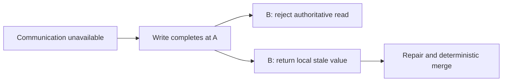

The two branches describe alternative policies, not two simultaneous promises from one operation. The executable model instantiates a separate register for each mode. Healing in the fixed-primary mode copies A's authority; healing in the local mode applies its logical-order merge. Neither branch implements failover or crash recovery.

<a id="lesson-1-07--e-real-world-examples"></a>

#### E. Real-world examples

For illustrative StopAround behavior, keep a usable route view with visibly aged public observations during provider or replica failure. Refuse to confirm a private edit if its authoritative preconditions cannot be checked. These decisions follow the individual invariant and freshness promise; they do not require classifying every component with the same CAP label.

For a separate example, a collaborative checklist may preserve concurrent additions using an appropriate merge model. A single-value “whole checklist wins” rule could discard one person's additions even while replicas converge. A seat-reservation operation has a different invariant and may need coordinated acceptance rather than independent local writes followed by merging.

The historical Dynamo paper explicitly discusses availability and conflict handling under failures as part of its application-facing design. Its lesson for this course is that conflict resolution belongs in the contract and implementation, not in a claim that convergence removes all consequences of concurrent writes. [Dynamo, 2007](https://www.allthingsdistributed.com/files/amazon-dynamo-sosp2007.pdf).

<a id="lesson-1-07--f-executable-example"></a>

#### F. Executable example

The full [partition model](exercises/module-01/07-cap-theorem/partition_model.py) operates on a register initialized to zero. Run its tests using [the guide](exercises/module-01/README.md). The tests construct the precise write-then-read history and separately show rejection, stale success, and deterministic convergence.

<!-- Listing: exercises/module-01/07-cap-theorem/partition_model.py -->

```python
"""Two-node register histories. CP uses a fixed primary and deliberately has no failover."""
class Unavailable(Exception): pass


class Register:
    def __init__(self,mode):
        if mode not in ('cp','ap'): raise ValueError('choose cp or ap')
        self.mode=mode; self.connected=True
        self.states={'A':(0,'A',0),'B':(0,'A',0)}

    def read(self,node):
        if node not in self.states: raise ValueError('unknown node')
        if self.mode=='cp':
            if node=='B' and not self.connected: raise Unavailable('cannot reach the fixed primary')
            return self.states['A'][2]
        return self.states[node][2]

    def write(self,node,value):
        if node not in self.states: raise ValueError('unknown node')
        if self.mode=='cp':
            if node=='B' and not self.connected: raise Unavailable('cannot reach the fixed primary')
            destination='A'
        else: destination=node
        previous=self.states[destination]
        self.states[destination]=(previous[0]+1,destination,value)
        if self.connected: self.heal()

    def partition(self): self.connected=False

    def heal(self):
        winner=self.states['A'] if self.mode=='cp' else max(self.states.values(),key=lambda value:value[:2])
        self.states={'A':winner,'B':winner}; self.connected=True
```

Calls execute sequentially; a partition suppresses propagation between the two local states. This is a history simulator. It does not inject packet loss into actual servers or verify an implementation of Raft, Paxos, leases, or a replicated database. Those claims would require a different system and substantially stronger checks.

<a id="lesson-1-07--g-architectural-decisions-and-trade-offs"></a>

#### G. Architectural decisions and trade-offs

Choose the required invariant and the partition-time user behavior before choosing a branded database category. Strong permission or reservation decisions often justify unavailability when authority cannot be established. Public read models can often trade freshness for continuity with visible age and bounded fallback load.

If accepting independent writes, define conflict detection, merge semantics, and what users see when their intent does not survive the merge. “Last writer wins” needs a precise ordering mechanism and an explanation of clock behavior. A timestamp alone is not evidence of real-time global order.

Do not add multi-region writers merely because reads are global. A single write authority with regional public caches or read projections can be easier to reason about. The right design balances measured latency, recovery, and correctness requirements rather than maximizing the number of active writers.

<a id="lesson-1-07--h-common-failures-and-debugging"></a>

#### H. Common failures and debugging

When a stale read appears, reconstruct invocation and response order and identify the actual replica and read mode. A timestamp in a log does not establish causality across unsynchronized clocks. Use correlated operation identities, versions, and known completion boundaries.

When two owners accept conflicting writes, inspect membership terms, fencing, client routing, and promotion decisions. A healthy process can still be an unauthorized old primary. When replicas converge to an unexpected value, inspect merge ordering and retained conflict metadata rather than declaring convergence itself a bug.

When a claim says “R plus W is greater than N, therefore strong consistency,” ask about distinct membership, version rules, concurrent writers, reads during repair, and reconfiguration. When a claim says “eventual means within a second,” ask which transport, repair, and admission assumptions establish that bound.

<a id="lesson-1-07--i-practical-exercise"></a>

#### I. Practical exercise

For each mode, initialize zero, partition the replicas, write 1 at A, then read B after the write completes. Record the successful value or rejection. Heal and read both replicas. Next, independently assign 10 at A and 20 at B during an AP partition and inspect the merge result.

Write a caller-facing contract for public price reads and private journey edits during the same infrastructure partition. Identify acceptable stale data, unavailable behavior, recovery identity, and what the UI must display. Explain why replacing B with three replicas does not by itself answer the question. Compare with the [worked solution](#lesson-1-07--exercise-solution).

<a id="lesson-1-07--j-interview-and-senior-engineering-assessment"></a>

#### J. Interview and senior-engineering assessment

1. What does CAP consistency mean in this lesson?
2. Why can B not safely guess the current value after an A-side write?
3. Does returning 503 satisfy formal availability for a read?
4. What is deliberately missing from the fixed-primary CP model?
5. Does eventual convergence preserve both concurrent assignments?
6. What does `R + W > N` establish, and what does it omit?
7. How can one product use different failure policies?

<a id="lesson-1-07--assessment-solutions"></a>

#### Assessment solutions

<a id="lesson-1-07--1-one-real-time-respecting-operation-history"></a>

##### 1. One real-time-respecting operation history

Linearizability makes operations appear instantaneous within their call intervals and preserves completed-before-started order. It is different from referential integrity, eventual equal replicas, or an operational uptime percentage. Define the property before applying the theorem.

<a id="lesson-1-07--2-the-partition-hides-distinguishing-information"></a>

##### 2. The partition hides distinguishing information

B has the same local observations whether A accepted the new write or did not. Returning its old value can contradict a completed earlier write. Obtaining authority may require communication that the partition prevents, so successful local completion and the strong read contract conflict in that execution.

<a id="lesson-1-07--3-a-response-is-not-necessarily-operation-success"></a>

##### 3. A response is not necessarily operation success

A 503 tells the caller the operation could not be served successfully. It can be a sensible bounded user-facing failure and preserve safety, but does not meet the theorem's successful-completion requirement for that request.

<a id="lesson-1-07--4-failover-and-crash-durability"></a>

##### 4. Failover and crash durability

A never changes role and never crashes in the model. B rejects partitioned authoritative operations. The code therefore cannot establish safe promotion, quorum replication, or survival of an acknowledgement after primary loss. Adding those requires a specified protocol.

<a id="lesson-1-07--5-agreement-can-discard-an-intent"></a>

##### 5. Agreement can discard an intent

The register's logical-counter/node ordering picks one winning assignment. After healing, both replicas agree, but one concurrent assignment is not retained. A richer merge model may preserve suitable operations, while domain constraints still require separate reasoning.

<a id="lesson-1-07--6-set-intersection-under-assumptions"></a>

##### 6. Set intersection under assumptions

Fixed distinct read and write member sets intersect under that inequality. Complete consistency also depends on write/version protocol, read selection, failures, concurrency, and membership changes. The equation is a component of an argument rather than a complete implementation.

<a id="lesson-1-07--7-specify-per-operation-semantics"></a>

##### 7. Specify per-operation semantics

Public observations can serve stale data with age information, while private edits can require authority and return unavailable when it cannot be established. Maintain separate observable contracts and recovery paths. One product label need not dictate every endpoint's guarantee.

<a id="lesson-1-07--k-key-takeaways-and-navigation"></a>

#### K. Key takeaways and navigation

Use concrete histories and precise definitions. State what an operation does during a partition, and distinguish convergence, durability, and linearizability.

Next: [1.08 — Database indexing](#lesson-1-08). Previous: [1.06 — Consistent hashing](#lesson-1-06).

<a id="lesson-1-07--exercise-solution"></a>

#### CAP theorem — worked solution

In cp mode, partition, write 1 at A, and read B: the read raises Unavailable. A remains the fixed authority. After heal, both reads return 1. In ap mode, the same B-side read succeeds with 0, demonstrating a successful stale observation after the A write completed. Healing propagates 1 when there is no competing update.

For concurrent AP assignments, A holds `(1, A, 10)` and B holds `(1, B, 20)`. Healing chooses the larger logical-counter/node tuple, so both return 20. This is a deterministic tie-break, not proof that B's human action happened later. A's assignment is not retained in the merged register.

A public-price contract can permit stale observations if it exposes their observation time and bounds the product's stale-serving policy under stated assumptions. During a prolonged partition, a strict source-age bound may require stopping successful reads once that bound is exceeded. Eventual consistency alone cannot guarantee the bound.

A private-edit contract can require the authoritative owner/version check, return an unavailable status when that authority cannot be established, and preserve the original operation key through retries. Do not switch to an independently writable old replica merely to obtain a successful status. A previously accepted write can still have an unknown client outcome if its response was lost.

Three replicas add placement choices, not an automatic consistency guarantee. A majority protocol can let an authoritative majority continue while a minority rejects operations, but membership, promotion, versioning, and fencing must be specified. A fleet-wide availability SLO can remain useful while differing from the theorem's universal guarantee.

The tests verify these local histories only. They do not run network servers, implement a consensus algorithm, model primary crashes, or prove a real database's partition behavior.

<a id="lesson-1-08"></a>

### Database indexing

Lesson 1.08 · Core concepts

<a id="lesson-1-08--a-learning-objectives-and-prerequisites"></a>

#### A. Learning objectives and prerequisites

You should be able to derive an index from a concrete query, read the important parts of a PostgreSQL execution plan, explain the order of a composite B-tree, and measure the write and storage cost of the improvement. You should also recognize when a sequential scan is a reasonable choice rather than evidence that the database ignored your work.

Read [data modeling](#lesson-1-03) and [API design](#lesson-1-02). The experiment uses PostgreSQL 18 and 100,000 synthetic rows in a uniquely owned lab schema. Its recorded timings are observations from one local run, not production benchmarks or universal latency numbers.

<a id="lesson-1-08--b-mental-model-and-intuition"></a>

#### B. Mental model and intuition

An index is an additional structure maintained to make particular access paths cheaper. It trades write work and space for fewer comparisons, fewer data-page visits, useful ordering, or a directly enforced uniqueness rule. The right question is “which rows and order does this query need?” rather than “which columns should have an index?”

Imagine a journey list that needs the twenty newest rows belonging to one owner. A table scan can inspect every row, discard other owners, and sort the survivors. A matching index can navigate to that owner's ordered range and stop after enough rows. The benefit comes from avoiding work, not from a magical property attached to the column name.

Your frontend's pagination contract matters here. A stable ordering tuple and bounded page size give the database a precise early-stop opportunity. Asking for every row, sorting in application memory, and then displaying twenty items defeats much of the index's potential value.

<a id="lesson-1-08--c-deep-technical-explanation"></a>

#### C. Deep technical explanation

<a id="lesson-1-08--b-tree-structure-and-heap-access"></a>

##### B-tree structure and heap access

A B-tree maintains ordered keys in pages with a balanced navigation structure. Searches traverse internal pages to a relevant leaf range, then scan suitable entries. A table's rows live separately in PostgreSQL's heap, so an ordinary index scan commonly visits heap pages to retrieve selected values and check tuple visibility. A short logical lookup can still involve many page accesses when many scattered rows qualify.

The familiar logarithmic-search explanation is useful but incomplete for system design. Page size, cache residency, selectivity, row width, physical correlation, MVCC visibility, and result count influence actual cost. An index finding half a large table can be less efficient than a sequential scan, especially when fetching heap pages in scattered order.

An index can also provide output order. A query that needs `ORDER BY created_at DESC, id DESC LIMIT 20` benefits when the scan already produces that order after its equality filters. Avoiding a large sort and stopping early can matter more than the raw search complexity.

<a id="lesson-1-08--composite-order-follows-the-query"></a>

##### Composite order follows the query

For the synthetic feed, the relevant index is `(owner_id, created_at DESC, id DESC)`. Owner equality selects one contiguous region; within it, time and ID provide the required newest-first order. The ID breaks timestamp ties. A keyset continuation can use the same tuple ordering, keeping filtering, order, cursor, and index aligned.

Separate indexes on owner and creation time are not equivalent. PostgreSQL can combine indexes for some filters, but a bitmap combination generally does not preserve the desired index order for an immediate ordered LIMIT. The planner must evaluate the whole query rather than collecting every index whose column name appears in it.

Avoid the absolute claim that a composite B-tree is unusable unless its first column is filtered. PostgreSQL 18 has additional strategies, including skip scans in suitable cases. Leading equality constraints and the first relevant range remain central to understanding efficient navigation; use the actual version's plan to evaluate other shapes. [PostgreSQL 18 multicolumn indexes](https://www.postgresql.org/docs/18/indexes-multicolumn.html).

A different feed may need a different index. An unscoped global newest-events query does not get the same direct ordered range from an owner-leading index. A query that filters by owner but orders by name also has a different ordering requirement. Do not create a universal wide index and assume its permutations are interchangeable.

<a id="lesson-1-08--selectivity-expressions-and-partial-indexes"></a>

##### Selectivity, expressions, and partial indexes

Selectivity describes how much of the relation qualifies. A rare owner can benefit from an index while a very common status may not. Data skew matters: the average number of rows per owner can hide a large tenant with a very different plan. Statistics help the planner estimate these populations, and ANALYZE updates them.

Write predicates that expose the intended range. Comparing a timestamp to lower and upper bounds is often more directly supported by a normal timestamp index than applying a date conversion to every row. Ensure the bounds represent the desired timezone; a local calendar day across a daylight-saving transition is not always 86,400 seconds.

Expression indexes can support a matching expression such as a normalized lookup, and partial indexes can store only rows satisfying a useful stable predicate, such as active tasks. The query must be compatible with the index expression or predicate under planner rules. Parameterization and prepared-plan choices can affect what is provable, so inspect the actual application query rather than a hand-edited version that happens to use constants. [CREATE INDEX documentation](https://www.postgresql.org/docs/18/sql-createindex.html).

<a id="lesson-1-08--read-explain-as-a-work-plan"></a>

##### Read EXPLAIN as a work plan

Plain EXPLAIN shows the estimated plan. EXPLAIN ANALYZE executes the query and records observed work. Planner cost values are internal estimates, not milliseconds. Compare estimated and actual row counts, scan choice, filters, sort behavior, loop counts, and buffers before declaring the query solved. [PostgreSQL EXPLAIN](https://www.postgresql.org/docs/18/using-explain.html).

Plans are trees. A Limit can sit above a Sort above a Sequential Scan. The root returning twenty rows does not mean only twenty table rows were examined. Inspect the child scan and removed-row information. Where a node executes multiple loops, actual row and timing figures need interpretation with their loop counts rather than being treated as one global total.

Buffers describe accesses through PostgreSQL's buffer machinery. Shared hits and reads are different; a shared read can still be served by the operating system cache rather than a physical disk. Parent-node counts can include descendant work, so summing every node can double-count. Compare like-for-like plan locations and report exactly what you measured.

For mutating statements, EXPLAIN ANALYZE really executes the mutation. Use isolated data and an appropriate transaction policy; do not paste it into a production write path as if it were a read-only planner inspection. This lesson's experiment executes SELECTs against a disposable synthetic fixture.

<a id="lesson-1-08--covering-indexes-and-visibility"></a>

##### Covering indexes and visibility

An index-only scan can return values available from an appropriate index, but PostgreSQL still needs to establish visibility under MVCC. Its visibility map can avoid heap checks for qualifying all-visible pages; recently changed pages may still require heap fetches. INCLUDE columns can cover additional output fields while increasing index size and write cost. [Index-only scans](https://www.postgresql.org/docs/18/indexes-index-only-scans.html).

The experiment selects a payload that is not included in the composite index. It therefore demonstrates an ordinary ordered index scan, not a promise of zero heap access. A giant covering index containing every response field can waste memory and amplify writes. Measure the specific benefit and account for churn and visibility behavior.

Other index types serve other access patterns. GIN is useful for suitable containment and full-text operations, GiST supports appropriate spatial and other operator classes, and BRIN can exploit physical correlation for some large relations. A B-tree over latitude and longitude is not a general nearest-station search solution. Spatial querying receives dedicated treatment later, with PostGIS and distance semantics explicitly tested.

<a id="lesson-1-08--every-index-changes-writes-and-operations"></a>

##### Every index changes writes and operations

Inserts, deletes, and relevant updates maintain additional index entries and generate related storage and logging work. Wider and more numerous indexes compete for cache and take time to build, replicate, back up, and restore. Some updates can avoid new index entries under PostgreSQL's HOT conditions, but this is conditional behavior, not a reason to ignore indexed-column churn.

A regular CREATE INDEX can block concurrent writes while building. CONCURRENTLY supports a different production rollout path with extra work, waits, failure states, and restrictions, including not running inside an ordinary transaction block. Inspect its documented lifecycle and verify the resulting index is valid. The isolated experiment uses the simpler regular build because no user traffic shares its fixture.

An index improvement should include a removal and monitoring decision. Track useful query latency and rows/buffers examined, write throughput, storage growth, and usage over a representative period. An apparently unused index may enforce a constraint or serve an infrequent critical operation; verify its role before dropping it.

<a id="lesson-1-08--d-architecture-and-data-flow"></a>

#### D. Architecture and data flow

The access path changes; the query's ownership and ordering contract remain the same.

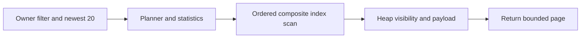

Before the index, the recorded fixture uses a sequential scan and sort. After the index, the planner can seek the owner/time range and stop after twenty results. The diagram shows the improved path; inspect the saved plans for both alternatives. Nothing about an index removes the need for the owner filter or a stable pagination tuple.

<a id="lesson-1-08--e-real-world-examples"></a>

#### E. Real-world examples

For an illustrative StopAround newest-journeys feed, use owner equality and descending creation/ID order. The current API lab deliberately exposes UUID-ascending pagination, so this is a proposed alternative contract and query, not a claim that adding this index silently changes that endpoint's semantics. Change the cursor and public ordering together if the product needs chronology.

For a separate task tracker, an active-task list by project can benefit from a small partial index when completed tasks dominate history. If the product later asks for a full historical export, that index may not help. The same table can have several legitimate workloads with different access paths and limits.

In the observed PostgreSQL 18.6 lab run, root shared-buffer accesses decreased from 1,924 to 23, and the added index occupied 4,079,616 bytes. Recorded execution times were 3.176 ms and 0.063 ms. These are one synthetic local run with its particular cache state; they are not a general speedup claim or a cold-disk benchmark. [Recorded plans](exercises/module-01/08-database-indexing/observed-plan.json).

<a id="lesson-1-08--f-executable-example"></a>

#### F. Executable example

The full [experiment](exercises/module-01/08-database-indexing/index_experiment.py) seeds its own 100,000-row schema and saves both JSON plans. Follow [the guide](exercises/module-01/README.md) for the database and dependencies, then run:

```bash
.venv/bin/python exercises/module-01/08-database-indexing/index_experiment.py
```

<!-- Listing: exercises/module-01/08-database-indexing/index_experiment.py -->

```python
"""Synthetic PostgreSQL access-path comparison; never disables sequential scans."""
import json
import os
from uuid import uuid4
import psycopg
from psycopg import sql

QUERY='SELECT id,created_at,payload FROM index_lab_events WHERE owner_id=42 ORDER BY created_at DESC,id DESC LIMIT 20'


def experiment(connection):
    connection.execute('CREATE TABLE index_lab_events(id bigint PRIMARY KEY,owner_id integer NOT NULL,created_at timestamptz NOT NULL,payload text NOT NULL)')
    connection.execute("INSERT INTO index_lab_events SELECT i,i%1000,timestamptz '2026-01-01 00:00:00+00'+i*interval '1 second',repeat('x',100) FROM generate_series(1,100000) AS i")
    connection.execute('ANALYZE index_lab_events')
    before=connection.execute('EXPLAIN (ANALYZE,BUFFERS,FORMAT JSON) '+QUERY).fetchone()[0][0]
    connection.execute('CREATE INDEX index_lab_owner_created ON index_lab_events(owner_id,created_at DESC,id DESC)')
    connection.execute('ANALYZE index_lab_events')
    after=connection.execute('EXPLAIN (ANALYZE,BUFFERS,FORMAT JSON) '+QUERY).fetchone()[0][0]
    return {'server_version':connection.execute('SHOW server_version').fetchone()[0],
            'fixture_rows':100000,'query':QUERY,'before':before,'after':after,
            'index_bytes':connection.execute("SELECT pg_relation_size('index_lab_owner_created')").fetchone()[0]}


if __name__=='__main__':
    schema='m1_index_'+uuid4().hex
    with psycopg.connect(os.environ['MODULE1_DATABASE_URL'],autocommit=True) as connection:
        connection.execute(sql.SQL('CREATE SCHEMA {}').format(sql.Identifier(schema)))
        try:
            connection.execute(sql.SQL('SET search_path TO {}').format(sql.Identifier(schema)))
            print(json.dumps(experiment(connection),indent=2))
        finally:
            connection.execute(sql.SQL('DROP SCHEMA {} CASCADE').format(sql.Identifier(schema)))
```

The test leaves sequential scans enabled and checks the planner's chosen index, absence of a separate sort, twenty output rows, and fewer root buffer accesses. It deliberately avoids an exact timing threshold, which would mostly test local scheduling and cache conditions. Planner choices can change with versions, data, and statistics; investigate a changed plan before forcing an index.

<a id="lesson-1-08--g-architectural-decisions-and-trade-offs"></a>

#### G. Architectural decisions and trade-offs

Add the narrowest index that materially improves a defined query under representative load. Consider whether the index also enforces a required constraint or supports another important path. A composite key with equality, range, and order aligned is often more useful than several guessed single-column indexes.

Use covering or partial indexes when the reduced work outweighs width, churn, and predicate restrictions. Separate interactive pages from large exports so a small-page optimization does not become an excuse to return an unbounded response. For a very small table, a scan can remain the simpler efficient choice.

Plan rollout and rollback with the same care as the SQL definition. Reserve build capacity, observe long transactions and replication, verify validity, and remove redundant structures only after understanding their constraints and real usage.

<a id="lesson-1-08--h-common-failures-and-debugging"></a>

#### H. Common failures and debugging

If an index is not chosen, inspect selectivity, table size, stale statistics, predicate expression, parameter types, sort requirements, and the exact application query. Disabling sequential scans can demonstrate an alternative path but is not evidence that forcing it is the right production fix.

If EXPLAIN looks fast while the endpoint is slow, include connection acquisition, transaction waits, serialization, network transfer, and N+1 calls. If row estimates differ greatly from actual counts, investigate skew and statistics before adding another index with the same mistaken assumptions.

If writes regress after indexing, measure changed indexes, WAL and I/O, indexed-column updates, and storage/cache pressure. If an index-only plan still fetches heap rows, inspect visibility and churn. If an online build fails, inspect invalid index state rather than assuming the name's existence proves a usable structure.

<a id="lesson-1-08--i-practical-exercise"></a>

#### I. Practical exercise

Run the experiment and identify the before and after scan nodes. Record estimated and actual rows, sort behavior, root hit/read buffers, execution time, and index bytes. Explain why root rows alone do not quantify scanned work and why shared reads are not necessarily physical disk reads.

Then design an owner-scoped chronological cursor query and its index. Explain how the design changes for a global newest-events feed and why separate owner/time indexes are not equivalent for the ordered LIMIT. Include one write-cost measurement you would collect before deploying the index. Compare with the [worked solution](#lesson-1-08--exercise-solution).

<a id="lesson-1-08--j-interview-and-senior-engineering-assessment"></a>

#### J. Interview and senior-engineering assessment

1. What work can a matching ordered index avoid?
2. Why does composite column order matter?
3. When can a sequential scan be the right plan?
4. What is the difference between EXPLAIN and EXPLAIN ANALYZE?
5. Why can an index-only scan still perform heap fetches?
6. What costs accompany an additional index?
7. Why is the observed millisecond improvement not a production guarantee?

<a id="lesson-1-08--assessment-solutions"></a>

#### Assessment solutions

<a id="lesson-1-08--1-filtering-sorting-and-unnecessary-page-visits"></a>

##### 1. Filtering, sorting, and unnecessary page visits

The engine can navigate directly to a qualifying range, produce the requested order, and stop after a bounded page. It can avoid scanning unrelated owners and sorting all matches. A normal index scan may still fetch heap values and visibility information.

<a id="lesson-1-08--2-the-structure-is-lexicographically-ordered"></a>

##### 2. The structure is lexicographically ordered

Leading equality conditions select a range whose later keys have useful ordering. An owner-leading time index directly supports one owner's newest rows, while a global newest feed has a different shape. Version-specific planner strategies can support other uses, so avoid absolute unusability rules.

<a id="lesson-1-08--3-large-fractions-or-small-relations"></a>

##### 3. Large fractions or small relations

If most rows qualify or the table is small, a scan can cost less than many index and heap visits. Data distribution, caching, and output requirements matter. An unused index in one plan is not automatically a planner failure.

<a id="lesson-1-08--4-estimates-versus-executed-observations"></a>

##### 4. Estimates versus executed observations

EXPLAIN reports a planned access path and estimated costs/rows. ANALYZE executes it and records actual behavior. Costs are not milliseconds, and mutating statements really mutate when executed. Use safe isolated data for experiments.

<a id="lesson-1-08--5-values-and-visibility-are-separate"></a>

##### 5. Values and visibility are separate

Available index values are insufficient if MVCC visibility still needs heap checks. The visibility map can permit avoiding those checks for all-visible pages. Frequent writes can reduce that benefit, and INCLUDE width adds maintenance cost.

<a id="lesson-1-08--6-maintained-structures-consume-resources"></a>

##### 6. Maintained structures consume resources

Account for write work, storage, cache competition, logging, build capacity, replication, backup, and restore. A constraint-backed index also has a correctness role. Measure a representative workload before declaring an extra index free or redundant.

<a id="lesson-1-08--7-the-fixture-fixes-only-some-variables"></a>

##### 7. The fixture fixes only some variables

Hardware, version, cache state, concurrent work, row distribution, and query parameters change performance. The structural evidence is less work and an appropriate access path; the saved timing is an observation that can be reproduced or challenged, not an SLO.

<a id="lesson-1-08--k-key-takeaways-and-navigation"></a>

#### K. Key takeaways and navigation

Design indexes from concrete filters, ordering, and bounds. Read plans as work, validate on real data, and budget the write and operational costs.

Next: [1.09 — Numbers to know](#lesson-1-09). Previous: [1.07 — CAP theorem](#lesson-1-07).

<a id="lesson-1-08--exercise-solution"></a>

#### Database indexing — worked solution

The supplied observed-plan.json records one PostgreSQL 18.6 run, with a sequential scan and sort before the composite index and an ordered index scan afterward. Root shared-buffer accesses were 1,924 before and 23 after: 20 shared hits plus 3 shared reads. The index occupied 4,079,616 bytes. Your timing and plan details may differ; retain your server version and fixture description.

Read the scan below Limit. Both plans return twenty rows, but the pre-index path must inspect a much larger relation and sort matching candidates. Parent buffer counters include child work; do not sum the tree. A shared read means a PostgreSQL buffer miss, not necessarily an uncached physical device access.

For a chronological owner list, use an index on `(owner_id, created_at DESC, id DESC)` and a continuation predicate `(created_at, id) < (cursor_time, cursor_id)` while retaining owner equality. Fetch limit plus one and publish a cursor only when more rows exist. A timestamp without the ID tie-breaker can skip equal-time rows.

A global newest feed has no owner equality, so a time/ID-leading index can provide the direct global order. PostgreSQL 18 may find other strategies for some distributions, but an owner-leading index is not the same access path. Separate indexes can sometimes combine filters without preserving the ordered LIMIT benefit of one composite structure.

Before deployment, measure write latency and throughput, WAL/I/O, index size, and cache pressure on representative inserts and updates. Account for concurrent build behavior and verify that the index is valid afterward. The local experiment uses a normal build in a disposable schema and does not validate a production rollout.

The automated check keeps sequential scans enabled, checks the chosen index and missing Sort node, verifies twenty results, and compares buffer work. It avoids exact timing assertions because they would be sensitive to unrelated scheduling and cache state.

<a id="lesson-1-09"></a>

### Numbers to know

Lesson 1.09 · Core concepts

<a id="lesson-1-09--a-learning-objectives-and-prerequisites"></a>

#### A. Learning objectives and prerequisites

You should be able to estimate request rate, average concurrency, data growth, network transfer, and failure headroom using explicit units and assumptions. You should also identify which unknown has the greatest influence on a decision and design a measurement to replace it.

Read [networking](#lesson-1-01), [caching](#lesson-1-04), and [database indexing](#lesson-1-08). Bring the distinction between an illustrative estimate, an observed benchmark, and a contractual target. This lesson uses synthetic workloads throughout. It offers arithmetic tools, not universal machine latencies or a cloud-instance recommendation.

<a id="lesson-1-09--b-mental-model-and-intuition"></a>

#### B. Mental model and intuition

A useful estimate is a small, inspectable model of a specific workload. It should tell you whether a design is plausible, where capacity will go first, and which measurement could change the decision. A precise-looking number based on an undefined “user” or a guessed record size is less useful than a range with clear units.

For StopAround, daily visitors, route searches, provider calls, saved journeys, and price observations are different populations. A visitor can issue several searches; a search can fan out to several providers; a cache hit can avoid a provider; a safe retried save can create only one logical record. Count the population at the boundary you are sizing.

Use round numbers to expose scale, then refine the sensitive assumptions. If storage is comfortably small under both low and high scenarios, another decimal place will not decide whether to shard. If one provider's miss traffic exceeds its allowed capacity under a modest hit-rate change, measure that workload before optimizing a less important estimate.

<a id="lesson-1-09--c-deep-technical-explanation"></a>

#### C. Deep technical explanation

<a id="lesson-1-09--keep-a-short-unit-ledger"></a>

##### Keep a short unit ledger

One second is 1,000 milliseconds, one millisecond is 1,000 microseconds, and one microsecond is 1,000 nanoseconds. A decimal kilobyte is 1,000 bytes; a kibibyte is 1,024 bytes. GB uses powers of ten, while GiB uses powers of two. Network rates often use bits per second, so eight bits per byte is another necessary conversion.

For these capacity exercises, model a day as 86,400 seconds. Calendar scheduling, local daylight-saving days, and precise time standards have their own semantics; this approximation is appropriate for sustained-rate storage arithmetic, not a universal rule for appointment time.

Write units beside intermediate values. `500 requests/second × 0.2 seconds/request` yields 100 requests in flight on average. `20 records/second × 86,400 seconds/day × 30 days × 1,000 bytes/record` yields bytes. If units do not cancel into the quantity you intended, fix the equation before interpreting the answer.

<a id="lesson-1-09--arrival-rate-and-peak-demand"></a>

##### Arrival rate and peak demand

Daily active users do not directly equal requests per second. With an illustrative one million daily users making five relevant requests each, the average is about 57.9 requests per second. A ten-times peak assumption gives roughly 579 requests per second. That factor is a hypothesis about traffic shape, not a standard property of a million-user service.

Choose a time window suitable for the resource. An hourly average can hide a thirty-second burst that exhausts a small pool. Count endpoint mixes and expensive operations separately. A single cacheable lookup and a route calculation with five dependencies should not receive identical cost weights merely because both are one HTTP request.

Distinguish offered load, admitted work, completed work, rejected work, and retries. If the service rejects excess traffic, completed throughput can remain flat while user demand rises. A dashboard showing stable completions is not proof that capacity is adequate. Admission and error counters close that blind spot.

<a id="lesson-1-09--concurrency-through-littles-law"></a>

##### Concurrency through Little's law

For a stable measured system, Little's law relates average population L, average throughput lambda, and average time in the same boundary W: `L = lambda × W`. At 500 completed attempts per second and a mean residence time of 200 ms, average in-flight attempts are 100. Include queue time if your population includes queued work. [MIT queueing lecture](https://web.mit.edu/1.041/www/lectures/L8-queuing-models-2024sp.pdf).

Do not substitute p99 latency for the mean and call the product p99 concurrency. The law concerns averages under its assumptions. A growing, unstable backlog also needs a flow model: arrivals exceeding departures cause population to increase over time, so a steady-state estimate does not describe the whole incident.

Choose the resource boundary correctly. A request lasting 200 ms may hold a database connection for only 20 ms and issue two SQL statements. One hundred average in-flight requests do not imply one hundred database connections are required. Size the pool from database transaction arrival rate, connection hold time, safe database concurrency, and queue/deadline policy.

<a id="lesson-1-09--capacity-utilization-and-failure-headroom"></a>

##### Capacity, utilization, and failure headroom

If an illustrative planning target is at most 60% utilization at 500 attempts per second, the nominal service-capacity requirement is `500 / 0.6`, about 833.3 attempts per second. The 60% target is a selected assumption, not a theorem about acceptable p99 latency. Queueing behavior depends on variance, parallelism, bottlenecks, and the service distribution.

Suppose each instance is assumed capable of 300 attempts per second under the relevant workload. Three instances provide 900 nominal capacity, but after losing one they provide only 600. At 500 offered attempts per second, surviving utilization becomes about 83.3%, exceeding the chosen target. Requiring `(N - 1) × 300 × 0.6 >= 500` yields four instances under these assumptions.

This arithmetic assumes load can redistribute and per-instance capacity adds linearly. A shared database, a hot shard, a provider quota, or an unbalanced router can violate that assumption. Replica count also has a durability meaning distinct from application-instance count. Do not multiply both without identifying what each copy actually does.

<a id="lesson-1-09--retry-and-fan-out-amplification"></a>

##### Retry and fan-out amplification

Mean attempts per logical request expresses retry amplification. If the mean rises from one to 1.5 at 500 logical requests per second, the attempted rate becomes 750 per second. With the same illustrative 200 ms mean attempt duration, average in-flight attempts become 150. Useful logical throughput has not increased.

The required nominal capacity at the 60% target becomes 1,250 attempts per second. Under the same 300-per-instance and one-failure assumptions, six total instances satisfy the target because five survivors supply 900 attempts per second at the target utilization. These are calculations under fixed assumptions, not deployment instructions or measured instance capabilities.

Fan-out adds another multiplier at a different boundary. Five dependency calls per admitted request at 500 requests per second imply 2,500 dependency calls per second before hits, batching, retries, or partial execution. An illustrative 80% reusable hit rate for that exact call population would leave 500 origin calls per second. A global cache hit rate for a different workload is not a valid substitute.

Bound amplification rather than buying capacity for uncontrolled retries. Define retry ownership, attempt limits, deadlines, and admission as in networking. If a failure makes calls slower as well as more numerous, both rate and residence time increase, making concurrency grow faster than the retry factor alone suggests.

<a id="lesson-1-09--storage-growth-and-physical-copies"></a>

##### Storage growth and physical copies

Use sustained logical writes for retention estimates, not a brief read peak. At 20 records per second, 1,000 logical bytes per record, and 30 days, logical storage is 51,840,000,000 bytes: 51.84 GB, or approximately 48.28 GiB. The example assumes a steady rate and no deletion before the retention boundary.

With three complete copies and an assumed additional 30% storage overhead on each copy, the model gives 202,176,000,000 bytes, or 202.176 GB, excluding backups. That overhead is illustrative; real tuple overhead, indexes, compression, free space, and retention churn must be measured. The indexing lesson's actual index bytes provide one example of replacing a guess with evidence.

WAL, temporary query space, migration copies, backup retention, and restore headroom are separate. A three-copy live database is not a backup policy: copies can replicate accidental deletion. Conversely, a compressed backup's size need not equal an indexed live dataset. Record the scope of the estimate rather than hiding all of these under one guessed multiplier.

The calculator does not multiply logical writes by retry attempts. It assumes retried mutations are correctly idempotent and the supplied write rate counts distinct records. If retries actually create duplicates, that is a correctness defect and a different workload, not a reason to quietly call duplicate growth normal.

<a id="lesson-1-09--network-and-queue-arithmetic"></a>

##### Network and queue arithmetic

At 500 responses per second and 2,000 body bytes per response, response bodies alone consume 1,000,000 bytes per second: 1 MB/s or 8 megabits/s. Add headers, encryption/framing overhead, requests, retries, and replication according to the measured path. Compression ratio and response-size distribution matter; one small average can conceal large transfers and memory pressure.

For a queue, net growth is arrival rate minus processing rate over the relevant interval. A thirty-second burst at 100 jobs per second with service at 50 creates 1,500 queued jobs if the queue starts empty and rates remain constant. After the burst, if arrivals settle at 25 while service remains 50, spare capacity is 25 jobs per second and the backlog takes about sixty seconds to drain.

Those calculations model counts, not the precise wait of each job. Job sizes, parallel workers, priority, retries, and deadlines affect individual latency. Measure oldest-job age as well as queue length. A queue can absorb a burst while preserving throughput yet still violate a user's useful completion deadline.

<a id="lesson-1-09--work-with-ranges-and-sensitivities"></a>

##### Work with ranges and sensitivities

Give uncertain quantities low, central, and high scenarios. If a record could be 500 to 2,000 bytes, logical storage spans fourfold before replication. If miss rate moves from 10% to 30%, origin demand triples even though the hit rate only changes by twenty percentage points. Show the consequence that matters to the architecture.

Then choose a measurement. Sample encoded payload and actual database/index sizes, measure the endpoint mix, inspect provider call counts per request, or run a bounded representative load test. Record environment and version. Synthetic experiments can reject an assumption, but do not establish production capacity under untested concurrency, data, or failure conditions.

<a id="lesson-1-09--d-architecture-and-data-flow"></a>

#### D. Architecture and data flow

The model keeps user intent, attempts, and stored facts as separate populations.

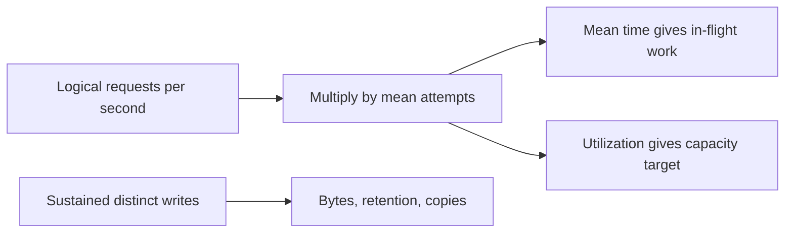

The calculator accepts peak logical request rate, mean attempt latency, and sustained distinct writes as independent inputs. It does not infer writes from all traffic or infer database pool size from request concurrency. That separation prevents a convenient equation from answering the wrong resource question.

<a id="lesson-1-09--e-real-world-examples"></a>

#### E. Real-world examples

For an illustrative StopAround launch, measure route searches separately from saved journeys. Read caching can reduce provider traffic without changing the number of distinct saved journeys. A routing-provider outage can raise attempts and mean latency while the write rate remains unchanged. The right capacity response starts with that distinction.

For a separate telemetry service, a small number of devices can generate high sustained ingest volume. User count is a poor storage predictor; observation frequency, encoded size, retention, and copies dominate. An analytical query workload can add temporary disk and CPU even when ingest rate is steady.

For both services, test a failure scenario explicitly. A planning spreadsheet sized only for the normal fleet can miss a saturated survivor, cold cache, or migration copy. The estimate should identify the assumption and the observation that would show it is failing.

<a id="lesson-1-09--f-executable-example"></a>

#### F. Executable example

Run the full [capacity model](exercises/module-01/09-numbers-to-know/capacity.py):

```bash
python3 exercises/module-01/09-numbers-to-know/capacity.py
```

It uses Decimal arithmetic, explicit byte units, finite positive input validation, and named outputs. The output is exact under the declared inputs; the inputs remain estimates. The tests cover known results, retry amplification without duplicate logical writes, and invalid nonphysical inputs.

<!-- Listing: exercises/module-01/09-numbers-to-know/capacity.py -->

```python
"""Unit-explicit illustrative estimates; Decimal arithmetic avoids binary-float rounding."""
from decimal import Decimal


def positive(value,name,allow_zero=False):
    result=Decimal(str(value))
    if not result.is_finite() or result<0 or (result==0 and not allow_zero): raise ValueError(f'invalid {name}')
    return result


def estimate(peak_requests_s,mean_latency_ms,sustained_writes_s,record_bytes,retention_days,
             copies=3,target_utilization='0.6',mean_attempts=1,storage_overhead_ratio='0.3'):
    peak=positive(peak_requests_s,'peak requests/s'); latency=positive(mean_latency_ms,'mean latency ms')
    writes=positive(sustained_writes_s,'sustained writes/s',True); size=positive(record_bytes,'record bytes')
    days=positive(retention_days,'retention days'); replicas=positive(copies,'copies')
    utilization=positive(target_utilization,'target utilization'); attempts=positive(mean_attempts,'mean attempts')
    overhead=positive(storage_overhead_ratio,'storage overhead',True)
    if utilization>=1 or attempts<1 or replicas!=replicas.to_integral_value(): raise ValueError('invalid utilization, attempts, or copy count')
    effective=peak*attempts; logical=writes*Decimal(86400)*days*size
    return {'attempts_s':effective,'mean_inflight':effective*latency/1000,
            'required_service_capacity_s':effective/utilization,
            'logical_bytes':logical,'physical_bytes_without_backups':logical*replicas*(1+overhead),
            'logical_GB':logical/Decimal(10)**9,'logical_GiB':logical/Decimal(2)**30}


if __name__=='__main__':
    import json
    print(json.dumps({k:str(v) for k,v in estimate(500,200,20,1000,30).items()},indent=2))
```

The model does not simulate queue distributions, failover placement, compression, backup schedules, or cloud billing. Add a mechanism only when the decision requires it, and name the new assumption. A decimal output should not imply that record-size or traffic guesses have decimal-level confidence.

<a id="lesson-1-09--g-architectural-decisions-and-trade-offs"></a>

#### G. Architectural decisions and trade-offs

Estimate before selecting more infrastructure. If projected retained data and work fit one well-operated database with headroom, sharding adds ownership cost without a demonstrated need. If the shared provider or database is the bottleneck, multiplying stateless instances can worsen contention rather than improve capacity.

Use a target range tied to response objectives and failure scenarios. More headroom costs resources but can reduce queues and aid recovery; a larger queue costs less immediate rejection but increases waiting. Test the user-visible deadline instead of treating either maximum utilization or zero rejection as the sole goal.

Prefer a few measurements that change the decision over an elaborate spreadsheet of guessed machine constants. Historical latency charts can provide context, but current hardware, placement, protocols, and workload need current evidence. Preserve observed benchmark inputs so another engineer can challenge the model.

<a id="lesson-1-09--h-common-failures-and-debugging"></a>

#### H. Common failures and debugging

For a tenfold estimate error, check seconds versus milliseconds, bytes versus bits, decimal versus binary units, average versus peak, and user requests versus dependency attempts. Check whether retention used sustained writes or an unrelated read peak. These mistakes often dominate arithmetic rounding.

For unexpectedly high concurrency, inspect both arrival rate and mean residence time, including queues. For storage growth, compare distinct rows, indexes, WAL, and temporary/backup usage. For a slow recovery after a burst, subtract ongoing arrivals before estimating drain time.

For a capacity test that looks impressive, inspect data distribution, cache warmth, endpoint mix, error rate, achieved latency, and client-side throttling. A load generator reaching its own limit cannot establish the server's maximum. A result with high rejection does not represent useful completed demand.

<a id="lesson-1-09--i-practical-exercise"></a>

#### I. Practical exercise

Use the calculator's default scenario: 500 logical requests/s, 200 ms mean attempt latency, 20 distinct writes/s, 1,000 bytes/record, 30 days, three copies, 30% storage overhead, and a 60% utilization target. Compute concurrency, logical and physical storage, response-body bandwidth for 2,000-byte responses, and one-failure instance count under an assumed 300 attempts/s per instance.

Repeat with 1.5 mean attempts, then double record size. Explain which outputs change and why logical rows do not multiply with retries under the idempotency assumption. Finally, solve the thirty-second queue burst and post-burst drain example, list the three most consequential unknowns, and propose measurements. Compare with the [worked solution](#lesson-1-09--exercise-solution).

<a id="lesson-1-09--j-interview-and-senior-engineering-assessment"></a>

#### J. Interview and senior-engineering assessment

1. Why is daily user count insufficient to size a backend?
2. What must match when applying Little's law?
3. Why is p99 latency not the right substitute for its mean time?
4. How do retries affect rate and concurrency?
5. Why are replicated live copies not a backup estimate?
6. How do you calculate backlog drain with ongoing arrivals?
7. What makes an estimate useful rather than merely precise?

<a id="lesson-1-09--assessment-solutions"></a>

#### Assessment solutions

<a id="lesson-1-09--1-operations-and-timing-differ"></a>

##### 1. Operations and timing differ

Users generate different numbers and types of operations at different times. Expand user activity into endpoint rates, peaks, fan-out, cache misses, and distinct writes at the resource boundary being sized. State the assumptions and measure their sensitive parts.

<a id="lesson-1-09--2-population-rate-time-and-boundary"></a>

##### 2. Population, rate, time, and boundary

Use average throughput and average residence time for the same stable observed population. Include waiting if queued items count in that population. Do not mix logical requests, retry attempts, and database transactions in one equation.

<a id="lesson-1-09--3-the-relationship-concerns-averages"></a>

##### 3. The relationship concerns averages

Percentiles of time do not directly produce percentiles of simultaneous population, especially with correlated arrivals and service times. Use mean values for the law and measure tail behavior or simulate an appropriate queue model separately.

<a id="lesson-1-09--4-more-attempts-without-more-useful-intent"></a>

##### 4. More attempts without more useful intent

Mean attempts multiplies the attempted rate. With constant mean attempt duration, average in-flight work scales by the same factor; if failures also slow calls, it grows further. Correct idempotency prevents retries from multiplying distinct business records.

<a id="lesson-1-09--5-different-failure-and-retention-scopes"></a>

##### 5. Different failure and retention scopes

Live replicas can copy deletion or corruption and need not preserve historical restore points. Backups have separate retention, compression, restore, and integrity properties. Include WAL, temporary space, migrations, and backup storage explicitly when the decision needs them.

<a id="lesson-1-09--6-use-spare-processing-capacity"></a>

##### 6. Use spare processing capacity

Subtract ongoing arrivals from processing throughput, then divide backlog by that positive net drain rate under constant-rate assumptions. In the example, 1,500 jobs divided by 25 spare jobs/s gives sixty seconds. If net drain is zero or negative, the backlog does not clear under that workload.

<a id="lesson-1-09--7-it-supports-a-falsifiable-decision"></a>

##### 7. It supports a falsifiable decision

Define units, boundaries, assumptions, ranges, and the decision threshold. Identify the unknown that could reverse the choice and measure it. Exact arithmetic cannot compensate for an incorrect workload model or an untested capacity assumption.

<a id="lesson-1-09--k-key-takeaways-and-navigation"></a>

#### K. Key takeaways and navigation

Keep rates, durations, bytes, copies, and populations explicit. Estimate failure and retry behavior, use ranges, and replace sensitive guesses with observations.

You have reached the end of Module 1. Next in the curriculum: [2.01 — Core database](COURSE_TOC.md#lesson-2-01), which remains planned. Previous: [1.08 — Database indexing](#lesson-1-08). The [Module 1 lab guide](exercises/module-01/README.md) collects all execution and cleanup commands.

<a id="lesson-1-09--exercise-solution"></a>

#### Numbers to know — worked solution

All values below are illustrative inputs and arithmetic, not measured instance capacity or a production recommendation.

| Quantity | Calculation | Result |
|---|---|---|
| Mean in-flight attempts | 500/s × 0.2 s | 100 |
| Nominal capacity at 60% target | 500/s ÷ 0.6 | about 833.3/s |
| Logical retained bytes | 20/s × 86,400 s/day × 30 days × 1,000 B | 51,840,000,000 B |
| Logical GB and GiB | bytes ÷ 10^9; bytes ÷ 2^30 | 51.84 GB; about 48.28 GiB |
| Three copies plus 30% overhead | logical bytes × 3 × 1.3 | 202,176,000,000 B |
| Response bodies | 500/s × 2,000 B | 1 MB/s; 8 megabits/s |
| Instances tolerating one loss | (N − 1) × 300/s × 0.6 ≥ 500/s | N = 4 |

At 1.5 mean attempts, attempted rate is 750/s, average in-flight attempts are 150 if mean attempt time stays 200 ms, and nominal capacity is 1,250/s. One-failure sizing becomes `(N − 1) × 300 × 0.6 >= 750`, so N = 6 under the linear-scaling assumption. Retry failure often also raises duration, so constant latency must be tested.

Logical retained rows and bytes stay unchanged because the write input counts distinct records and the model assumes idempotent retried mutations. Doubling record size doubles both logical and modeled physical storage, without changing request concurrency. Response bandwidth changes only if response size or attempted response traffic also changes; record size and response size are independent inputs.

The queue grows at 100 − 50 = 50 jobs/s for thirty seconds, accumulating 1,500 jobs. Afterward it drains at 50 − 25 = 25 jobs/s, requiring sixty seconds under the constant-rate assumptions. Dividing by the full 50/s would incorrectly ignore ongoing arrivals.

Three influential unknowns are peak endpoint mix and fan-out, mean latency/connection hold time under failure, and physical storage per logical record including indexes. Measure provider calls per admitted request, trace the relevant timing boundaries under representative load, and compare encoded payload, table, and index sizes. Also inspect backup and migration space separately; the model explicitly excludes them.

The executable checks validate unit conversions, retry arithmetic, and invalid inputs. They do not establish a latency SLO, a benchmark for a particular machine, or the linear scaling assumed in the instance-count example.
