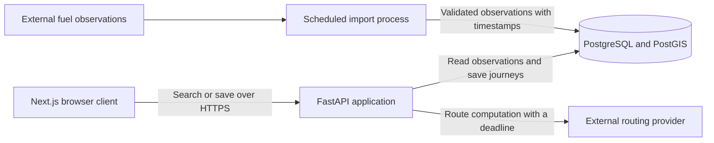
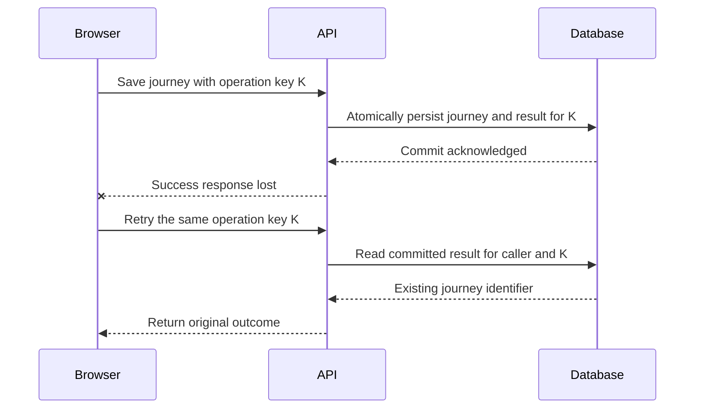

# Senior Full-Stack System Design Masterclass

Working edition · 1 written lesson(s) · Target: 98 lessons

This partial edition contains the complete currently written lesson content and worked exercise solutions. The original curriculum has not yet been verified; lesson placement remains provisional. It is not the completed 98-lesson textbook.

## Contents

- [Orientation](#provisional-module-00)
  - [From frontend features to production systems](#provisional-m0-01)

<a id="provisional-module-00"></a>

## Orientation

<a id="provisional-m0-01"></a>

### From frontend features to production systems

Provisional Module 0 introduction · Lesson identity pending import of the original curriculum

<a id="provisional-m0-01--a-learning-objectives-and-prerequisites"></a>

#### A. Learning objectives and prerequisites

After this lesson, you should be able to turn a feature description into a system boundary, distinguish user-visible guarantees from implementation choices, estimate workload with explicit units, and explain why retries and concurrent requests complicate correctness. You should also be able to name the evidence needed to investigate a slow request instead of immediately adding infrastructure.

Prerequisites: experience delivering a web application, calling HTTP APIs, and interpreting basic application logs. No prior distributed-systems knowledge is assumed. Your existing frontend skills transfer: tracing state, defining component contracts, and measuring rendering performance all become useful across process boundaries.

This lesson introduces concepts that later lessons will examine in detail: networking, API contracts, transactions, concurrency, capacity planning, and observability. Their exact lesson links will be assigned when the original curriculum is available. See the [source inventory](SOURCE_INVENTORY.md) for that limitation and the [exercise solution](#provisional-m0-01--exercise-solution) after attempting the work.

<a id="provisional-m0-01--b-mental-model-and-intuition"></a>

#### B. Mental model and intuition

A frontend feature is often described by what appears on screen: enter a route, choose a fuel type, and see recommended stops. A production system must explain how that answer becomes trustworthy. Where do prices originate? How old can they be? What happens when the routing provider is unavailable? Can another user read a saved journey? What remains true if two requests arrive together?

System design connects a product promise to the mechanisms that uphold it. A diagram names components; a design explains their responsibilities, the facts they own, the messages between them, and their behavior under failure. The useful unit of reasoning is an operation with an outcome, such as “save this journey for this user,” rather than a list of products such as PostgreSQL, Redis, and Kafka.

In a browser, you can often inspect the state relevant to one interaction. Across a browser, API process, database, and external provider, there is no single observer with perfect information. A timeout may mean that a request never arrived, that execution is still running, or that execution finished but its response was lost. These possibilities require different recovery behavior.

Senior engineering begins by making such uncertainty explicit. You do not need an elaborate architecture for every feature. You need a small architecture whose assumptions, limits, and recovery behavior you can explain and test.

<a id="provisional-m0-01--c-deep-technical-explanation"></a>

#### C. Deep technical explanation

<a id="provisional-m0-01--translate-requirements-into-observable-contracts"></a>

##### Translate requirements into observable contracts

A functional requirement describes behavior: “return fuel stations within a configurable detour of the selected route.” A quality requirement constrains that behavior: “for eligible searches, return a valid response within 1.5 seconds for at least 95% of requests over a rolling seven-day window.” Both statements still need definitions. Is time measured in the browser or at the API boundary? Does a routing-provider timeout count as failure? Is an empty result valid?

Define an **eligible request** as one that meets a documented contract, including authorized access where required and supported input bounds. Exclude genuine caller validation mistakes from a service-availability denominator only through a stable rule; never relabel overload errors as invalid input. An empty search can be successful if the search completed correctly. A provider failure should not masquerade as “no stations found.”

A service level indicator measures behavior; a service level objective sets its target. For example, count valid API responses delivered before a deadline and divide by eligible requests. This combined measure makes slow failures visible. Browser timing and API timing answer different questions and should have separate definitions. These terms follow [Google's SRE treatment of service level objectives](https://sre.google/sre-book/service-level-objectives/).

Requirements should also identify **invariants**: properties that must remain true across all allowed executions. Examples include “a saved journey has exactly one owner,” “a response never labels an unknown price as current,” and “retrying one save operation does not create two journeys.” An invariant guides schema constraints, authorization, and transaction boundaries. “Use a relational database” is an implementation choice, not an invariant.

<a id="provisional-m0-01--identify-ownership-and-boundaries"></a>

##### Identify ownership and boundaries

A process boundary separates address spaces and failure domains. If an API process restarts, its in-memory variables disappear; committed data in a separate database can remain. A trust boundary separates actors whose input or authority must be checked. A browser-to-API request crosses both boundaries. A function call between modules inside one API process crosses neither by itself.

Choose a source of truth for each important fact. A database can own saved journeys and their ownership. A fuel-data provider can own observations of prices, while your database owns the observations you imported and their timestamps. A browser cache owns a local representation, not authority to modify another user's journey.

An operation should have a clear authoritative outcome. For a save, that usually means a committed database change. The browser displaying a success toast is an observation of that outcome. Losing the response after the commit does not undo the save. This distinction is the foundation of reliable retries.

<a id="provisional-m0-01--understand-concurrency-before-adding-machines"></a>

##### Understand concurrency before adding machines

Concurrency means multiple operations can be in progress with overlapping lifetimes. Parallelism means computation occurs simultaneously. Even one API process can interleave requests while waiting for database or network I/O. A single deployment does not make read-then-write code safe.

Suppose two requests read a journey's version as 7, independently edit it, and both overwrite its contents. The second write can erase the first. A database transaction groups work, but its isolation level and statements determine which interference is prevented. PostgreSQL's default Read Committed isolation gives a statement its own committed-data snapshot; successive statements in one transaction can see different committed changes. See the [PostgreSQL transaction-isolation documentation](https://www.postgresql.org/docs/18/transaction-iso.html).

One possible solution is a conditional update with an expected version: update only when the stored version is still 7, increment it, and return a conflict when no row matches. Another is to lock the row before a coordinated update. The former detects stale edits; the latter makes competing writers wait. Neither substitutes for authorization or input validation. PostgreSQL documents row-lock behavior and the cost of long transactions in its [explicit-locking reference](https://www.postgresql.org/docs/18/explicit-locking.html).

Do not hold a database transaction open while asking a slow external provider to compute a route unless there is a compelling consistency requirement. That extends connection occupancy and may extend lock duration without making the remote operation part of the database transaction.

<a id="provisional-m0-01--separate-rate-latency-and-concurrency"></a>

##### Separate rate, latency, and concurrency

Consider this illustrative workload, not measured StopAround traffic:

- 100,000 daily active users.
- 4 recommendation searches per active user per day.
- A peak rate 8 times the daily average.
- Mean API residence time of 300 milliseconds during a stable peak interval.

The daily volume is `100,000 users/day × 4 searches/user = 400,000 searches/day`. There are `24 × 60 × 60 = 86,400 seconds/day`, so the average rate is `400,000 / 86,400 = 4.63 searches/second`. The illustrative peak rate is `4.63 × 8 = 37.04 searches/second`.

Little's law relates average occupancy, throughput, and average residence time: `L = λ × W`. For a stable system with matched measurement boundaries, `37.04 requests/second × 0.300 seconds/request = 11.11 requests` in flight on average. This use of averages and a stationary regime is discussed in [MIT's queueing-model lectures](https://web.mit.edu/1.041/www/lectures/L8-queuing-models-2024sp.pdf).

If mean residence time becomes 3 seconds at the same achieved throughput, average occupancy becomes 111.11 requests. Latency can therefore create a resource problem even when request rate is unchanged. If arrivals exceed service capacity and backlog grows without bound, this stable-regime estimate cannot describe the incident as if it had settled.

These numbers do not tell you how many CPU cores or database connections to purchase. Requests can wait without consuming a core, and they may hold a database connection for only part of their lifetime. To estimate occupied database connections, use database operations per second and the time a connection is actually checked out. Retries add attempts; multiple queries add database operations. Measure each boundary separately.

You also cannot substitute p95 latency for mean residence time in Little's law. A percentile describes a point in a distribution; an average supports this occupancy relationship. Keep both: averages help resource reasoning, while tail percentiles expose slow user experiences.

<a id="provisional-m0-01--treat-failure-as-a-set-of-states"></a>

##### Treat failure as a set of states

For a network operation, distinguish success, definite rejection, and unknown outcome. A schema validation error is a definite rejection before mutation. A lost connection after a database commit creates an unknown outcome for the caller. Retrying must be based on operation semantics, not merely on an exception class.

An idempotent operation has the same intended effect when repeated as when performed once. HTTP method semantics provide guidance, but an arbitrary creation endpoint is not automatically safe to replay. [RFC 9110's idempotency section](https://www.rfc-editor.org/rfc/rfc9110.html#section-9.2.2) explains this distinction and cautions about automatic retries of non-idempotent requests.

An application can make creation retryable by binding a client-generated operation key to an authenticated caller, request fingerprint, and durable result. Reserving the key and performing the mutation must be coordinated so two simultaneous attempts cannot both create resources. Later lessons will implement that protocol. Here, the essential insight is that retry policy and data design must agree.

<a id="provisional-m0-01--d-architecture-and-data-flow"></a>

#### D. Architecture and data flow

This illustrative boundary map is a starting point for reasoning, not a complete StopAround design or a description of its current implementation.



The database owns saved journeys. Imported prices retain observation timestamps. Route computation is a dependency with its own failure behavior. The importer can initially be a scheduled command from the same codebase; this box does not imply a separate microservice or a message broker.

The next diagram isolates a write whose response is lost:



Read the sequence as a protocol requirement. It assumes the durable operation record is committed with the mutation and the retry is authenticated and fingerprint-checked. A cache entry written after the commit would leave a failure window.

<a id="provisional-m0-01--e-real-world-examples"></a>

#### E. Real-world examples

For StopAround, freshness is part of answer quality. A quick response based on an old fuel observation may be less useful than a slightly slower one with a clear observation time. A reasonable product contract could display age and warn when observations exceed a threshold. The threshold is a product assumption to validate, not a universal database setting.

For an independent example, consider a workshop with ten remaining seats. A browser disabling its submit button reduces accidental repeated clicks, but two users and two tabs can still submit together. The authoritative capacity check belongs where concurrent reservations become durable. A safe mechanism must prevent accepted reservations from exceeding capacity; UI state alone cannot uphold that invariant.

These are teaching examples. No internal architectures or performance metrics of named commercial applications are assumed. The lesson's documented operational framework is narrower: Google describes latency, traffic, errors, and saturation as useful monitoring signals in [Monitoring Distributed Systems](https://sre.google/sre-book/monitoring-distributed-systems/).

<a id="provisional-m0-01--f-executable-example"></a>

#### F. Executable example

The following complete Python model checks arithmetic and invalid assumptions. It is a local estimation tool, not a benchmark or an API implementation. Its inputs are daily volume, an illustrative peak multiplier, and mean latency at that peak workload.

The executable source is [load_model.py](exercises/module-00/01-system-boundaries/load_model.py):

```python
import json
from math import isfinite


def estimate_load(
    *, daily_requests: float, peak_factor: float, mean_latency_ms: float
) -> dict[str, float]:
    for name, value in (
        ("daily_requests", daily_requests),
        ("peak_factor", peak_factor),
        ("mean_latency_ms", mean_latency_ms),
    ):
        if not isfinite(value):
            raise ValueError(f"{name} must be finite")
    if daily_requests < 0 or peak_factor < 1 or mean_latency_ms <= 0:
        raise ValueError("volume >= 0, peak factor >= 1, latency > 0 required")

    average_rps = daily_requests / 86_400
    peak_rps = average_rps * peak_factor
    mean_in_flight = peak_rps * (mean_latency_ms / 1_000)
    if not all(isfinite(value) for value in (peak_rps, mean_in_flight)):
        raise ValueError("estimate exceeds finite numeric range")
    return {
        "average_rps": average_rps,
        "peak_rps": peak_rps,
        "mean_in_flight": mean_in_flight,
    }


if __name__ == "__main__":
    print(json.dumps(estimate_load(
        daily_requests=400_000, peak_factor=8, mean_latency_ms=300
    ), indent=2))
```

Run from the repository root:

```sh
python3 exercises/module-00/01-system-boundaries/load_model.py
python3 -m unittest discover -s exercises/module-00/01-system-boundaries -v
```

Expect approximately `4.6296` average requests/second, `37.0370` peak requests/second, and `11.1111` mean in-flight requests. The tests check the reference calculation, tenfold latency growth, zero volume, invalid inputs, and numeric overflow. They do not establish production capacity. To do that, run representative load against a realistic environment and observe saturation and the latency distribution.

The function rejects NaN, infinity, negative volume, invalid peak factors, and nonpositive latency. That matters because a model that silently accepts meaningless assumptions can produce a confident but unusable recommendation. The type annotations describe a numeric Python interface; this function is not an untrusted JSON request parser.

<a id="provisional-m0-01--g-architectural-decisions-and-trade-offs"></a>

#### G. Architectural decisions and trade-offs

Start with a modular application and a relational database when they satisfy the workload and ownership model. One deployable API keeps local changes and transactions straightforward. It can still have separate modules for routing, journeys, and data import. Separate processes become useful when isolation, resource profiles, or independent operational ownership justify their cost.

| Decision | Useful starting point | Evidence that could change it |
|---|---|---|
| Compute recommendations synchronously | Return a result within a bounded request | Work routinely exceeds the response deadline; expose a durable job and status |
| Read observations from PostgreSQL | Keep query logic and authority together | Measured repeated reads dominate cost and bounded staleness is acceptable; consider caching |
| Keep business modules in one API | Preserve simple deployment and local coordination | A workload needs independently controlled resources or a team needs a separate ownership boundary |
| Run imports on a schedule | Match a known data-refresh cadence | Bursts, resumability, or backlog management require a durable job mechanism |
| Choose a deployment size | Use a representative load test and recovery target | Measurements show CPU, memory, database, or dependency saturation |

Every additional component introduces configuration, credentials, monitoring, deployment work, and a new failure surface. A cache may reduce read latency but adds invalidation and freshness decisions. A queue moves work out of the response path but requires retry, duplicate handling, and backlog visibility. Costs include operator attention as well as the hosting bill.

Preserve migration options through clear ownership and contracts. Do not create an abstraction for every possible future database. Document why today's choice meets today's requirements and specify a measurable condition for revisiting it.

<a id="provisional-m0-01--h-common-failures-and-debugging"></a>

#### H. Common failures and debugging

Consider an illustrative incident: recommendation p95 latency rises from 700 milliseconds to 6 seconds, while HTTP traffic remains roughly flat. Begin with impact and scope. Identify the affected endpoint, time window, region, response codes, and deployment changes. Avoid concluding that “the database is slow” from one aggregate graph.

| Observation | Hypothesis | Evidence to collect | Targeted response |
|---|---|---|---|
| Provider spans grow; CPU stays low | Remote dependency slows down | Dependency latency, timeouts, attempts per search | Bound deadlines and concurrency; provide an explicitly limited fallback when valid |
| Connection acquisition dominates | Pool exhausted or connections held too long | Checkout time, active transactions, pool waiters | Shorten connection lifetime; fix leaks; bound admission |
| One query duration grows | Changed plan, missing useful index, or more data | Query plan, row estimates, buffers, data distribution | Test the query or index change on representative data |
| Saved journeys appear twice | Retry after an unknown outcome | Operation keys, request attempts, committed rows | Add durable deduplication tied to the mutation |
| API looks healthy but users wait | Measurement boundary misses client delay | Browser timings and correlated request traces | Investigate network, rendering, or gateway delay |

If requests hold database connections during remote calls, more API replicas may create even more waiting connections. Compare the total configured pools across all processes with database capacity. Scaling one tier can worsen another tier's saturation.

Mitigate before completing a perfect explanation: roll back a recent harmful change, cap expensive work, or disable an optional enrichment. Preserve correctness when degrading. Returning timestamped observations with a clear limitation may be acceptable; silently presenting stale data as fresh is a different product behavior.

After recovery, test the causal hypothesis and write a prevention action. “Increase the pool” is incomplete without knowing whether demand, hold time, or a leak caused exhaustion. Observability should let you distinguish those causes; otherwise the next incident repeats the same guesswork.

<a id="provisional-m0-01--i-practical-exercise"></a>

#### I. Practical exercise

Write a one-page engineering brief for a StopAround recommendation request and saved-journey operation. Spend approximately 60–90 minutes, then compare your reasoning with the [worked solution](#provisional-m0-01--exercise-solution).

Use the illustrative workload from section C. Add these constraints: imported observations may be at most 30 minutes old before a warning is required; route computation can fail; saved journeys are private; the client can retry after a timeout. The 30-minute threshold is an exercise assumption.

Your brief must include:

1. Two functional requirements, a precisely bounded latency indicator, an availability indicator, and three invariants.
2. A responsibility map for browser, API, database, and providers, including authoritative ownership.
3. Average and peak request rates, mean occupancy at 300 milliseconds and 3 seconds, and one reason those figures cannot size a database pool directly.
4. A timeline in which a save commits and its response disappears. State the retry protocol and the consistency boundary it requires.
5. A decision to include or omit a cache and a queue, justified by present requirements.
6. A debugging plan for rising latency with stable traffic and a safe degraded response for provider failure.

For an additional challenge, repeat the invariant analysis for the workshop's last seat. Identify where a read-then-write sequence can violate the capacity rule. You need not implement the transaction in this introductory exercise.

Successful work makes assumptions explicit, shows units, distinguishes failed search from an empty result, and explains the durable outcome of a retried write. A list of infrastructure names does not satisfy the exercise.

<a id="provisional-m0-01--j-interview-and-senior-engineering-assessment"></a>

#### J. Interview and senior-engineering assessment

Attempt these before reading the solutions.

1. A product manager asks for a “fast, reliable recommendation API.” Which questions turn that statement into an implementable contract?
2. Does deploying a single API process eliminate concurrent-update bugs? Explain with an interleaving.
3. A save request times out after the database commits. What does the browser know, and how should it recover?
4. At 37.04 requests/second and 300 milliseconds mean residence time, how many requests are in flight on average? Why is that not a database connection count?
5. API p95 is low, but users report slow searches. How would you investigate the discrepancy?
6. Would a cache, a queue, or additional API replicas fix a slow external routing provider? Explain the conditions and risks.
7. What evidence would justify splitting an importer out of the API deployment? What would remain shared or coordinated afterward?

<a id="provisional-m0-01--assessment-solutions"></a>

#### Assessment solutions

<a id="provisional-m0-01--1-define-the-boundary-and-denominator"></a>

##### 1. Define the boundary and denominator

Ask which operation and user journey matter, where elapsed time is measured, which requests are eligible, what a valid result means, which failures count, and over what window the target is evaluated. Set an explicit latency target and success proportion. Clarify freshness and privacy separately: a fast response can still be wrong or unauthorized. An implementable contract describes observable behavior and can be turned into an automated measurement.

<a id="provisional-m0-01--2-one-process-still-interleaves-work"></a>

##### 2. One process still interleaves work

Request A reads version 7 and waits. Request B reads version 7. A writes its edit; B writes an edit based on the old value. Without a condition or appropriate locking, B can erase A's change. Waiting on I/O allows overlap even without parallel CPU execution. Choose conflict detection or serialization according to the product behavior required; a process-local mutex would not protect a second process or another database writer.

<a id="provisional-m0-01--3-the-outcome-is-unknown-to-the-caller"></a>

##### 3. The outcome is unknown to the caller

The browser knows that it did not receive a usable response, not that the save failed. Reuse the same operation key with the same payload and authenticated owner. The API should return the durable original outcome when that operation has committed. A new key represents a new operation and could create a duplicate. Deduplication must survive API restarts and concurrent requests, and payload mismatches must be rejected rather than silently treated as the same save.

<a id="provisional-m0-01--4-match-units-and-resource-boundaries"></a>

##### 4. Match units and resource boundaries

`37.04 requests/second × 0.300 seconds/request = 11.112 requests`, approximately 11.11 in flight on average. This includes all time inside the API measurement boundary. Database connections are occupied only during checkout intervals, and there may be several database operations per request. Pool sizing also needs burst behavior, query latency, database capacity, and limits across replicas. Replacing the mean with p95 would not compute mean occupancy.

<a id="provisional-m0-01--5-follow-the-user-visible-path"></a>

##### 5. Follow the user-visible path

Compare browser measurements with gateway and API spans for the same searches. Check DNS/connect/TLS time where available, request queueing before the API, provider duration, response transfer, and client rendering. Confirm that successful-only API metrics are not hiding timed-out requests and that sampling is not excluding slow users. Determine whether the complaint concerns a particular device or network rather than trusting a global percentile to describe every user.

<a id="provisional-m0-01--6-change-the-dependency-pressure-deliberately"></a>

##### 6. Change the dependency pressure deliberately

A cache helps only when repeated computations can be reused under an acceptable freshness and privacy policy. A durable job helps only if the product accepts deferred completion and has a status contract; it does not make computation faster. More replicas may increase calls to an already constrained provider. First measure attempts, deadlines, latency, and rate limits. Bound work and retries, then choose reuse, deferred work, or a documented degraded mode when its semantics fit.

<a id="provisional-m0-01--7-separate-a-measured-operational-need"></a>

##### 7. Separate a measured operational need

Useful evidence includes imports consuming enough CPU or memory to harm interactive requests, a need to restart imports independently, or a distinct scheduling and recovery model. A scheduled process from the same repository may already provide sufficient separation. Splitting does not eliminate schema coordination, database budgets, credentials, or observability. Define checkpointing and idempotent import behavior so a process crash does not require guessing which observations were committed.

<a id="provisional-m0-01--k-key-takeaways-and-navigation"></a>

#### K. Key takeaways and navigation

Design begins with an operation, measurable promises, and invariants. Assign authority for each fact, make process and trust boundaries explicit, and account for unknown outcomes. Concurrency exists before horizontal scaling. Capacity estimates connect rates to time within a precise boundary; they guide measurement rather than replace load testing.

Choose additional infrastructure when its benefits address an observed or required constraint. For production ownership, you must be able to implement the contract, test competing operations, deploy a change, detect a failure, and recover safely. Recognizing component names is only the beginning.

Return to the [course home](README.md), attempt the [exercise](#provisional-m0-01--i-practical-exercise), or review the [solutions](#provisional-m0-01--assessment-solutions). The next lesson will be selected from the verified curriculum; the current [checkpoint](CHECKPOINT.md) records what is needed before that selection.

<a id="provisional-m0-01--exercise-solution"></a>

#### Worked solution: system boundaries and workload

Attempt [the exercise](#provisional-m0-01--i-practical-exercise) first. This is one defensible solution to the stated hypothetical workload, not a description of the current StopAround application.

<a id="provisional-m0-01--exercise-solution--requirements-and-invariants"></a>

##### Requirements and invariants

The search accepts a supported route and fuel preference, then returns matching station observations and observation times. The save operation creates a private journey owned by the authenticated caller and returns a stable identifier.

For the exercise, define the latency indicator as the fraction of eligible searches receiving a valid response within 1.5 seconds, measured from API ingress to completion of response transmission at that boundary. Target at least 95% over seven days. This is a combined timeliness-and-success target; count timeouts as failures. It excludes the browser's network and rendering time, which need a separate user-experience measurement.

Define availability as valid search responses divided by eligible searches over 30 days, with an illustrative 99.5% target. Count dependency timeouts and overload rejections as failed eligible searches. A 4xx response is not automatically a caller mistake: classification follows the request contract and failure cause. Missing final responses must remain visible through ingress accounting and deadlines rather than disappearing from success-only instrumentation.

Three invariants are: only the owner can read or mutate a private journey; each successful retry of one save operation identifies the same journey; and an observation older than 30 minutes is accompanied by a freshness warning. Distinguish observation time from import time. Reimporting an old observation does not make it fresh. Compare timestamps at a defined response-evaluation time with monitored clock synchronization.

<a id="provisional-m0-01--exercise-solution--responsibilities"></a>

##### Responsibilities

The browser collects input, renders warnings, and retains a save operation key across retries. The API validates input, authenticates the caller, enforces resource ownership, bounds provider work, and coordinates durable writes. PostgreSQL owns saved journeys and committed operation outcomes. The import process validates external observations and preserves their source timestamps. The routing provider owns the computation it performs; its failure is not evidence that no station exists.

<a id="provisional-m0-01--exercise-solution--capacity-calculation"></a>

##### Capacity calculation

`100,000 users/day × 4 searches/user = 400,000 searches/day`.

`400,000 searches/day ÷ 86,400 seconds/day = 4.6296 searches/second` average.

`4.6296 × 8 = 37.0370 searches/second` illustrative peak.

At a stable peak interval, `37.0370 requests/second × 0.300 seconds/request = 11.1111 requests` in flight on average. At a 3-second mean residence time, `37.0370 × 3 = 111.1111 requests`.

If each search performs one database operation holding a connection for 20 milliseconds, a separate illustrative estimate is `37.0370 operations/second × 0.020 seconds/operation = 0.7407 occupied connections` on average. This is not a recommended pool size: it excludes bursts, long transactions, imports, other endpoints, and capacity limits. It demonstrates why request lifetime and connection lifetime are different quantities.

<a id="provisional-m0-01--exercise-solution--lost-response-and-retry"></a>

##### Lost response and retry

The browser sends operation K with payload P as user U. The API validates the request. Within a database transaction, it coordinates the unique operation identity `(U, K)`, stores a fingerprint of P, creates the journey, and records its result. It commits; the response is lost. The browser retries with U, K, and P. The API finds the committed operation, checks the fingerprint, and returns the same journey identifier.

Concurrent attempts must coordinate on the durable unique identity. A conflicting in-progress attempt may wait for the transaction or receive a documented retryable response. A changed payload under the same key is a conflict. A rollback leaves no successful operation outcome. Define key retention before promising an unlimited deduplication window. This is a protocol design exercise; a later idempotency lesson must implement and test these cases.

<a id="provisional-m0-01--exercise-solution--infrastructure-decisions"></a>

##### Infrastructure decisions

Begin without a separate search cache: the exercise provides no measured read bottleneck and freshness rules already require care. Revisit caching if repeated equivalent searches consume a measured resource and acceptable reuse rules are defined.

Begin without a broker for interactive searches. A bounded request matches the product contract. Run imports as a scheduled process. Consider durable jobs when work needs resumability, deferred completion, or explicit backlog handling. Neither a cache nor a broker replaces ownership checks or a transaction protocol.

<a id="provisional-m0-01--exercise-solution--failure-investigation-and-degradation"></a>

##### Failure investigation and degradation

Correlate API residence time with provider duration, attempt rate, database query duration, and pool checkout waits. Compare mean and tail latency. Check whether recent deployments extended transaction lifetimes or changed queries. Stable ingress with rising occupancy points to longer work or waiting, not necessarily more users.

If a route cannot be computed and no permitted route-specific fallback exists, return a clear temporary failure within the deadline. If the product explicitly permits an approximate result using a previously computed compatible route, label its age and limitations. An HTTP 200 containing an empty list would conceal a failed computation.

For the workshop extension, two callers can both read one remaining seat and both create reservations. Move the capacity decision and accepted reservation into one coordinated database operation or transaction. Conditional updates, row locks, or serializable transactions with retries are candidate mechanisms; each must also address cancellation and replayed requests.
