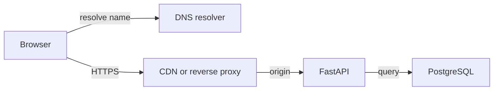

# Networking essentials

Lesson 1.01 · Core concepts

## A. Learning objectives and prerequisites

By the end, you should be able to explain the path from a browser interaction to an API response, distinguish connection setup from application work, assign a useful timeout to each boundary, and investigate a slow request without immediately adding servers. You should also explain why canceling a browser request cannot establish whether a database mutation committed.

Start with [0.01 — Introduction](../module-00/01-from-features-to-systems.md) and [0.02 — How to prepare](../module-00/02-how-to-prepare.md). Familiarity with browser developer tools is sufficient; you do not need to implement a transport protocol. The [Module 1 lab guide](../../exercises/module-01/README.md) supplies the Python environment and commands. All workloads and incident numbers below are illustrative.

## B. Mental model and intuition

A request is a sequence of dependent work across separately operated systems. Your React component sees one promise, but that promise can include waiting for a connection, resolving a name, establishing transport security, reaching a reverse proxy, entering an application queue, querying a database, and transferring a response. A single duration cannot tell you which resource was scarce.

Think in boundaries and clocks. A browser measures an interaction; a proxy measures its upstream exchange; FastAPI measures handler work; PostgreSQL measures a statement. Those intervals overlap. Adding all of them double-counts time, while looking only at handler time misses everything before the handler starts. A trace connects related spans; it does not make their durations interchangeable.

For StopAround, separate the page shell, the route computation, the station list, and the saved journey. A cached JavaScript bundle can arrive quickly while an uncached route request crosses a continent. Improving the bundle does not reduce the routing provider's response time. Making requests parallel reduces some waiting, but increases simultaneous load and makes the slowest required dependency determine completion.

## C. Deep technical explanation

### Names, addresses, and connection reuse

DNS translates names into records, including IPv4 A records and IPv6 AAAA records. Your browser, operating system, recursive resolver, and authoritative service may participate, with caches at multiple points. A DNS TTL expresses a caching lifetime for a record; it does not force every established connection to close when that lifetime ends. A hostname can resolve successfully while its returned destination remains unreachable. These are separate failure domains. [DNS concepts, RFC 1034](https://www.rfc-editor.org/rfc/rfc1034.html).

Changing a DNS record therefore creates a transition period. Existing clients may retain an address or an open connection. During a planned cutover, keep the previous destination safe long enough for the actual clients and caches involved. A shorter TTL can help future lookups converge, but cannot recall a response already cached under an older TTL. Measure traffic at both destinations instead of declaring a migration complete after one successful lookup.

TCP supplies an ordered byte stream with retransmission, flow control, and congestion control. It does not preserve your JSON message boundaries or tell you whether a SQL transaction committed. A TCP acknowledgement concerns received transport data, not completed application work. Packet loss can delay later bytes even when the application server is healthy. [TCP specification, RFC 9293](https://www.rfc-editor.org/rfc/rfc9293.html).

Connection reuse avoids repeated setup, but introduces another resource: a bounded pool. Suppose a backend permits twenty provider connections. If all twenty are occupied, request twenty-one may wait locally before sending any bytes. The provider's dashboard can show normal response times while your application is slow. Observe pool acquisition time, active connections, and rejected or queued work separately from upstream service time.

### Security and protocol versions

TLS authenticates the peer under a certificate-validation policy and protects the connection's contents against observation and alteration. Keep hostname verification enabled. A valid certificate for the API hostname does not authorize Alice to read Bob's journey; application authorization is a later decision. A CDN may terminate one TLS connection and establish another to the origin, producing two separate trust and timing boundaries. [TLS 1.3, RFC 8446](https://www.rfc-editor.org/rfc/rfc8446.html).

The conventional HTTPS-over-TCP path is not universal. HTTP/2 multiplexes streams on one TCP connection, so separate HTTP exchanges can share transport-level delays. HTTP/3 uses QUIC over UDP and has different transport behavior. The probe in this lesson intentionally measures Python's HTTPS-over-TCP path; it does not characterize every browser protocol. Your browser's network panel should identify the negotiated protocol before you reason about connection sharing.

HTTP supplies the request method, target, headers, status, and representation. A proxy's 504 means it timed out waiting for an upstream response according to its policy. It does not prove the upstream operation was canceled. Similarly, a 200 says the server reports success under the endpoint's contract; only that contract tells you what was committed or merely accepted. [HTTP semantics, RFC 9110](https://www.rfc-editor.org/rfc/rfc9110.html).

### Latency has a shape

An illustrative cold request might spend 15 ms in name resolution, 40 ms establishing TCP, 40 ms negotiating TLS, 25 ms waiting for an application worker, 80 ms in useful handler work, and 20 ms transferring and consuming the response. That particular serial path totals 220 ms. A warm request can reuse the name and connection, but still queue for a worker. Do not quote 220 ms as a universal internet latency or assume every handshake always costs exactly one round trip.

Bandwidth measures a rate of transferred data; latency measures elapsed time. Compressing a large payload can reduce transfer time, but cannot remove a slow database lock. Moving the API nearer its database can reduce repeated database round trips, even if the browser remains distant. The best placement depends on how many sequential exchanges occur on each link, not simply on where the frontend is hosted.

Percentiles describe a distribution. A p99 endpoint duration is a threshold covering 99% of the measured requests in that population and window. It is not a guarantee for a particular user. For parallel calls, the maximum of their durations matters when every result is required. For serial calls, the durations add per request, but adding separately reported p99 values does not generally produce the p99 of the sum. Retain traces or joint measurements when a budget depends on correlations.

### Deadlines, timeouts, and retries

A timeout bounds one wait according to a library's definition. A deadline bounds the remaining useful lifetime of the overall operation. Distinguish pool acquisition, connection establishment, reading response data, database execution, and the user interaction. Some read timeouts reset after progress; a peer sending occasional bytes may keep such a request alive much longer than expected.

For an illustrative one-second interaction budget, reserve time for browser-to-API transit and response handling before allocating the remainder to dependencies. Propagate the remaining budget. If a dependency receives only 120 ms of useful budget, starting a second 500 ms attempt cannot rescue the interaction. Set limits on both attempt count and total time, apply backoff with jitter where appropriate, and stop admitting work once it cannot finish usefully.

Retries add traffic precisely when something may already be overloaded. If four layers each allow three attempts, one logical operation can create as many as 81 leaf attempts. Choose a retry owner and a total budget. A successful retry of a read is different from safely retrying a write whose acknowledgement disappeared. The latter requires a durable operation identity, taught in the next lesson. [Google SRE: handling overload](https://sre.google/sre-book/handling-overload/).

## D. Architecture and data flow

This is an illustrative logical path. The CDN and API can terminate separate connections; the resolver is a naming dependency rather than a service through which every HTTP request passes.



On a warm connection, the browser may skip name resolution and handshake work for this exchange. At the edge, a valid public cache hit can avoid the origin. A personalized journey request follows the configured private-data policy instead. The API should attach a request identifier and trace context, enforce admission limits, and observe provider and database waits. A database acknowledgement precedes a successful synchronous-save response, but the response can still be lost after that acknowledgement.

## E. Real-world examples

In an illustrative StopAround incident, users report that the station list appears after several seconds. Handler logs show 90 ms, while browser traces show two seconds before the response starts. Inspect the proxy's upstream timing and the API's connection-pool wait. If the queue is outside the handler timer, adding database indexes may leave the delay unchanged. Reproduce from the same region and connection state before comparing measurements.

For a separate example, an internal document service uploads large attachments. Small requests are fast, while large uploads fail through a proxy. Investigate body-size limits, upload timeouts, buffering, and application streaming before increasing application CPU. An application cannot fix a request body that the proxy rejected before forwarding it. A precise boundary diagram saves time because it identifies which component could have observed the failure.

At a CDN, treat a cached public station-directory response differently from a user's saved routes. The cache key and authorization policy must prevent one user's response from being served to another. Geographic proximity is useful only after the content is eligible to be shared. Lesson 1.04 develops the consistency and privacy implications.

## F. Executable example

The full [network probe](../../exercises/module-01/01-networking-essentials/network_probe.py) resolves a hostname, creates a verified HTTPS connection, requests a response, and reads at most 4,096 body bytes. Run it against a public HTTPS endpoint you are authorized to query:

```bash
python3 exercises/module-01/01-networking-essentials/network_probe.py https://www.python.org/
```

The labels are deliberately narrow: `connect_including_tls_ms` also includes the connection library's own address lookup, and `request_to_headers_ms` ends after response headers arrive, not at full-body completion. The preliminary DNS lookup can warm a resolver cache. This is a diagnostic experiment, not a browser benchmark or a clean separation of TCP and TLS timings.

<!-- Listing: exercises/module-01/01-networking-essentials/network_probe.py -->

```python
"""Bounded HTTPS timing probe. Resolves DNS separately; connect includes a second lookup."""
import http.client
import socket
import ssl
import time
from urllib.parse import urlsplit


def probe(url: str, timeout: float = 2.0) -> dict:
    target = urlsplit(url)
    if target.scheme != 'https' or not target.hostname or target.username or target.password or target.fragment:
        raise ValueError('Use an HTTPS URL without credentials or a fragment')
    if not 0 < timeout <= 30:
        raise ValueError('timeout must be greater than zero and at most 30 seconds')
    port = target.port or 443
    start = time.monotonic()
    addresses = socket.getaddrinfo(target.hostname, port, type=socket.SOCK_STREAM)
    resolved = time.monotonic()
    connection = http.client.HTTPSConnection(target.hostname, port, timeout=timeout, context=ssl.create_default_context())
    try:
        connection.connect()
        connected = time.monotonic()
        connection.request('GET', (target.path or '/') + ('?' + target.query if target.query else ''))
        response = connection.getresponse()
        headers = time.monotonic()
        sample = response.read(4096)
        return {'addresses': len({item[4][0] for item in addresses}), 'status': response.status,
                'dns_ms': round((resolved-start)*1000, 2),
                'connect_including_tls_ms': round((connected-resolved)*1000, 2),
                'request_to_headers_ms': round((headers-connected)*1000, 2), 'sample_bytes': len(sample)}
    finally:
        connection.close()


if __name__ == '__main__':
    import json
    import sys
    print(json.dumps(probe(sys.argv[1]), indent=2))
```

Socket timeouts do not establish a total operation deadline, and the system resolver may have its own timeout policy. The probe does not follow redirects, pool connections, implement retries, or make its results comparable across unrelated hosts. The deterministic tests verify bounded reads, resource cleanup, and input rejection; a live request is a separate environment-dependent check. The module's [pinned dependencies](../../exercises/module-01/requirements.txt) and [check runner](../../exercises/module-01/run_checks.py) accompany the lab guide.

## G. Architectural decisions and trade-offs

Prefer one well-instrumented API near its primary database until a measured requirement justifies more regions. Cross-region replicas and active writers introduce failure and consistency questions that a CDN for public assets does not. First reduce unnecessary sequential network exchanges, reuse bounded connections, and remove oversized payloads.

For a provider dependency, choose between waiting, returning a partial result, or using an explicitly stale fallback. A stale station price may be acceptable with its observation time displayed; a save confirmation cannot be invented from a cached response. Write down the user-visible behavior for each dependency failure before choosing a timeout.

Retries need a cost limit and a semantic rule. Retry a transient failure only when the remaining budget allows it and the endpoint's contract makes repetition safe. A timeout during a mutation should become an unknown outcome associated with an operation key, rather than a prompt to create a new operation. Backpressure should bound work before downstream queues grow beyond useful deadlines.

## H. Common failures and debugging

If DNS resolution fails, compare the failing client's resolver and record type with a known-good client. Check record changes and expiry rather than restarting the API. If resolution succeeds but connection establishment fails, investigate routing, destination readiness, firewall policy, and address-family behavior. A healthy IPv4 route does not prove IPv6 connectivity.

If certificate validation fails, inspect hostname, expiry, certificate chain, and trust configuration. Disabling verification hides the fault and removes the security property you were trying to establish. If only established connections fail after deployment, inspect connection draining and idle-timeout alignment across clients and proxies.

If latency rises with concurrency, inspect queue age, active requests, pool occupancy, and database waits. Record the time before a handler starts. When a browser aborts a save, correlate the operation key with the database result; do not infer rollback from an aborted promise. Keep credentials, sensitive query parameters, and full route coordinates out of routine logs.

## I. Practical exercise

Investigate this illustrative report: “The API is 80 ms, but saving a journey takes 700 ms.” The browser records 20 ms DNS, 90 ms connection and security setup, 300 ms waiting before upstream processing, 80 ms handler work, and 30 ms response handling. The remaining 180 ms is not instrumented. The first save committed, but its response was lost; the user clicked again.

Produce a boundary diagram, account for the measured 520 ms without inventing an explanation for the remaining 180 ms, identify the next two measurements, and propose a one-second end-to-end budget with explicit retry ownership. State how the UI should recover the ambiguous save. Run the probe twice, record its protocol and limitations, and explain why those results cannot establish the browser's missing interval. Compare with the [worked solution](../../exercises/module-01/01-networking-essentials/SOLUTION.md).

## J. Interview and senior-engineering assessment

1. Why can an API handler report low latency while the user experiences a slow request?
2. Does a DNS TTL expiring force an existing HTTPS connection to move to a new server?
3. What does a TCP acknowledgement establish about a journey save?
4. How should a browser timeout affect the interpretation of a write's outcome?
5. Why can connection reuse improve latency and still create a bottleneck?
6. Is the sum of three dependency p99 values the p99 of the user interaction?
7. When is a CDN useful for StopAround, and what must remain protected?

## Assessment solutions

### 1. Different timing boundaries

The handler timer can exclude browser queuing, DNS, connection setup, proxy buffering, worker admission, and response transfer. Correlate the same request across browser, proxy, application, and database. Compare nested intervals rather than adding overlapping span durations. A new measurement should target an unexplained boundary.

### 2. DNS and established transport are separate

TTL affects caching of a DNS record. An open connection already has a destination and may continue until it closes or fails. A safe migration accounts for both cached answers and connection lifetimes, with evidence that traffic has drained from the old destination.

### 3. Transport receipt is not transaction commit

TCP acknowledges transport data, without understanding a business operation. The API can receive bytes and crash before commit, or commit and lose the response. Only a durable application record and a defined response contract resolve that distinction.

### 4. Timeout means the caller stopped waiting

A write can be committed, rejected, or still executing. Preserve the original operation identity and reconcile or retry under the endpoint's idempotency contract. Canceling UI work can prevent stale rendering, but cannot retroactively roll back a remote transaction.

### 5. Pools trade setup cost for bounded shared capacity

Reuse avoids repeated connection work. However, a fixed pool can fill with slow operations and make new requests wait before sending. Observe acquisition latency and bound the waiting population. Increasing the pool without checking downstream capacity can move the bottleneck into the provider or database.

### 6. Percentiles cannot generally be added

The slowest one percent of each dependency need not occur on the same requests. Correlation, serial versus parallel structure, and request populations matter. Measure the end-to-end distribution and inspect representative traces; use component budgets as design constraints rather than a percentile identity.

### 7. Cache eligible public representations

A CDN can serve public assets and appropriately keyed public station data closer to readers. Private journeys need a policy that prevents cross-user reuse. Authentication, cache eligibility, key design, and origin protection come before assuming an edge hit is safe.

## K. Key takeaways and navigation

Follow the request across boundaries, distinguish waiting from useful work, and define timeout semantics before adding retries. A lost response is an application protocol problem as well as a network symptom.

Next: [1.02 — API design](02-api-design.md). Revisit [the learning loop](../module-00/02-how-to-prepare.md) when an experiment produces a number without resolving a question.
