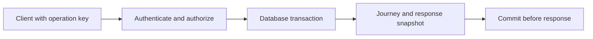

# API design

Lesson 1.02 · Core concepts

## A. Learning objectives and prerequisites

You should finish this lesson able to turn a user operation into a resource contract, distinguish authentication from resource authorization, make retries safe across API replicas, paginate a changing collection, and evolve a contract without silently changing its meaning. The goal is a reliable boundary between your TypeScript client and Python service.

Read [networking essentials](01-networking-essentials.md) first. The example uses the PostgreSQL schema explained fully in the next lesson; the [lab guide](../../exercises/module-01/README.md) initializes it for you. All endpoint designs and incidents here are teaching examples, not descriptions of a deployed StopAround system.

## B. Mental model and intuition

An API is a set of promises about observations and state changes. A route name and a JSON shape are only the visible surface. The contract also includes who may call it, what identifies the operation, when success becomes durable, what a repeated request means, and how the caller should recover from uncertainty.

Start with the user action. “Save this journey for me” implies a principal, an owned journey, a durable write, and a recoverable outcome. “Find stations near this route” implies bounded query input, a freshness policy, pagination or truncation rules, and a potentially partial response when a provider is unavailable. Giving both endpoints a convenient POST body does not make their operational semantics equivalent.

For a frontend engineer, treat the API as a state machine you cannot inspect directly. Your client must distinguish loading, confirmed success, a known rejection, and an unknown outcome. A generic error toast collapses those states and often encourages unsafe repetition. Design the recovery path alongside the happy path.

## C. Deep technical explanation

### Resources and method semantics

Use nouns for durable resources and a consistent representation. The lab exposes `POST /v1/journeys`, `GET /v1/journeys/{id}`, and `GET /v1/journeys`. Creation returns 201 and a Location header; replay of an already completed creation returns 200 with the stored representation. This replay status is an explicit lab convention, not a universal requirement for idempotency.

HTTP defines safe methods and idempotent method semantics. Safe means the client does not request a state change; idempotent means repeating the same intended request has the same intended effect. Incidental logging can still occur. POST is not inherently idempotent, so this endpoint adds a durable operation-key contract. A DELETE can remain idempotent even when a second response reports that the resource is already absent. [HTTP semantics, RFC 9110](https://www.rfc-editor.org/rfc/rfc9110.html).

Separate acceptance from completion. Returning 202 for a background route calculation should include a way to observe the operation and its terminal result. Returning 201 for a synchronous save should occur after the transaction commits. The lab does the latter; there is no queue or hidden worker. Choose asynchronous processing when its lifecycle and recovery costs are justified, not to make a slow mutation appear successful sooner.

### Validate a bounded contract

Validate types, lengths, ranges, allowed fields, and semantic relationships at the boundary. The lab rejects blank or excessively long names, extra request fields, malformed identifiers, oversized page limits, and operation keys outside a small allowed alphabet. Server-owned fields such as owner, creation time, and version are absent from the input model. That prevents a client from assigning them through mass updates.

Validation is not authorization. A syntactically valid journey identifier can identify another person's data. Authentication establishes a principal from verified credentials. Authorization checks whether that principal may perform this operation on this resource, including collection queries, export routes, background jobs, and nested resources. Filtering the detail endpoint while leaving the list endpoint unscoped is a data leak.

The executable lab uses a server-configured map of demonstration bearer tokens to user identifiers, binds to loopback, and stores only synthetic data. It demonstrates ownership enforcement, not an identity provider. A deployed service needs verified issuer/audience/expiry policy, credential handling and rotation, HTTPS, abuse controls, and an appropriate browser session design. Do not move the demonstration token map into a public application.

### Durable idempotency across replicas

The client creates one unpredictable operation key for one intended creation and preserves it through transport retries. The server scopes the key by authenticated owner, canonicalizes the accepted payload, and stores its hash with the completed response. Reusing a key with a different payload returns a conflict, rather than silently creating a different resource or replaying an unrelated result.

The lab serializes contenders for an owner/key pair with a PostgreSQL transaction-scoped advisory lock. Every API replica using this write path consults the same database. After acquiring the lock, the transaction checks the durable operation record. A completed matching request returns its stored response snapshot. Otherwise, it inserts the journey and its operation record in one transaction. Commit happens before the response is returned.

This lock is not a substitute for database constraints. The primary key on owner and operation key prevents duplicate records even if another writer violates the application protocol. The lock prevents a race in the normal check-then-create path. A rare hash collision between different lock identities only serializes unrelated operations; it cannot merge their separately checked records. A timeout acquiring the lock returns a retryable failure under the same operation key.

Storing a response snapshot matters. If the user later renames the journey, replaying its original creation should not accidentally return a newly assembled response with different data. The lab retains keys indefinitely and has no delete endpoint. A real retention policy must specify the replay window, resource deletion behavior, privacy obligations, and what happens after a key expires. Deleting a key can allow the same old request to create another resource.

The guarantee is limited to effects in this transaction and to cooperating writers. A provider charge, email, or queue publication outside it needs its own delivery and deduplication design, often an outbox. The phrase “exactly once” cannot erase the boundary between two independent systems.

### Pagination and concurrent changes

Offset pagination is understandable, but inserts and deletes before an offset can cause skips or repeats between requests. Keyset pagination asks for rows after a stable ordering tuple. For a chronological feed, `(created_at, id)` supplies a tie-breaker; using a timestamp alone loses rows when timestamps are equal.

The lab intentionally uses the simpler total order `id ASC` and a UUID `after` cursor. This order is deterministic but not chronological. Each query filters by owner, asks for `limit + 1` rows, returns at most `limit`, and supplies a next cursor only if another row exists. A cursor does not grant access: authorization is re-evaluated on every page. It also does not create a snapshot. Concurrent inserts with identifiers behind the cursor may not appear in this traversal.

For an export requiring a complete stable set, define snapshot semantics or materialize an export job. For an ordinary live list, document how concurrent changes appear. Opaque or signed cursors can bind ordering and filter parameters, but signing alone does not establish ownership or point-in-time consistency.

### Errors and evolution

Use machine-readable error categories and stable meanings. Distinguish missing credentials, forbidden operations, absent resources, validation failures, conflicting operation keys, rate limits, and temporary dependency failure. A 404 can deliberately conceal an inaccessible resource, as in this lab. Keep SQL text, credentials, and stack traces out of client errors. A request identifier belongs in diagnostics without becoming an authorization credential.

The lab uses FastAPI's small `detail` errors. A larger API can adopt the standardized problem-details representation with a stable problem type and structured extensions. Do not claim the lab already implements that representation. [Problem details, RFC 9457](https://www.rfc-editor.org/rfc/rfc9457.html).

Evolve contracts by considering existing consumers. Adding an optional response field is often easier than changing a field's type, ordering, unit, or nullability. Strict enum decoders can break when a new value appears. A `/v1` path is a namespace, not a migration plan: document deprecation, observe old-client traffic, test compatibility, and define when old behavior ends.

## D. Architecture and data flow

The operation record and business mutation share the same commit boundary. The browser remains outside it.



Inside the transaction, acquire the owner/key lock, inspect an existing record, and either replay it or insert both rows. If the process fails before commit, the transaction rolls back. If it fails after commit but before the client receives the response, another attempt with the same key observes the stored result. A database connection failure around commit still leaves the immediate outcome unknown to the caller; idempotency gives the caller a safe recovery operation.

## E. Real-world examples

For StopAround, imagine a mobile user crossing between networks while saving a planned fuel stop. The client retains the same operation key while retrying the save. The UI can say that confirmation is pending and avoid creating a fresh operation. Once the response is recovered, it uses the server's journey identifier. The server never trusts a supplied owner identifier simply because the client also sent a valid bearer token.

For an independent example, an appointment service accepts “reserve this slot.” A resource identifier and an idempotency key solve different problems. The key prevents one user's repeated intent from creating duplicate reservations; a unique constraint or conditional capacity update prevents two different users from both reserving the final slot. You need both when both invariants matter. Idempotency cannot compensate for an incorrect capacity transaction.

In either service, a list endpoint should publish its order and filtering semantics. A pleasant frontend cannot repair an API that sometimes orders by modification time and sometimes by creation time while treating the same cursor as valid. Contract tests should inspect observable behavior, including authorization and repeated operations.

## F. Executable example

The full [FastAPI application](../../exercises/module-01/02-api-design/api.py) is shown below. Follow [the lab guide](../../exercises/module-01/README.md) to initialize PostgreSQL, start it on port 8001, and call it with synthetic credentials. The integration checks exercise real PostgreSQL commits and concurrent duplicate requests; they do not mock the database.

<!-- Listing: exercises/module-01/02-api-design/api.py -->

```python
"""Local teaching API. Demo bearer tokens are supplied by the caller, not an identity provider."""
import hashlib
import hmac
import json
import re
from typing import Annotated
from uuid import UUID, uuid4

import psycopg
from psycopg.rows import dict_row
from psycopg.types.json import Jsonb
from fastapi import Depends, FastAPI, Header, HTTPException, Query
from fastapi.encoders import jsonable_encoder
from fastapi.responses import JSONResponse
from fastapi.security import HTTPAuthorizationCredentials, HTTPBearer
from pydantic import BaseModel, ConfigDict, Field, field_validator


class JourneyInput(BaseModel):
    model_config = ConfigDict(extra='forbid')
    name: str = Field(min_length=1, max_length=120)

    @field_validator('name')
    @classmethod
    def clean_name(cls, value):
        value = value.strip()
        if not value: raise ValueError('name cannot be blank')
        return value


def create_app(database_url: str, principals: dict[str, UUID], schema: str = 'public') -> FastAPI:
    if not re.fullmatch(r'[a-z][a-z0-9_]{0,62}', schema): raise ValueError('invalid schema')
    if not principals: raise ValueError('at least one demo principal is required')
    app = FastAPI(title='Module 1 journey lab')
    bearer = HTTPBearer(auto_error=False)

    def owner(credentials: Annotated[HTTPAuthorizationCredentials | None, Depends(bearer)]):
        if credentials:
            for token, user_id in principals.items():
                if hmac.compare_digest(credentials.credentials.encode(), token.encode()): return user_id
        raise HTTPException(401, 'Valid bearer credentials required', headers={'WWW-Authenticate': 'Bearer'})

    def connect():
        return psycopg.connect(database_url, row_factory=dict_row,
                               options=f'-csearch_path={schema} -cstatement_timeout=3000 -clock_timeout=1000')

    @app.exception_handler(psycopg.OperationalError)
    @app.exception_handler(psycopg.errors.QueryCanceled)
    def temporary_failure(request, error):
        return JSONResponse(status_code=503, content={'detail': 'Database temporarily unavailable; retry creation with the same operation key'}, headers={'Retry-After': '1'})

    @app.post('/v1/journeys')
    def create_journey(body: JourneyInput, user_id: Annotated[UUID, Depends(owner)],
                       operation_key: Annotated[str, Header(alias='Idempotency-Key', min_length=1, max_length=80)]):
        if not re.fullmatch(r'[A-Za-z0-9._:-]+', operation_key): raise HTTPException(422, 'Invalid operation key')
        digest = hashlib.sha256(json.dumps(body.model_dump(), sort_keys=True, separators=(',', ':')).encode()).digest()
        lock = int.from_bytes(hashlib.blake2b(f'{user_id}:create:{operation_key}'.encode(), digest_size=8).digest(), 'big', signed=True)
        with connect() as connection:
            connection.execute('SELECT pg_advisory_xact_lock(%s)', (lock,))
            previous = connection.execute('SELECT payload_hash,response_snapshot FROM create_requests WHERE owner_id=%s AND operation_key=%s', (user_id, operation_key)).fetchone()
            if previous:
                if bytes(previous['payload_hash']) != digest: raise HTTPException(409, 'Operation key was used with another payload')
                journey = previous['response_snapshot']
                status = 200
            else:
                journey_id = uuid4()
                journey = connection.execute('INSERT INTO journeys(id,owner_id,name) VALUES (%s,%s,%s) RETURNING id,name,created_at,version', (journey_id, user_id, body.name)).fetchone()
                connection.execute('INSERT INTO create_requests(owner_id,operation_key,payload_hash,journey_id,response_snapshot) VALUES (%s,%s,%s,%s,%s)', (user_id, operation_key, digest, journey_id, Jsonb(jsonable_encoder(journey))))
                status = 201
        return JSONResponse(status_code=status, content=jsonable_encoder(journey), headers={'Location': f'/v1/journeys/{journey["id"]}', 'Cache-Control': 'private, no-store'})

    @app.get('/v1/journeys/{journey_id}')
    def get_journey(journey_id: UUID, user_id: Annotated[UUID, Depends(owner)]):
        with connect() as connection:
            row = connection.execute('SELECT id,name,created_at,version FROM journeys WHERE owner_id=%s AND id=%s', (user_id, journey_id)).fetchone()
        if not row: raise HTTPException(404, 'Journey not found')
        return JSONResponse(content=jsonable_encoder(row), headers={'Cache-Control': 'private, no-store'})

    @app.get('/v1/journeys')
    def list_journeys(user_id: Annotated[UUID, Depends(owner)], after: UUID | None = None,
                      limit: Annotated[int, Query(ge=1, le=50)] = 20):
        with connect() as connection:
            rows = connection.execute('SELECT id,name,created_at,version FROM journeys WHERE owner_id=%s AND (%s::uuid IS NULL OR id>%s) ORDER BY id LIMIT %s', (user_id, after, after, limit+1)).fetchall()
        page = rows[:limit]
        return JSONResponse(content=jsonable_encoder({'items': page, 'next_after': page[-1]['id'] if len(rows)>limit else None}), headers={'Cache-Control': 'private, no-store'})

    return app


if __name__ == '__main__':
    import os
    import uvicorn
    app = create_app(os.environ['MODULE1_DATABASE_URL'], {'alice-lab-token': UUID('00000000-0000-0000-0000-000000000001'), 'bob-lab-token': UUID('00000000-0000-0000-0000-000000000002')})
    uvicorn.run(app, host='127.0.0.1', port=8001)
```

The synchronous handlers run through FastAPI's synchronous endpoint execution path, so they do not place synchronous psycopg calls inside an `async def` handler. Each request uses a short-lived connection in this small lab. A deployed high-throughput service should use a bounded connection pool with acquisition limits and measure that extra waiting boundary. Framework execution details and test patterns should be checked against the installed version. [FastAPI asynchronous tests](https://fastapi.tiangolo.com/advanced/async-tests/).

## G. Architectural decisions and trade-offs

A small REST-style JSON API is enough here. GraphQL can help clients request varied graph-shaped data, while RPC can make command-oriented operations explicit; neither choice supplies transaction semantics or ownership checks automatically. Select an interface based on consumer needs and operational cost.

Durable response snapshots consume storage and create a retention responsibility. Recomputing a response is cheaper only when its contract permits changing representations. Advisory locking serializes repeated requests without a separate coordination service, but contended keys can wait and a database outage affects both the operation and its deduplication. The lab uses bounded database statement and lock waits, returning 503 for transient database failures.

UUID keyset pagination keeps the lab small. A product requiring “newest journey first” should change the public contract, query, cursor, and supporting index together. Do not silently reinterpret the UUID cursor as chronological after a deployment.

## H. Common failures and debugging

For duplicate creations, trace owner, operation key, canonical payload hash, and stored result identifier. A new key on every UI retry defeats deduplication. An in-memory dictionary works only within one process lifetime and cannot coordinate replicas. A record written after the transaction leaves a crash window between mutation and deduplication.

For a cross-user leak, inspect the actual SQL filter on every path, including pagination and joins. Client-side filtering is not access control. For unexplained conflicts, compare canonical accepted payloads: whitespace normalization or a newly added default can change the hash policy across versions. Plan compatibility before changing canonicalization.

For slow requests, separate lock wait, connection acquisition, execution, and response transfer. Do not retry a database integrity error as though it were a transient network failure. Preserve the operation key when a temporary failure leaves commit status uncertain.

## I. Practical exercise

Run the API and create a journey as Alice. Repeat the request with the same key and payload, then with the same key and a different name. Try reading Alice's journey as Bob. Create several journeys and traverse two pages with a page size of two. Record the statuses, identifiers, and cursor behavior.

Next, design a chronological version of the list contract without implementing a second pagination mode. Specify the ordering tuple, cursor fields, SQL predicate, ownership filter, and what happens when a concurrent insert lands before the current cursor. Finally, explain which additional mechanism would be required if creating a journey also published an event to a separate message broker. Compare with the [worked solution](../../exercises/module-01/02-api-design/SOLUTION.md).

## J. Interview and senior-engineering assessment

1. What must an API contract specify beyond the request and response types?
2. Why must an idempotency record commit with the mutation?
3. Why are an operation key and a unique reservation constraint both useful?
4. Is a valid bearer token sufficient to read an arbitrary journey identifier?
5. What guarantees does the lab's cursor provide, and what does it omit?
6. Why store a response snapshot instead of querying the journey on every replay?
7. How would you evolve a name field into structured destination data safely?

## Assessment solutions

### 1. Semantics and recovery

Specify principal and resource authorization, validation limits, success durability, retry behavior, error categories, ordering, freshness, and evolution rules. Those promises determine how a client handles uncertainty and how operators identify a broken invariant.

### 2. Remove the crash window

Separate commits allow the business effect to survive without its deduplication record, or a record to survive without its effect. One transaction makes both durable together. After an acknowledgement is lost, the same key can resolve the existing result rather than repeat the mutation.

### 3. They enforce different invariants

An operation key identifies repeated attempts at one intent. A uniqueness or capacity rule coordinates different legitimate intents competing for the same resource. Two users normally have different keys; deduplication alone cannot prevent both from claiming the final slot.

### 4. Identity does not imply ownership

Verify credentials, derive the principal server-side, and include the authorization condition in the database query. The lab returns 404 for a journey not visible to that principal. Apply the same rule to list and nested-resource paths.

### 5. Stable order without snapshot isolation across requests

The UUID cursor defines a strict continuation boundary and avoids offset shifts for existing rows. It does not sort chronologically or freeze the collection. New rows behind the cursor can be absent from a traversal, so stable exports need an additional snapshot or materialization design.

### 6. Replay the original completed result

Querying a mutable resource can change the apparent result of the original operation after later edits. A stored snapshot preserves the agreed replay representation. It adds retention and privacy costs and must be included in the same transaction.

### 7. Expand, migrate, observe, then contract

Add a compatible optional structure, preserve the original field while clients migrate, and define authoritative meanings during coexistence. Measure old-client use, test readers that handle absent or new fields, and remove the old shape only under an explicit compatibility policy. A new path version alone does not migrate anyone.

## K. Key takeaways and navigation

Design APIs around owned resources, durable outcomes, bounded inputs, and explicit recovery. Pagination and idempotency are contracts with limits, not magic flags.

Next: [1.03 — Data modeling](03-data-modeling.md). Previous: [1.01 — Networking essentials](01-networking-essentials.md).
