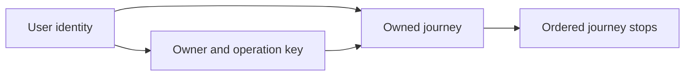

# Data modeling

Lesson 1.03 · Core concepts

## A. Learning objectives and prerequisites

After this lesson, you should be able to derive entities from user operations, choose keys and relationship cardinalities, place invariants in PostgreSQL constraints, and select a transaction strategy for concurrent changes. You should recognize when normalization protects correctness and when a deliberately maintained projection can improve a measured read path.

Read [API design](02-api-design.md) first. You need basic SQL vocabulary, but not previous database administration experience. The [lab guide](../../exercises/module-01/README.md) runs the schema and integration checks on PostgreSQL 18. StopAround schemas and workloads below are illustrative teaching designs. They are not a claim that every production database should share this schema.

## B. Mental model and intuition

A data model records facts and protects relationships between them. Start with what must remain true after every accepted operation. “A stop belongs to an existing journey owned by the same person” is more useful than “we need a stops table.” It identifies two entities, an ownership boundary, and a relationship that can be checked independently of the current API implementation.

Your frontend state already has identities and relationships. A selected journey identifier refers to one saved journey; an ordered list of stops refers to positions within it. The backend adds persistence, competing writers, partial failures, and callers that do not follow your UI's conventions. A disabled button cannot protect an invariant when another client or a background job writes directly.

Separate authoritative facts from convenient views. A station's current display card can be assembled from station identity, recent observations, and a user's preferences. Those facts do not necessarily share an owner, update rate, or retention rule. Copying the assembled card into every saved journey can accidentally turn a mutable display into historical truth.

## C. Deep technical explanation

### Entities, keys, and cardinality

The lab has users, journeys, ordered journey stops, and completed creation requests. A user owns many journeys. A journey has zero or more stops. One completed creation request identifies one journey, while different operation keys could legitimately create different journeys with the same display name. A name is therefore not the journey's identity.

Use a stable primary key for identity and additional unique constraints for independent business rules. UUIDs make it convenient to assign identifiers without a global sequence call, but random UUID values are not a chronology. A database sequence is also a valid choice; predictability of an identifier is not an authorization mechanism. Choose based on access patterns, storage, generation, and exposure requirements rather than treating one type as universally senior.

The stop key `(journey_id, position)` represents an ordered slot within a journey. It permits a station to appear twice at different positions, which can be reasonable for a round trip. The nonnegative position check does not require a contiguous sequence beginning at zero. If the product needs contiguity or atomic reordering, that is an additional operation-level invariant, not something the existing key quietly guarantees.

The schema stores a synthetic station UUID without a station table. This keeps the local lab focused on ownership and transactions; it does not prove that a real station exists. A complete station catalog would need its own identity and lifecycle policy. Explicitly naming the boundary is better than implying an unenforced foreign relationship.

### Constraints are executable rules

NOT NULL, CHECK, UNIQUE, primary keys, and foreign keys express different promises. NOT NULL prevents absent required values. CHECK constrains an individual row's accepted values. UNIQUE coordinates competing inserts of the same key. A foreign key requires a referenced identity to exist. A nullable column can interact surprisingly with uniqueness; PostgreSQL normally treats nulls as distinct for a unique constraint, with an explicit alternative available. [PostgreSQL 18 constraints](https://www.postgresql.org/docs/18/ddl-constraints.html).

The journey has a global `id` primary key and a unique `(owner_id, id)` pair. The apparently redundant second key gives a composite foreign key a target. A stop carries both owner and journey identifiers and references that pair. This prevents a syntactically valid Bob-owned stop from pointing at Alice's journey, even if application code supplies the wrong pair. It also supports owner-scoped access paths, at the cost of another maintained index.

Constraints complement authorization rather than replacing it. This schema does not enable row-level security, and a database client with broad privileges can still select another user's rows. The API must derive the principal and filter operations. Database roles and optional row-level policies can provide additional protection when designed and tested explicitly.

### Normalization and controlled duplication

Normalization reduces contradictory copies of the same fact. If station name and address appear in every price observation, correcting an address requires changing many rows. If only some updates succeed, the database offers multiple answers to the same question. A station table for stable identity and separate observations for changing prices avoids that update anomaly.

A useful practical test is to ask what determines each attribute. A journey's owner and display name depend on the journey identifier. A stop's position belongs to its journey relationship. A station's address depends on station identity rather than stop position. Putting facts at the wrong grain creates deletion, insertion, and update anomalies even when the JSON shape looks convenient.

Denormalization can be deliberate. A route-search projection might store a latest-price summary beside indexed station geography, refreshed from authoritative observations. Specify which source wins, how updates propagate, how readers detect age, and how the projection is rebuilt. A projection that cannot be rebuilt or reconciled has quietly become another authority.

Historical snapshots have a different purpose. A saved quote or original API response may need to preserve what the user observed at a particular moment. The lab's response snapshot is intentional duplication with operation-history semantics. It should not be used as the current journey record after later edits.

### Transactions and concurrency

A transaction groups changes into one commit or rollback boundary. In the schema check, inserting a journey followed by an invalid stop rolls back both. Outside observers should not see a successful partial result from that transaction. This does not make an email or external provider call part of the database transaction; those systems remain outside it.

Isolation describes which concurrent observations are permitted. Under PostgreSQL's default Read Committed isolation, each statement sees a snapshot appropriate to that statement; two SELECTs in one transaction can observe different committed data. A transaction alone does not turn check-then-act code into a race-free reservation. [PostgreSQL transaction isolation](https://www.postgresql.org/docs/18/transaction-iso.html).

Suppose two requests both read `remaining = 1`, then independently decide to reserve. An application-level check can approve both. Prefer an atomic conditional update such as “decrement where remaining is greater than zero,” inspect whether a row changed, and create the reservation in the same transaction. Alternatively, lock the relevant row before checking, or use serializable transactions with whole-transaction retries. The appropriate choice depends on the invariant and contention, not on a blanket rule that higher isolation is always free.

For edits, the lab demonstrates optimistic concurrency. The caller reads version 1; an update changes the name and increments the version only where the current version is still 1. One writer succeeds; a stale writer changes zero rows. The application can then present a conflict instead of silently overwriting someone else's change. Retrying the exact stale update without reconciliation defeats the point.

Locks have cost. Keep transactions short, acquire shared resources in a consistent order, and avoid waiting on a network provider while holding a row lock. Deadlocks are possible even with individually correct statements. An aborted transaction must be rolled back; retry the complete logical transaction with a bounded policy when the failure is transient and repetition is safe.

### Time, measurements, and deletion

Store event time and ingestion time separately when delayed provider data matters. An observation received today might describe a price seen yesterday. Use timezone-aware timestamps for instants, preserve the relevant local timezone when scheduling is a domain requirement, and do not infer ordering from client clocks alone. The lab's `created_at` uses transaction time; long transactions can assign the same time to several inserted rows, which is another reason a pagination tuple needs a unique tie-breaker.

Choose units and precision explicitly. A distance can be stored as integer meters, and a displayed fuel price can use a decimal type with a declared currency and volume unit. A float does not communicate whether a value means meters, kilometers, liters, or gallons. Geographic proximity later needs appropriate spatial types, coordinate reference systems, and indexes; this lab does not install PostGIS or validate a spatial query.

Deletion is a relationship policy. Stops cascade when their parent journey is deleted, while retained creation-request records currently prevent deleting the referenced journey. That deliberate lab restriction preserves replay identity. A product supporting erasure must coordinate operation-record retention, response snapshots, child rows, analytics, and backups. Adding CASCADE everywhere can remove audit or replay state that another operation still depends on.

## D. Architecture and data flow

Read the arrows as references to authoritative identities, not as a network call graph.



The stop and request references include owner and journey together. On creation, the API inserts the journey and completed request within one database transaction. On a stop update, it must verify the authenticated owner and maintain the ordered-set invariant. Database constraints reject structurally invalid relationships even when a writer bypasses the normal API path.

## E. Real-world examples

For StopAround, keep station identity distinct from a price observation. A station can change its display name, while old observations remain associated with the same identity. A latest-price projection can accelerate route search, but a user should still see the observation time and any freshness limitation. A saved journey can reference the station without claiming that its current price will remain valid when the driver arrives.

For an independent example, a team task tracker has projects, members, and tasks. Copying a member's current display name into every task is convenient for reads but creates a consistency obligation when the member changes their name. A historical “name shown when this approval happened” is a different fact with different retention semantics. The table design should reflect which meaning the product needs.

In both examples, test a concurrent invariant directly. “Two requests attempted the last slot and only one committed” is stronger evidence than two unit tests that individually validate positive input. Similarly, a database foreign-key rejection demonstrates protection against a writer that does not use the frontend.

## F. Executable example

The [schema](../../exercises/module-01/03-data-modeling/schema.sql) is the same one used by the API lab. Bootstrap only adds missing lab tables and synthetic users; it does not constitute a migration framework for changing existing production tables. Use a fresh local lab database and the pinned environment in [the guide](../../exercises/module-01/README.md).

<!-- Listing: exercises/module-01/03-data-modeling/schema.sql -->

```sql
CREATE TABLE IF NOT EXISTS users (
    id uuid PRIMARY KEY,
    email text NOT NULL UNIQUE CHECK (length(email) BETWEEN 3 AND 254)
);
CREATE TABLE IF NOT EXISTS journeys (
    id uuid PRIMARY KEY,
    owner_id uuid NOT NULL REFERENCES users(id),
    name text NOT NULL CHECK (length(btrim(name)) BETWEEN 1 AND 120),
    created_at timestamptz NOT NULL DEFAULT now(),
    version integer NOT NULL DEFAULT 1 CHECK (version > 0),
    UNIQUE (owner_id, id)
);
CREATE TABLE IF NOT EXISTS journey_stops (
    owner_id uuid NOT NULL,
    journey_id uuid NOT NULL,
    position integer NOT NULL CHECK (position >= 0),
    station_id uuid NOT NULL,
    PRIMARY KEY (journey_id, position),
    FOREIGN KEY (owner_id, journey_id) REFERENCES journeys(owner_id, id) ON DELETE CASCADE
);
CREATE TABLE IF NOT EXISTS create_requests (
    owner_id uuid NOT NULL,
    operation_key varchar(80) NOT NULL,
    payload_hash bytea NOT NULL,
    journey_id uuid NOT NULL,
    response_snapshot jsonb NOT NULL,
    PRIMARY KEY (owner_id, operation_key),
    FOREIGN KEY (owner_id, journey_id) REFERENCES journeys(owner_id, id)
);
```

The [bootstrap script](../../exercises/module-01/03-data-modeling/bootstrap.py) adds the synthetic lab users. The PostgreSQL tests attempt a cross-owner stop insert, force a failure after inserting a parent, and issue two updates against the same expected version. They verify actual constraint enforcement, rollback, and stale-write rejection. Each test class owns a newly generated schema and drops only that schema afterward. No production or existing user table is truncated.

## G. Architectural decisions and trade-offs

Start with a normalized relational authority when joins and transactions match the invariant. JSONB can hold flexible supplementary data, but moving every relationship into a JSON document makes constraints, joins, and independent updates harder. A document model can be appropriate when the aggregate is naturally read and written together and its limits are understood.

Optimistic concurrency is attractive when edits rarely conflict and users can reconcile them. Pessimistic locking helps serialize a short, contended decision but adds waiting and deadlock risk. Serializable isolation can protect broader invariants, with a requirement to handle retryable aborts. Choose and test the particular race you need to prevent.

Denormalize after identifying an expensive read path and a maintainable update policy. An extra maintained index or projection increases write work and recovery responsibility. Record the authoritative source and rebuild procedure before accepting the optimization.

## H. Common failures and debugging

For contradictory data, inspect the keys that identify facts and every writer that maintains duplicate fields. A repair script that changes only one copy can make the contradiction harder to detect. For foreign-key errors, inspect the exact referenced tuple, including owner, and confirm that the parent insert committed in the same intended schema.

For lost edits, reproduce two writers using the same starting version. Inspect row counts from conditional updates instead of assuming that a syntactically successful UPDATE changed a row. For unexpected waits, inspect long-running transactions, lock holders, and transaction boundaries; do not immediately raise every timeout.

For an aborted transaction, ensure the connection is rolled back before reuse. For a deletion failure, read the referencing constraint and decide which retained fact depends on the row. Removing the constraint merely to make the delete succeed can destroy the invariant that the schema was protecting.

## I. Practical exercise

Draw the four lab entities with keys and cardinalities. Explain why the composite owner/journey reference exists despite the journey's global primary key. Predict the outcome of inserting a Bob-owned stop for Alice's journey, inserting a negative stop position, and reusing an occupied position.

Then design a station/price-observation extension on paper. Specify identity, event and ingestion time, currency and volume unit, uniqueness for provider observations, and a latest-price projection with a rebuild policy. Finally, describe how to reorder three stops atomically without allowing concurrent edits to overwrite each other. Run the real PostgreSQL checks and compare with the [worked solution](../../exercises/module-01/03-data-modeling/SOLUTION.md).

## J. Interview and senior-engineering assessment

1. What question should you ask before creating a table?
2. Why is a client-side ownership check insufficient?
3. What does normalization prevent, and when is duplication intentional?
4. Does wrapping check-then-act in a default transaction prevent every race?
5. How does an expected-version update prevent a lost edit?
6. What does the stop-position constraint fail to guarantee?
7. Why can a journey deletion fail even though stops use cascading deletion?

## Assessment solutions

### 1. Identify the fact and invariant

Ask what one row represents, what identifies it, which attributes depend on that identity, and what must remain true across accepted operations. Those answers determine keys, cardinality, constraints, and transaction scope more reliably than copying a current screen's JSON shape.

### 2. Writers and clients are independent

An attacker or another legitimate client can bypass UI checks, while background jobs may have separate code paths. Derive identity server-side and enforce ownership in every operation. The composite foreign key additionally rejects a structurally cross-owner relationship at the database boundary.

### 3. Avoid conflicting copies of a fact

Normalization reduces update, insertion, and deletion anomalies. A maintained read projection or a historical snapshot can deliberately duplicate values, but must have explicit authority, update or immutability rules, retention, and recovery semantics. Convenience alone does not define those rules.

### 4. Isolation and statement structure matter

At Read Committed, separate reads can both observe the same available capacity before either update. Use a conditional update, suitable row lock, uniqueness rule, or stronger isolation with retry handling. The transaction groups effects but does not automatically express the business invariant.

### 5. Make the precondition part of the write

The update predicate includes the previously observed version, and success increments it. A competing earlier update changes the version, causing the stale write to affect zero rows. The caller must treat that result as a conflict and reconcile rather than ignoring it.

### 6. It protects slots, not an entire ordered-list policy

The primary key prevents two stops from occupying one journey position, and CHECK rejects negative positions. Gaps, a nonzero first position, repeated stations, and concurrent reorder intent require additional decisions. Do not claim those properties from constraints that do not encode them.

### 7. Different relationships have different lifecycle rules

Retained creation requests reference the journey without cascading deletion. Their replay contract currently depends on that identity. A deletion workflow must deliberately reconcile request retention and snapshots; cascading stops addresses only one relationship.

## K. Key takeaways and navigation

Model authoritative facts, encode structural invariants, and test the concurrent operation that could break them. Transactions are a boundary whose isolation and external effects still need reasoning.

Next: [1.04 — Caching](04-caching.md). Previous: [1.02 — API design](02-api-design.md).
