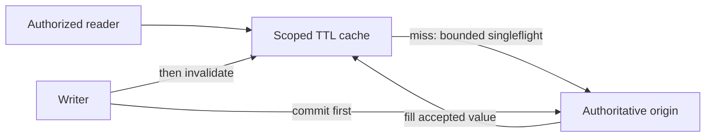

# Caching

Lesson 1.04 · Core concepts

## A. Learning objectives and prerequisites

You should be able to choose a cache location from an access pattern, define the key and freshness contract, analyze invalidation races, and protect the origin during a cache outage or synchronized expiry. You should also distinguish a cached representation from an authoritative record and a cache hit from an authorized response.

Read [networking](01-networking-essentials.md), [API design](02-api-design.md), and [data modeling](03-data-modeling.md). The executable example uses Python asyncio, with each concurrency mechanism explained here. It needs no Redis service. All cache sizes, TTLs, loads, and incidents below are illustrative unless identified as observed lab results.

## B. Mental model and intuition

A cache remembers a previously computed answer under assumptions about identity and time. Every lookup asks two questions: is this the same question, and is the remembered answer still acceptable? The key answers the first; the freshness and invalidation policy answer the second. Fast wrong answers are a correctness problem even when the hit-rate chart is excellent.

For StopAround, a station's public display name changes slowly, a provider price changes more often, and a user's saved journey is private. They should not automatically share one cache policy. A route search can combine public facts with private preferences, creating a representation whose key and sharing rules differ from either input alone.

Caching also changes failure behavior. A warm cache can protect a busy database. An empty or unreachable cache can suddenly send all traffic to that database. Design the origin admission limit and fallback behavior at the same time as the cache; otherwise, an optimization becomes a hidden capacity dependency.

## C. Deep technical explanation

### Placement follows the avoided work

A browser cache avoids some downloads for one user. A CDN can avoid long-distance origin requests for shareable content. An API-process cache avoids repeated local computation or provider calls within one process. A shared cache can coordinate reusable answers across API replicas but introduces network access and another operated service. A database buffer cache has different semantics again: it accelerates access to database pages without replacing SQL transaction rules.

Choose placement by asking which expensive work is repeated and who can safely share the result. A local cache may be sufficient for a small instance count and modest repeated lookups. Ten local caches can each perform the same miss, which matters when a provider quota is tight. A shared cache reduces duplicate storage and misses across processes, at the cost of another failure boundary.

Avoid treating every frontend framework cache as one mechanism. Browser HTTP caching, an application query cache, server rendering caches, and backend result caches can have different keys and invalidation triggers. Trace a stale value through the actual layers rather than repeatedly clearing whichever cache is easiest to reach.

### Keys encode the question

A key might include a representation version, station identifier, fuel type, currency, locale, and relevant authorization scope. A route-search key also needs the routing assumptions that affect results, such as vehicle constraints and route geometry normalization. Omitting units or filters merges different questions. Including a random request identifier prevents reuse. Including an unbounded raw URL can create uncontrolled cardinality and expose sensitive data in diagnostics.

Do not use a bearer token itself as a cache key. Derive a stable permitted scope after authentication, and enforce current authorization before returning private data. An old cached ownership result can outlive a permission change. Whether that delay is acceptable is a security and product decision, not merely a performance setting.

Normalize inputs deliberately. Sorting unordered filter sets can improve reuse; sorting an ordered route's stops changes its meaning. Version the representation when interpretation changes, and retire old keys under a capacity policy. A version prefix prevents accidental mixing but does not automatically reclaim old entries.

### Freshness, expiry, and eviction

TTL defines when an entry is considered expired under a policy. Eviction removes entries to satisfy capacity, often approximating least-recently-used or another workload-aware strategy. A key can be evicted before its TTL, and an expired key can remain physically allocated until accessed or reclaimed. Measure memory and useful hit rate rather than assuming expiry alone bounds storage.

A 30-second TTL does not universally mean data is at most 30 seconds behind the authority. A loader may read an already-lagging replica, wait before filling the cache, or accept stale provider data. Stale-while-revalidate can extend the serving window further. Track source observation or version time separately from cache insertion time and define which age the UI displays.

HTTP caching has its own vocabulary. `private` restricts shared-cache reuse, `no-store` asks caches not to store the response, and `no-cache` permits storage but requires validation before reuse. Validators such as ETags can avoid transferring an unchanged representation. `Vary` identifies request-header dimensions that affect selection; it is not a general authorization mechanism. The exact rules belong to the HTTP caching specification. [RFC 9111](https://www.rfc-editor.org/rfc/rfc9111.html).

### Cache-aside and invalidation races

In cache-aside, the application checks the cache, reads the authority on a miss, and fills the cache. Writes normally commit at the authority before invalidating or updating the cached representation. Writing the cache first can expose a value whose database transaction later rolls back.

Even commit-then-delete has a race. Reader R misses and reads version 1. Writer W commits version 2 and deletes the cache key. R then fills the key with version 1. The cache now contains stale data after the invalidation completed. A TTL limits that fill's residence under the assumed loader policy, but does not make the race disappear.

Possible responses include accepting a bounded stale window, using version-aware cache writes, writing a versioned immutable key and advancing an authoritative pointer, or coordinating the relevant read/write path. An invalidation event stream needs ordering, duplicate handling, and recovery after missed events. A delayed second deletion can reduce one race window but is not a proof of correctness under arbitrary delays.

Keep correctness-critical decisions at the authority. A cached “one appointment remains” can support a display, but the reservation must still atomically check availability. The cache should not become the final authority merely because it is faster.

### Stampedes and admission control

A stampede occurs when many callers miss together and all load the same expensive value. Singleflight coalesces simultaneous loads for a key. TTL jitter spreads expiry across different keys. Proactive refresh can reduce cold misses for popular values. These solve related but different patterns: jitter does not prevent twenty simultaneous requests for one uncached key, and singleflight does not limit loads for twenty thousand distinct keys.

The lab bounds retained entries, value size, and the number of distinct active origin loads. A duplicate miss may join an existing load even when the distinct-load limit is full. A new key is rejected promptly rather than placed in an unbounded internal queue. Incoming request population and the number of waiters on one key still require admission limits outside this component.

The waiting caller and shared load have separate lifetimes. If one disconnected caller cancels the shared task, other callers can fail unnecessarily. The lab shields the shared task from individual waiter cancellation and places a timeout on the cooperative asynchronous loader. Shutdown explicitly cancels and joins outstanding loads. CPU-bound code that blocks the event loop cannot be preempted by an asyncio timeout.

### Failure and observability

Decide whether cache errors fail open to a bounded origin path, serve an explicitly stale value, or fail closed. There is no universal safe fallback. A public station label can tolerate a different policy from revoked access or a capacity reservation. Negative caching of “not found” can reduce repeated expensive misses, but use short, scoped rules so a newly created resource or permission change is not hidden too long.

Measure hit/miss/error rates by useful low-cardinality categories, origin load, entry age, evictions, coalesced waiters, rejected loads, and memory. A high overall hit rate can conceal a small but expensive miss population. Avoid logging full private keys or labeling metrics with every user or route.

## D. Architecture and data flow

The cache is a reusable read path; database commits remain authoritative.



The writer arrows show a cache-aside design to reason about; the minimal executable cache implements TTL loading only and exposes no write-invalidation API. This distinction matters: its tests demonstrate coalescing, expiry, and resource limits, not a distributed invalidation protocol. A multi-process deployment needs a deliberate cross-process policy.

## E. Real-world examples

For an illustrative StopAround search, cache a public provider response by station, fuel type, and representation version. Retain the provider observation time and expose age. If the provider is unavailable, a bounded stale fallback can be useful if the user sees that limitation. Do not label a stale observation “live” merely because the cache was accessed recently.

For a private journey page, either avoid shared caching or scope the representation and recheck authorization under a documented permission-change policy. A shared cache key such as `journey:123` is unsafe if the lookup returns a private representation without checking who may see it. The API lab conservatively sends `private, no-store` rather than adding an unnecessary private-result cache.

For a separate example, a documentation service caches rendered public articles. An immutable key containing article revision makes historical rendering easy to reuse. The mutable “current revision” pointer has a smaller but still real freshness problem. This separation often makes invalidation reasoning clearer than overwriting one large mutable value.

## F. Executable example

The full [TTL cache](../../exercises/module-01/04-caching/ttl_cache.py) is a single-event-loop component for bounded UTF-8 strings. Run its tests through [the lab guide](../../exercises/module-01/README.md). Tests use controlled clocks and events for expiry and coalescing; the loader-timeout check uses a small real asynchronous timeout.

<!-- Listing: exercises/module-01/04-caching/ttl_cache.py -->

```python
"""Bounded, single-event-loop cache. It does not coordinate separate API processes."""
import asyncio
import math
import time
from collections import OrderedDict


class CacheBusy(Exception): pass


class TTLCache:
    def __init__(self, ttl=30.0, max_entries=128, max_inflight=8, max_value_bytes=4096, load_timeout=1.0, clock=time.monotonic):
        limits=(max_entries,max_inflight,max_value_bytes)
        if not math.isfinite(ttl) or ttl <= 0 or not math.isfinite(load_timeout) or load_timeout <= 0 or any(type(n) is not int or n < 1 for n in limits):
            raise ValueError('positive finite TTL and positive limits required')
        self.ttl, self.max_entries, self.max_inflight = ttl,max_entries,max_inflight
        self.max_value_bytes,self.clock=max_value_bytes,clock
        self.load_timeout=load_timeout
        self.entries=OrderedDict()
        self.pending={}
        self.closed=False

    async def get(self, key, loader):
        if self.closed: raise RuntimeError('cache is closed')
        if not isinstance(key,str) or not 0 < len(key) <= 256: raise ValueError('key must contain 1–256 characters')
        entry=self.entries.get(key)
        if entry and entry[0] > self.clock():
            self.entries.move_to_end(key)
            return entry[1]
        self.entries.pop(key,None)
        task=self.pending.get(key)
        if task is None:
            if len(self.pending) >= self.max_inflight: raise CacheBusy('too many distinct origin loads')
            async def fill():
                try:
                    value=await asyncio.wait_for(loader(),timeout=self.load_timeout)
                    if not isinstance(value,str) or len(value.encode()) > self.max_value_bytes:
                        raise ValueError('loader must return a bounded UTF-8 string')
                    self.entries[key]=(self.clock()+self.ttl,value)
                    self.entries.move_to_end(key)
                    while len(self.entries)>self.max_entries: self.entries.popitem(last=False)
                    return value
                finally:
                    self.pending.pop(key,None)
            task=asyncio.create_task(fill())
            # Retrieve errors even if every waiting caller has disconnected.
            task.add_done_callback(lambda done: done.exception() if not done.cancelled() else None)
            self.pending[key]=task
        return await asyncio.shield(task)

    async def close(self):
        self.closed=True
        tasks=list(self.pending.values())
        for task in tasks: task.cancel()
        await asyncio.gather(*tasks,return_exceptions=True)
        self.pending.clear()
        self.entries.clear()
```

Call `await cache.get(key, loader)` with an asynchronous, bounded origin loader and `await cache.close()` during shutdown. The default values are teaching configuration, not a sizing recommendation. Retained entries are bounded by count and accepted value bytes; upstream response streaming must impose its own body-size bound before a loader allocates a large value.

## G. Architectural decisions and trade-offs

Choose TTL-only caching when a clearly stated stale window is acceptable and the simpler system meets the load target. Add invalidation or shared coordination when a measured requirement needs it. Every new consistency mechanism should have a missed-event or restart recovery story.

A cache cluster can improve reuse across API replicas but does not eliminate origin admission control. If it becomes unreachable, falling through all misses to the database can exceed database capacity. Test the cold-cache and cache-outage workloads, not just the warm steady state.

Coalescing makes one origin result serve several callers, so choose keys and failure propagation carefully. A failed shared load should not poison the cache indefinitely. Individual caller deadlines should not cancel work that other admitted callers still need, while the shared load itself still needs a finite useful lifetime.

## H. Common failures and debugging

For stale values, inspect source version/time, cache fill time, policy, and all cache layers. Reproduce the stale-fill race instead of assuming a successful delete proves freshness. For incorrect cross-user results, audit key dimensions and the authorization check before considering a TTL adjustment.

For a provider traffic spike at regular intervals, inspect synchronized expiry and whether singleflight is local or shared. For a memory increase despite a short TTL, inspect eviction behavior, value size, cardinality, and references held by pending tasks. Expiration is not necessarily immediate memory reclamation.

For cascading failure during an outage, measure distinct misses, fallback concurrency, and rejection behavior. Raising origin concurrency until errors disappear in a quiet test can make a real outage worse. Restore a bounded service path and choose an honest degraded response.

## I. Practical exercise

Predict and then test twenty concurrent requests for one missing key, one hundred different missing keys with an active-load limit of eight, and cancellation of one waiter while another still needs the shared value. Distinguish cached-entry capacity, distinct origin loads, and incoming waiter count.

Draw the version-1 reader/version-2 writer invalidation race. Choose a policy for public station prices and another for private journey permissions. For each, state the acceptable stale behavior, key scope, failure fallback, and one observation that would reveal a violated assumption. Compare with the [worked solution](../../exercises/module-01/04-caching/SOLUTION.md).

## J. Interview and senior-engineering assessment

1. What two questions does a cache lookup need to answer?
2. Why does a 30-second TTL not prove a 30-second maximum source age?
3. How can stale data appear after a successful cache deletion?
4. What do singleflight and TTL jitter each solve?
5. Why shield a shared load from one caller's cancellation?
6. Is failing open to the database always safe?
7. What must a private cache key and lookup protect?

## Assessment solutions

### 1. Identity and acceptable freshness

The key must describe the same representation request, including relevant scope, filters, units, and version. The policy must say whether the stored answer is still acceptable. A fast lookup that merges different questions is wrong even with a high hit rate.

### 2. Source age and residence time differ

The origin can already be stale, a delayed reader can fill an old value, and stale-serving extensions can exceed the nominal TTL. Record source observation/version separately from insertion and define freshness at the boundary the user actually cares about.

### 3. A delayed fill can follow invalidation

A reader fetches version 1, a writer commits version 2 and deletes the key, then the reader inserts version 1. Accept the bounded stale window explicitly or introduce a version-aware coordination design. A successful deletion alone does not order every concurrent reader.

### 4. Same-key concurrency versus many-key expiry

Singleflight shares one active load for a key. Jitter spreads expiry across different keys. Neither replaces distinct-load admission, origin capacity limits, or cross-process coordination when local caches independently miss.

### 5. Shared work has several beneficiaries

One caller disconnecting should not cancel the value another caller is awaiting. Shielding separates those lifetimes, while a shared timeout and explicit shutdown still bound the work. It does not remove the need to limit the number of admitted waiters.

### 6. Fallback can overload the authority

An unavailable cache can turn nearly all requests into misses. The database may be sized for a much smaller miss population. Bound fallback load, choose a stale or partial response where valid, and reject work when there is no safe capacity.

### 7. Representation isolation and current permissions

Include the appropriate user or tenant scope and validate resource access. Do not use a bearer token as the key or assume a cached value authorizes itself. Permission changes need an explicit invalidation or allowed-staleness policy.

## K. Key takeaways and navigation

Cache a well-defined answer under a freshness contract, bound both storage and origin work, and keep correctness at the authority. Test the cold and failing paths as carefully as a warm hit.

Next: [1.05 — Sharding](05-sharding.md). Previous: [1.03 — Data modeling](03-data-modeling.md).
