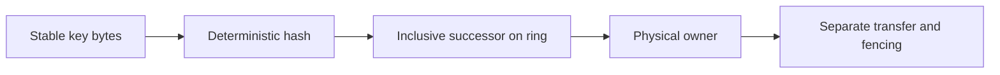

# Consistent hashing

Lesson 1.06 · Core concepts

## A. Learning objectives and prerequisites

You should be able to place keys on a hash ring, explain why adding a node moves only particular ranges, distinguish virtual nodes from physical replicas, and evaluate distribution using work as well as key count. You should also be able to list the coordination and migration mechanisms a hash ring does not provide.

Read [sharding](05-sharding.md) first. Basic familiarity with a sorted list is sufficient for the implementation. The code uses a deterministic cryptographic digest for placement, not Python's process-dependent built-in string hash. All node names and workload measurements in the lab are synthetic.

## B. Mental model and intuition

A placement function answers “which owner should hold this key under this membership configuration?” A useful placement rule changes as little as practical when membership changes. If adding one cache node invalidates almost everyone's placement, the remaining nodes and the origin can receive a large avoidable burst of work.

Imagine numeric positions around a circular track. Each owner has markers, and each key has a position. Walk forward from the key to the first owner marker; that marker's physical node owns the key. When a new marker appears, it takes the interval immediately behind it. Other intervals keep their previous first marker.

That geometric explanation is the mechanism. It does not say that the new owner already has the data, that every router agrees about the markers, or that the old owner has stopped accepting writes. Those are the ownership and movement problems from the previous lesson. Keep placement separate from its operational use.

## C. Deep technical explanation

### Why modulo placement moves broadly

With a fixed membership size N, `hash(key) modulo N` maps keys to numbered owners. Changing N changes the arithmetic for many keys. Even keys assigned to surviving owners can now point to different surviving owners. That can create substantial movement when the intended change was just adding one machine.

Consistent hashing uses a stable hash space and owner positions instead. The original research developed this family of ideas for distributed caching under changing membership. Its central placement insight is limited remapping as the destination set changes. [Karger and colleagues, 1997](https://people.csail.mit.edu/karger/Papers/web.pdf).

For a small numeric illustration, place A at 20, B at 60, and C at 90 on a ring spanning 0 through 99. A key at 35 belongs to B; a key at 95 wraps around to A. Add D at 45. Keys after 20 through 45 now belong to D, while keys after 45 through 60 remain with B. At exactly an owner marker, this lesson chooses that marker as the owner, implemented with an inclusive successor lookup.

The numeric positions are illustrative, not the actual SHA-256 outputs in the code. The code uses a much larger hash space and several markers per physical node. The small example lets you verify the boundary rule without reading enormous integers.

### Virtual nodes improve granularity

One random point per physical node can produce uneven intervals. A node with a large preceding gap owns many uniformly distributed keys; another can own very few. Give each physical node multiple virtual-node tokens distributed through the ring. Each physical node then owns several smaller ranges, making movement and balance less dependent on one lucky position.

More virtual nodes improve granularity and often improve balance, but increase metadata, configuration, and lookup work. They cannot guarantee equal load for a particular finite workload. They also cannot split one hot key: every lookup for that key still chooses one owner unless an additional replication or request-distribution mechanism changes the read path.

Virtual nodes can express capacity weights by giving a larger physical node more tokens. Changing a node's token count is itself a placement change that needs a controlled rollout. If you regenerate every existing node's tokens during a membership change, you lose the limited-movement argument because old boundaries no longer remain fixed.

The lab uses a fixed number of tokens per node and deterministic token identities based on a length-prefixed UTF-8 node name plus token index. Sorting the input membership list makes configuration order irrelevant. The same names and virtual-node count reproduce the same positions across processes.

### Lookup and movement properties

The ring stores sorted `(position, physical_node)` pairs. Hash a key, find the first position greater than or equal to its hash using binary search, and wrap to position zero if necessary. With N physical nodes and V virtual nodes each, the metadata has N times V entries and lookup is logarithmic in that entry count after computing the digest.

When a new physical node is added while old tokens remain fixed, every moved key moves to that new node. A surviving old node does not steal a range from another surviving old node during that addition. On removal, only keys previously owned by the removed node need a new primary owner. The tests check these structural properties rather than asserting one exact movement percentage.

Under symmetric, well-distributed assumptions, adding one equal-capacity node to N nodes moves an expected fraction near `1 / (N + 1)` of keys. That is an expectation under assumptions, not a per-run guarantee or a bound on bytes moved. A few large values can dominate transfer volume, and nonuniform demand can dominate request load even with a balanced key count.

The implementation rejects empty membership, duplicate physical names, invalid virtual-node counts, and token collisions. A cryptographic-space collision is very unlikely, but silently discarding a duplicate position would make ownership depend on an accidental ordering policy. Explicit rejection makes the configuration failure visible. Collision handling must be consistent across all routers.

### Replication is a separate rule

A primary owner alone does not provide durability or failover. To choose replicas, a ring-based design might continue clockwise and select distinct physical nodes, optionally respecting zone or rack boundaries. Choosing the next three tokens can accidentally select the same physical node three times. Distinct token identities do not establish independent failure domains.

Replica membership, acknowledged-write durability, repair, and leader or quorum rules require additional protocols. A timeout does not prove a node is permanently dead. Removing a temporarily unreachable owner immediately can produce churn, cold loads, and conflicting writes if the old owner is still reachable by another client.

For a disposable cache, losing a key may mean recomputing it from an authority. For an authoritative database, a missing key on the new owner cannot simply be treated as nonexistent. The data-transfer and stale-writer fencing protocol must establish where the latest accepted state lives.

### Membership agreement and rollout

Two routers with different membership views can assign the same key to different owners. A deterministic hash function only guarantees agreement when its inputs and membership agree. Version the configuration and observe which version each router uses. Decide whether old views are rejected, redirected, or temporarily supported under a specified migration policy.

Placement configuration includes encoding, hash algorithm, token identity format, token count, membership, weighting, and boundary convention. Changing any of those can move data. Persist or reproducibly derive the configuration, and plan a transition for schema or algorithm upgrades rather than assuming they are harmless code refactors.

For cached data, a rollout may permit fallback to the authority with bounded origin load. For durable data, use the ownership-transfer mechanisms from sharding: copy, reconcile where needed, publish ownership, and fence stale writers. A correct mathematical ring does not establish a correct distributed write history.

### Compare simpler alternatives

A static map is sufficient for a small fixed fleet. Stable virtual buckets provide explicit directory-controlled movement. Rendezvous hashing assigns a score to each key/node pair and selects the highest-scoring node, avoiding a token ring at the cost of evaluating candidate owners under the chosen implementation. These approaches have different metadata, weighting, and lookup trade-offs; none automatically replicates data.

Choose based on actual membership churn, node count, workload skew, routing cost, and operational familiarity. For a small StopAround deployment using one PostgreSQL authority, a hash ring is a learning exercise, not an immediate application requirement. Additional infrastructure should solve an observed problem.

## D. Architecture and data flow

This diagram shows the placement calculation, followed by a separate movement responsibility.



All routers must use the same versioned configuration to reproduce the owner. The executable ring stops at owner selection. Its demonstration compares old and expanded configurations without copying any values or changing a running service's routing. That keeps the evidence aligned with the mechanism being taught.

## E. Real-world examples

For an illustrative StopAround public-result cache, a ring could assign station lookup keys across cache nodes. Adding a node would transfer responsibility for selected ranges, causing bounded cold misses rather than a broad modulo remap. The origin still needs protection while those misses warm. Private-data authorization and key scoping remain requirements regardless of placement.

A documented engineering example is the 2007 Dynamo paper, which describes consistent hashing and virtual nodes as part of a larger key-value storage design. Its replication and recovery mechanisms are additional parts of that design, illustrating why placement alone is insufficient. Read its historical architecture in context rather than assuming a current managed product has the same implementation. [Dynamo paper](https://www.allthingsdistributed.com/files/amazon-dynamo-sosp2007.pdf).

For a separate workload, a thumbnail service may have evenly distributed image identifiers but a few extremely popular images. Adding more virtual nodes can balance many key ranges without relieving repeated reads of one image. Replicated hot results or a CDN address that demand pattern more directly than changing the primary hash rule.

## F. Executable example

Run the full [ring demonstration](../../exercises/module-01/06-consistent-hashing/hash_ring.py):

```bash
python3 exercises/module-01/06-consistent-hashing/hash_ring.py
```

It reports owner counts and moved keys for 10,000 deterministic synthetic identifiers when D joins A, B, and C. These observations describe that fixture and configuration. The tests verify membership-order independence, addition/removal movement, single-node operation, exact boundary selection, and wraparound.

<!-- Listing: exercises/module-01/06-consistent-hashing/hash_ring.py -->

```python
"""Deterministic placement only: no replication, failure detector, or data transfer."""
import bisect
import hashlib


def token(value): return int.from_bytes(hashlib.sha256(value.encode('utf-8')).digest(),'big')


class HashRing:
    def __init__(self,nodes,virtual_nodes=128):
        nodes=list(nodes)
        if not nodes or any(not isinstance(n,str) or not n for n in nodes) or len(set(nodes))!=len(nodes):
            raise ValueError('nonempty unique node names required')
        if not isinstance(virtual_nodes,int) or virtual_nodes < 1: raise ValueError('positive virtual-node count required')
        points=[]
        for node in sorted(nodes):
            for index in range(virtual_nodes):
                # Length prefix prevents ambiguities between node names and replica numbers.
                position=token(f'{len(node.encode())}:{node}:{index}')
                points.append((position,node))
        points.sort()
        if len({point[0] for point in points})!=len(points): raise ValueError('token collision: choose a new placement configuration')
        self.points=points
        self.positions=[point[0] for point in points]

    def owner(self,key):
        index=bisect.bisect_left(self.positions,token(key))%len(self.points)
        return self.points[index][1]


if __name__ == '__main__':
    from collections import Counter
    keys=[f'journey:{index}' for index in range(10000)]
    old=HashRing(['A','B','C']); new=HashRing(['A','B','C','D'])
    print('Owners after expansion:',dict(Counter(new.owner(key) for key in keys)))
    print('Moved keys:',sum(old.owner(key)!=new.owner(key) for key in keys),'of',len(keys))
```

The SHA-256 digest supplies stable placement bytes; this is not password hashing or credential verification. Python objects use substantially more memory than the digest bytes alone, so estimate actual router memory if scaling this implementation to many tokens. The demonstration remains a local algorithm model.

## G. Architectural decisions and trade-offs

Use more virtual nodes when finer-grained balance and movement justify additional metadata. Measure key, byte, and request distributions independently. Treat a change in token count as a placement rollout, not a free tuning operation.

Separate temporary health observations from authoritative membership changes. Removing a node after one failed request can cause unnecessary movement and contradict another router's view. A production service needs a specified failure-detection and membership policy with observable configuration versions.

For a small fixed application, prefer the simplest ownership mechanism that meets the requirement. A ring is valuable when its limited-remapping property addresses meaningful churn; it is not a prerequisite for a scalable relational application.

## H. Common failures and debugging

If two processes disagree on an owner, compare configuration version, membership, token count, encoding, digest algorithm, token identity format, and boundary convention. Check for accidental use of Python's built-in hash. Do not begin by copying data until routing inputs agree.

If balance looks good by keys but poor by CPU, inspect popularity and value sizes. If an added node causes movement between surviving old nodes, verify that old tokens remained unchanged. If one physical server holds several nominal replicas, inspect whether replica selection skipped repeated physical owners and respected failure domains.

If expansion causes an origin spike, inspect cold misses and admission limits. An expected 25% key move in an equal four-node ring is not a guarantee that only 25% of traffic or bytes will move. Measure the workload's actual distribution and throttle warm-up accordingly.

## I. Practical exercise

Place A, B, and C at 20, 60, and 90 on a 0–99 ring. Assign keys 10, 20, 35, 60, 85, and 95 using the inclusive-successor convention. Add D at 45 and identify exactly which supplied keys move. Remove B and repeat the ownership reasoning.

Then run the real digest-based demonstration with one token and with 128 tokens per node. Record the key counts and movement without presenting either fixture as a universal balance guarantee. Describe the extra work required to use that ring for authoritative journey storage rather than a recomputable cache. Compare with the [worked solution](../../exercises/module-01/06-consistent-hashing/SOLUTION.md).

## J. Interview and senior-engineering assessment

1. What property does consistent hashing improve during membership changes?
2. Why do virtual nodes help, and what can they not fix?
3. Which keys can move when one node is added with old tokens unchanged?
4. Why must replica selection consider physical nodes?
5. What configuration differences can make routers disagree?
6. Is an expected moved-key fraction a bandwidth estimate?
7. What must accompany the ring for durable data?

## Assessment solutions

### 1. Limited reassignment

The rule preserves existing range boundaries when destinations change, so addition or removal need not remap unrelated keys broadly. It improves placement stability; it does not move data or establish agreement on membership.

### 2. Smaller distributed ownership ranges

Several tokens reduce dependence on one random interval and offer finer movement granularity. They increase metadata and cannot divide one hot key or guarantee equal work for a skewed workload. Measure the resource you need to balance.

### 3. Moved keys go to the new node

New tokens take predecessor intervals from existing owners. With all old tokens fixed, a moved key's new primary is the added node; it does not move between two surviving old nodes. Regenerating old tokens invalidates that property.

### 4. Tokens are not failure domains

Adjacent tokens can belong to the same physical machine. Replica selection must skip duplicate physical owners and may need zone/rack constraints. Several copies on one machine do not protect against that machine's loss.

### 5. All placement inputs matter

Compare membership and its version, encoding, hash algorithm, token identity format, virtual-node count, weights, and boundary convention. A deterministic function agrees only for equal inputs. Temporary health observations also need a coordinated membership policy.

### 6. Keys, bytes, and traffic differ

An expected key fraction assumes a distribution and says nothing about value sizes or popularity. Transfer cost depends on bytes, indexes, replication, and catch-up traffic; user impact depends on which keys become cold or move.

### 7. Ownership and recovery protocols

Add replicated durability where required, coordinated membership, safe transfer, stale-writer fencing, repair, and crash recovery. A new owner returning “missing” is not proof that a previously committed record never existed.

## K. Key takeaways and navigation

Understand the successor rule and its limited-movement assumptions. Keep distribution, replication, membership, and safe movement as distinct responsibilities.

Next: [1.07 — CAP theorem](07-cap-theorem.md). Previous: [1.05 — Sharding](05-sharding.md).
