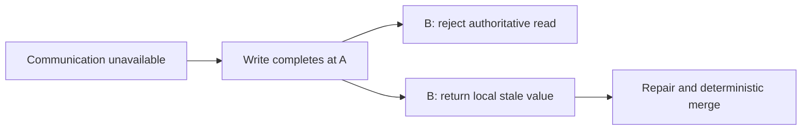

# CAP theorem

Lesson 1.07 · Core concepts

## A. Learning objectives and prerequisites

You should be able to explain the impossibility result using an actual read/write history, distinguish linearizability from everyday uses of “consistent,” and state the failure behavior of one particular operation. You should also explain eventual convergence without implying a maximum stale interval or preservation of every concurrent intent.

Read [data modeling](03-data-modeling.md), [sharding](05-sharding.md), and [consistent hashing](06-consistent-hashing.md). This lesson uses a two-node register model. It deliberately does not implement consensus, failover, durable replication, or arbitrary concurrent execution. All histories are teaching examples unless linked to a published source.

## B. Mental model and intuition

Imagine two service nodes that cannot exchange messages. Both remain reachable by some clients. A client completes a write through A, then another client asks B for the current value. B cannot know whether A accepted a new value. To preserve one globally current answer, B must obtain sufficient authority or stop successfully answering that operation. To keep answering locally, B may return an older value.

The important decision is the operation's behavior during this uncertainty. “We use a highly available database” does not tell your frontend whether a successful save will be visible on a different replica or whether a read might fail rather than return stale data. State the contract in terms a caller can observe.

For StopAround, displaying an older public station observation can be acceptable with an age label. Granting access to a private journey after permission was revoked can violate a different invariant. One application can make different decisions for different operations and representations. Do not force the whole product into one slogan.

## C. Deep technical explanation

### Define the properties precisely

In the formal CAP setting, consistency is an atomic single-copy behavior commonly expressed as linearizability. Availability requires requests received by non-failing nodes to eventually complete with the operation's valid response. Partition tolerance considers executions where communication between nodes can fail. Gilbert and Lynch establish that these guarantees cannot all be maintained in their asynchronous partition model. An HTTP error is not a successful register read merely because a server responded. [Gilbert and Lynch](https://www.comp.nus.edu.sg/~gilbert/pubs/BrewersConjecture-SigAct.pdf).

Linearizability lets each completed operation appear to take effect at one instant between its invocation and response, while respecting real-time order between non-overlapping operations. Concurrent operations may have more than one legal ordering. If a write completes before a later read begins, that read cannot return the previous value unless an intervening legal write explains it. [Herlihy and Wing](https://cs.brown.edu/~mph/HerlihyW90/p463-herlihy.pdf).

This is different from a foreign-key constraint being internally consistent, from ACID's database-invariant usage of consistency, and from two replicas eventually containing equal bytes. Those are useful properties, but substituting one for another changes the question. Similarly, a 99.9% monthly success SLO is an operational metric, not the theorem's universal availability guarantee.

The result is about behavior under a partition, not a menu where an operator permanently removes networking failures from consideration. When all communication works, a service can provide both useful availability and strong reads. Under communication uncertainty, the specified operation must reveal which guarantee is relaxed or which subset of nodes stops successfully serving it.

### Walk through a distinguishing history

Start with value 0 at A and B. Prevent A and B from communicating. Write value 1 at A and observe a successful acknowledgement. Only after that response, ask B to read. B's local state is still 0. From its own messages, B cannot distinguish this execution from one where no write happened at A.

If B immediately returns 0, it continues serving but violates the required real-time ordering for this history. If B waits for authoritative information or returns an unavailable response, it avoids the stale successful read but gives up successful completion at that reachable non-failing node during the partition. A timeout can bound user waiting, but does not manufacture the missing information.

This simple register history is enough to expose the decision. Real databases have more complex protocols, but no amount of caching, a clever hash function, or an extra frontend retry makes the inaccessible state observable without additional assumptions. A client can request a minimum known version, yet B must still wait, route elsewhere, or reject when it cannot establish that version.

### What the CP model actually does

The lab's `cp` mode has a permanently designated primary A. Connected requests through B forward logically to A. During a partition, B rejects reads and writes instead of serving its local copy. A remains the only writer and can continue serving under this deliberately restricted failure model.

There is no automatic promotion, primary crash, lease, or quorum in this code. Its linearizable histories rely on one fixed authority that is never replaced. Allowing B to promote itself independently would invalidate that argument. The model also does not promise that an A-only acknowledgement survives A's permanent loss. Durability and failover need additional protocols and evidence.

A real replicated service may use majority agreement to retain one authoritative history while a minority cannot proceed. The majority side can often continue; that does not satisfy the theorem's availability requirement for every non-failing node. Production availability depends on topology, client routing, failure domains, and which operations need coordination.

### What the AP model actually does

In `ap` mode, each reachable replica accepts local reads and writes. During a partition, reading B after a completed A write can return the old value. On healing, the model selects one register state using a deterministic `(logical_counter, node_name)` ordering and installs it on both nodes. Under this model's finite history and successful healing, replicas converge.

The logical counter is not wall-clock time and cannot identify the globally most recent human action during disconnection. If A assigns 10 and B assigns 20 concurrently, one assignment wins under the rule and the other intent is not retained. Convergence establishes agreement under the merge rule, not that the merge satisfies every business requirement.

Eventual consistency needs assumptions: updates eventually stop or settle sufficiently, communication and repair eventually succeed, and replicas apply a compatible merge policy. It does not automatically bound staleness in seconds. A disconnected replica can remain old for the duration of disconnection. A UI claiming “always current within five seconds” needs additional operational assumptions and enforcement.

For sets, counters, or more complex objects, a merge can sometimes preserve more intent than a single winning register value. That requires a well-defined operation model and merge semantics. Replacing a last-winner register with a conflict-free structure is a domain decision, not an automatic upgrade that preserves arbitrary constraints such as “only one reservation remains.”

### Quorums, replication, and misleading shortcuts

For a fixed replica set of N distinct members, read and write sets with sizes R and W satisfying `R + W > N` intersect. That arithmetic is useful, but intersection alone is not a complete linearizability proof. Version ordering, concurrent writes, repair, membership changes, failure assumptions, and read behavior still matter. A system using substitute replicas during failures may not even have the same fixed-set intersection assumption.

Likewise, three replicas do not automatically provide strong reads, and a leader name in a diagram does not stop an old leader from accepting writes after a partition. Safe leader changes require a specified agreement and fencing mechanism. The shard lesson's stale-writer problem is one concrete manifestation of this requirement.

Asynchronous replication can provide useful read scaling and recovery while allowing stale follower reads. Synchronous acknowledgement policies can strengthen particular durability promises at a latency and availability cost. Specify the actual read and write contract rather than deducing it from the words “replicated” or “SQL.”

### Design user-visible degradation

For a public station feed, a stale response can carry observation time, source version, and an explicit freshness limitation. For a private journey mutation, the service can reject or delay when it cannot establish the authoritative state. For a saved operation whose response disappeared, retain its operation key and reconcile against the authority instead of submitting a new intent to another partition.

Session guarantees can improve experience without proving global linearizability. Sticky routing may let one client read its own writes while another client sees an older replica. A minimum-version token can make lag visible, but may force waiting or rejection. State which guarantee applies to which client interaction.

Define separate success, stale-success, conflict, and unavailable outcomes when the product needs them. A generic 200 containing a stale result without a freshness contract hides the trade-off. A generic retry policy that switches writers can create competing histories if ownership is not coordinated.

## D. Architecture and data flow

The same partition produces different allowed behavior depending on the read contract.



The two branches describe alternative policies, not two simultaneous promises from one operation. The executable model instantiates a separate register for each mode. Healing in the fixed-primary mode copies A's authority; healing in the local mode applies its logical-order merge. Neither branch implements failover or crash recovery.

## E. Real-world examples

For illustrative StopAround behavior, keep a usable route view with visibly aged public observations during provider or replica failure. Refuse to confirm a private edit if its authoritative preconditions cannot be checked. These decisions follow the individual invariant and freshness promise; they do not require classifying every component with the same CAP label.

For a separate example, a collaborative checklist may preserve concurrent additions using an appropriate merge model. A single-value “whole checklist wins” rule could discard one person's additions even while replicas converge. A seat-reservation operation has a different invariant and may need coordinated acceptance rather than independent local writes followed by merging.

The historical Dynamo paper explicitly discusses availability and conflict handling under failures as part of its application-facing design. Its lesson for this course is that conflict resolution belongs in the contract and implementation, not in a claim that convergence removes all consequences of concurrent writes. [Dynamo, 2007](https://www.allthingsdistributed.com/files/amazon-dynamo-sosp2007.pdf).

## F. Executable example

The full [partition model](../../exercises/module-01/07-cap-theorem/partition_model.py) operates on a register initialized to zero. Run its tests using [the guide](../../exercises/module-01/README.md). The tests construct the precise write-then-read history and separately show rejection, stale success, and deterministic convergence.

<!-- Listing: exercises/module-01/07-cap-theorem/partition_model.py -->

```python
"""Two-node register histories. CP uses a fixed primary and deliberately has no failover."""
class Unavailable(Exception): pass


class Register:
    def __init__(self,mode):
        if mode not in ('cp','ap'): raise ValueError('choose cp or ap')
        self.mode=mode; self.connected=True
        self.states={'A':(0,'A',0),'B':(0,'A',0)}

    def read(self,node):
        if node not in self.states: raise ValueError('unknown node')
        if self.mode=='cp':
            if node=='B' and not self.connected: raise Unavailable('cannot reach the fixed primary')
            return self.states['A'][2]
        return self.states[node][2]

    def write(self,node,value):
        if node not in self.states: raise ValueError('unknown node')
        if self.mode=='cp':
            if node=='B' and not self.connected: raise Unavailable('cannot reach the fixed primary')
            destination='A'
        else: destination=node
        previous=self.states[destination]
        self.states[destination]=(previous[0]+1,destination,value)
        if self.connected: self.heal()

    def partition(self): self.connected=False

    def heal(self):
        winner=self.states['A'] if self.mode=='cp' else max(self.states.values(),key=lambda value:value[:2])
        self.states={'A':winner,'B':winner}; self.connected=True
```

Calls execute sequentially; a partition suppresses propagation between the two local states. This is a history simulator. It does not inject packet loss into actual servers or verify an implementation of Raft, Paxos, leases, or a replicated database. Those claims would require a different system and substantially stronger checks.

## G. Architectural decisions and trade-offs

Choose the required invariant and the partition-time user behavior before choosing a branded database category. Strong permission or reservation decisions often justify unavailability when authority cannot be established. Public read models can often trade freshness for continuity with visible age and bounded fallback load.

If accepting independent writes, define conflict detection, merge semantics, and what users see when their intent does not survive the merge. “Last writer wins” needs a precise ordering mechanism and an explanation of clock behavior. A timestamp alone is not evidence of real-time global order.

Do not add multi-region writers merely because reads are global. A single write authority with regional public caches or read projections can be easier to reason about. The right design balances measured latency, recovery, and correctness requirements rather than maximizing the number of active writers.

## H. Common failures and debugging

When a stale read appears, reconstruct invocation and response order and identify the actual replica and read mode. A timestamp in a log does not establish causality across unsynchronized clocks. Use correlated operation identities, versions, and known completion boundaries.

When two owners accept conflicting writes, inspect membership terms, fencing, client routing, and promotion decisions. A healthy process can still be an unauthorized old primary. When replicas converge to an unexpected value, inspect merge ordering and retained conflict metadata rather than declaring convergence itself a bug.

When a claim says “R plus W is greater than N, therefore strong consistency,” ask about distinct membership, version rules, concurrent writers, reads during repair, and reconfiguration. When a claim says “eventual means within a second,” ask which transport, repair, and admission assumptions establish that bound.

## I. Practical exercise

For each mode, initialize zero, partition the replicas, write 1 at A, then read B after the write completes. Record the successful value or rejection. Heal and read both replicas. Next, independently assign 10 at A and 20 at B during an AP partition and inspect the merge result.

Write a caller-facing contract for public price reads and private journey edits during the same infrastructure partition. Identify acceptable stale data, unavailable behavior, recovery identity, and what the UI must display. Explain why replacing B with three replicas does not by itself answer the question. Compare with the [worked solution](../../exercises/module-01/07-cap-theorem/SOLUTION.md).

## J. Interview and senior-engineering assessment

1. What does CAP consistency mean in this lesson?
2. Why can B not safely guess the current value after an A-side write?
3. Does returning 503 satisfy formal availability for a read?
4. What is deliberately missing from the fixed-primary CP model?
5. Does eventual convergence preserve both concurrent assignments?
6. What does `R + W > N` establish, and what does it omit?
7. How can one product use different failure policies?

## Assessment solutions

### 1. One real-time-respecting operation history

Linearizability makes operations appear instantaneous within their call intervals and preserves completed-before-started order. It is different from referential integrity, eventual equal replicas, or an operational uptime percentage. Define the property before applying the theorem.

### 2. The partition hides distinguishing information

B has the same local observations whether A accepted the new write or did not. Returning its old value can contradict a completed earlier write. Obtaining authority may require communication that the partition prevents, so successful local completion and the strong read contract conflict in that execution.

### 3. A response is not necessarily operation success

A 503 tells the caller the operation could not be served successfully. It can be a sensible bounded user-facing failure and preserve safety, but does not meet the theorem's successful-completion requirement for that request.

### 4. Failover and crash durability

A never changes role and never crashes in the model. B rejects partitioned authoritative operations. The code therefore cannot establish safe promotion, quorum replication, or survival of an acknowledgement after primary loss. Adding those requires a specified protocol.

### 5. Agreement can discard an intent

The register's logical-counter/node ordering picks one winning assignment. After healing, both replicas agree, but one concurrent assignment is not retained. A richer merge model may preserve suitable operations, while domain constraints still require separate reasoning.

### 6. Set intersection under assumptions

Fixed distinct read and write member sets intersect under that inequality. Complete consistency also depends on write/version protocol, read selection, failures, concurrency, and membership changes. The equation is a component of an argument rather than a complete implementation.

### 7. Specify per-operation semantics

Public observations can serve stale data with age information, while private edits can require authority and return unavailable when it cannot be established. Maintain separate observable contracts and recovery paths. One product label need not dictate every endpoint's guarantee.

## K. Key takeaways and navigation

Use concrete histories and precise definitions. State what an operation does during a partition, and distinguish convergence, durability, and linearizability.

Next: [1.08 — Database indexing](08-database-indexing.md). Previous: [1.06 — Consistent hashing](06-consistent-hashing.md).
