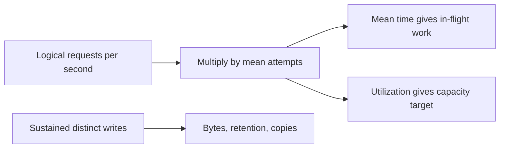

# Numbers to know

Lesson 1.09 · Core concepts

## A. Learning objectives and prerequisites

You should be able to estimate request rate, average concurrency, data growth, network transfer, and failure headroom using explicit units and assumptions. You should also identify which unknown has the greatest influence on a decision and design a measurement to replace it.

Read [networking](01-networking-essentials.md), [caching](04-caching.md), and [database indexing](08-database-indexing.md). Bring the distinction between an illustrative estimate, an observed benchmark, and a contractual target. This lesson uses synthetic workloads throughout. It offers arithmetic tools, not universal machine latencies or a cloud-instance recommendation.

## B. Mental model and intuition

A useful estimate is a small, inspectable model of a specific workload. It should tell you whether a design is plausible, where capacity will go first, and which measurement could change the decision. A precise-looking number based on an undefined “user” or a guessed record size is less useful than a range with clear units.

For StopAround, daily visitors, route searches, provider calls, saved journeys, and price observations are different populations. A visitor can issue several searches; a search can fan out to several providers; a cache hit can avoid a provider; a safe retried save can create only one logical record. Count the population at the boundary you are sizing.

Use round numbers to expose scale, then refine the sensitive assumptions. If storage is comfortably small under both low and high scenarios, another decimal place will not decide whether to shard. If one provider's miss traffic exceeds its allowed capacity under a modest hit-rate change, measure that workload before optimizing a less important estimate.

## C. Deep technical explanation

### Keep a short unit ledger

One second is 1,000 milliseconds, one millisecond is 1,000 microseconds, and one microsecond is 1,000 nanoseconds. A decimal kilobyte is 1,000 bytes; a kibibyte is 1,024 bytes. GB uses powers of ten, while GiB uses powers of two. Network rates often use bits per second, so eight bits per byte is another necessary conversion.

For these capacity exercises, model a day as 86,400 seconds. Calendar scheduling, local daylight-saving days, and precise time standards have their own semantics; this approximation is appropriate for sustained-rate storage arithmetic, not a universal rule for appointment time.

Write units beside intermediate values. `500 requests/second × 0.2 seconds/request` yields 100 requests in flight on average. `20 records/second × 86,400 seconds/day × 30 days × 1,000 bytes/record` yields bytes. If units do not cancel into the quantity you intended, fix the equation before interpreting the answer.

### Arrival rate and peak demand

Daily active users do not directly equal requests per second. With an illustrative one million daily users making five relevant requests each, the average is about 57.9 requests per second. A ten-times peak assumption gives roughly 579 requests per second. That factor is a hypothesis about traffic shape, not a standard property of a million-user service.

Choose a time window suitable for the resource. An hourly average can hide a thirty-second burst that exhausts a small pool. Count endpoint mixes and expensive operations separately. A single cacheable lookup and a route calculation with five dependencies should not receive identical cost weights merely because both are one HTTP request.

Distinguish offered load, admitted work, completed work, rejected work, and retries. If the service rejects excess traffic, completed throughput can remain flat while user demand rises. A dashboard showing stable completions is not proof that capacity is adequate. Admission and error counters close that blind spot.

### Concurrency through Little's law

For a stable measured system, Little's law relates average population L, average throughput lambda, and average time in the same boundary W: `L = lambda × W`. At 500 completed attempts per second and a mean residence time of 200 ms, average in-flight attempts are 100. Include queue time if your population includes queued work. [MIT queueing lecture](https://web.mit.edu/1.041/www/lectures/L8-queuing-models-2024sp.pdf).

Do not substitute p99 latency for the mean and call the product p99 concurrency. The law concerns averages under its assumptions. A growing, unstable backlog also needs a flow model: arrivals exceeding departures cause population to increase over time, so a steady-state estimate does not describe the whole incident.

Choose the resource boundary correctly. A request lasting 200 ms may hold a database connection for only 20 ms and issue two SQL statements. One hundred average in-flight requests do not imply one hundred database connections are required. Size the pool from database transaction arrival rate, connection hold time, safe database concurrency, and queue/deadline policy.

### Capacity, utilization, and failure headroom

If an illustrative planning target is at most 60% utilization at 500 attempts per second, the nominal service-capacity requirement is `500 / 0.6`, about 833.3 attempts per second. The 60% target is a selected assumption, not a theorem about acceptable p99 latency. Queueing behavior depends on variance, parallelism, bottlenecks, and the service distribution.

Suppose each instance is assumed capable of 300 attempts per second under the relevant workload. Three instances provide 900 nominal capacity, but after losing one they provide only 600. At 500 offered attempts per second, surviving utilization becomes about 83.3%, exceeding the chosen target. Requiring `(N - 1) × 300 × 0.6 >= 500` yields four instances under these assumptions.

This arithmetic assumes load can redistribute and per-instance capacity adds linearly. A shared database, a hot shard, a provider quota, or an unbalanced router can violate that assumption. Replica count also has a durability meaning distinct from application-instance count. Do not multiply both without identifying what each copy actually does.

### Retry and fan-out amplification

Mean attempts per logical request expresses retry amplification. If the mean rises from one to 1.5 at 500 logical requests per second, the attempted rate becomes 750 per second. With the same illustrative 200 ms mean attempt duration, average in-flight attempts become 150. Useful logical throughput has not increased.

The required nominal capacity at the 60% target becomes 1,250 attempts per second. Under the same 300-per-instance and one-failure assumptions, six total instances satisfy the target because five survivors supply 900 attempts per second at the target utilization. These are calculations under fixed assumptions, not deployment instructions or measured instance capabilities.

Fan-out adds another multiplier at a different boundary. Five dependency calls per admitted request at 500 requests per second imply 2,500 dependency calls per second before hits, batching, retries, or partial execution. An illustrative 80% reusable hit rate for that exact call population would leave 500 origin calls per second. A global cache hit rate for a different workload is not a valid substitute.

Bound amplification rather than buying capacity for uncontrolled retries. Define retry ownership, attempt limits, deadlines, and admission as in networking. If a failure makes calls slower as well as more numerous, both rate and residence time increase, making concurrency grow faster than the retry factor alone suggests.

### Storage growth and physical copies

Use sustained logical writes for retention estimates, not a brief read peak. At 20 records per second, 1,000 logical bytes per record, and 30 days, logical storage is 51,840,000,000 bytes: 51.84 GB, or approximately 48.28 GiB. The example assumes a steady rate and no deletion before the retention boundary.

With three complete copies and an assumed additional 30% storage overhead on each copy, the model gives 202,176,000,000 bytes, or 202.176 GB, excluding backups. That overhead is illustrative; real tuple overhead, indexes, compression, free space, and retention churn must be measured. The indexing lesson's actual index bytes provide one example of replacing a guess with evidence.

WAL, temporary query space, migration copies, backup retention, and restore headroom are separate. A three-copy live database is not a backup policy: copies can replicate accidental deletion. Conversely, a compressed backup's size need not equal an indexed live dataset. Record the scope of the estimate rather than hiding all of these under one guessed multiplier.

The calculator does not multiply logical writes by retry attempts. It assumes retried mutations are correctly idempotent and the supplied write rate counts distinct records. If retries actually create duplicates, that is a correctness defect and a different workload, not a reason to quietly call duplicate growth normal.

### Network and queue arithmetic

At 500 responses per second and 2,000 body bytes per response, response bodies alone consume 1,000,000 bytes per second: 1 MB/s or 8 megabits/s. Add headers, encryption/framing overhead, requests, retries, and replication according to the measured path. Compression ratio and response-size distribution matter; one small average can conceal large transfers and memory pressure.

For a queue, net growth is arrival rate minus processing rate over the relevant interval. A thirty-second burst at 100 jobs per second with service at 50 creates 1,500 queued jobs if the queue starts empty and rates remain constant. After the burst, if arrivals settle at 25 while service remains 50, spare capacity is 25 jobs per second and the backlog takes about sixty seconds to drain.

Those calculations model counts, not the precise wait of each job. Job sizes, parallel workers, priority, retries, and deadlines affect individual latency. Measure oldest-job age as well as queue length. A queue can absorb a burst while preserving throughput yet still violate a user's useful completion deadline.

### Work with ranges and sensitivities

Give uncertain quantities low, central, and high scenarios. If a record could be 500 to 2,000 bytes, logical storage spans fourfold before replication. If miss rate moves from 10% to 30%, origin demand triples even though the hit rate only changes by twenty percentage points. Show the consequence that matters to the architecture.

Then choose a measurement. Sample encoded payload and actual database/index sizes, measure the endpoint mix, inspect provider call counts per request, or run a bounded representative load test. Record environment and version. Synthetic experiments can reject an assumption, but do not establish production capacity under untested concurrency, data, or failure conditions.

## D. Architecture and data flow

The model keeps user intent, attempts, and stored facts as separate populations.



The calculator accepts peak logical request rate, mean attempt latency, and sustained distinct writes as independent inputs. It does not infer writes from all traffic or infer database pool size from request concurrency. That separation prevents a convenient equation from answering the wrong resource question.

## E. Real-world examples

For an illustrative StopAround launch, measure route searches separately from saved journeys. Read caching can reduce provider traffic without changing the number of distinct saved journeys. A routing-provider outage can raise attempts and mean latency while the write rate remains unchanged. The right capacity response starts with that distinction.

For a separate telemetry service, a small number of devices can generate high sustained ingest volume. User count is a poor storage predictor; observation frequency, encoded size, retention, and copies dominate. An analytical query workload can add temporary disk and CPU even when ingest rate is steady.

For both services, test a failure scenario explicitly. A planning spreadsheet sized only for the normal fleet can miss a saturated survivor, cold cache, or migration copy. The estimate should identify the assumption and the observation that would show it is failing.

## F. Executable example

Run the full [capacity model](../../exercises/module-01/09-numbers-to-know/capacity.py):

```bash
python3 exercises/module-01/09-numbers-to-know/capacity.py
```

It uses Decimal arithmetic, explicit byte units, finite positive input validation, and named outputs. The output is exact under the declared inputs; the inputs remain estimates. The tests cover known results, retry amplification without duplicate logical writes, and invalid nonphysical inputs.

<!-- Listing: exercises/module-01/09-numbers-to-know/capacity.py -->

```python
"""Unit-explicit illustrative estimates; Decimal arithmetic avoids binary-float rounding."""
from decimal import Decimal


def positive(value,name,allow_zero=False):
    result=Decimal(str(value))
    if not result.is_finite() or result<0 or (result==0 and not allow_zero): raise ValueError(f'invalid {name}')
    return result


def estimate(peak_requests_s,mean_latency_ms,sustained_writes_s,record_bytes,retention_days,
             copies=3,target_utilization='0.6',mean_attempts=1,storage_overhead_ratio='0.3'):
    peak=positive(peak_requests_s,'peak requests/s'); latency=positive(mean_latency_ms,'mean latency ms')
    writes=positive(sustained_writes_s,'sustained writes/s',True); size=positive(record_bytes,'record bytes')
    days=positive(retention_days,'retention days'); replicas=positive(copies,'copies')
    utilization=positive(target_utilization,'target utilization'); attempts=positive(mean_attempts,'mean attempts')
    overhead=positive(storage_overhead_ratio,'storage overhead',True)
    if utilization>=1 or attempts<1 or replicas!=replicas.to_integral_value(): raise ValueError('invalid utilization, attempts, or copy count')
    effective=peak*attempts; logical=writes*Decimal(86400)*days*size
    return {'attempts_s':effective,'mean_inflight':effective*latency/1000,
            'required_service_capacity_s':effective/utilization,
            'logical_bytes':logical,'physical_bytes_without_backups':logical*replicas*(1+overhead),
            'logical_GB':logical/Decimal(10)**9,'logical_GiB':logical/Decimal(2)**30}


if __name__=='__main__':
    import json
    print(json.dumps({k:str(v) for k,v in estimate(500,200,20,1000,30).items()},indent=2))
```

The model does not simulate queue distributions, failover placement, compression, backup schedules, or cloud billing. Add a mechanism only when the decision requires it, and name the new assumption. A decimal output should not imply that record-size or traffic guesses have decimal-level confidence.

## G. Architectural decisions and trade-offs

Estimate before selecting more infrastructure. If projected retained data and work fit one well-operated database with headroom, sharding adds ownership cost without a demonstrated need. If the shared provider or database is the bottleneck, multiplying stateless instances can worsen contention rather than improve capacity.

Use a target range tied to response objectives and failure scenarios. More headroom costs resources but can reduce queues and aid recovery; a larger queue costs less immediate rejection but increases waiting. Test the user-visible deadline instead of treating either maximum utilization or zero rejection as the sole goal.

Prefer a few measurements that change the decision over an elaborate spreadsheet of guessed machine constants. Historical latency charts can provide context, but current hardware, placement, protocols, and workload need current evidence. Preserve observed benchmark inputs so another engineer can challenge the model.

## H. Common failures and debugging

For a tenfold estimate error, check seconds versus milliseconds, bytes versus bits, decimal versus binary units, average versus peak, and user requests versus dependency attempts. Check whether retention used sustained writes or an unrelated read peak. These mistakes often dominate arithmetic rounding.

For unexpectedly high concurrency, inspect both arrival rate and mean residence time, including queues. For storage growth, compare distinct rows, indexes, WAL, and temporary/backup usage. For a slow recovery after a burst, subtract ongoing arrivals before estimating drain time.

For a capacity test that looks impressive, inspect data distribution, cache warmth, endpoint mix, error rate, achieved latency, and client-side throttling. A load generator reaching its own limit cannot establish the server's maximum. A result with high rejection does not represent useful completed demand.

## I. Practical exercise

Use the calculator's default scenario: 500 logical requests/s, 200 ms mean attempt latency, 20 distinct writes/s, 1,000 bytes/record, 30 days, three copies, 30% storage overhead, and a 60% utilization target. Compute concurrency, logical and physical storage, response-body bandwidth for 2,000-byte responses, and one-failure instance count under an assumed 300 attempts/s per instance.

Repeat with 1.5 mean attempts, then double record size. Explain which outputs change and why logical rows do not multiply with retries under the idempotency assumption. Finally, solve the thirty-second queue burst and post-burst drain example, list the three most consequential unknowns, and propose measurements. Compare with the [worked solution](../../exercises/module-01/09-numbers-to-know/SOLUTION.md).

## J. Interview and senior-engineering assessment

1. Why is daily user count insufficient to size a backend?
2. What must match when applying Little's law?
3. Why is p99 latency not the right substitute for its mean time?
4. How do retries affect rate and concurrency?
5. Why are replicated live copies not a backup estimate?
6. How do you calculate backlog drain with ongoing arrivals?
7. What makes an estimate useful rather than merely precise?

## Assessment solutions

### 1. Operations and timing differ

Users generate different numbers and types of operations at different times. Expand user activity into endpoint rates, peaks, fan-out, cache misses, and distinct writes at the resource boundary being sized. State the assumptions and measure their sensitive parts.

### 2. Population, rate, time, and boundary

Use average throughput and average residence time for the same stable observed population. Include waiting if queued items count in that population. Do not mix logical requests, retry attempts, and database transactions in one equation.

### 3. The relationship concerns averages

Percentiles of time do not directly produce percentiles of simultaneous population, especially with correlated arrivals and service times. Use mean values for the law and measure tail behavior or simulate an appropriate queue model separately.

### 4. More attempts without more useful intent

Mean attempts multiplies the attempted rate. With constant mean attempt duration, average in-flight work scales by the same factor; if failures also slow calls, it grows further. Correct idempotency prevents retries from multiplying distinct business records.

### 5. Different failure and retention scopes

Live replicas can copy deletion or corruption and need not preserve historical restore points. Backups have separate retention, compression, restore, and integrity properties. Include WAL, temporary space, migrations, and backup storage explicitly when the decision needs them.

### 6. Use spare processing capacity

Subtract ongoing arrivals from processing throughput, then divide backlog by that positive net drain rate under constant-rate assumptions. In the example, 1,500 jobs divided by 25 spare jobs/s gives sixty seconds. If net drain is zero or negative, the backlog does not clear under that workload.

### 7. It supports a falsifiable decision

Define units, boundaries, assumptions, ranges, and the decision threshold. Identify the unknown that could reverse the choice and measure it. Exact arithmetic cannot compensate for an incorrect workload model or an untested capacity assumption.

## K. Key takeaways and navigation

Keep rates, durations, bytes, copies, and populations explicit. Estimate failure and retry behavior, use ranges, and replace sensitive guesses with observations.

You have reached the end of Module 1. Next in the curriculum: [2.01 — Core database](../../COURSE_TOC.md#lesson-2-01), which remains planned. Previous: [1.08 — Database indexing](08-database-indexing.md). The [Module 1 lab guide](../../exercises/module-01/README.md) collects all execution and cleanup commands.
